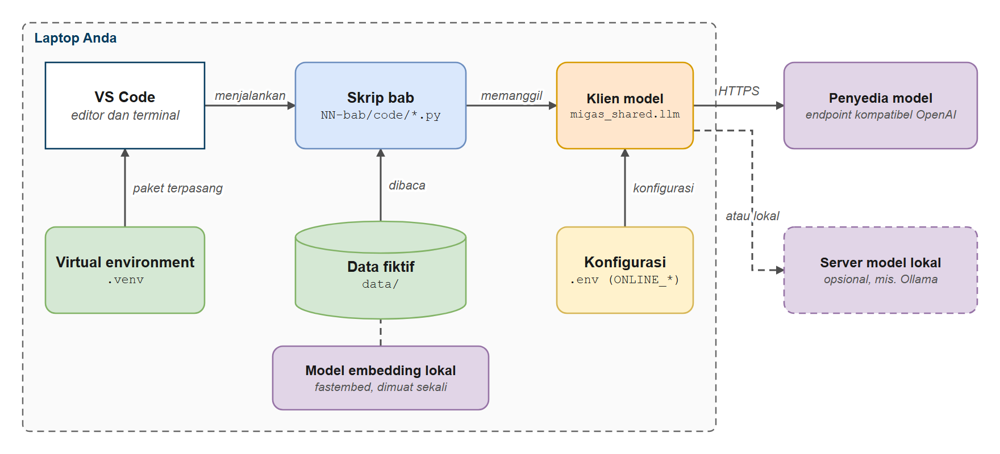
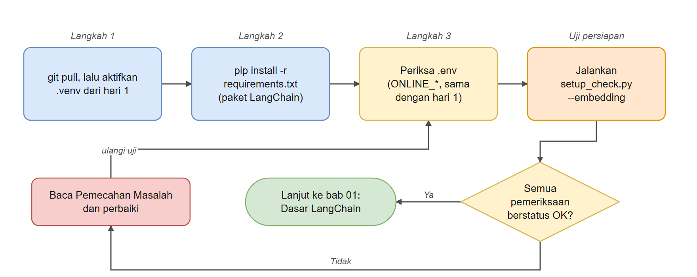
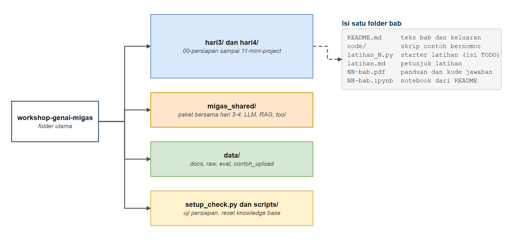

# Persiapan Hari 3 dan 4

Selamat datang di hari 3 dan 4. Hari 1 dan 2 sudah menyiapkan sebagian besar lingkungan Anda: Python, virtual environment, file `.env`, data migas, dan model embedding. Bab ini hanya memeriksa dan menambah yang baru untuk LangChain dan LangGraph: memperbarui repo, memasang paket tambahan, memastikan `.env` yang sama bekerja, lalu menjalankan skrip uji. Setelah bab ini selesai, Anda siap menjalankan semua contoh.

## Prasyarat

- Sudah mengikuti workshop GenAI Migas hari 1 (LLM dan prompt) dan hari 2 (RAG), termasuk Unit 1 hari 1 (memasang Python, membuat virtual environment, dan mengisi `.env`). Hari 3 dan 4 tidak mengulang konsep model bahasa maupun RAG; yang dipelajari adalah cara memakainya dengan LangChain dan hal-hal baru di atasnya (tool, agen, memori, MCP, mini project)
- Pemahaman dasar baris perintah (terminal)
- Editor teks atau IDE (VS Code direkomendasikan, dengan ekstensi Python dan Jupyter)

## Tujuan Pembelajaran

Setelah bab ini Anda bisa:

- Memperbarui repo dan memasang dependency tambahan untuk LangChain dan LangGraph
- Memastikan file `.env` yang sama dengan hari 1 dan 2 dipakai juga oleh kode hari 3 dan 4
- Menjalankan skrip uji untuk memastikan model, data, dan embedding siap
- Mengerjakan latihan: mengisi bagian `TODO` pada `latihan_N.py` dengan kode dari bagian Kode Jawaban Latihan di PDF bab

---

## Analogi: Persiapan Sebelum Memasak

Koki yang baik tidak menyalakan kompor lalu baru mencari bahan. Sebelum mulai, ia memeriksa kompor menyala, pisau dan panci tersedia, bahan sudah ada, dan resep terbuka di depannya. Kalau ada yang kurang, ia tahu di awal, bukan di tengah memasak.

Bab ini adalah pemeriksaan dapur Anda. Dapur sudah Anda siapkan di hari 1; sekarang kita menambah beberapa peralatan baru dan memastikan semuanya masih menyala. Memakan waktu sekitar 10 menit, dan menghemat banyak kebingungan di bab-bab berikutnya.

| Di dapur | Di workshop ini |
|---|---|
| Dapur dan peralatannya | Python dan virtual environment (dari hari 1) |
| Kunci gudang bahan | API key penyedia model di file `.env` (sama dengan hari 1) |
| Resep dan bahan contoh | Folder `data/` berisi SOP dan laporan fiktif |
| Menyalakan kompor sebentar untuk memastikan berfungsi | Skrip `setup_check.py` |



*Gambar 1. Komponen lingkungan kerja hari 3 dan 4*

---

## Disclaimer Data

Seluruh data di folder `data/` (SOP, laporan, investigasi, manual, work order, insiden) adalah data fiktif untuk pembelajaran. Nama sumur, aset, dan angka tidak mewakili kondisi operasi sebenarnya.

---

## Model yang Dipakai

Hari 3 dan 4 memakai model bahasa yang sama dengan hari 1 dan 2, lewat endpoint kompatibel OpenAI, dan membaca variabel yang sama di file `.env`: `ONLINE_API_KEY`, `ONLINE_BASE_URL`, dan `ONLINE_MODEL`. Jadi kalau `.env` Anda sudah berfungsi di hari 1, tidak ada yang perlu diubah.

| Pengaturan | Kapan dipakai | Yang Anda perlukan |
|---|---|---|
| A. OpenRouter (online) | Workshop: Anda memakai API key OpenRouter dari penyelenggara | API key, endpoint `https://openrouter.ai/api/v1`, nama model dari penyelenggara |
| B. Server lokal (misalnya Ollama) | Anda ingin berjalan offline atau tanpa biaya | Ollama terpasang di laptop dan sebuah model yang sudah di-download |

Langkah rinci untuk keduanya ada di [LAMPIRAN.md](./LAMPIRAN.md). Kode hari 3 dan 4 hanya membaca `ONLINE_*`; variabel `LLM_PROFILE` dan `ONLINE_PROVIDERS` dari hari 1 diabaikan. Untuk memakai server lokal, isi `ONLINE_*` dengan nilai server itu.

---

## Pengaturan



*Gambar 2. Alur persiapan sampai lolos uji*

### Langkah 1: Perbarui Repo

Dari root repo (folder `workshop-genai-migas`), ambil materi terbaru. Kalau Anda belum punya repo ini, clone dulu seperti di hari 1 (Unit 1).

```bash
git pull
```

Aktifkan virtual environment yang Anda buat di hari 1:

```bash
# Windows:
.venv\Scripts\activate
# macOS / Linux:
source .venv/bin/activate
```

---

### Langkah 2: Pasang Dependency Tambahan

```bash
pip install -r requirements.txt
```

Paket hari 1 dan 2 sudah terpasang, jadi pip hanya memasang yang baru:

- `langchain` dan `langgraph`: `create_agent()`, eksekusi agen, memori, streaming, dan persetujuan
- `langgraph-checkpoint-sqlite`: memori agen yang tersimpan di file (bab 5)
- `langchain-mcp-adapters`: tool dari server MCP (bab 9)
- `langgraph-cli`: server lokal untuk LangGraph Studio (bab 11, opsional)
- `migas-shared`: paket bersama di folder `migas_shared` (dipasang dengan `-e .` dari `requirements.txt`, seperti `common` di hari 1 dan 2)

---

### Langkah 3: Periksa File `.env`

Kalau Anda sudah mengisi `.env` di hari 1, lewati langkah ini. Kalau belum, salin file contoh lalu isi tiga variabel model:

```bash
# Windows (Command Prompt)
copy .env.example .env

# Windows (PowerShell)
Copy-Item .env.example .env

# macOS / Linux / WSL
cp .env.example .env
```

```bash
ONLINE_API_KEY=isi-dengan-api-key-workshop
ONLINE_BASE_URL=https://openrouter.ai/api/v1
ONLINE_MODEL=deepseek/deepseek-v4-flash
```

> **Jaga kerahasiaan API key.** File `.env` sudah dikecualikan dari Git lewat `.gitignore`. Jangan menempelkan API key ke kode, ke chat, atau ke screenshot.

Variabel embedding (`EMBED_PROVIDER`, `EMBED_MODEL`, dan seterusnya) sudah berisi nilai bawaan yang benar: model embedding multibahasa yang berjalan di laptop Anda tanpa API key, dan model yang sama dengan hari 2 sehingga tidak perlu di-download ulang.



*Gambar 3. Peta folder repositori*

---

## Uji Persiapan Anda

Jalankan skrip uji dari root repo:

```bash
python setup_check.py --embedding
```

Skrip ini sama dengan yang Anda pakai di hari 1, ditambah pemeriksaan untuk hari 3 dan 4: paket LangChain dan LangGraph terpasang, `ONLINE_*` terbaca oleh `migas_shared`, model menjawab lewat LangChain, dan model embedding bisa dimuat. Skrip ini juga memeriksa sisa latihan hari 1 dan 2 yang bisa membuat hasil hari 3 dan 4 berbeda dari materi (dokumen hasil upload, mode reasoning, dan index yang dibuat dengan model embedding lain). Kalau model embedding sudah ada di folder `models/` dari hari 2, pemuatannya hanya sekitar satu detik.

**Keluaran yang diharapkan** (isi jawaban model bisa berbeda):

```text

== 1. Python dan paket
  [OK]   Versi Python >= 3.10 Python 3.12.11 di workshop-genai-migas\.venv\Scripts\python.exe (0.0s)
  [OK]   import openai 3.29.0 (1.3s)
  [OK]   import dotenv  (0.0s)
  [OK]   import pydantic 2.14.1 (0.0s)
  [OK]   import pandas 3.0.6 (0.5s)
  [OK]   import matplotlib 3.11.2 (0.2s)
  [OK]   import streamlit 1.65.0 (0.3s)
  [OK]   import langchain_core 1.6.9 (0.0s)
  [OK]   import langchain_openai 1.7.0 (1.3s)
  [OK]   import langchain_community 0.4.2 (0.0s)
  [OK]   import langchain_text_splitters  (0.0s)
  [OK]   import langchain_chroma  (0.8s)
  [OK]   import chromadb 1.5.9 (0.0s)
  [OK]   import fastembed 0.9.0 (0.4s)
  [OK]   import rank_bm25  (0.0s)
  [OK]   import pypdf 6.20.0 (0.1s)
  [OK]   import yaml 6.0.3 (0.0s)
  [OK]   import common  (0.0s)
  [OK]   import langchain 1.4.4 (0.0s)
  [OK]   import langgraph  (0.0s)
  [OK]   import langgraph.checkpoint.sqlite  (0.0s)
  [OK]   import langchain_mcp_adapters  (0.0s)
  [OK]   import migas_shared  (0.0s)

== 2. Konfigurasi .env
  [OK]   File .env dan API key profil=online, model=deepseek/deepseek-v4-flash, API key terisi (0.0s)
  [OK]   Konfigurasi .env untuk hari 3-4 ONLINE_* terisi, dipakai bersama hari 1-2 (0.0s)
  [OK]   Data workshop data lengkap (0.0s)

== 2b. Sisa latihan hari 1-2 yang memengaruhi hari 3-4
  [OK]   Kondisi knowledge base dan .env tidak ada upload dan mode reasoning bawaan (none) (0.0s)

== 3. Koneksi (memerlukan internet)
  [OK]   Pemanggilan LLM jawaban model: 'SIAP' (1.8s)
  [OK]   Pemanggilan LLM lewat LangChain (hari 3-4) jawaban model (LangChain): 'SIAP' (1.5s)
  [OK]   Model embedding (unduhan pertama sekitar 220 MB) dimensi 384 (1.4s)
  [OK]   Model embedding lewat migas_shared (hari 3-4) dimensi 384 (1.9s)
  [OK]   Index Chroma cocok dengan model embedding dimensi index sama dengan model embedding (384) (0.3s)

Seluruh pemeriksaan berhasil. Environment siap digunakan.
```

Kalau Anda melihat "Seluruh pemeriksaan berhasil", Anda siap. Kalau ada baris yang berawalan `GAGAL`, lihat bagian Pemecahan Masalah di bawah. Baris berawalan `PERINGATAN` tidak menggagalkan pemeriksaan, tetapi artinya ada sisa dari hari 1 atau 2; ikuti saran di bawah barisnya (biasanya `python scripts/reset_knowledge.py`) sebelum mulai bab 2.

> **Tanpa embedding.** Kalau koneksi Anda terbatas, jalankan `python setup_check.py --offline`. Model embedding baru dibutuhkan oleh contoh yang memakai tool pencarian dokumen `cari_dokumen`: bab 2 (contoh 5), bab 3 (contoh 2), bab 6 (contoh 5), bab 7 (contoh 6), bab 8 (contoh 3), bab 9 (contoh 3 dan 4), serta bab 10 dan 11. Contoh lainnya, termasuk seluruh bab 1, 4, 5, dan kedua bab bonus, berjalan tanpa embedding. Anda juga bisa memakai `EMBED_PROVIDER=openai` dengan server embedding lokal; lihat [LAMPIRAN.md](./LAMPIRAN.md).

---

## Knowledge Base Dipakai Bersama

Tool `cari_dokumen` dan bab-bab RAG memakai index Chroma di folder `chroma_db/`, yang sama dengan index hari 2. Kalau index itu sudah ada, hari 3 dan 4 langsung memakainya; kalau belum, index dibangun otomatis pada pemakaian pertama (sekitar satu menit).

Kalau Anda mengunggah dokumen ke knowledge base di hari 2 (Unit 7), dokumen itu ikut terlihat di hari 3 dan 4. Mengganti model embedding di `.env` setelah index dibuat juga membuat index lama tidak cocok. Untuk mengembalikan ke kondisi awal:

```bash
python scripts/reset_knowledge.py
```

`python setup_check.py` memberi `PERINGATAN` untuk kedua kasus itu. Hentikan dulu aplikasi Streamlit hari 2 kalau masih berjalan, supaya folder `chroma_db/` tidak terkunci.

---

## Menjalankan Skrip Sel demi Sel

Skrip di folder `code/` dan file `latihan_N.py` ditulis sebagai **sel**, seperti di hari 1 dan 2. Baris `# %%` memisahkan kode menjadi sel, dan `# %% [markdown]` menandai sel penjelasan. Dengan begitu satu skrip bisa dijalankan bagian demi bagian, dan Anda melihat keluaran tiap langkah sebelum lanjut ke langkah berikutnya. Setiap bab juga punya notebook (`NN-nama-bab.ipynb`) yang berisi sel-sel yang sama beserta keluarannya.

Di VS Code (ekstensi Python dan Jupyter terpasang):

1. Buka skrip, misalnya `hari3/01-dasar-langchain/code/02_multi_turn_chat.py`. Di atas setiap sel muncul link **Run Cell**.
2. Pilih interpreter dari `.venv` repo (tombol **Select Kernel** atau `Ctrl+Shift+P`, lalu *Python: Select Interpreter*). Paket `ipykernel` sudah ada di `requirements.txt`.
3. Klik **Run Cell**, atau letakkan kursor di dalam sel lalu tekan `Shift+Enter`. Keluaran tampil di Interactive Window di sisi kanan.
4. Sel berbagi satu sesi: variabel dari sel di atas (misalnya `model` dan `messages`) tetap ada di sel berikutnya. Jalankan sel **berurutan dari atas**. Untuk mengulang dari awal, restart kernel.

Skrip yang sama tetap bisa dijalankan utuh dari terminal; itu sama dengan menjalankan semua sel berurutan dari atas ke bawah:

```bash
python hari3/01-dasar-langchain/code/02_multi_turn_chat.py
```

Beberapa skrip punya sel opsional berlabel `INTERAKTIF = False`, misalnya chatbot yang menunggu ketikan Anda. Ubah nilainya menjadi `True` lalu jalankan sel itu untuk mencoba sendiri; biarkan `False` kalau menjalankan seluruh file dari terminal.

---

## Cara Mengerjakan Latihan

Setiap bab 01 sampai 10, juga kedua bab bonus, punya latihan dengan pola yang sama seperti hari 1 dan 2 (bab 11 adalah mini project, jadi tidak punya starter):

1. Buka `latihan_1.py` di folder bab (atau `latihan_1.ipynb` kalau Anda lebih suka notebook). Kerangkanya sudah lengkap, tetapi bagian intinya kosong. Latihan berikutnya (`latihan_2.py`, dan seterusnya) berformat sama; beberapa di antaranya berlabel bonus.
2. Cari komentar `TODO(B3.1)`, `TODO(B3.2)`, dan seterusnya (angka pertama adalah nomor bab). Di bawahnya ada baris seperti `agent = None  # TODO: ganti dengan implementasi Anda`.
3. Buka PDF bab itu (`NN-nama-bab.pdf` di folder yang sama), cari bagian **Kode Jawaban Latihan** di bagian akhir. Untuk tiap TODO, PDF menyebut cell mana yang diubah dan kode yang harus disalin.
4. Salin kode itu menggantikan baris `... = None`, lalu jalankan cell. Nomor TODO bersambung dalam satu bab (misalnya `TODO(B3.1)` sampai `TODO(B3.5)`), jadi Anda selalu tahu bagian mana yang sedang dikerjakan.

Petunjuk singkat tiap latihan ada di `latihan.md` pada folder bab.

---

## Daftar Periksa

Sebelum memulai hari 3, pastikan:

- [ ] `git pull` berhasil dan folder `hari3/` serta `hari4/` ada
- [ ] Virtual environment hari 1 aktif
- [ ] Dependency terpasang (`pip install -r requirements.txt`)
- [ ] File `.env` berisi `ONLINE_API_KEY`, `ONLINE_BASE_URL`, dan `ONLINE_MODEL`
- [ ] `python setup_check.py --embedding` berakhir dengan "Seluruh pemeriksaan berhasil" dan tanpa baris `PERINGATAN` (atau peringatannya sudah ditangani)
- [ ] Ekstensi Python dan Jupyter terpasang di VS Code (dibutuhkan untuk menjalankan skrip sel demi sel)

---

## Pemecahan Masalah

| Gejala | Penyebab umum | Perbaikan |
|---|---|---|
| `GAGAL Konfigurasi .env untuk hari 3-4` | `ONLINE_API_KEY`, `ONLINE_BASE_URL`, atau `ONLINE_MODEL` belum diisi | Salin `.env.example` menjadi `.env` lalu isi ketiga variabel itu |
| `GAGAL import langchain` atau `import langgraph` | Dependency tambahan belum terpasang, atau `.venv` belum aktif | Aktifkan `.venv`, lalu `pip install -r requirements.txt` |
| `401` atau `Unauthorized` | API key salah atau ada spasi tambahan | Salin ulang key tanpa spasi atau tanda kutip |
| `Connection error` | Endpoint salah, server lokal belum jalan, atau jaringan terblokir | Periksa `ONLINE_BASE_URL`; untuk Ollama pastikan aplikasinya berjalan |
| `400 ... model not found` | Nama model salah | Periksa `ONLINE_MODEL` di daftar model penyedia Anda |
| `GAGAL Data workshop` | Folder `data/` terhapus atau tidak lengkap | Pulihkan folder `data/` dengan `git checkout -- data` |
| Download embedding gagal atau sangat lambat | Koneksi terbatas, atau folder `models/` belum ada | Salin folder `models/` dari instruktur, atau pakai `EMBED_PROVIDER=openai` |
| Tampilan karakter rusak di konsol Windows | Konsol memakai encoding lama | Jalankan `set PYTHONUTF8=1` sebelum menjalankan skrip |
| `ModuleNotFoundError: migas_shared` | Paket bersama belum terpasang | Jalankan `pip install -e .` dari root repo |
| Jawaban pencarian dokumen berisi dokumen yang bukan bawaan | Anda mengunggah dokumen di hari 2 | Jalankan `python scripts/reset_knowledge.py` |
| `PERINGATAN Index Chroma` pada `setup_check.py` | Model embedding diganti setelah index dibuat | Jalankan `python scripts/reset_knowledge.py`, atau kembalikan `EMBED_PROVIDER` dan `EMBED_MODEL` di `.env` |
| `PERINGATAN LLM_REASONING_EFFORT` | Nilai di `.env` bukan `none` | Kembalikan ke `none`, kecuali Anda memang bereksperimen |

---

## Sumber Tambahan

- [Dokumentasi Python](https://docs.python.org/3/)
- [Dokumentasi LangChain Python](https://python.langchain.com/)
- [Dokumentasi OpenRouter](https://openrouter.ai/docs)
- [Dokumentasi Ollama](https://github.com/ollama/ollama)

---

## Langkah Selanjutnya

Persiapan selesai. Saatnya membuat panggilan model pertama Anda.

Lanjut ke [Dasar LangChain](../01-dasar-langchain/README.md).

---

## Navigasi

[Kembali ke Utama](../../README.md) | [Berikutnya: Dasar LangChain](../01-dasar-langchain/README.md)
