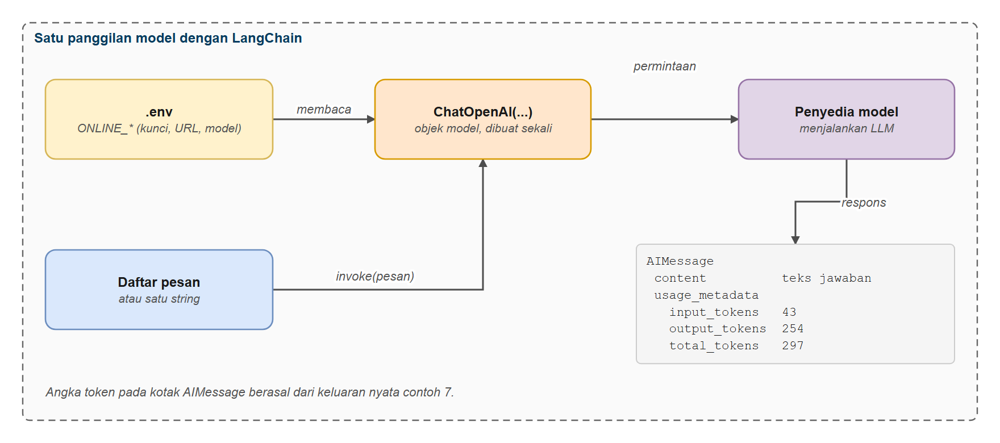
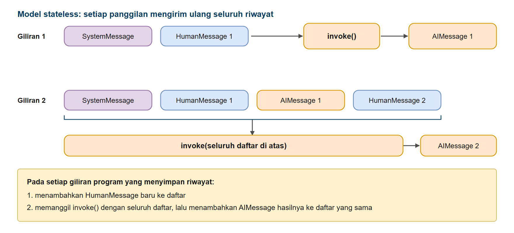
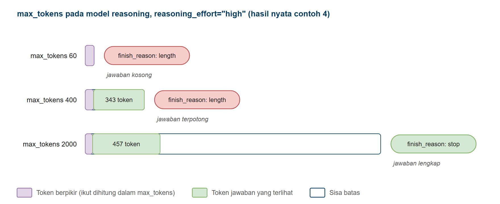
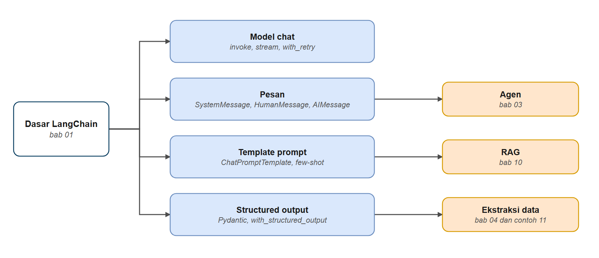

# Dasar LangChain: Model, Pesan, Prompt, dan Structured Output

Bab ini awal dari hari 3. Di hari 1 Anda sudah memanggil LLM langsung lewat SDK `openai` (paket Python `openai` yang diimpor dengan `from openai import OpenAI`; SDK adalah kumpulan kode siap pakai dari penyedia untuk berbicara dengan API-nya), menyusun prompt, meminta keluaran JSON, dan mengekstrak work order dengan Pydantic. Di sini kita **tidak mengulang konsepnya**. Yang Anda pelajari adalah cara hal-hal yang sama ditulis di LangChain: objek model, daftar pesan, template prompt, dan structured output. Semua yang dibangun pada bab-bab berikutnya (tool, agen, memori, RAG) berdiri di atas komponen ini.

## Prasyarat

- Sudah menyelesaikan [Persiapan Kursus](../00-persiapan/README.md)
- Sudah mengikuti workshop hari 1 (pemanggilan LLM dan prompt engineering) dan hari 2 (RAG)

## Tujuan Pembelajaran

Setelah bab ini Anda bisa:

- Membuat objek model chat LangChain dari konfigurasi `.env` dan memanggilnya
- Mengelola riwayat percakapan dengan `SystemMessage`, `HumanMessage`, dan `AIMessage`
- Mengalirkan jawaban (streaming), menangani error dengan `with_retry()`, dan membaca pemakaian token
- Mengenali perilaku model reasoning terhadap `max_tokens`
- Membuat template prompt dan few-shot yang bisa dipakai ulang
- Mendapat objek Pydantic dari model dengan `with_structured_output()`

---

## Mengapa LangChain?

Wajar kalau Anda bertanya: di hari 1 dan 2 semuanya sudah jalan dengan SDK `openai` dan fungsi buatan sendiri (seperti `chat()` di `common/llm.py`), lalu kenapa sekarang pakai LangChain? Jawaban jujurnya ada dua.

**Untuk satu panggilan model, SDK `openai` sudah cukup.** Bab ini sengaja pendek karena keuntungan LangChain di sini kecil: retry, structured output, dan template menghemat beberapa baris, tetapi tidak mengubah cara kerjanya. Kalau aplikasi Anda hanya mengirim satu prompt dan membaca satu jawaban, SDK tanpa framework adalah pilihan yang masuk akal.

**Keuntungan sebenarnya muncul ketika model mulai bertindak.** Loop agen sendiri pendek: panggil model, jalankan tool yang diminta, ulangi sampai tidak ada permintaan tool lagi ([bab 3](../03-agen/README.md) membahasnya). Yang makin banyak adalah hal-hal yang harus dipasang di sekelilingnya supaya agen layak dipakai orang lain:

| Kebutuhan | Kalau ditulis sendiri | Di kursus ini |
|-----------|----------------------|---------------|
| Memori percakapan per pengguna | Menyimpan dan memuat riwayat, menentukan kunci tiap percakapan | Checkpointer dan `thread_id` ([bab 5](../05-memori-agen/README.md)) |
| Jawaban dan progres tool tampil saat berjalan | Mengubah loop menjadi generator, memisahkan token dari langkah | `stream_mode` ([bab bonus Streaming Agen](../bonus-streaming-agen/README.md)) |
| Berhenti sebelum tindakan berisiko, lanjut setelah manusia memutuskan | Menyimpan keadaan loop di tengah jalan dan memulihkannya | `interrupt` dan `HumanInTheLoopMiddleware` ([bab 6](../06-persetujuan-manusia/README.md)) |
| Batas panggilan, redaction data pribadi, penanganan error tool | Menyisipkan kode di beberapa titik loop | Middleware ([bab 6](../06-persetujuan-manusia/README.md) dan [bab 7](../07-guardrails-middleware/README.md)) |
| Memakai tool dari layanan lain | Menulis klien dan skema tool untuk setiap layanan | Adaptor MCP ([bab 9](../../hari4/09-mcp/README.md)) |

Semuanya bisa ditulis sendiri. Pertanyaannya: apakah Anda mau merawat framework buatan sendiri, lengkap dengan tesnya, di samping aplikasinya?

**Harganya** juga perlu Anda tahu sejak awal:

- **Lapisan tambahan.** Kalau hasil tidak sesuai harapan, Anda perlu paham apa yang terjadi di bawahnya. Karena itu kursus ini memperlihatkan pesan mentah, `usage_metadata`, dan loop manual.
- **API yang berubah antar versi.** Kursus ini menetapkan versi minimum di `requirements.txt` (dan membatasi satu paket, adaptor MCP) karena contohnya ditulis untuk LangChain 1.4 dan LangGraph 1.2.
- **Dependency lebih banyak** dibanding memanggil SDK langsung.

Aturan praktisnya: mulai dari SDK, lalu pindah ke LangChain begitu Anda mulai menulis loop agen, penyimpanan riwayat, atau mekanisme interrupt sendiri. Bab 3 menjawab sisanya: setelah membaca loop manualnya, Anda akan tahu apa saja yang dikerjakan `create_agent()`.

---

## Dari Hari 1 ke LangChain

Tabel ini menunjukkan di mana Anda akan bertemu lagi dengan hal-hal yang sudah dikenal dari hari 1.

| Yang sudah dikerjakan di hari 1 | Padanan di LangChain | Contoh |
|---|---|---|
| Memanggil LLM lewat SDK `openai` (`client.chat.completions.create`) | `ChatOpenAI(...).invoke()` | 1 |
| Model bersifat stateless; riwayat dikirim ulang oleh program | Daftar pesan: `SystemMessage`, `HumanMessage`, `AIMessage` | 2 |
| Jawaban muncul bertahap | `model.stream()` | 3 |
| Temperature, token, mode reasoning | Parameter konstruktor, `usage_metadata` | 4 dan 7 |
| Berpindah model online atau lokal | Isi `.env`, `init_chat_model()` | 5 |
| Retry dan penanganan error buatan sendiri (`common/llm.py`) | `with_retry()` | 6 |
| Prompt terstruktur dan few-shot | `ChatPromptTemplate`, `FewShotChatMessagePromptTemplate` | 8 dan 9 |
| Keluaran JSON, skema Pydantic, ekstraksi work order | `with_structured_output()` | 10 dan 11 |

> **Tentang keluaran contoh.** Jawaban model berbeda setiap kali dijalankan, begitu pula waktu responsnya. Keluaran yang ditampilkan di seluruh kursus ini berasal dari menjalankan skrip sebenarnya dengan satu model uji (`deepseek-v4.1-flash`). Model yang Anda pakai di workshop bisa berbeda, jadi hasilnya mirip tetapi tidak persis sama.

---

## Contoh 1: Halo LangChain

Panggilan model pertama. Yang berbeda dari hari 1 hanya bentuknya: model adalah objek yang dibuat sekali dari konfigurasi, lalu dipanggil dengan `invoke()`.



*Gambar 1. Alur satu panggilan model dengan LangChain*

**Kode**: [`code/01_halo_langchain.py`](./code/01_halo_langchain.py)
**Jalankan**: `python hari3/01-dasar-langchain/code/01_halo_langchain.py`

```python
# %% [markdown]
# # Halo LangChain
# Jalankan sel satu per satu dengan Shift+Enter, atau seluruh file: `python hari3/01-dasar-langchain/code/01_halo_langchain.py`
#
# Panggilan LangChain pertama Anda: membuat objek model chat lalu mengirim satu pertanyaan.

# %%
# Langkah 1 - Menyiapkan model
import os

from dotenv import load_dotenv
from langchain_openai import ChatOpenAI

load_dotenv()

# Buat objek model chat
model = ChatOpenAI(
    model=os.getenv("ONLINE_MODEL"),
    base_url=os.getenv("ONLINE_BASE_URL"),
    api_key=os.getenv("ONLINE_API_KEY"),
    reasoning_effort=os.getenv("LLM_REASONING_EFFORT", "none"),
)

# %% [markdown]
# ## Langkah 2 - Panggilan AI pertama Anda
# `model.invoke()` mengirim pertanyaan dan mengembalikan satu pesan jawaban.

# %%
response = model.invoke("Apa fungsi separator pada fasilitas produksi minyak dan gas? Jawab dalam satu kalimat.")

print("Jawaban AI:", response.content)
print("\nBerhasil! Anda baru saja membuat panggilan LangChain pertama.")
```

### Keluaran yang Diharapkan

```text
Jawaban AI: Separator berfungsi untuk memisahkan fluida produksi dari sumur menjadi tiga fase utama—gas, minyak, dan air—berdasarkan perbedaan densitas dan tekanan, sehingga masing-masing komponen dapat diolah lebih lanjut secara efisien.

Berhasil! Anda baru saja membuat panggilan LangChain pertama.
```

### Cara Kerjanya

1. `ChatOpenAI` menerima `model`, `base_url`, dan `api_key`. Ketiganya dibaca dari `.env` (`ONLINE_MODEL`, `ONLINE_BASE_URL`, `ONLINE_API_KEY`), sehingga berpindah penyedia cukup dengan mengubah file itu. Kode tidak berubah.
2. `invoke()` menerima string, mengirimnya sebagai pesan pengguna, dan mengembalikan objek `AIMessage`. Teks jawabannya ada di `response.content`.
3. **Baris `reasoning_effort`.** Model DeepSeek V4 Flash bisa "berpikir" dulu sebelum menjawab. Itu memakai token dan waktu tambahan, dan pada pertanyaan sederhana hampir tidak ada manfaatnya. Nilainya dibaca dari `LLM_REASONING_EFFORT` di `.env` (`none`, `low`, `medium`, atau `high`), sama seperti di hari 1 dan 2, dengan `none` sebagai nilai bawaan. Semua kode di hari 3 dan 4 memakai baris yang sama.

---

## Contoh 2: Pesan dan Riwayat Percakapan

Di hari 1 Anda melihat bahwa model stateless: ia hanya tahu apa yang dikirim pada panggilan itu. LangChain menyimpan percakapan sebagai daftar pesan yang punya tipe.



*Gambar 2. Model tidak menyimpan percakapan: riwayat dikirim ulang*

| Jenis | Fungsi | Contoh |
|---|---|---|
| `SystemMessage` | Mengatur peran dan aturan | `SystemMessage(content="Anda asisten serah terima shift")` |
| `HumanMessage` | Masukan pengguna | `HumanMessage(content="Apa kondisi SR-020?")` |
| `AIMessage` | Jawaban model, dikembalikan oleh `invoke()` | berisi `content`, `usage_metadata`, `id` |

**Kode**: [`code/02_multi_turn_chat.py`](./code/02_multi_turn_chat.py)
**Jalankan**: `python hari3/01-dasar-langchain/code/02_multi_turn_chat.py`

```python
# %% [markdown]
# # Percakapan Multi-Giliran: Serah Terima Shift
# Jalankan sel satu per satu dengan Shift+Enter, atau seluruh file: `python hari3/01-dasar-langchain/code/02_multi_turn_chat.py`
#
# Model tidak menyimpan percakapan. Agar asisten "mengingat", seluruh riwayat pesan dikirim ulang pada setiap giliran.

# %%
# Langkah 1 - Menyiapkan model
import os

from dotenv import load_dotenv
from langchain_core.messages import AIMessage, HumanMessage, SystemMessage
from langchain_openai import ChatOpenAI

load_dotenv()

model = ChatOpenAI(
    model=os.getenv("ONLINE_MODEL"),
    base_url=os.getenv("ONLINE_BASE_URL"),
    api_key=os.getenv("ONLINE_API_KEY"),
    reasoning_effort=os.getenv("LLM_REASONING_EFFORT", "none"),
)

# %% [markdown]
# ## Langkah 2 - Giliran pertama
# Riwayat dimulai dengan pesan sistem dan laporan pertama dari operator shift pagi.

# %%
pertanyaan_1 = (
    "Catatan serah terima dari shift pagi di GS-SR1: ESP SR-020 sempat trip overload kemarin sore, "
    "sudah restart dan stabil sejak pukul 18.00. Level controller separator V-SR1-101 masih hunting. "
    "Tolong catat."
)
messages = [
    SystemMessage(content="Anda adalah asisten serah terima shift di Gathering Station GS-SR1. "
                          "Jawab ringkas dan jelas dalam Bahasa Indonesia."),
    HumanMessage(content=pertanyaan_1),
]

print("Operator:", pertanyaan_1)
response_1 = model.invoke(messages)
print("\nAsisten:", response_1.content)
messages.append(AIMessage(content=response_1.content))

# %% [markdown]
# ## Langkah 3 - Giliran kedua
# Asisten mengingat isi catatan karena seluruh riwayat dikirim ulang.

# %%
pertanyaan_2 = "Apa saja yang perlu dipantau oleh shift malam?"
messages.append(HumanMessage(content=pertanyaan_2))

print("Operator:", pertanyaan_2)
response_2 = model.invoke(messages)
print("\nAsisten:", response_2.content)
messages.append(AIMessage(content=response_2.content))

# %% [markdown]
# ## Langkah 4 - Giliran ketiga
# Asisten masih mengingat semuanya.

# %%
pertanyaan_3 = "Buat ringkasannya dalam tiga butir untuk dicatat di buku log."
messages.append(HumanMessage(content=pertanyaan_3))

print("Operator:", pertanyaan_3)
response_3 = model.invoke(messages)
print("\nAsisten:", response_3.content)
# Jawaban ketiga tidak ditambahkan ke riwayat karena percakapan berakhir di sini

# %% [markdown]
# ## Langkah 5 - Memeriksa riwayat
# Jalankan sel ini untuk melihat isi riwayat setelah tiga giliran.

# %%
print(f"Total pesan dalam riwayat: {len(messages)} pesan, terdiri dari 1 pesan sistem, 3 pesan pengguna, dan 2 jawaban AI")
for pesan in messages:
    print(f"  {pesan.type:<6} | {str(pesan.content)[:60]}")

# %% [markdown]
# Perhatikan bagaimana asisten mengingat konteks sepanjang percakapan.
```

### Keluaran yang Diharapkan

```text
Operator: Catatan serah terima dari shift pagi di GS-SR1: ESP SR-020 sempat trip overload kemarin sore, sudah restart dan stabil sejak pukul 18.00. Level controller separator V-SR1-101 masih hunting. Tolong catat.

Asisten: Noted. Serah terima shift pagi GS-SR1:

1. ESP SR-020 sempat trip overload kemarin sore, sudah restart dan stabil sejak pukul 18.00.
2. Level controller separator V-SR1-101 masih hunting.

Siap, akan saya teruskan ke operator shift berikutnya dan pantau perkembangannya.

Operator: Apa saja yang perlu dipantau oleh shift malam?

Asisten: Untuk shift malam, fokus pemantauan di GS-SR1:

1. **ESP SR-020**
   - Ampere motor dan tekanan discharge secara berkala (misal tiap 2 jam) untuk memastikan tidak ada overload berulang.
   - Suhu motor dan frekuensi VSD (jika dipasang) sebagai indikasi stres operasi.

2. **Separator V-SR1-101**
   - Level controller hunting: pantau tren level, bukaan control valve, dan fluktuasi produksi.
   - Catat waktu dan nilai ekstrem untuk analisis penyebab (kemungkinan tuning, masalah sensor, atau perubahan laju alir masuk).

3. **Penunjang umum**
   - Pastikan tidak ada alarm atau trip baru, serta kondisi sistem masih stabil.
   - Laporkan segera jika ada anomali atau perubahan signifikan sebelum memburuk.

Jika semua normal, tetap lakukan pencatatan rutin dan siapkan laporan serah terima untuk shift berikutnya.

Operator: Buat ringkasannya dalam tiga butir untuk dicatat di buku log.

Asisten: Ringkasan untuk buku log shift malam:

1. **ESP SR-020**: pantau ampere, tekanan discharge, suhu motor tiap 2 jam; waspadai overload berulang.
2. **V-SR1-101**: amati tren level separator dan bukaan control valve; catat ekstrem/hunting.
3. **Umum**: pastikan tidak ada alarm/trip baru; laporkan anomali segera.

Total pesan dalam riwayat: 6 pesan, terdiri dari 1 pesan sistem, 3 pesan pengguna, dan 2 jawaban AI
  system | Anda adalah asisten serah terima shift di Gathering Station
  human  | Catatan serah terima dari shift pagi di GS-SR1: ESP SR-020 s
  ai     | Noted. Serah terima shift pagi GS-SR1:

1. ESP SR-020 sempat
  human  | Apa saja yang perlu dipantau oleh shift malam?
  ai     | Untuk shift malam, fokus pemantauan di GS-SR1:

1. **ESP SR-
  human  | Buat ringkasannya dalam tiga butir untuk dicatat di buku log
```

### Cara Kerjanya

1. Daftar `messages` menampung seluruh percakapan; setelah tiap jawaban, `AIMessage` ditambahkan ke daftar.
2. Setiap `invoke()` mengirim **seluruh** daftar, sehingga "yang perlu dipantau" pada giliran kedua dipahami sebagai ESP SR-020 dan level controller yang disebut di giliran pertama.
3. Mengelola daftar ini secara manual akan merepotkan kalau percakapan panjang atau penggunanya banyak. Bab [Memori Agen](../05-memori-agen/README.md) menyerahkannya ke checkpointer.

---

## Contoh 3: Streaming

Di LangChain, streaming cukup mengganti `invoke()` dengan `stream()`. Hasilnya adalah generator yang menghasilkan chunk, dan `content` tiap chunk langsung ditampilkan.

**Kode**: [`code/03_streaming.py`](./code/03_streaming.py)
**Jalankan**: `python hari3/01-dasar-langchain/code/03_streaming.py`

```python
# %% [markdown]
# # Streaming Jawaban
# Jalankan sel satu per satu dengan Shift+Enter, atau seluruh file: `python hari3/01-dasar-langchain/code/03_streaming.py`
#
# Membandingkan pemanggilan biasa (`invoke`) dengan streaming (`stream`).

# %%
# Langkah 1 - Menyiapkan model
import os
import time

from dotenv import load_dotenv
from langchain_openai import ChatOpenAI

# Muat variabel lingkungan
load_dotenv()

PROMPT = "Jelaskan cara kerja Electrical Submersible Pump (ESP) pada sumur minyak dalam 2 paragraf."

model = ChatOpenAI(
    model=os.getenv("ONLINE_MODEL"),
    base_url=os.getenv("ONLINE_BASE_URL"),
    api_key=os.getenv("ONLINE_API_KEY"),
    reasoning_effort=os.getenv("LLM_REASONING_EFFORT", "none"),
)

# %% [markdown]
# ## Langkah 2 - Tanpa streaming (cara biasa)
# Jawaban baru tampil setelah seluruh teks selesai dibuat.

# %%
print("Tanpa streaming (cara biasa):\n")

mulai = time.time()
response = model.invoke(PROMPT)
selesai = time.time()

print(response.content)
print(f"\nJawaban lengkap diterima setelah: {(selesai - mulai) * 1000:.0f} ms\n")

# %% [markdown]
# ## Langkah 3 - Dengan streaming
# Jawaban dialirkan chunk demi chunk dan ditulis begitu tiba.

# %%
print("=" * 80)
print("AI (streaming):")

mulai = time.time()
waktu_chunk_pertama = 0

# Alirkan jawaban chunk demi chunk
for chunk in model.stream(PROMPT):
    if waktu_chunk_pertama == 0:
        waktu_chunk_pertama = time.time()
    # Tulis setiap chunk begitu tiba (tanpa baris baru)
    print(chunk.content, end="", flush=True)

print("\n\nStreaming selesai.")
selesai = time.time()

print("\n")
print(f"Chunk pertama tiba setelah: {(waktu_chunk_pertama - mulai) * 1000:.0f} ms")
print(f"Streaming selesai setelah: {(selesai - mulai) * 1000:.0f} ms")
print("\nPerhatikan bahwa streaming terasa lebih responsif.")

# %% [markdown]
# ## Intinya
# Streaming memberi feedback langsung, sehingga aplikasi terasa lebih cepat.
```

### Keluaran yang Diharapkan

```text
Tanpa streaming (cara biasa):

Electrical Submersible Pump (ESP) adalah metode pengangkatan buatan (artificial lift) yang digunakan untuk memproduksi fluida dari sumur minyak, terutama ketika tekanan reservoir alami sudah tidak mampu mendorong minyak ke permukaan. Sistem ini bekerja dengan mengubah energi listrik menjadi energi kinetik (kecepatan) dan kemudian menjadi energi tekanan. Prinsip kerjanya dimulai dari *multi-stage centrifugal pump* yang terletak di dalam sumur, biasanya di kedalaman di bawah permukaan fluida (dynamic fluid level). Motor listrik yang terletak di bawah pompa menggerakkan poros yang terhubung dengan serangkaian impeler dan diffuser. Saat impeler berputar, fluida (campuran minyak, air, dan gas) tersedot masuk, lalu didorong secara radial ke luar dengan kecepatan tinggi. Diffuser yang mengelilingi impeler berfungsi mengarahkan aliran dan mengubah kecepatan fluida menjadi tekanan. Proses ini diulang oleh setiap tahap (stage) pompa yang jumlahnya bisa puluhan hingga ratusan, sehingga tekanan fluida meningkat bertahap dari tekanan intake hingga melebihi tekanan hidrostatik kolom fluida di atas sumur, yang akhirnya memaksa fluida naik ke permukaan melalui pipa produksi (tubing).

Sistem pendukung ESP sangat penting untuk memastikan operasi yang berkelanjutan. Motor listrik yang terendam fluida membutuhkan pelumas dan pendinginan; oleh karena itu, motor ini diisi dengan minyak dielektrik khusus dan didinginkan oleh aliran fluida yang melewati motor sebelum masuk ke pompa. Tenaga listrik disuplai dari permukaan melalui kabel listrik tiga fase (*power cable*) yang diikat di sepanjang tubing, melewati *protector* atau *seal* yang berada di antara motor dan pompa untuk menyeimbangkan tekanan internal dan mencegah fluida sumur masuk ke motor. Di permukaan, listrik yang berasal dari *switchboard* atau *Variable Speed Drive (VSD)* dikontrol untuk mengatur kecepatan motor, sehingga laju produksi dapat disesuaikan dengan kondisi reservoir. Sensor *downhole* (seperti *pressure and temperature gauge*) dipasang di bawah motor untuk mengirim data real-time ke permukaan. Keunggulan utama ESP adalah kemampuannya memompa volume fluida yang sangat besar (dari ratusan hingga puluhan ribu barel per hari) dari kedalaman yang dalam, namun kelemahannya adalah sensitif terhadap kandungan gas berlebih dan pasir yang dapat merusak impeler, sehingga pemilihan desain dan pemantauan yang teliti sangat diperlukan.

Jawaban lengkap diterima setelah: 7859 ms

================================================================================
AI (streaming):
Electrical Submersible Pump (ESP) adalah pompa sentrifugal bertingkat yang ditempatkan di dasar sumur minyak, biasanya di bawah permukaan fluida. Cara kerjanya dimulai dengan motor listrik tiga fasa yang terletak di bagian paling bawah unit. Motor ini digerakkan oleh listrik yang disuplai dari permukaan melalui kabel listrik khusus yang ditanam di sepanjang pipa produksi. Ketika motor berputar, putaran ini diteruskan ke poros pompa melalui bagian pelindung (protector/ seal) yang berfungsi melindungi motor dari masuknya fluida sumur dan menyeimbangkan tekanan internal. Di atas pelindung terdapat intake (pintu masuk fluida) yang menyaring pasir dan gas, lalu fluida masuk ke dalam rumah pompa yang berisi puluhan hingga ratusan impeller dan diffuser. Setiap tahap impeller berputar dan memberikan energi kinetik ke fluida, sementara diffuser mengubah energi kinetik tersebut menjadi tekanan (head). Karena jumlah tahap yang banyak, tekanan yang dihasilkan sangat besar, sehingga fluida dapat terangkat ke permukaan meskipun sumur sangat dalam.

Secara singkat, ESP bekerja berdasarkan prinsip gaya sentrifugal: fluida tersedot masuk melalui intake, lalu didorong secara bertahap oleh impeller yang berputar cepat dalam ruang tertutup. Tekanan yang terakumulasi dari setiap tahap pompa mampu melawan tekanan hidrostatik kolom fluida di atasnya dan gaya gesekan, sehingga minyak bisa mengalir naik ke fasilitas produksi di permukaan. Kecepatan motor dan jumlah tahap dapat diatur sesuai kebutuhan laju alir dan kedalaman sumur. ESP sangat efektif untuk sumur dengan produksi cairan tinggi dan kedalaman menengah hingga dalam, namun kurang cocok jika kandungan gas bebasnya tinggi (lebih dari 10%) karena dapat menyebabkan gangguan seperti *gas lock*, yang mana pompa kehilangan kemampuan untuk menghasilkan tekanan karena gelembung gas mengisi ruang impeller. Sistem ini dikendalikan dari permukaan melalui panel kontrol yang memantau arus, voltase, dan frekuensi untuk mendeteksi masalah serta mengoptimalkan kinerja pompa.

Streaming selesai.


Chunk pertama tiba setelah: 1762 ms
Streaming selesai setelah: 6737 ms

Perhatikan bahwa streaming terasa lebih responsif.
```

### Cara Kerjanya

- Waktu "chunk pertama" jauh lebih kecil daripada waktu jawaban lengkap tanpa streaming. Streaming tidak mempercepat model dan total waktunya tidak otomatis berkurang (selisih pada rekaman di atas, 7859 ms dibanding 6737 ms, berasal dari dua panggilan terpisah dengan panjang jawaban yang berbeda); yang berubah adalah kapan pengguna mulai melihat sesuatu.
- Pakai streaming untuk jawaban panjang yang dibaca manusia. Jangan pakai kalau program perlu jawaban utuh dulu (parsing, validasi).
- Bab bonus [Streaming Agen](../bonus-streaming-agen/README.md) memperluas ide ini ke agen, termasuk penampilan langkah tool.

---

## Contoh 4: Parameter dan Model Reasoning

Temperature dan token sudah dibahas di hari 1. Di LangChain, parameter itu diberikan lewat konstruktor (`ChatOpenAI(temperature=0, max_tokens=..., reasoning_effort=...)`). Contoh ini menyorot satu hal yang sering bikin kaget: **model reasoning menghitung token berpikirnya sebagai bagian dari `max_tokens`**. Supaya model berpikir panjang, Langkah 3 memakai `reasoning_effort="high"` secara eksplisit; kode kursus yang lain memakai nilai dari `.env` (bawaannya `none`).



*Gambar 3. Token berpikir dan max_tokens pada model reasoning*

**Kode**: [`code/04_parameters_and_reasoning.py`](./code/04_parameters_and_reasoning.py)
**Jalankan**: `python hari3/01-dasar-langchain/code/04_parameters_and_reasoning.py`

```python
# %% [markdown]
# # Parameter Model: temperature, max_tokens, dan Model Reasoning
# Jalankan sel satu per satu dengan Shift+Enter, atau seluruh file: `python hari3/01-dasar-langchain/code/04_parameters_and_reasoning.py`
#
# Konsep temperature dan token sudah dibahas di workshop hari 1 (unit 2). Di sini yang dilihat adalah:
# - parameter diberikan lewat konstruktor ChatOpenAI
# - `reasoning_effort` mengatur seberapa banyak model berpikir; nilai bawaannya diambil dari LLM_REASONING_EFFORT di `.env`
# - model reasoning menghitung token berpikirnya ke dalam batas max_tokens

# %%
# Langkah 1 - Menyiapkan fungsi pembuat model
import os

from dotenv import load_dotenv
from langchain_openai import ChatOpenAI

load_dotenv()


def buat_model(**parameter):
    """Buat ChatOpenAI dengan parameter tambahan (temperature, max_tokens, reasoning_effort, dan lain-lain)."""
    parameter.setdefault("reasoning_effort", os.getenv("LLM_REASONING_EFFORT", "none"))
    return ChatOpenAI(
        model=os.getenv("ONLINE_MODEL"),
        base_url=os.getenv("ONLINE_BASE_URL"),
        api_key=os.getenv("ONLINE_API_KEY"),
        **parameter,
    )


print(f"Parameter model untuk {os.getenv('ONLINE_MODEL')}\n")

# %% [markdown]
# ## Langkah 2 - Parameter diberikan sekali saat model dibuat

# %%
model = buat_model(temperature=0)
print("Model dibuat dengan temperature=0")
print(f"   temperature terbaca: {model.temperature}")

# %% [markdown]
# ## Langkah 3 - max_tokens pada model reasoning
# Token berpikir ikut dihitung dalam `max_tokens`. Di sini `reasoning_effort="high"` dipakai secara eksplisit supaya
# model berpikir panjang. Batas yang kecil bisa menghasilkan jawaban kosong.

# %%
prompt = "Jelaskan proses pemisahan minyak, gas, dan air di separator tiga fasa dalam 3 paragraf."
print("Batas max_tokens dan hasilnya")
print("=" * 80)
print(f"{'max_tokens':>10} | {'karakter jawaban':>16} | {'token keluar':>12} | {'token berpikir':>14} | finish_reason")
print("-" * 80)

for batas in (60, 400, 2000):
    response = buat_model(max_tokens=batas, reasoning_effort="high").invoke(prompt)
    usage = response.usage_metadata or {}
    berpikir = (usage.get("output_token_details") or {}).get("reasoning")
    alasan = response.response_metadata.get("finish_reason")
    print(f"{batas:>10} | {len(str(response.content)):>16} | {usage.get('output_tokens', '-'):>12} | "
          f"{berpikir if berpikir is not None else '-':>14} | {alasan}")
    if not str(response.content).strip():
        print("           -> jawaban KOSONG: token habis dipakai untuk berpikir sebelum ada teks yang terlihat")

# %% [markdown]
# ## Langkah 4 - Bandingkan dengan reasoning dimatikan
# `reasoning_effort="none"` membuat model langsung menulis jawaban. Batas yang sama kini menghasilkan jawaban terpotong,
# bukan kosong.

# %%
print(f"{'max_tokens':>10} | {'karakter jawaban':>16} | {'token keluar':>12} | {'token berpikir':>14} | finish_reason")
print("-" * 80)

for batas in (60, 400, 2000):
    response = buat_model(max_tokens=batas, reasoning_effort="none").invoke(prompt)
    usage = response.usage_metadata or {}
    berpikir = (usage.get("output_token_details") or {}).get("reasoning")
    alasan = response.response_metadata.get("finish_reason")
    print(f"{batas:>10} | {len(str(response.content)):>16} | {usage.get('output_tokens', '-'):>12} | "
          f"{berpikir if berpikir is not None else '-':>14} | {alasan}")

# %% [markdown]
# ## Pengamatan
# - Parameter seperti temperature, max_tokens, dan reasoning_effort diberikan lewat konstruktor ChatOpenAI
# - Pada model reasoning, token berpikir ikut dihitung dalam max_tokens
# - Batas yang terlalu kecil bisa menghasilkan jawaban kosong, bukan jawaban terpotong
# - Periksa finish_reason dan jumlah karakter sebelum memakai jawaban di kode
```

### Keluaran yang Diharapkan

```text
Parameter model untuk deepseek/deepseek-v4-flash

Model dibuat dengan temperature=0
   temperature terbaca: 0.0

Batas max_tokens dan hasilnya
================================================================================
max_tokens | karakter jawaban | token keluar | token berpikir | finish_reason
--------------------------------------------------------------------------------
        60 |                0 |           60 |             60 | length
           -> jawaban KOSONG: token habis dipakai untuk berpikir sebelum ada teks yang terlihat
       400 |             1431 |          400 |             57 | length
      2000 |             1927 |          507 |             50 | stop

max_tokens | karakter jawaban | token keluar | token berpikir | finish_reason
--------------------------------------------------------------------------------
        60 |              226 |           60 |              0 | length
       400 |             1603 |          400 |              0 | length
      2000 |             2627 |          631 |              0 | stop
```

### Cara Kerjanya

1. Pada `max_tokens` 60 dengan `reasoning_effort="high"`, seluruh token keluar habis untuk berpikir (kolom "token berpikir" sama dengan "token keluar", 60 dari 60) dan `finish_reason` adalah `length`. Jawabannya **kosong**, bukan terpotong.
2. Pada `max_tokens` 400, model hanya memakai 57 token untuk berpikir sehingga jawabannya muncul, tetapi **terpotong** di tengah (1431 karakter) dan `finish_reason` tetap `length`. Jumlah token berpikir berbeda tiap kali dijalankan; pada rekaman lain batas 400 bisa saja menghasilkan jawaban kosong atau utuh.
3. Pada batas 2000 ada cukup token untuk berpikir (50 token) dan menulis jawaban utuh (1927 karakter); `finish_reason` menjadi `stop`.
4. Langkah 4 mengulang tiga batas yang sama dengan `reasoning_effort="none"`. Tidak ada token berpikir (0 pada ketiganya), batas 60 menghasilkan jawaban terpotong 226 karakter, bukan kosong, dan hanya batas 2000 yang selesai dengan `stop`. Inilah alasan kursus ini memakai `none` sebagai bawaan lewat `LLM_REASONING_EFFORT`: lebih cepat, lebih hemat, dan `max_tokens` bekerja seperti yang diharapkan.
5. Konsekuensi praktis: pada model reasoning, jangan memberi `max_tokens` kecil untuk "menghemat". Beri batas yang cukup besar, dan periksa `finish_reason` serta isi jawaban sebelum dipakai di kode.

---

## Contoh 5: Inisialisasi Lintas Penyedia

`init_chat_model()` membuat model dari string, tanpa mengimpor kelas penyedia tertentu. Berguna kalau penyedia dipilih saat program berjalan.

| Penyedia | Format | Catatan |
|---|---|---|
| Endpoint kompatibel OpenAI (OpenRouter, Ollama, vLLM) | nama model dengan `model_provider="openai"` dan `base_url` | dipakai di kursus ini |
| OpenAI | `openai:<model>` | perlu paket `langchain-openai` |
| Anthropic | `anthropic:<model>` | perlu paket `langchain-anthropic` |
| Google | `google_genai:<model>` | perlu paket `langchain-google-genai` |

**Kode**: [`code/05_init_chat_model.py`](./code/05_init_chat_model.py)
**Jalankan**: `python hari3/01-dasar-langchain/code/05_init_chat_model.py`

```python
# %% [markdown]
# # Inisialisasi Model Lintas Penyedia dengan init_chat_model()
# Jalankan sel satu per satu dengan Shift+Enter, atau seluruh file: `python hari3/01-dasar-langchain/code/05_init_chat_model.py`
#
# `init_chat_model()` membuat model dari nama penyedia sehingga berpindah penyedia cukup mengganti string.

# %%
# Langkah 1 - Menyiapkan model
import os

from dotenv import load_dotenv
from langchain.chat_models import init_chat_model
from langchain_core.messages import HumanMessage

load_dotenv()

nama_model = os.getenv("ONLINE_MODEL")

# init_chat_model() memilih kelas model yang tepat dari nama penyedia (model_provider).
# Server yang kompatibel OpenAI (OpenRouter, Ollama, vLLM) dipakai dengan model_provider="openai"
# dan base_url masing-masing.
model = init_chat_model(
    nama_model,
    model_provider="openai",
    base_url=os.getenv("ONLINE_BASE_URL"),
    api_key=os.getenv("ONLINE_API_KEY"),
    reasoning_effort=os.getenv("LLM_REASONING_EFFORT", "none"),
)

print("Inisialisasi Model Lintas Penyedia dengan init_chat_model()\n")

# %% [markdown]
# ## Langkah 2 - Memanggil model
# Interface pemanggilan sama seperti `ChatOpenAI`.

# %%
response = model.invoke([
    HumanMessage(content="Apa kepanjangan HSE dalam industri migas? Jawab dalam satu kalimat.")
])

print("Jawaban:", response.content)

# %% [markdown]
# ## Konsep Berpindah Penyedia
# `init_chat_model()` membuat perpindahan penyedia menjadi sederhana:
#
#     # Endpoint kompatibel OpenAI (OpenRouter, Ollama, vLLM)
#     model = init_chat_model("nama-model", model_provider="openai", base_url="...", api_key="...")
#
#     # OpenAI langsung
#     model = init_chat_model("openai:gpt-5-mini")
#
#     # Anthropic (butuh paket langchain-anthropic)
#     model = init_chat_model("anthropic:claude-sonnet-4-5")
#
#     # Google (butuh paket langchain-google-genai)
#     model = init_chat_model("google_genai:gemini-2.5-flash")
#
# Interface sama, penyedia berbeda: cukup ganti string model.
```

### Keluaran yang Diharapkan

```text
Inisialisasi Model Lintas Penyedia dengan init_chat_model()

Jawaban: HSE dalam industri migas adalah kepanjangan dari *Health, Safety, and Environment* (Kesehatan, Keselamatan Kerja, dan Lingkungan).
```

---

## Contoh 6: Retry Bawaan

Panggilan API bisa gagal karena rate limit (429), gangguan sementara (500), atau jaringan. Di hari 1 retry ditulis sendiri; di LangChain cukup `with_retry()`.

**Kode**: [`code/06_builtin_retry.py`](./code/06_builtin_retry.py)
**Jalankan**: `python hari3/01-dasar-langchain/code/06_builtin_retry.py`

```python
# %% [markdown]
# # Retry Bawaan LangChain
# Jalankan sel satu per satu dengan Shift+Enter, atau seluruh file: `python hari3/01-dasar-langchain/code/06_builtin_retry.py`
#
# `with_retry()` membungkus model dengan percobaan ulang otomatis untuk error sementara seperti 429.

# %%
# Langkah 1 - Menyiapkan model
import os

from dotenv import load_dotenv
from langchain_openai import ChatOpenAI

load_dotenv()

model = ChatOpenAI(
    model=os.getenv("ONLINE_MODEL"),
    base_url=os.getenv("ONLINE_BASE_URL"),
    api_key=os.getenv("ONLINE_API_KEY"),
    reasoning_effort=os.getenv("LLM_REASONING_EFFORT", "none"),
)

# %% [markdown]
# ## Langkah 2 - Menambahkan retry
# Pakai logika retry bawaan, yang otomatis menangani error sementara seperti 429.

# %%
model_with_retry = model.with_retry(stop_after_attempt=3)  # Maksimal percobaan

# %% [markdown]
# ## Langkah 3 - Memanggil model dengan penanganan error
# Jenis error tertentu (429, 401) diberi petunjuk yang sesuai.

# %%
try:
    print("Memanggil API dengan retry otomatis...\n")
    response = model_with_retry.invoke("Apa kepanjangan SOP dan apa fungsinya di lapangan? Jawab singkat.")
    print("Berhasil.")
    print(response.content)
except Exception as error:
    print(f"Error: {error}")

    # Tangani jenis error tertentu
    pesan = str(error)
    if "429" in pesan:
        print("\nBatas laju terlampaui. Coba lagi beberapa saat lagi.")
    elif "401" in pesan:
        print("\nPeriksa API key Anda di file .env")
```

### Keluaran yang Diharapkan

```text
Memanggil API dengan retry otomatis...

Berhasil.
**SOP** = **Standard Operating Procedure** (Prosedur Operasi Standar).

**Fungsi di lapangan (singkat):**
Sebagai **panduan langkah kerja baku** agar semua orang bertindak sama, sesuai standar, aman, dan hasilnya konsisten. Fungsinya untuk meminimalisir kesalahan, memastikan kualitas, dan jadi acuan evaluasi jika terjadi masalah.
```

### Cara Kerjanya

- `with_retry(stop_after_attempt=3)` membungkus model dengan retry dan delay yang membesar (exponential backoff). Hasilnya dipakai seperti model biasa, termasuk di dalam agen.
- Setelah percobaan terakhir gagal, error dilempar agar program Anda yang memutuskan.
- Keterbatasan: `with_retry()` bermasalah dengan `.stream()`. Untuk operasi penting yang butuh retry, pakai `.invoke()`.

---

## Contoh 7: Membaca Pemakaian Token

Rekap pemakaian di hari 1 dibuat dari respons mentah SDK `openai`. Di LangChain, pemakaian ada di `response.usage_metadata`.

**Kode**: [`code/07_token_usage.py`](./code/07_token_usage.py)
**Jalankan**: `python hari3/01-dasar-langchain/code/07_token_usage.py`

```python
# %% [markdown]
# # Token Usage Tracking
# Jalankan sel satu per satu dengan Shift+Enter, atau seluruh file: `python hari3/01-dasar-langchain/code/07_token_usage.py`
#
# Jumlah token masukan dan keluaran dibaca dari metadata respons.

# %%
# Langkah 1 - Menyiapkan model
import os

from dotenv import load_dotenv
from langchain_openai import ChatOpenAI

load_dotenv()

model = ChatOpenAI(
    model=os.getenv("ONLINE_MODEL"),
    base_url=os.getenv("ONLINE_BASE_URL"),
    api_key=os.getenv("ONLINE_API_KEY"),
    reasoning_effort=os.getenv("LLM_REASONING_EFFORT", "none"),
)

print("Contoh Token Usage Tracking\n")

# %% [markdown]
# ## Langkah 2 - Mengirim satu permintaan

# %%
response = model.invoke("Jelaskan apa itu water cut dalam 2 kalimat.")

# %% [markdown]
# ## Langkah 3 - Membaca pemakaian token dari metadata

# %%
# Ambil pemakaian token dari metadata
usage = response.usage_metadata

if usage:
    print("Rincian token:")
    print(f"  Token prompt (masukan):   {usage.get('input_tokens', 'N/A')}")
    print(f"  Token jawaban (keluaran): {usage.get('output_tokens', 'N/A')}")
    print(f"  Total token:              {usage.get('total_tokens', 'N/A')}")
else:
    print("Informasi pemakaian token tidak tersedia di metadata respons.")

print("\nJawaban:")
print(response.content)
```

### Keluaran yang Diharapkan

```text
Contoh Token Usage Tracking

Rincian token:
  Token prompt (masukan):   17
  Token jawaban (keluaran): 89
  Total token:              106

Jawaban:
Water cut adalah persentase volume air yang terkandung dalam campuran fluida yang diproduksi dari sumur minyak, dihitung dengan membandingkan volume air terhadap total volume cairan (air + minyak). Semakin tinggi water cut, semakin banyak air yang keluar bersama minyak, yang menandakan semakin menipisnya cadangan minyak atau semakin matangnya tahap produksi suatu sumur.
```

### Cara Kerjanya

- `usage_metadata` memuat `input_tokens`, `output_tokens`, dan `total_tokens`. Pada model reasoning, token berpikir termasuk dalam token keluar (lihat contoh 4).
- Kalau penyedia tidak mengirim data pemakaian, nilainya kosong. Bab [Sistem Multi-Agen](../../hari4/08-sistem-multi-agen/README.md) memakai pencatat pemakaian lintas panggilan untuk membandingkan biaya.

---

## Contoh 8: Template Prompt

Di hari 1 prompt disusun sebagai string. Di LangChain, `ChatPromptTemplate` menyimpan struktur pesan dengan placeholder `{variabel}`, dan operator `|` menyambungkannya ke model menjadi sebuah **chain**.

**Kode**: [`code/08_prompt_template.py`](./code/08_prompt_template.py)
**Jalankan**: `python hari3/01-dasar-langchain/code/08_prompt_template.py`

```python
# %% [markdown]
# # Prompt Template
# Jalankan sel satu per satu dengan Shift+Enter, atau seluruh file: `python hari3/01-dasar-langchain/code/08_prompt_template.py`
#
# Template prompt bisa dipakai ulang dengan nilai berbeda, lalu dirangkai dengan model memakai operator `|`.

# %%
# Langkah 1 - Menyiapkan template dan model
import os

from dotenv import load_dotenv
from langchain_core.prompts import ChatPromptTemplate
from langchain_openai import ChatOpenAI

load_dotenv()

# Buat template yang bisa dipakai ulang
template = ChatPromptTemplate.from_messages([
    ("system", "Anda adalah asisten yang meringkas catatan shift migas untuk {audiens}. Maksimal dua kalimat."),
    ("human", "{catatan}"),
])

model = ChatOpenAI(
    model=os.getenv("ONLINE_MODEL"),
    base_url=os.getenv("ONLINE_BASE_URL"),
    api_key=os.getenv("ONLINE_API_KEY"),
    reasoning_effort=os.getenv("LLM_REASONING_EFFORT", "none"),
)

# %% [markdown]
# ## Langkah 2 - Merangkai template dengan model
# Pakai template berkali-kali dengan nilai berbeda.

# %%
chain = template | model

catatan = (
    "Shift malam GS-SR1: ESP SR-020 trip overload pukul 02.10, restart 2 kali gagal, "
    "megger motor menunjukkan 0 Mohm. Produksi SR-020 hilang sekitar 120 bopd. "
    "Usulan pulling job untuk ganti motor. Separator V-SR1-101 normal."
)

# %% [markdown]
# ## Langkah 3 - Ringkasan untuk supervisor lapangan

# %%
hasil_1 = chain.invoke({"audiens": "supervisor lapangan", "catatan": catatan})
print("Untuk supervisor lapangan:", hasil_1.content)

# %% [markdown]
# ## Langkah 4 - Ringkasan untuk manajer asset
# Catatan sama, audiens berbeda.

# %%
hasil_2 = chain.invoke({"audiens": "manajer asset (fokus dampak produksi dan biaya)", "catatan": catatan})
print("\nUntuk manajer asset:", hasil_2.content)
```

### Keluaran yang Diharapkan

```text
Untuk supervisor lapangan: ESP SR-020 trip overload pukul 02.10 dengan dua kali restart gagal dan hasil megger motor 0 Mohm, mengindikasikan kerusakan isolasi motor yang parah. Produksi SR-020 hilang sekitar 120 bopd, sehingga diusulkan pulling job untuk mengganti motor, sementara separator V-SR1-101 beroperasi normal.


Untuk manajer asset: ESP SR-020 trip overload pukul 02.10, dua kali restart gagal dengan hasil megger motor 0 Mohm, mengindikasikan kegagalan isolasi motor dan hilangnya produksi sekitar 120 bopd. Langkah selanjutnya diusulkan pulling job untuk penggantian motor, yang akan menimbulkan biaya intervensi dan downtime tambahan.
```

### Cara Kerjanya

1. Template didefinisikan sekali dengan placeholder (`{audiens}`, `{catatan}`).
2. `template | model` membuat chain; `chain.invoke({...})` mengisi placeholder lalu memanggil model.
3. Catatan yang sama menghasilkan ringkasan yang berbeda untuk pembaca yang berbeda, hanya karena variabel `audiens` berbeda.

**Kapan pesan, kapan template?** Daftar pesan cocok kalau isinya dirakit dinamis oleh kode (agen, bab berikutnya). Template cocok untuk prompt berbentuk tetap dengan variabel (misalnya prompt RAG).

---

## Contoh 9: Few-Shot dengan Template

Few-shot sudah Anda pakai di hari 1 untuk klasifikasi insiden. `FewShotChatMessagePromptTemplate` membungkus pasangan contoh masukan dan keluaran sebagai pesan.

**Kode**: [`code/09_few_shot.py`](./code/09_few_shot.py)
**Jalankan**: `python hari3/01-dasar-langchain/code/09_few_shot.py`

```python
# %% [markdown]
# # Few-Shot Prompting
# Jalankan sel satu per satu dengan Shift+Enter, atau seluruh file: `python hari3/01-dasar-langchain/code/09_few_shot.py`
#
# Model diajari lewat contoh pasangan masukan dan keluaran sebelum diminta menjawab masukan baru.

# %%
# Langkah 1 - Menyiapkan model
import os

from dotenv import load_dotenv
from langchain_core.prompts import ChatPromptTemplate, FewShotChatMessagePromptTemplate
from langchain_openai import ChatOpenAI

load_dotenv()

model = ChatOpenAI(
    model=os.getenv("ONLINE_MODEL"),
    base_url=os.getenv("ONLINE_BASE_URL"),
    api_key=os.getenv("ONLINE_API_KEY"),
    reasoning_effort=os.getenv("LLM_REASONING_EFFORT", "none"),
    temperature=0,
)

# %% [markdown]
# ## Langkah 2 - Contoh pengajaran
# Catatan work order dan tingkat prioritasnya.

# %%
contoh = [
    {"input": "Gas bocor di flange kompresor K-ML1-201, alarm LEL menyala", "output": "TINGGI"},
    {"input": "PM rutin greasing bearing pompa P-SR1-302 sesuai jadwal", "output": "RENDAH"},
    {"input": "ESP SR-020 trip overload, sudah restart dan stabil, perlu pemeriksaan lanjutan", "output": "SEDANG"},
]

# Template untuk satu contoh
template_contoh = ChatPromptTemplate.from_messages([
    ("human", "{input}"),
    ("ai", "{output}"),
])

# Template few-shot
template_few_shot = FewShotChatMessagePromptTemplate(
    example_prompt=template_contoh,
    examples=contoh,
)

# %% [markdown]
# ## Langkah 3 - Template akhir dan chain
# Pesan sistem, contoh, lalu masukan pengguna.

# %%
template_akhir = ChatPromptTemplate.from_messages([
    ("system", "Anda menetapkan prioritas work order migas. Jawab hanya dengan satu kata: TINGGI, SEDANG, atau RENDAH."),
    template_few_shot,
    ("human", "{input}"),
])

chain = template_akhir | model

# %% [markdown]
# ## Langkah 4 - Menguji dengan catatan baru

# %%
catatan_uji = [
    "Ceceran minyak di sekitar wellhead KN-061, sumur sudah di-shut in",
    "Penggantian V-belt pumping unit KN-033 sesuai rencana bulan depan",
    "Level controller separator V-SR1-101 hunting, produksi sempat di-cut",
]
for catatan in catatan_uji:
    hasil = chain.invoke({"input": catatan})
    print(f"{catatan}\n   -> {hasil.content}")
```

### Keluaran yang Diharapkan

```text
Ceceran minyak di sekitar wellhead KN-061, sumur sudah di-shut in
   -> TINGGI
Penggantian V-belt pumping unit KN-033 sesuai rencana bulan depan
   -> RENDAH
Level controller separator V-SR1-101 hunting, produksi sempat di-cut
   -> TINGGI
```

### Cara Kerjanya

1. Contoh didefinisikan sebagai daftar pasangan masukan dan keluaran.
2. Template contoh menentukan bentuk tiap pasangan; template few-shot mengulanginya untuk semua contoh.
3. Prompt akhir = pesan sistem + contoh + masukan pengguna. Temperature 0 dan batasan "jawab hanya dengan satu kata" membuat keluaran mudah diperiksa oleh kode.

---

## Contoh 10: Structured Output

Di hari 1 Anda meminta JSON lalu memeriksa dan memperbaikinya sendiri. `with_structured_output(Skema)` melakukan pekerjaan itu: model mengembalikan **objek Pydantic**, bukan teks.

**Kode**: [`code/10_structured_output.py`](./code/10_structured_output.py)
**Jalankan**: `python hari3/01-dasar-langchain/code/10_structured_output.py`

```python
# %% [markdown]
# # Structured Output
# Jalankan sel satu per satu dengan Shift+Enter, atau seluruh file: `python hari3/01-dasar-langchain/code/10_structured_output.py`
#
# Keluaran model dipaksa mengikuti skema Pydantic sehingga field bisa diakses langsung sebagai atribut bertipe.

# %%
# Langkah 1 - Menyiapkan model
import os

from dotenv import load_dotenv
from langchain_openai import ChatOpenAI
from pydantic import BaseModel, Field

load_dotenv()

model = ChatOpenAI(
    model=os.getenv("ONLINE_MODEL"),
    base_url=os.getenv("ONLINE_BASE_URL"),
    api_key=os.getenv("ONLINE_API_KEY"),
    reasoning_effort=os.getenv("LLM_REASONING_EFFORT", "none"),
)

# %% [markdown]
# ## Langkah 2 - Menentukan skema keluaran
# Skema ditulis dengan Pydantic.

# %%
class InfoSumur(BaseModel):
    """Skema informasi sumur produksi."""
    kode_sumur: str = Field(description="Kode sumur, contoh SR-020")
    jenis_pompa: str = Field(description="Jenis pompa angkat buatan, contoh ESP, SRP atau PCP")
    produksi_minyak_bopd: float = Field(description="Produksi minyak dalam barel per hari (bopd)")
    water_cut_persen: float = Field(description="Water cut dalam persen, antara 0 dan 100")


# Buat model dengan structured output
structured_model = model.with_structured_output(InfoSumur, method="function_calling")

# %% [markdown]
# ## Langkah 3 - Mengekstrak informasi dari teks

# %%
teks = "Sumur SR-020 memakai ESP dan saat ini berproduksi 120 bopd minyak dengan water cut sekitar 80 persen."

hasil = structured_model.invoke(f"Ekstrak informasi sumur dari teks berikut: {teks}")

# Akses field bertipe secara langsung
print(f"Kode sumur: {hasil.kode_sumur}")
print(f"Jenis pompa: {hasil.jenis_pompa}")
print(f"Produksi minyak (bopd): {hasil.produksi_minyak_bopd}")
print(f"Water cut (%): {hasil.water_cut_persen}")
print(f"Tipe objek hasil: {type(hasil).__name__}")
```

### Keluaran yang Diharapkan

```text
Kode sumur: SR-020
Jenis pompa: ESP
Produksi minyak (bopd): 120.0
Water cut (%): 80.0
Tipe objek hasil: InfoSumur
```

### Cara Kerjanya

1. Skema adalah `BaseModel` Pydantic; `Field(description=...)` memandu model mengisi tiap kolom.
2. `model.with_structured_output(Skema, method="function_calling")` mengembalikan model yang hasilnya sudah berupa objek `Skema`.
3. Atributnya punya tipe (`hasil.kode_sumur`, bukan `hasil["kode_sumur"]`), dan Pydantic menolak nilai yang melanggar aturan.

> **Mengapa `method="function_calling"`?** Metode bawaan `with_structured_output()` pada `langchain-openai` memakai fitur JSON schema penyedia (`response_format`), yang tidak didukung semua endpoint kompatibel OpenAI atau semua skema. Dengan `function_calling`, skema dikirim sebagai tool, fitur yang didukung hampir semua penyedia. Pada salah satu endpoint yang kami uji, metode bawaan kadang ditolak dengan error 400, sedangkan `function_calling` selalu berhasil.

---

## Contoh 11: Ekstraksi Work Order dengan `WOExtract`

Gabungan template dan structured output pada data hari 1: catatan work order ditulis bebas, skema `WOExtract` (dari paket bersama `migas_shared`) memakai `Literal` untuk jenis peralatan dan kategori kegagalan, serta validasi rentang untuk downtime. Setelah model mengekstrak, **kode membandingkan hasilnya dengan data acuan**, bukan model yang menilai dirinya sendiri.

**Kode**: [`code/11_work_order_extraction.py`](./code/11_work_order_extraction.py)
**Jalankan**: `python hari3/01-dasar-langchain/code/11_work_order_extraction.py`

```python
# %% [markdown]
# # Ekstraksi Work Order dengan Skema WOExtract
# Jalankan sel satu per satu dengan Shift+Enter, atau seluruh file: `python hari3/01-dasar-langchain/code/11_work_order_extraction.py`
#
# Ekstraksi work order dengan skema WOExtract dari paket bersama.
#
# Catatan lapangan work order ditulis bebas dan penuh singkatan. Model membaca dan menstrukturkan teks,
# lalu KODE memverifikasi hasilnya terhadap data acuan (data/eval/work_orders_truth.csv).

# %%
# Langkah 1 - Menyiapkan model dan prompt sistem
import os

import pandas as pd
from dotenv import load_dotenv
from langchain_core.prompts import ChatPromptTemplate
from langchain_openai import ChatOpenAI

from migas_shared.config import DATA
from migas_shared.data import WOExtract

load_dotenv()

SISTEM = """Anda mengekstrak data terstruktur dari catatan work order lapangan minyak (teks bebas Bahasa Indonesia,
penuh singkatan). Aturan:
- asset_id: kode aset pada catatan, huruf kapital
- equipment_type: SR-xxx dan ML-xxx adalah ESP kecuali disebut PCP; KN-xxx adalah SRP; SG-KN-xx Steam Generator;
  FL-... Flowline; V-SR1-101 Separator; K-ML1-201 Gas Compressor; P-SR1-302 Water Injection Pump
- downtime_hours: lama unit berhenti dalam jam ("1 hari" = 24, "45 menit" = 0.75)
- safety_flag: true jika ada kebocoran fluida/gas/uap atau risiko keselamatan lain"""

model = ChatOpenAI(
    model=os.getenv("ONLINE_MODEL"),
    base_url=os.getenv("ONLINE_BASE_URL"),
    api_key=os.getenv("ONLINE_API_KEY"),
    reasoning_effort=os.getenv("LLM_REASONING_EFFORT", "none"),
    temperature=0,
)

# %% [markdown]
# ## Langkah 2 - Membuat pengekstrak
# `with_structured_output` memaksa keluaran mengikuti skema WOExtract (termasuk validasi Pydantic).

# %%
pengekstrak = ChatPromptTemplate.from_messages([("system", SISTEM), ("human", "{catatan}")]) | model.with_structured_output(WOExtract, method="function_calling")

# %% [markdown]
# ## Langkah 3 - Mengambil catatan nyata beserta jawaban acuannya

# %%
wo = pd.read_csv(DATA / "raw" / "work_orders.csv").merge(
    pd.read_csv(DATA / "eval" / "work_orders_truth.csv"), on="wo_id").head(3)

# %% [markdown]
# ## Langkah 4 - Ekstraksi dan verifikasi oleh kode
# Hasil model dibandingkan field demi field dengan data acuan, bukan dinilai oleh model.

# %%
cocok_total, field_total = 0, 0
for _, baris in wo.iterrows():
    hasil = pengekstrak.invoke({"catatan": baris["deskripsi"]})
    print(f"\n{baris['wo_id']}: {baris['deskripsi']}")
    print(f"   Hasil model : {hasil.model_dump()}")

    # Verifikasi oleh kode, bukan oleh model
    acuan = {
        "asset_id": baris["asset_id"], "equipment_type": baris["equipment_type"],
        "failure_category": baris["failure_category"], "action_category": baris["action_category"],
        "downtime_hours": float(baris["downtime_hours"]), "safety_flag": bool(baris["safety_flag"]),
    }
    cocok = [k for k, v in acuan.items() if getattr(hasil, k) == v]
    cocok_total += len(cocok)
    field_total += len(acuan)
    salah = [k for k in acuan if k not in cocok]
    print(f"   Cocok dengan acuan: {len(cocok)}/{len(acuan)}" + (f" (berbeda: {', '.join(salah)})" if salah else ""))

print(f"\nTotal kecocokan: {cocok_total}/{field_total} field")
```

### Keluaran yang Diharapkan

```text

WO-26-12115: ESP SR-020 trip OL, coba restart 2x gagal. Megger motor phase-to-ground 0 Mohm -> motor burnt. Usul pulling job ganti motor. downtime 5 jam.
   Hasil model : {'asset_id': 'SR-020', 'equipment_type': 'ESP', 'failure_category': 'Electrical', 'component': 'Motor', 'action_category': 'Replace', 'downtime_hours': 5.0, 'safety_flag': False}
   Cocok dengan acuan: 5/6 (berbeda: action_category)

WO-26-11663: V-SR1-101: level control hunting, positioner LCV rusak, diganti. Produksi GS sempat di-cut. downtime 1 hari Info ke foreman.
   Hasil model : {'asset_id': 'V-SR1-101', 'equipment_type': 'Separator', 'failure_category': 'Instrumentation/Control', 'component': 'LCV positioner', 'action_category': 'Replace', 'downtime_hours': 24.0, 'safety_flag': False}
   Cocok dengan acuan: 5/6 (berbeda: action_category)

WO-26-11997: KN-089 belt slip & 1 putus. Ganti V-belt 3 pcs dan setel tension. DT 6h
   Hasil model : {'asset_id': 'KN-089', 'equipment_type': 'SRP', 'failure_category': 'Mechanical', 'component': 'V-belt', 'action_category': 'Replace', 'downtime_hours': 6.0, 'safety_flag': False}
   Cocok dengan acuan: 6/6

Total kecocokan: 16/18 field
```

### Cara Kerjanya

1. Skema dari paket bersama: `from migas_shared.data import WOExtract`.
2. Data nyata: baris dari `data/raw/work_orders.csv`, dengan jawaban acuan dari `data/eval/work_orders_truth.csv`.
3. Verifikasi per field oleh kode; kalau ada yang berbeda, Anda langsung melihat field mana.
4. Validasi Pydantic menolak nilai di luar daftar atau rentang sebelum sampai ke program Anda.

Hasilnya tidak harus sempurna. Di hari 1 Anda sudah melihat bahwa akurasi ekstraksi bergantung pada kualitas prompt dan contoh; yang dibahas di sini adalah mekanisme skema, validasi, dan verifikasi di LangChain.

---

## Peta Konsep



*Gambar 4. Peta konsep bab 01*

---

## Poin Penting

- **Model adalah objek**: dibuat sekali dari `.env`, lalu dipanggil dengan `invoke()` atau `stream()`
- **Percakapan adalah daftar pesan bertipe**; seluruh daftar dikirim di setiap panggilan
- **Model reasoning**: token berpikir ikut dihitung dalam `max_tokens`; batas kecil menghasilkan jawaban kosong atau terpotong
- **`with_retry()`** menggantikan loop retry buatan sendiri (pakai `invoke()`, bukan `stream()`)
- **Template** menyimpan prompt berbentuk tetap; **pesan** dirakit dinamis oleh kode
- **`with_structured_output()`** mengembalikan objek Pydantic; kode, bukan model, memverifikasi hasilnya

---

## Latihan

Latihan bab ini berupa starter yang tinggal Anda isi: `latihan_1.py` dan seterusnya (atau `latihan_1.ipynb`), dengan bagian inti dikosongkan dan diberi komentar `TODO`. Petunjuk singkat ada di [latihan.md](./latihan.md); kode jawabannya ada di bagian **Kode Jawaban Latihan** pada PDF bab ini.

Latihan mencakup:

1. **Chatbot Serah Terima Shift**: percakapan dengan riwayat pesan
2. **Few-Shot Format Teacher**: ajari model format catatan work order lewat contoh
3. **Ekstraktor Suku Cadang**: skema Pydantic untuk data suku cadang

---

## Sumber Tambahan

- [Dokumentasi LangChain Python](https://python.langchain.com/)
- [Dokumentasi Chat Models](https://python.langchain.com/docs/integrations/chat/)
- [Dokumentasi Prompt Templates](https://python.langchain.com/docs/concepts/prompt_templates/)
- [Dokumentasi Structured Output](https://python.langchain.com/docs/concepts/structured_outputs/)

---

## Langkah Selanjutnya

Anda sudah bisa memanggil model, mengelola percakapan, menyusun prompt, dan mendapat data bertipe. Berikutnya model diberi kemampuan baru: **memanggil fungsi (tool)**, misalnya menghitung water cut atau mencari prosedur di dokumen.

---

## Pemecahan Masalah

| Gejala | Penyebab umum | Perbaikan |
|---|---|---|
| `AuthenticationError` atau `401` | API key salah | Periksa `ONLINE_API_KEY` di `.env` |
| `400 ... Model is unavailable` atau `model not found` | Nama model salah, atau model sementara tidak tersedia | Samakan nama model dengan daftar penyedia; coba lagi beberapa saat |
| `model must be specified` atau `None` | Variabel `.env` tidak terbaca | Jalankan dari root repo dan pastikan `.env` ada |
| Jawaban kosong padahal tidak ada error | `max_tokens` habis dipakai untuk berpikir (model reasoning) | Naikkan `max_tokens`; periksa `finish_reason` |
| Asisten "lupa" isi percakapan | Jawaban model tidak ditambahkan ke daftar `messages` | `append(AIMessage(...))` setelah setiap jawaban |
| `Missing some input keys` saat `invoke` | Variabel template tidak diisi | Pastikan semua `{variabel}` ada di dictionary masukan |
| Tanda kurung kurawal di prompt memicu error | `{` dan `}` dianggap variabel | Tulis dua kali: `{{` dan `}}` |
| `with_structured_output` error atau mengembalikan `None` | Skema ditolak penyedia atau model tidak mengikuti skema | Pakai `method="function_calling"`, sederhanakan skema, perjelas deskripsi field |
| `ValidationError` Pydantic | Nilai dari model melanggar aturan (rentang atau Literal) | Perketat deskripsi field atau retry |
| `429` berulang | Rate limit penyedia atau API key bersama | Kurangi permintaan paralel atau naikkan `stop_after_attempt` |

---

## Dependency

Bab ini memakai `langchain-openai`, `langchain-core`, `langchain`, `pydantic`, `pandas`, `python-dotenv`, dan paket bersama `migas-shared` (untuk contoh 11).

---

## Referensi

Sumber ide dan teknik di bab ini:

- LangChain. Models. [Dokumentasi](https://docs.langchain.com/oss/python/langchain/models).
- LangChain. Messages. [Dokumentasi](https://docs.langchain.com/oss/python/langchain/messages).
- LangChain. ChatOpenAI integration. [Dokumentasi](https://docs.langchain.com/oss/python/integrations/chat/openai).
- Pydantic. Validation. [Dokumentasi](https://docs.pydantic.dev/latest/).
- Brown, T. B. et al. (2020). Language Models are Few-Shot Learners. [Makalah](https://arxiv.org/abs/2005.14165).
- Wei, J. et al. (2022). Chain-of-Thought Prompting Elicits Reasoning in Large Language Models. [Makalah](https://arxiv.org/abs/2201.11903).
- DeepSeek-AI (2025). DeepSeek-R1: Incentivizing Reasoning Capability in LLMs via Reinforcement Learning. [Makalah](https://arxiv.org/abs/2501.12948).

---

## Navigasi

[Sebelumnya: Persiapan Kursus](../00-persiapan/README.md) | [Kembali ke Utama](../../README.md) | [Berikutnya: Function Calling dan Tools](../02-tools-function-calling/README.md)
