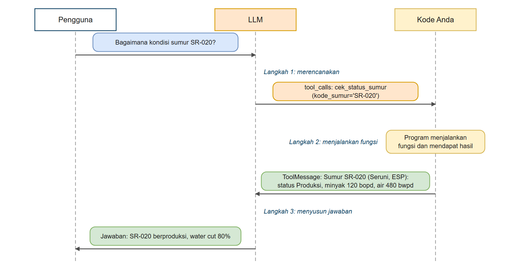
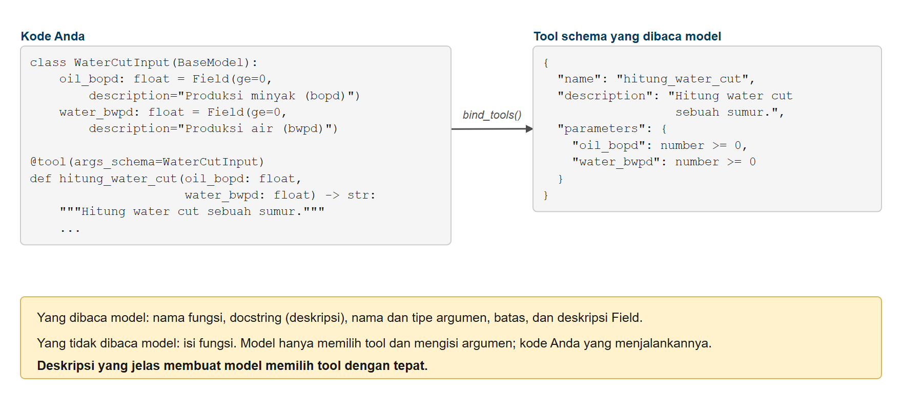
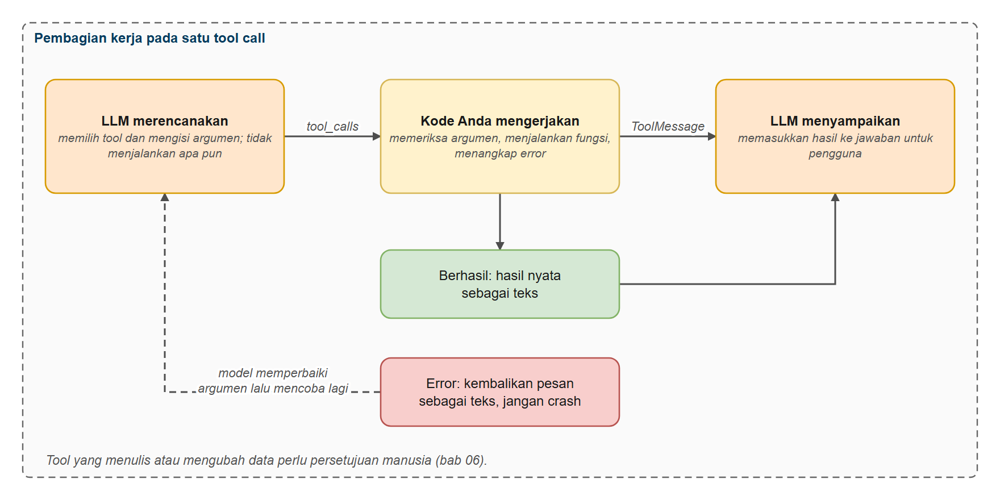

# Function Calling dan Tools

Di bab ini Anda mempelajari cara membuat AI bisa lebih dari sekadar menulis teks, lewat function calling dan tool. Anda akan melihat bagaimana LLM bisa memanggil fungsi dengan argumen terstruktur, membuat tool dengan skema Pydantic supaya tipe datanya terjaga, dan membangun sistem tempat AI bisa memicu tindakan nyata seperti memanggil API, meng-query database, atau menghitung sesuatu, termasuk mencari prosedur di SOP.

**Ini bab fondasi untuk membangun agen AI.** Tool adalah komponen dasar yang memberi agen kemampuan. Tanpa tool, agen hanyalah pembuat teks. Di [Memulai dengan Agen](../03-agen/README.md), Anda akan melihat bagaimana agen memakai tool yang Anda buat di sini untuk mengambil keputusan sendiri dan menyelesaikan masalah bertahap.

## Prasyarat

- Sudah menyelesaikan [Dasar LangChain](../01-dasar-langchain/README.md)

## Tujuan Pembelajaran

Setelah bab ini Anda bisa:

- Memahami apa itu function calling dan mengapa penting
- Membuat tool dengan skema Pydantic agar tipe datanya terjaga (type-safe)
- Mengikat (bind) tool ke model chat
- Menjalankan tool dan menangani hasilnya
- Membangun sistem dengan banyak tool
- Menerapkan praktik terbaik saat merancang tool

---

## Tentang Contoh Kode

Snippet kode di README ini adalah file lengkap yang ada di folder `code/`. Keluaran yang ditampilkan berasal dari menjalankan file itu.

Dua catatan tentang tool di kursus ini:

- **Tool tidak memakai `eval()`.** Kalkulator berbasis `eval()` mudah dibuat tetapi berbahaya: model bisa saja diminta menjalankan kode sembarang. Kita menulis tool khusus (`hitung_water_cut`, `konversi_satuan`) yang hanya melakukan satu hal dengan jelas.
- **Data sumur ini fiktif.** `DATA_SUMUR` adalah dictionary pengganti database atau sistem SCADA sungguhan.

---

## Analogi: Pelayan dan Dapur Restoran

**Bayangkan Anda memesan makanan di sebuah restoran.**

Anda berkata: "Nasi goreng dua porsi, satu tidak pedas, dan es teh satu." Pelayan tidak memasak sendiri. Ia:

1. **Memahami pesanannya** (apa yang diminta)
2. **Menulis pesanan sesuai menu** dan mengirimnya ke bagian yang tepat (nama fungsi di sini hanya contoh):
   - Dapur: "Nasi goreng, 2 porsi, 1 tidak pedas" (fungsi `buat_hidangan`)
   - Bar minuman: "Es teh, 1 gelas" (fungsi `buat_minuman`)
   - Kasir: "Hitung total tagihan" (fungsi `hitung_tagihan`)
3. **Setiap bagian mengerjakan tugasnya** dan menyerahkan hasilnya
4. **Pelayan menyajikan** hidangan dan tagihan kepada Anda

**Function calling pada AI bekerja persis seperti itu.**

LLM:

- **Memahami** permintaan pengguna
- **Membuat function call terstruktur** dengan argumen yang benar
- **Mengembalikan** nama fungsi dan argumennya (tetapi tidak menjalankannya)
- **Mengolah** hasil fungsi menjadi jawaban

Kuncinya: LLM tidak *melakukan* tindakan itu sendiri. Ia *menjelaskan* fungsi mana yang dipanggil dan dengan parameter apa. Kode Anda yang menjalankannya.

| Di restoran | Di LangChain |
|---|---|
| Pelayan yang meneruskan pesanan ke bagian yang tepat | Model (LLM) yang memilih tool |
| Menu: nama dan penjelasan tiap hidangan | Nama dan deskripsi tool |
| Formulir pesanan (jumlah, tingkat pedas, nomor meja) | Skema argumen Pydantic |
| Koki yang memasak | Kode Python Anda yang menjalankan fungsi |
| Hidangan yang diantar kembali ke pelayan | `ToolMessage` yang dikirim kembali ke model |

---

## Apa Itu Function Calling?

[Function calling](../../GLOSARIUM.md#function-calling) mengubah LLM dari pembuat teks menjadi koordinator tindakan. Alih-alih hanya menghasilkan teks, LLM bisa memicu operasi nyata: memeriksa status sumur, meng-query database, memanggil API, dan banyak lagi.

### Perubahan Paradigma

**Sebelum**: LLM hanya bisa menghasilkan teks. "Berapa produksi SR-020 sekarang?" dijawab "Saya tidak memiliki akses ke data produksi real-time..."

**Sesudah**: LLM bisa meminta operasi eksternal. "Berapa produksi SR-020 sekarang?" menghasilkan `{ "function": "cek_status_sumur", "args": { "kode_sumur": "SR-020" } }`, kode Anda menjalankannya, dan LLM menjawab "SR-020 sedang berproduksi 120 bopd minyak dan 480 bwpd air."

### Memahami Model Eksekusi

**Konsep penting: LLM tidak pernah menjalankan fungsi secara langsung.** Yang sebenarnya terjadi:

**1. Peran LLM (merencanakan)**:

- Menganalisis permintaan pengguna
- Menentukan fungsi mana yang dipanggil
- Membuat function call terstruktur beserta argumennya
- Mengembalikannya sebagai JSON (tidak menjalankan apa pun)

**2. Peran kode Anda (mengerjakan)**:

- Menerima deskripsi function call
- Benar-benar menjalankan fungsinya
- Mendapat hasil nyata (panggilan API, perhitungan, dan sebagainya)
- Mengirim hasil kembali ke LLM

**3. Peran LLM lagi (menyampaikan)**:

- Memasukkan hasil fungsi ke dalam jawaban yang wajar
- Mengembalikan jawaban yang membantu kepada pengguna

### Mengapa Pemisahan Ini Penting

**Keamanan dan kendali**: kode Anda yang menentukan fungsi apa yang ada dan mengendalikan eksekusinya. Anda bisa menolak operasi berbahaya.



*Gambar 1. Siklus function calling: model merencanakan, kode menjalankan*

**Contoh alur**: "Bagaimana status SR-020 dan KN-033?"

```python
# 1. LLM membuat (tidak menjalankan):
{
    "tool_calls": [
        {"name": "cek_status_sumur", "args": {"kode_sumur": "SR-020"}},
        {"name": "cek_status_sumur", "args": {"kode_sumur": "KN-033"}}
    ]
}

# 2. Kode Anda menjalankan:
sr020 = cek_status_sumur("SR-020")   # -> "Produksi, 120 bopd"
kn033 = cek_status_sumur("KN-033")   # -> "Menunggu pulling"

# 3. LLM menjawab:
"SR-020 berproduksi 120 bopd. KN-033 menunggu pulling."
```

### Karakteristik Utama

- LLM membuat function call (menjelaskan apa yang harus dilakukan)
- Kode Anda menjalankan fungsi (melakukan pekerjaan sebenarnya)
- Anda tetap memegang kendali atas keamanan dan validasi
- LLM menalar kapan fungsi dipakai

---

## Membuat Tool dengan Decorator @tool

Di LangChain Python, tool dibuat dengan decorator `@tool` dan skema Pydantic supaya tipenya terjaga (type safety).

Kalau Anda baru mengenal Pydantic: ini library Python untuk validasi data berdasarkan anotasi tipe. Anggap sebagai cara menjelaskan seperti apa masukan yang valid, misalnya "parameter ini harus string" atau "angka ini tidak boleh negatif". Pydantic memvalidasi data saat program berjalan.

**Anda ingin memberi AI kemampuan menghitung water cut.** Tanpa tool, AI hanya menebak hitungan atau berkata "saya tidak bisa berhitung dengan pasti". Dengan tool, AI mengenali kapan perhitungan dibutuhkan dan meminta penghitungan sebenarnya dijalankan.

### Contoh 1: Tool Sederhana

Mari lihat cara membuat tool dengan decorator `@tool` dan skema Pydantic supaya parameternya type-safe.

**Kode**: [`code/01_simple_tool.py`](./code/01_simple_tool.py)
**Jalankan**: `python hari3/02-tools-function-calling/code/01_simple_tool.py`

```python
# %% [markdown]
# # Contoh 1: Tool Sederhana
# Jalankan sel satu per satu dengan Shift+Enter, atau seluruh file: `python hari3/02-tools-function-calling/code/01_simple_tool.py`
#
# Membuat tool dengan decorator `@tool` dan skema masukan Pydantic, lalu mengujinya langsung tanpa model.

# %%
# Langkah 1 - Impor dan skema masukan
from langchain_core.tools import tool
from pydantic import BaseModel, Field, ValidationError
from dotenv import load_dotenv

load_dotenv()


# Tentukan skema masukan dengan Pydantic
class WaterCutInput(BaseModel):
    """Skema masukan untuk tool water cut."""
    oil_bopd: float = Field(ge=0, description="Produksi minyak dalam barel per hari (bopd), contoh 120")
    water_bwpd: float = Field(ge=0, description="Produksi air dalam barel per hari (bwpd), contoh 480")


# %% [markdown]
# ## Langkah 2 - Membuat tool
# Decorator `@tool` mengubah fungsi menjadi tool. Docstring-nya menjadi deskripsi yang dibaca model.

# %%
# Buat tool dengan decorator @tool
@tool(args_schema=WaterCutInput)
def hitung_water_cut(oil_bopd: float, water_bwpd: float) -> str:
    """Hitung water cut (persentase air dalam total cairan produksi) sebuah sumur.
    Pakai tool ini bila perlu mengetahui water cut dari angka produksi minyak dan air."""
    total = oil_bopd + water_bwpd
    if total == 0:
        return "Tidak dapat dihitung: total produksi cairan adalah 0."
    water_cut = water_bwpd / total * 100
    return f"Water cut = {water_cut:.1f}% (total cairan {total:.0f} bpd)"


print("Tool dibuat:", hitung_water_cut.name)
print("Deskripsi:", hitung_water_cut.description)
print("Skema argumen:", list(hitung_water_cut.args))

# %% [markdown]
# ## Langkah 3 - Menguji tool secara langsung

# %%
hasil = hitung_water_cut.invoke({"oil_bopd": 120, "water_bwpd": 480})
print("Hasil:", hasil)

# %% [markdown]
# ## Langkah 4 - Skema menolak masukan yang tidak masuk akal
# Skema Pydantic menolak masukan sebelum fungsi berjalan.

# %%
try:
    hitung_water_cut.invoke({"oil_bopd": -10, "water_bwpd": 480})
except ValidationError as error:
    print("Masukan ditolak oleh skema:", error.errors()[0]["msg"])
```

### Keluaran yang Diharapkan

```text
Tool dibuat: hitung_water_cut
Deskripsi: Hitung water cut (persentase air dalam total cairan produksi) sebuah sumur.
    Pakai tool ini bila perlu mengetahui water cut dari angka produksi minyak dan air.
Skema argumen: ['oil_bopd', 'water_bwpd']

Hasil: Water cut = 80.0% (total cairan 600 bpd)

Masukan ditolak oleh skema: Input should be greater than or equal to 0
```

### Cara Kerjanya

**Apa yang terjadi**:

1. **Definisikan skema masukan**: `BaseModel` Pydantic dengan `Field(description=...)` untuk parameter
2. **Buat tool**: decorator `@tool(args_schema=...)` membuat tool
3. **Tulis logikanya**: isi fungsi berisi perhitungan sebenarnya
4. **Kembalikan hasil**: string yang menjelaskan hasilnya
5. **Validasi otomatis**: nilai negatif ditolak oleh skema sebelum fungsi berjalan (baris terakhir keluaran)

**Komponen utama**:

- **Fungsi implementasi**: apa yang sebenarnya dilakukan tool (`def hitung_water_cut(...)`)
- **Nama**: cara LLM merujuk tool (`"hitung_water_cut"`)
- **Deskripsi**: membantu LLM memutuskan kapan memakainya (diambil dari docstring)
- **Skema**: model Pydantic yang menentukan parameter (`WaterCutInput`)

**Penting**: pada tahap ini kita baru *membuat* tool. Kita belum menghubungkannya ke LLM. Itu langkah di Contoh 2.

---

## Mengikat Tool ke Model

Pakai `bind_tools()` agar tool tersedia bagi LLM.

**Anda sudah membuat tool water cut, tetapi bagaimana AI tahu tool itu ada?** Tool hanya ada di kode Anda, terpisah dari AI. Anda perlu memberi tahu AI "ini tool yang boleh dipakai" dan membiarkan AI memutuskan kapan memanggilnya. Di situlah `.bind_tools()` berperan: ia menghubungkan tool ke model sehingga AI bisa memilih kapan memakainya.

### Contoh 2: Mengikat dan Memanggil Tool

Mari lihat cara memakai `.bind_tools()` agar tool tersedia, dan lihat bagaimana AI membuat `tool_calls` terstruktur.

**Kode**: [`code/02_tool_calling.py`](./code/02_tool_calling.py)
**Jalankan**: `python hari3/02-tools-function-calling/code/02_tool_calling.py`

```python
# %% [markdown]
# # Contoh 2: Mengikat dan Memanggil Tool
# Jalankan sel satu per satu dengan Shift+Enter, atau seluruh file: `python hari3/02-tools-function-calling/code/02_tool_calling.py`
#
# Tool diikat ke model dengan `bind_tools`. Model hanya MEMINTA pemanggilan tool; tool belum dijalankan.

# %%
# Langkah 1 - Menyiapkan model, skema, dan tool
from langchain_openai import ChatOpenAI
from langchain_core.tools import tool
from pydantic import BaseModel, Field
from dotenv import load_dotenv
import os

load_dotenv()

model = ChatOpenAI(
    model=os.getenv("ONLINE_MODEL"),
    base_url=os.getenv("ONLINE_BASE_URL"),
    api_key=os.getenv("ONLINE_API_KEY"),
    reasoning_effort=os.getenv("LLM_REASONING_EFFORT", "none"),
)


class WaterCutInput(BaseModel):
    oil_bopd: float = Field(ge=0, description="Produksi minyak dalam bopd")
    water_bwpd: float = Field(ge=0, description="Produksi air dalam bwpd")


@tool(args_schema=WaterCutInput)
def hitung_water_cut(oil_bopd: float, water_bwpd: float) -> str:
    """Hitung water cut (persentase air dalam total cairan produksi) sebuah sumur."""
    total = oil_bopd + water_bwpd
    return f"Water cut = {water_bwpd / total * 100:.1f}%" if total else "Total produksi 0"


# %% [markdown]
# ## Langkah 2 - Mengikat tool ke model

# %%
# Ikat tool ke model
model_with_tools = model.bind_tools([hitung_water_cut])

# %% [markdown]
# ## Langkah 3 - Memanggil model dengan sebuah pertanyaan
# Perhatikan isi `tool_calls`: model menyebut tool apa dan argumen apa, tetapi tool belum dijalankan.

# %%
pertanyaan = "Sumur SR-020 memproduksi 120 bopd minyak dan 480 bwpd air. Berapa water cut-nya?"
response = model_with_tools.invoke(pertanyaan)

print("Pertanyaan:", pertanyaan)
print("\nIsi teks (content):", repr(response.content))
print("\nPermintaan tool call (tool_calls):")
for pemanggilan in response.tool_calls:
    print(f"  Nama     : {pemanggilan['name']}")
    print(f"  Argumen  : {pemanggilan['args']}")
    print(f"  ID       : {pemanggilan['id']}")

print("\nPerhatikan: tool BELUM dijalankan. Model hanya menjelaskan tool apa dan argumen apa.")
```

### Keluaran yang Diharapkan

```text
Pertanyaan: Sumur SR-020 memproduksi 120 bopd minyak dan 480 bwpd air. Berapa water cut-nya?

Isi teks (content): '\n\n'

Permintaan tool call (tool_calls):
  Nama     : hitung_water_cut
  Argumen  : {'oil_bopd': 120, 'water_bwpd': 480}
  ID       : call_aed67db32dd54520a2d63fb0

Perhatikan: tool BELUM dijalankan. Model hanya menjelaskan tool apa dan argumen apa.
```

### Cara Kerjanya

**Yang terjadi**:

1. **LLM melihat deskripsi tool**: saat kita mengikat tool water cut, LLM mempelajari keberadaannya
2. **LLM menganalisis pertanyaan**: "Berapa water cut-nya?" butuh tool water cut
3. **LLM membuat tool call**: mengembalikan data terstruktur berisi nama tool, argumen, dan ID
4. **Kode Anda menerima tool call**: `response.tool_calls[0]` berisi tool call terstruktur
5. **Langkah berikutnya** (belum ditampilkan): Anda menjalankan tool dengan argumen itu

**Penting**: LLM tidak menghitung apa pun! Ia hanya *menjelaskan* tool apa yang dipanggil dan dengan argumen apa. Kode Anda yang harus menjalankan tool (lihat Contoh 3).

---

## Menangani Eksekusi Tool

### Contoh 3: Siklus Tool Call Lengkap

Pada contoh ini Anda melihat alur lengkap: LLM membuat tool call, kode Anda menjalankan tool, dan hasilnya kembali ke LLM untuk jawaban akhir.



*Gambar 2. Dari fungsi Python menjadi tool schema untuk model*

**Kode**: [`code/03_tool_execution.py`](./code/03_tool_execution.py)
**Jalankan**: `python hari3/02-tools-function-calling/code/03_tool_execution.py`

```python
# %% [markdown]
# # Contoh 3: Siklus Tool Call Lengkap
# Jalankan sel satu per satu dengan Shift+Enter, atau seluruh file: `python hari3/02-tools-function-calling/code/03_tool_execution.py`
#
# Siklus tiga langkah: model merencanakan pemanggilan tool, KODE ANDA menjalankan tool, lalu hasilnya
# dikirim kembali ke model untuk menyusun jawaban akhir.

# %%
# Langkah 1 - Menyiapkan model
from langchain_openai import ChatOpenAI
from langchain_core.tools import tool
from langchain_core.messages import HumanMessage, AIMessage, ToolMessage
from pydantic import BaseModel, Field
from dotenv import load_dotenv
import os

load_dotenv()

model = ChatOpenAI(
    model=os.getenv("ONLINE_MODEL"),
    base_url=os.getenv("ONLINE_BASE_URL"),
    api_key=os.getenv("ONLINE_API_KEY"),
    reasoning_effort=os.getenv("LLM_REASONING_EFFORT", "none"),
)

# %% [markdown]
# ## Langkah 2 - Data dan tool status sumur
# Data status sumur bersifat fiktif. Pada sistem nyata, ini akan berasal dari database atau SCADA.

# %%
# Data status sumur (fiktif). Pada sistem nyata, ini akan berasal dari database atau SCADA.
DATA_SUMUR = {
    "SR-020": {"area": "Seruni", "pompa": "ESP", "status": "Produksi", "minyak_bopd": 120, "air_bwpd": 480,
               "catatan": "ESP trip overload kemarin sore, stabil sejak pukul 18.00"},
    "SR-027": {"area": "Seruni", "pompa": "ESP", "status": "Produksi", "minyak_bopd": 95, "air_bwpd": 380,
               "catatan": "Pembacaan H2S 12 ppm pada 22 Juli 2026, dalam investigasi HSE"},
    "KN-033": {"area": "Kenanga", "pompa": "SRP", "status": "Menunggu pulling", "minyak_bopd": 0, "air_bwpd": 0,
               "catatan": "Sucker rod patah, menunggu jadwal rig"},
}


class StatusSumurInput(BaseModel):
    kode_sumur: str = Field(description="Kode sumur, contoh SR-020 atau KN-033")


@tool(args_schema=StatusSumurInput)
def cek_status_sumur(kode_sumur: str) -> str:
    """Cek status operasi sebuah sumur: area, jenis pompa, status, produksi minyak dan air, serta catatan terakhir."""
    data = DATA_SUMUR.get(kode_sumur.strip().upper())
    if not data:
        return f"Sumur {kode_sumur} tidak ditemukan. Sumur yang terdaftar: {', '.join(DATA_SUMUR)}"
    return (f"Sumur {kode_sumur} ({data['area']}, {data['pompa']}): status {data['status']}, "
            f"minyak {data['minyak_bopd']} bopd, air {data['air_bwpd']} bwpd. Catatan: {data['catatan']}")


model_with_tools = model.bind_tools([cek_status_sumur])

# %% [markdown]
# ## Langkah 3 - Model membuat permintaan tool call (perencanaan)

# %%
query = "Bagaimana kondisi sumur SR-020 saat ini?"
print("Pengguna:", query)
response1 = model_with_tools.invoke(query)
tool_call = response1.tool_calls[0]
print("\nLangkah 1 - Permintaan tool dari model:")
print(f"  Tool : {tool_call['name']}")
print(f"  Args : {tool_call['args']}")
print(f"  ID   : {tool_call['id']}")

# %% [markdown]
# ## Langkah 4 - Kode Anda menjalankan tool (pelaksanaan)

# %%
tool_result = cek_status_sumur.invoke(tool_call["args"])
print("Langkah 2 - Hasil eksekusi tool:")
print(f"  {tool_result}")

# %% [markdown]
# ## Langkah 5 - Mengirim hasil kembali ke model (komunikasi)

# %%
messages = [
    HumanMessage(content=query),
    AIMessage(content="", tool_calls=response1.tool_calls),
    ToolMessage(content=tool_result, tool_call_id=tool_call["id"]),
]

final_response = model.invoke(messages)
print("Langkah 3 - Jawaban akhir:")
print(f"  {final_response.content}")
```

### Keluaran yang Diharapkan

```text
Pengguna: Bagaimana kondisi sumur SR-020 saat ini?

Langkah 1 - Permintaan tool dari model:
  Tool : cek_status_sumur
  Args : {'kode_sumur': 'SR-020'}
  ID   : call_c303c583c87349428a204630

Langkah 2 - Hasil eksekusi tool:
  Sumur SR-020 (Seruni, ESP): status Produksi, minyak 120 bopd, air 480 bwpd. Catatan: ESP trip overload kemarin sore, stabil sejak pukul 18.00

Langkah 3 - Jawaban akhir:
  Berdasarkan data terakhir, berikut kondisi sumur **SR-020** saat ini:

**Status: Produksi (beroperasi)**
- **Minyak:** 120 bopd
- **Air:** 480 bwpd
- **Catatan:** Pompa ESP sempat *trip* (mati mendadak) akibat *overload* kemarin sore, namun sudah berhasil distabilkan kembali sejak pukul 18.00.

Secara umum sumur berjalan normal, tapi perlu dipantau lebih ketat karena ada riwayat gangguan overload baru-baru ini.

Apakah Anda ingin info lebih detail—misalnya tren produksi, tekanan, atau riwayat trip sebelumnya?
```

### Cara Kerjanya

**Alur lengkap**:

1. **Langkah 1 - LLM membuat tool call**:
   - Pengguna bertanya "Bagaimana kondisi sumur SR-020 saat ini?"
   - LLM memutuskan memakai tool `cek_status_sumur` dengan `{"kode_sumur": "SR-020"}`
2. **Langkah 2 - Jalankan tool**:
   - Kode Anda memanggil `cek_status_sumur.invoke(tool_call["args"])`
   - Tool mengembalikan status sumur dari `DATA_SUMUR`
3. **Langkah 3 - Kirim hasil kembali ke LLM**:
   - Susun riwayat percakapan: pesan pengguna, tool call oleh AI, dan hasil tool
   - LLM menerima data status sumur
   - LLM membuat jawaban dalam bahasa biasa

`tool_call_id` pada `ToolMessage` harus sama dengan `id` tool call-nya: begitulah model mencocokkan hasil dengan permintaannya.

**Inti**: pola tiga langkah ini (membuat, menjalankan, menjawab) adalah inti function calling.

---

## Banyak Tool

LLM bisa memilih dari beberapa tool berdasarkan pertanyaan.

**Anda membangun asisten yang perlu kemampuan berbeda: menghitung water cut, mengonversi satuan, dan memeriksa status sumur.** Alih-alih membuat beberapa instance AI atau logika pemilihan yang rumit, Anda ingin satu AI yang memilih tool yang tepat untuk setiap tugas: tool water cut untuk "berapa water cut-nya", tool konversi untuk "1500 psi berapa bar", dan tool status untuk "bagaimana kondisi KN-033".

### Contoh 4: Sistem Multi-Tool

Mari lihat cara mengikat banyak tool dengan `.bind_tools([tool1, tool2, tool3])` dan membiarkan AI memilih mana yang dipanggil.

**Kode**: [`code/04_multiple_tools.py`](./code/04_multiple_tools.py)
**Jalankan**: `python hari3/02-tools-function-calling/code/04_multiple_tools.py`

```python
# %% [markdown]
# # Contoh 4: Sistem Multi-Tool
# Jalankan sel satu per satu dengan Shift+Enter, atau seluruh file: `python hari3/02-tools-function-calling/code/04_multiple_tools.py`
#
# Model diberi tiga tool sekaligus dan memilih sendiri tool yang tepat (atau tidak memakai tool sama sekali)
# untuk setiap pertanyaan.

# %%
# Langkah 1 - Menyiapkan model
from langchain_openai import ChatOpenAI
from langchain_core.tools import tool
from pydantic import BaseModel, Field
from typing import Literal
from dotenv import load_dotenv
import os

load_dotenv()

model = ChatOpenAI(
    model=os.getenv("ONLINE_MODEL"),
    base_url=os.getenv("ONLINE_BASE_URL"),
    api_key=os.getenv("ONLINE_API_KEY"),
    reasoning_effort=os.getenv("LLM_REASONING_EFFORT", "none"),
)

# %% [markdown]
# ## Langkah 2 - Mendefinisikan tiga tool
# Water cut, konversi satuan, dan status sumur, masing-masing dengan skema masukan sendiri.

# %%
class WaterCutInput(BaseModel):
    oil_bopd: float = Field(ge=0, description="Produksi minyak dalam bopd")
    water_bwpd: float = Field(ge=0, description="Produksi air dalam bwpd")


class KonversiInput(BaseModel):
    nilai: float = Field(description="Angka yang dikonversi")
    dari: Literal["bbl", "m3", "psi", "bar"] = Field(description="Satuan asal")
    ke: Literal["bbl", "m3", "psi", "bar"] = Field(description="Satuan tujuan")


class StatusSumurInput(BaseModel):
    kode_sumur: str = Field(description="Kode sumur, contoh SR-020")


@tool(args_schema=WaterCutInput)
def hitung_water_cut(oil_bopd: float, water_bwpd: float) -> str:
    """Hitung water cut (persen air dalam total cairan produksi) dari produksi minyak dan air."""
    total = oil_bopd + water_bwpd
    return f"Water cut = {water_bwpd / total * 100:.1f}%" if total else "Total produksi 0"


@tool(args_schema=KonversiInput)
def konversi_satuan(nilai: float, dari: str, ke: str) -> str:
    """Konversi satuan volume (bbl dan m3) atau tekanan (psi dan bar)."""
    faktor = {("bbl", "m3"): 0.158987, ("m3", "bbl"): 1 / 0.158987, ("psi", "bar"): 0.0689476, ("bar", "psi"): 14.5038}
    if dari == ke:
        return f"{nilai} {ke}"
    if (dari, ke) not in faktor:
        return f"Konversi {dari} ke {ke} tidak didukung (volume dan tekanan tidak dapat saling dikonversi)."
    return f"{nilai} {dari} = {nilai * faktor[(dari, ke)]:.3f} {ke}"


@tool(args_schema=StatusSumurInput)
def cek_status_sumur(kode_sumur: str) -> str:
    """Cek status operasi sebuah sumur berdasarkan kodenya."""
    return f"Sumur {kode_sumur}: status Produksi"


model_with_tools = model.bind_tools([hitung_water_cut, konversi_satuan, cek_status_sumur])

# %% [markdown]
# ## Langkah 3 - Water cut
# Pertanyaan yang cocok dengan `hitung_water_cut`.

# %%
query = "Produksi minyak 200 bopd dan air 300 bwpd, berapa water cut-nya?"
response = model_with_tools.invoke(query)
print(f"Pertanyaan: {query}")
if response.tool_calls:
    for pemanggilan in response.tool_calls:
        print(f"  Tool dipilih: {pemanggilan['name']}")
        print(f"  Argumen     : {pemanggilan['args']}")
else:
    print("  Tidak memanggil tool (model menjawab langsung)")

# %% [markdown]
# ## Langkah 4 - Konversi satuan
# Pertanyaan yang cocok dengan `konversi_satuan`.

# %%
query = "Tekanan wellhead 1500 psi itu berapa bar?"
response = model_with_tools.invoke(query)
print(f"Pertanyaan: {query}")
if response.tool_calls:
    for pemanggilan in response.tool_calls:
        print(f"  Tool dipilih: {pemanggilan['name']}")
        print(f"  Argumen     : {pemanggilan['args']}")
else:
    print("  Tidak memanggil tool (model menjawab langsung)")

# %% [markdown]
# ## Langkah 5 - Status sumur
# Pertanyaan yang cocok dengan `cek_status_sumur`.

# %%
query = "Apa status sumur KN-033?"
response = model_with_tools.invoke(query)
print(f"Pertanyaan: {query}")
if response.tool_calls:
    for pemanggilan in response.tool_calls:
        print(f"  Tool dipilih: {pemanggilan['name']}")
        print(f"  Argumen     : {pemanggilan['args']}")
else:
    print("  Tidak memanggil tool (model menjawab langsung)")

# %% [markdown]
# ## Langkah 6 - Pertanyaan tanpa tool
# Tidak ada tool yang relevan, jadi model seharusnya menjawab langsung.

# %%
query = "Apa kepanjangan SOP?"
response = model_with_tools.invoke(query)
print(f"Pertanyaan: {query}")
if response.tool_calls:
    for pemanggilan in response.tool_calls:
        print(f"  Tool dipilih: {pemanggilan['name']}")
        print(f"  Argumen     : {pemanggilan['args']}")
else:
    print("  Tidak memanggil tool (model menjawab langsung)")
```

### Keluaran yang Diharapkan

> **Catatan tentang perilaku tool call:** tool call itu probabilistik, jadi hasilnya bisa berbeda tiap kali dan antar model. Sebagian model menjawab langsung untuk pertanyaan sederhana alih-alih memanggil tool. Supaya lebih bisa diandalkan, pakai prompt yang lebih eksplisit seperti "Pakai tool hitung_water_cut untuk..." atau pertimbangkan parameter `tool_choice`.

```text
Pertanyaan: Produksi minyak 200 bopd dan air 300 bwpd, berapa water cut-nya?
  Tool dipilih: hitung_water_cut
  Argumen     : {'oil_bopd': 200, 'water_bwpd': 300}

Pertanyaan: Tekanan wellhead 1500 psi itu berapa bar?
  Tool dipilih: konversi_satuan
  Argumen     : {'nilai': 1500, 'dari': 'psi', 'ke': 'bar'}

Pertanyaan: Apa status sumur KN-033?
  Tool dipilih: cek_status_sumur
  Argumen     : {'kode_sumur': 'KN-033'}

Pertanyaan: Apa kepanjangan SOP?
  Tidak memanggil tool (model menjawab langsung)
```

### Cara Kerjanya

**Yang terjadi**:

1. **Mengikat banyak tool**: ketiga tool tersedia bagi LLM
2. **LLM membaca deskripsi tool**:
   - hitung_water_cut: "Hitung water cut (persen air dalam total cairan produksi) dari produksi minyak dan air"
   - konversi_satuan: "Konversi satuan volume (bbl dan m3) atau tekanan (psi dan bar)"
   - cek_status_sumur: "Cek status operasi sebuah sumur berdasarkan kodenya"
3. **LLM memilih tool yang sesuai** untuk tiap pertanyaan
4. **LLM membuat argumen yang benar** untuk tiap tool
5. **Pertanyaan umum** ("Apa kepanjangan SOP?") tidak butuh tool, sehingga model menjawab langsung

**Inti**: LLM memilih tool secara otomatis berdasarkan:

- Nama tool
- Deskripsi tool
- Skema parameter
- Pertanyaan pengguna

**Praktik terbaik**: tulis deskripsi tool yang jelas dan spesifik agar LLM bisa memilih dengan tepat.

---

## Tool Pencarian Dokumen

Tool tidak harus berupa hitungan. Salah satu tool paling berguna di kursus ini adalah **pencarian dokumen**: pipeline retrieval dari workshop hari 2 (pencarian hybrid atas SOP, manual, laporan, dan investigasi) dibungkus menjadi sebuah tool, sehingga model bisa "membuka SOP" saat perlu.

### Contoh 5: Tool Pencarian Dokumen

Siklus tiga langkahnya sama dengan Contoh 3. Bedanya, tool kini mencari di basis dokumen dan mengembalikan blok `<dokumen id=... revisi=... bagian=...>` yang bisa dikutip.

**Kode**: [`code/05_document_search_tool.py`](./code/05_document_search_tool.py)
**Jalankan**: `python hari3/02-tools-function-calling/code/05_document_search_tool.py`

> **Pemakaian pertama.** Saat dijalankan pertama kali, index Chroma dibangun di folder `chroma_db/` (beberapa detik) dan model embedding dimuat. Jalankan berikutnya jauh lebih cepat.

```python
# %% [markdown]
# # Contoh 5: Tool Pencarian Dokumen
# Jalankan sel satu per satu dengan Shift+Enter, atau seluruh file: `python hari3/02-tools-function-calling/code/05_document_search_tool.py`
#
# Tool pencarian dokumen: pipeline retrieval workshop dibungkus menjadi tool.
#
# Siklus 3 langkah sama seperti contoh sebelumnya (model merencanakan, kode menjalankan, model menjawab),
# hanya kali ini tool-nya mencari di SOP dan manual.
#
# Di sini role pengguna ditulis tetap di dalam kode ("engineer"). Di bab 3 dan seterusnya, role dibaca dari
# konteks runtime sehingga tidak bisa diubah oleh model.

# %%
# Langkah 1 - Menyiapkan model
from langchain_openai import ChatOpenAI
from langchain_core.tools import tool
from langchain_core.messages import HumanMessage, AIMessage, ToolMessage
from pydantic import BaseModel, Field
from dotenv import load_dotenv
import os

from migas_shared import rag_pipeline as rp
from migas_shared.rag_tools import build_retriever

load_dotenv()

model = ChatOpenAI(
    model=os.getenv("ONLINE_MODEL"),
    base_url=os.getenv("ONLINE_BASE_URL"),
    api_key=os.getenv("ONLINE_API_KEY"),
    reasoning_effort=os.getenv("LLM_REASONING_EFFORT", "none"),
)

# %% [markdown]
# ## Langkah 2 - Membuat tool pencarian
# Role pengguna ditetapkan oleh program, bukan oleh model.

# %%
ROLE_PENGGUNA = "engineer"  # ditetapkan oleh program, bukan oleh model


class CariInput(BaseModel):
    query: str = Field(description="Kalimat pencarian dengan istilah teknis, contoh 'alarm H2S tindakan'")


@tool(args_schema=CariInput)
def cari_prosedur(query: str) -> str:
    """Cari chunk SOP, manual, dan laporan yang berstatus aktif. Hasil berupa blok <dokumen id=... revisi=... bagian=...>
    yang dapat dikutip. Pakai untuk pertanyaan tentang prosedur, batas alarm, dan langkah kerja."""
    docs = build_retriever().search(query, k=3, mode="hybrid", role=ROLE_PENGGUNA, active_only=True)
    return rp.format_context(docs) if docs else "Tidak ada dokumen yang relevan."


model_with_tools = model.bind_tools([cari_prosedur])

# %% [markdown]
# ## Langkah 3 - Model merencanakan pencarian
# Model boleh meminta lebih dari satu pencarian sekaligus; setiap permintaan WAJIB dijawab dengan `ToolMessage`.

# %%
query = "Berapa jarak minimal muster point dari sumber gas H2S menurut SOP yang berlaku?"
print("Pengguna:", query)

response1 = model_with_tools.invoke(query)
for tool_call in response1.tool_calls:
    print("\nLangkah 1 - Model meminta tool:", tool_call["name"], tool_call["args"])

# %% [markdown]
# ## Langkah 4 - Kode menjalankan setiap pencarian di basis dokumen

# %%
messages = [
    HumanMessage(content="Jawab hanya berdasarkan dokumen dan sebut ID dokumennya. " + query),
    AIMessage(content="", tool_calls=response1.tool_calls),
]
for tool_call in response1.tool_calls:
    hasil = cari_prosedur.invoke(tool_call["args"])
    print(f"\nLangkah 2 - Hasil pencarian ({len(hasil)} karakter), chunk awal:")
    print(hasil[:400] + " ...")
    messages.append(ToolMessage(content=hasil, tool_call_id=tool_call["id"]))

# %% [markdown]
# ## Langkah 5 - Model menjawab berdasarkan dokumen yang ditemukan

# %%
jawaban = model.invoke(messages)
print("Langkah 3 - Jawaban akhir:")
print(jawaban.content)
```

### Keluaran yang Diharapkan

```text
Pengguna: Berapa jarak minimal muster point dari sumber gas H2S menurut SOP yang berlaku?

Langkah 1 - Model meminta tool: cari_prosedur {'query': 'jarak minimal muster point sumber gas H2S'}

Langkah 1 - Model meminta tool: cari_prosedur {'query': 'muster point H2S jarak aman'}


Langkah 2 - Hasil pencarian (1872 karakter), chunk awal:
<dokumen id="SOP-HSE-001" revisi="3" status="active" bagian="4. Tingkat Alarm dan Tindakan (Rev. 3)">
[SOP-HSE-001 Rev.3 — Penanganan Bahaya Gas Hidrogen Sulfida (H2S) — 4. Tingkat Alarm dan Tindakan (Rev. 3)]
## 4. Tingkat Alarm dan Tindakan (Rev. 3)
| Level | Pembacaan detector | Tindakan wajib |
|---|---|---|
| Alarm 1 (kuning) | ≥ 5 ppm | Waspada, hentikan pekerjaan non-esensial, periksa sum ...

Langkah 2 - Hasil pencarian (2334 karakter), chunk awal:
<dokumen id="SOP-HSE-001" revisi="3" status="active" bagian="6. Prosedur Evakuasi">
[SOP-HSE-001 Rev.3 — Penanganan Bahaya Gas Hidrogen Sulfida (H2S) — 6. Prosedur Evakuasi]
## 6. Prosedur Evakuasi
1. Saat Alarm 2 berbunyi, tahan napas sejenak, bergerak **tegak lurus terhadap arah angin**, lalu menuju muster point upwind (minimal 50 m).
2. Lapor ke supervisor/control room melalui radio: lokasi,  ...

Langkah 3 - Jawaban akhir:
Berdasarkan dokumen, jarak minimal muster point dari sumber gas H2S adalah **50 meter** di arah atas angin (upwind).

Hal ini dinyatakan dalam **SOP-HSE-001** (Revisi 3) pada **Bagian 4 (Tingkat Alarm dan Tindakan)** dan **Bagian 6 (Prosedur Evakuasi)**. Di bagian tersebut disebutkan bahwa jarak minimum muster point naik dari 30 m menjadi **50 m upwind**, dan pada prosedur evakuasi juga tertulis "menuju muster point upwind (minimal 50 m)".

**Sumber dokumen:** SOP-HSE-001 Rev.3, Bagian 4 dan Bagian 6.
```

### Cara Kerjanya

1. **Model merencanakan**: dari pertanyaan tentang jarak muster point, model membuat query pencarian untuk tool `cari_prosedur`. Pada rekaman di atas model mengirim dua query berbeda dalam satu giliran, dan kode menjawab keduanya (setiap `tool_call` harus mendapat `ToolMessage`)
2. **Kode menjalankan pencarian**: `build_retriever().search(...)` mencari hybrid (embedding dan kata kunci) dan hanya mengembalikan dokumen berstatus aktif
3. **Model menjawab dari dokumen**: jawaban merujuk SOP-HSE-001 Rev 3 yang aktif, bukan Rev 2 yang sudah tidak berlaku (30 m)
4. **Peran pengguna**: di contoh ini `ROLE_PENGGUNA = "engineer"` ditulis di dalam kode. Ini disengaja: **peran tidak boleh menjadi argumen yang diisi model**, karena model bisa dibujuk untuk mengaku sebagai peran lain. Di bab 3 dan seterusnya, peran dikirim lewat konteks runtime (`KonteksPengguna`) dan tool bawaan `cari_dokumen` dari paket bersama membacanya dari sana

---

## Praktik Terbaik

### 1. Deskripsi Tool yang Jelas

```python
# Kurang baik
description = "Urusan sumur"

# Baik
description = "Cek status operasi sebuah sumur: area, jenis pompa, status, produksi minyak dan air, serta catatan terakhir."
```

### 2. Nama Parameter yang Deskriptif

```python
# Kurang baik
class InputSchema(BaseModel):
    x: str
    y: int

# Baik
class KonversiInput(BaseModel):
    nilai: float = Field(description="Angka yang dikonversi, contoh 1500")
    dari: Literal["bbl", "m3", "psi", "bar"] = Field(description="Satuan asal")
```

### 3. Penanganan Error

```python
@tool(args_schema=InputSchema)
def tool_aman(param: str) -> str:
    """Menjalankan operasi dengan penanganan error."""
    try:
        hasil = operasi_berisiko(param)
        return hasil
    except Exception as error:
        return f"Error: {error}. Coba lagi dengan parameter berbeda."
```

Mengembalikan pesan error sebagai teks memungkinkan model memperbaiki sendiri pemanggilannya.

### 4. Validasi

```python
class StatusInput(BaseModel):
    kode_sumur: str = Field(min_length=3, description="Kode sumur, contoh SR-020")

@tool(args_schema=StatusInput)
def cek_sumur(kode_sumur: str) -> str:
    """Cek sumur."""
    if "-" not in kode_sumur:
        raise ValueError("Format kode sumur tidak valid")
    return f"Sumur {kode_sumur} ditemukan"
```

### 5. Tool Tindakan Tulis Butuh Pengaman

Tool yang hanya membaca (status sumur, hitungan) relatif aman. Tool yang **menulis** (membuat work order, mengubah status dokumen, meng-upload dokumen) berisiko. Rancang tool tulis dengan validasi ketat, dan pada bab 6 Anda akan menambahkan persetujuan manusia sebelum tool seperti itu dijalankan.

---

## Peta Konsep

Bab ini mengajarkan alur kerja function calling yang lengkap:



*Gambar 3. Pembagian kerja model dan kode pada satu tool call*

---

## Titik Periksa Kemajuan

Sebelum lanjut, pastikan Anda bisa:

| Kemampuan | Sudah bisa |
|-------|-------|
| Membuat tool dengan decorator `@tool` dan skema Pydantic | [ ] |
| Mengikat tool ke model dengan `bind_tools()` | [ ] |
| Memahami pola eksekusi 3 langkah | [ ] |
| Menjalankan tool dan mengirim hasilnya kembali ke LLM | [ ] |
| Membangun sistem multi-tool | [ ] |
| Menulis deskripsi tool yang jelas | [ ] |

---

## Poin Penting

- **Function calling** memungkinkan LLM memicu tindakan nyata
- **LLM membuat** function call, tetapi tidak menjalankannya
- **Tool** dibuat dengan decorator `@tool` dan skema Pydantic
- **bind_tools()** membuat tool tersedia bagi model
- **Type safety** dengan Pydantic mencegah error
- **Deskripsi yang jelas** membantu LLM memilih tool yang tepat
- **Penanganan error** membuat tool tahan gangguan
- **Banyak tool** memungkinkan kemampuan yang kompleks
- **Peran pengguna** tidak boleh menjadi argumen yang diisi model
- **Tool adalah fondasi agen**: berikutnya Anda melihat bagaimana agen memakai tool untuk menyelesaikan masalah secara mandiri

---

## Latihan

Latihan bab ini berupa starter yang tinggal Anda isi: `latihan_1.py` dan seterusnya (atau `latihan_1.ipynb`), dengan bagian inti dikosongkan dan diberi komentar `TODO`. Petunjuk singkat ada di [latihan.md](./latihan.md); kode jawabannya ada di bagian **Kode Jawaban Latihan** pada PDF bab ini.

Latihan mencakup:

1. **Tool Konversi Satuan dengan Siklus Eksekusi Lengkap**: bangun tool dan terapkan pola 3 langkah
2. **Asisten Pemeriksaan Sumur Multi-Tool** (bonus): sistem dengan banyak tool dan loop eksekusi

---

## Sumber Tambahan

- [Dokumentasi Tool Calling](https://python.langchain.com/docs/how_to/tool_calling/)
- [Panduan Custom Tools](https://python.langchain.com/docs/how_to/custom_tools/)
- [Dokumentasi Pydantic](https://docs.pydantic.dev/)

---

## Langkah Selanjutnya

Kerja bagus. Anda sudah belajar membuat **tool** yang bisa dipanggil LLM untuk melakukan tindakan nyata, tetapi Anda masih harus menangani sendiri loop eksekusinya (panggil model, jalankan tool, panggil lagi).

### Dari Tool Manual ke Agen Otonom

**Bagaimana kalau LLM bisa memutuskan sendiri tool mana yang dipakai dan kapan, tanpa Anda menulis alur kendalinya?**

Berikutnya Anda akan belajar bagaimana agen memutuskan sendiri tool yang dipakai dan mengatur alur kerja bertahap yang kompleks, mengubah tool Anda menjadi sistem yang benar-benar cerdas.

---

## Pemecahan Masalah

| Gejala | Penyebab umum | Perbaikan |
|---|---|---|
| `response.tool_calls` kosong | Model menjawab langsung tanpa tool | Perjelas deskripsi tool, tulis prompt lebih eksplisit, atau pakai `tool_choice` |
| `IndexError: list index out of range` pada `tool_calls[0]` | Tidak ada tool call | Periksa `if response.tool_calls:` sebelum mengakses |
| `ToolMessage` ditolak penyedia (error 400) | `tool_call_id` tidak cocok atau `AIMessage` tool_calls tidak disertakan | Sertakan `AIMessage(tool_calls=...)` sebelum `ToolMessage` dan salin `id` apa adanya |
| `ValidationError` dari skema tool | Model memberi argumen di luar aturan (misalnya angka negatif) | Perjelas `description` field, atau tangkap error dan kembalikan sebagai teks |
| Pencarian dokumen sangat lambat pada pemakaian pertama | Index dan model embedding sedang dibangun atau di-download | Tunggu selesai; jalankan berikutnya lebih cepat |

---

## Dependency

Bab ini memakai `langchain-openai`, `langchain-core`, `pydantic`, dan paket bersama `migas-shared` (Contoh 5 dan latihan bonus).

---

## Referensi

Sumber ide dan teknik di bab ini:

- LangChain. Tools. [Dokumentasi](https://docs.langchain.com/oss/python/langchain/tools).
- Schick, T. et al. (2023). Toolformer: Language Models Can Teach Themselves to Use Tools. [Makalah](https://arxiv.org/abs/2302.04761).
- Anthropic (2025). Writing effective tools for AI agents. [Artikel teknik](https://www.anthropic.com/engineering/writing-tools-for-agents).
- Anthropic. Tool use with Claude. [Dokumentasi](https://docs.anthropic.com/en/docs/build-with-claude/tool-use/overview).
- OpenAI. Function calling. [Dokumentasi](https://platform.openai.com/docs/guides/function-calling).

---

## Navigasi

[Sebelumnya: Dasar LangChain](../01-dasar-langchain/README.md) | [Kembali ke Utama](../../README.md) | [Berikutnya: Memulai dengan Agen](../03-agen/README.md)
