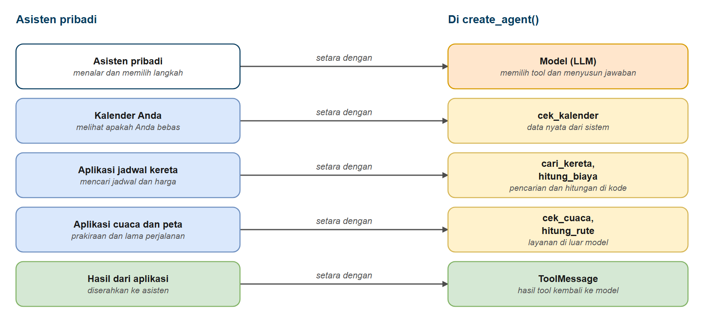
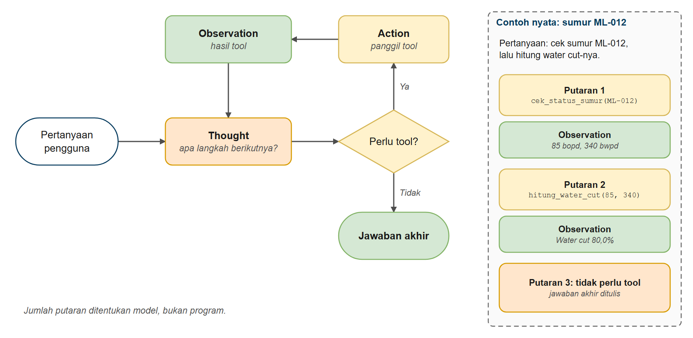
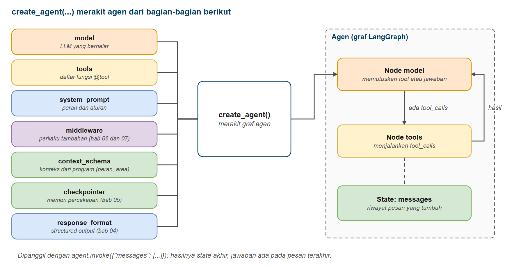

# Memulai dengan Agen

Di bab ini Anda belajar membangun agen (agent) AI yang bisa menalar masalah, memilih tool yang sesuai, dan bekerja secara berulang menuju solusi. Anda akan memahami pola ReAct (Reasoning + Acting) dengan menulis loop agen langkah demi langkah, lalu melihat bagaimana agen memilih tool sendiri untuk menyelesaikan tugas yang kompleks. Kemampuan ini memungkinkan Anda membangun sistem AI otonom yang menangani tugas bertahap.

## Prasyarat

- Sudah menyelesaikan [Function Calling dan Tools](../02-tools-function-calling/README.md)

## Tujuan Pembelajaran

Setelah bab ini Anda bisa:

- Memahami apa itu agen AI dan cara kerjanya
- Menerapkan pola ReAct (Reasoning + Acting)
- Membangun loop agen yang berulang sampai masalah terselesaikan
- Memberi agen banyak tool dan membiarkannya memilih yang tepat
- Memakai `create_agent()` untuk sistem agen yang siap produksi
- Membangun sistem AI otonom bertahap

---

## Analogi: Asisten Pribadi yang Mengatur Perjalanan

**Bayangkan Anda punya asisten pribadi dengan beberapa alat bantu:**

- Aplikasi jadwal kereta: bisa melihat jadwal dan harga tiket
- Kalender Anda: bisa melihat apakah Anda sedang bebas
- Aplikasi cuaca: bisa melihat prakiraan cuaca
- Aplikasi peta: bisa menghitung lama perjalanan

Ketika Anda bertanya: *"Apakah saya sempat berangkat ke Bandung hari Jumat pagi, dan berapa biayanya?"*

Asisten tidak menjawab dengan menebak, dan tidak mengerjakan semuanya sekaligus. Ia:

1. **Bernalar**: "Saya perlu tahu Anda bebas atau tidak, lalu jadwal kereta"
2. **Bertindak**: buka kalender Anda untuk hari Jumat
3. **Mengamati**: Jumat pagi kosong
4. **Bernalar**: "Sekarang saya perlu jadwal dan harga kereta"
5. **Bertindak**: cari kereta Jumat pagi ke Bandung
6. **Mengamati**: ada kereta pukul 07.00 dengan harga tertentu
7. **Bernalar**: "Saya sudah punya cukup informasi"
8. **Menjawab**: sampaikan jawaban akhir

**Agen AI bekerja dengan cara yang sama.**

Mereka:

- **Berpikir** tentang apa yang perlu dilakukan (Reasoning)
- **Memilih** tool yang tepat (pengambilan keputusan)
- **Memakai** tool (Acting)
- **Mengevaluasi** hasilnya (Observation)
- **Mengulang** sampai punya jawaban
- **Menjawab** pengguna

| Asisten pribadi | Di LangChain |
|---|---|
| Asisten yang memutuskan langkah berikutnya | Model (LLM) di dalam agen |
| Aplikasi dengan fungsi masing-masing | Tool dengan deskripsi masing-masing |
| Meminta aplikasi menjalankan sesuatu | Tool call (`tool_calls`) |
| Hasil yang ditampilkan aplikasi | Pesan tool (`ToolMessage`) |
| Asisten berhenti dan melapor | Pesan AI tanpa `tool_calls` |



*Gambar 1. Asisten pribadi dan padanannya pada agen*

---

## Apa Itu Agen?

### LLM Biasa (Tanpa Tool)

```text
Pengguna: "Berapa produksi SR-020 saat ini?"
LLM: "Saya tidak dapat mengakses data produksi real-time. Saya hanya dapat memberi informasi umum..."
```

### Agen dengan Tool

```text
Pengguna: "Berapa produksi SR-020 saat ini?"
Agen: [Berpikir] "Saya perlu memakai tool status sumur"
Agen: [Memakai] cek_status_sumur(kode_sumur="SR-020")
Agen: [Mengamati] "Produksi, minyak 120 bopd, air 480 bwpd"
Agen: [Menjawab] "SR-020 berproduksi 120 bopd minyak dan 480 bwpd air"
```

*Agen dengan tool bisa mengakses data terkini dan melakukan tindakan, sedangkan LLM biasa terbatas pada data latihnya.*

---

## Pola ReAct

ReAct = **Rea**soning + **Act**ing

Agen mengikuti loop berulang ini:

```text
1. Thought (Pikiran): Apa yang sebaiknya saya lakukan berikutnya?
2. Action (Aksi): Pakai tool tertentu
3. Observation (Observasi): Apa yang dikembalikan tool?
4. (Ulangi 1-3 sesuai kebutuhan)
5. Final Answer (Jawaban Akhir): Jawab pengguna
```

**Contoh**:

```text
Pengguna: "Cek sumur SR-020, hitung water cut-nya, lalu bandingkan dengan batas 75%"

Thought 1: Saya perlu data produksi SR-020
Action 1: cek_status_sumur(kode_sumur="SR-020")
Observation 1: minyak 120 bopd, air 480 bwpd

Thought 2: Saya perlu menghitung water cut
Action 2: hitung_water_cut(oil_bopd=120, water_bwpd=480)
Observation 2: Water cut = 80.0%

Final Answer: "Water cut SR-020 adalah 80%, melewati batas 75%."
```



*Gambar 2. Loop ReAct pada agen, dengan contoh nyata sumur ML-012*

---

## Membangun Agen dengan create_agent()

LangChain Python menyediakan `create_agent()` dari `langchain.agents`, sebuah API tingkat tinggi yang menangani loop ReAct secara otomatis. Ini adalah **pendekatan yang direkomendasikan** untuk membangun agen produksi.

**Yang dilakukan create_agent() untuk Anda**:

- Mengelola loop ReAct (Thought, Action, Observation, ulangi)
- Menangani riwayat pesan secara otomatis
- Menerapkan batas iterasi untuk mencegah loop tanpa akhir
- Menyediakan penanganan error siap produksi
- Mengembalikan respons terstruktur yang rapi

---

### Contoh 1: Agen Dasar dengan create_agent()

Mari lihat cara memakai `create_agent()` untuk membuat agen otonom yang menangani loop ReAct secara otomatis.

**Kode**: [`code/01_basic_agent.py`](./code/01_basic_agent.py)
**Jalankan**: `python hari3/03-agen/code/01_basic_agent.py`

```python
# %% [markdown]
# # Contoh 1: Agen Dasar dengan create_agent()
# Jalankan sel satu per satu dengan Shift+Enter, atau seluruh file: `python hari3/03-agen/code/01_basic_agent.py`
#
# `create_agent()` membuat agen yang memutuskan sendiri kapan memanggil tool, menjalankannya, dan menyusun
# jawaban akhir.

# %%
# Langkah 1 - Menyiapkan model dan tool
from langchain.agents import create_agent
from langchain_core.tools import tool
from langchain_core.messages import HumanMessage
from langchain_openai import ChatOpenAI
from dotenv import load_dotenv
import os

from migas_shared.tampil import jejak_tool

load_dotenv()

model = ChatOpenAI(
    model=os.getenv("ONLINE_MODEL"),
    base_url=os.getenv("ONLINE_BASE_URL"),
    api_key=os.getenv("ONLINE_API_KEY"),
    reasoning_effort=os.getenv("LLM_REASONING_EFFORT", "none"),
)


# Tool untuk agen. Docstring dibaca model untuk memutuskan kapan tool dipakai.
@tool
def hitung_water_cut(oil_bopd: float, water_bwpd: float) -> str:
    """Hitung water cut (persentase air dalam total cairan produksi) sebuah sumur.

    Args:
        oil_bopd: Produksi minyak dalam barel per hari (bopd)
        water_bwpd: Produksi air dalam barel per hari (bwpd)
    """
    total = oil_bopd + water_bwpd
    if total == 0:
        return "Total produksi 0, water cut tidak dapat dihitung."
    return f"Water cut = {water_bwpd / total * 100:.1f}%"


# %% [markdown]
# ## Langkah 2 - Membuat agen
# Cukup satu panggilan `create_agent()`; tidak perlu menulis loop sendiri.

# %%
# Buat agen dengan create_agent(), selesai
agent = create_agent(
    model,
    tools=[hitung_water_cut],
    system_prompt="Anda adalah asisten operasi produksi migas. Jawab ringkas dalam Bahasa Indonesia.",
)

# %% [markdown]
# ## Langkah 3 - Menjalankan agen
# Agen dipanggil dengan daftar pesan. Jawaban akhir ada di pesan terakhir.

# %%
# Pakai agen dengan daftar pesan
query = "Sumur SR-020 memproduksi 120 bopd minyak dan 480 bwpd air. Berapa water cut-nya?"
print(f"Pengguna: {query}\n")
response = agent.invoke({"messages": [HumanMessage(content=query)]})

# Jawaban akhir ada di pesan terakhir
last_message = response["messages"][-1]
print(f"Agen: {last_message.content}")

# %% [markdown]
# ## Langkah 4 - Melihat jejak tool

# %%
print("Tool yang dipanggil agen:")
for baris in jejak_tool(response["messages"]):
    print("  -", baris)

print("\nDi balik layar:")
print("   create_agent() menjalankan pola ReAct (Thought, Action, Observation)")
print(f"   dan mengurus semua kode loop untuk Anda. Jumlah pesan dalam hasil: {len(response['messages'])}")
```

### Keluaran yang Diharapkan

> **Catatan:** jawaban model bisa berbeda setiap kali dijalankan. Keluaran di seluruh bab ini berasal dari menjalankan skrip sebenarnya.

```text
Pengguna: Sumur SR-020 memproduksi 120 bopd minyak dan 480 bwpd air. Berapa water cut-nya?

Agen: Water cut sumur SR-020 adalah **80%**.

Perhitungan: Water cut = (480 / (120 + 480)) × 100% = (480 / 600) × 100% = 80%.

Tool yang dipanggil agen:
  - hitung_water_cut({'oil_bopd': 120, 'water_bwpd': 480})

Di balik layar:
   create_agent() menjalankan pola ReAct (Thought, Action, Observation)
   dan mengurus semua kode loop untuk Anda. Jumlah pesan dalam hasil: 4
```

### Cara Kerjanya

**Yang terjadi di balik layar**:

1. **Agen menerima pertanyaan**: "Sumur SR-020 memproduksi 120 bopd minyak dan 480 bwpd air. Berapa water cut-nya?"
2. **Bernalar**: menentukan bahwa ia butuh tool water cut
3. **Bertindak**: menjalankan `hitung_water_cut(oil_bopd=120, water_bwpd=480)`
4. **Mengamati**: mendapat hasil "Water cut = 80.0%"
5. **Menjawab**: menyusun jawaban dalam bahasa biasa

Hasil `agent.invoke(...)` adalah dictionary dengan kunci `messages`: seluruh percakapan, termasuk pesan pengguna, permintaan tool dari AI, hasil tool, dan jawaban akhir. Fungsi bantu `jejak_tool()` dari paket bersama hanya merapikan daftar tool call dari pesan-pesan itu.

---

### Contoh 2: create_agent() dengan Banyak Tool dan Konteks Pengguna

Mari lihat cara memberi agen banyak tool dengan `tools=[tool1, tool2, tool3]` dan melihat bagaimana ia memilih yang tepat sendiri. Kali ini kita juga memakai tool pencarian dokumen `cari_dokumen` dari paket bersama.

**Kode**: [`code/02_multi_tool_agent.py`](./code/02_multi_tool_agent.py)
**Jalankan**: `python hari3/03-agen/code/02_multi_tool_agent.py`

```python
# %% [markdown]
# # Contoh 2: Agen dengan Banyak Tool
# Jalankan sel satu per satu dengan Shift+Enter, atau seluruh file: `python hari3/03-agen/code/02_multi_tool_agent.py`
#
# Agen diberi empat tool: tiga tool lapangan dari bab 2 dan satu tool pencarian dokumen. Agen memilih tool
# yang tepat untuk setiap pertanyaan.

# %%
# Langkah 1 - Menyiapkan model dan agen
from langchain.agents import create_agent
from langchain_core.messages import HumanMessage
from langchain_openai import ChatOpenAI
from dotenv import load_dotenv
import os

from migas_shared.rag_tools import KonteksPengguna, cari_dokumen
from migas_shared.tampil import jejak_tool
from migas_shared.field_tools import hitung_water_cut, konversi_satuan, cek_status_sumur

load_dotenv()

model = ChatOpenAI(
    model=os.getenv("ONLINE_MODEL"),
    base_url=os.getenv("ONLINE_BASE_URL"),
    api_key=os.getenv("ONLINE_API_KEY"),
    reasoning_effort=os.getenv("LLM_REASONING_EFFORT", "none"),
)

# Empat tool: tiga tool lapangan dari bab 2 dan satu tool pencarian dokumen.
# context_schema memberi tahu agen bentuk konteks tepercaya (peran pengguna) yang dikirim program.
agent = create_agent(
    model,
    tools=[hitung_water_cut, konversi_satuan, cek_status_sumur, cari_dokumen],
    system_prompt=(
        "Anda adalah asisten operasi produksi migas di Gathering Station GS-SR1. "
        "Pakai tool bila perlu. Untuk pertanyaan prosedur, cari di dokumen dan sebut ID dokumennya. "
        "Jawab ringkas dalam Bahasa Indonesia."
    ),
    context_schema=KonteksPengguna,
)

# Peran dikirim oleh PROGRAM lewat context, bukan oleh model
konteks = KonteksPengguna(role="operator", area="Seruni", user_id="op-17")

# %% [markdown]
# ## Langkah 2 - Pertanyaan status sumur
# Agen memilih tool yang tepat untuk setiap pertanyaan.

# %%
query = "Apa status sumur SR-020?"
response = agent.invoke({"messages": [HumanMessage(content=query)]}, context=konteks)
print(f"Pengguna: {query}")
print("  Tool    :", "; ".join(jejak_tool(response["messages"])) or "(tidak ada)")
print(f"  Agen    : {response['messages'][-1].content}\n")

# %% [markdown]
# ## Langkah 3 - Pertanyaan konversi satuan

# %%
query = "Tekanan wellhead ML-012 tercatat 900 psi. Berapa bar?"
response = agent.invoke({"messages": [HumanMessage(content=query)]}, context=konteks)
print(f"Pengguna: {query}")
print("  Tool    :", "; ".join(jejak_tool(response["messages"])) or "(tidak ada)")
print(f"  Agen    : {response['messages'][-1].content}\n")

# %% [markdown]
# ## Langkah 4 - Pertanyaan prosedur (pencarian dokumen)

# %%
query = "Berapa jarak minimal muster point dari sumber gas H2S menurut SOP yang berlaku?"
response = agent.invoke({"messages": [HumanMessage(content=query)]}, context=konteks)
print(f"Pengguna: {query}")
print("  Tool    :", "; ".join(jejak_tool(response["messages"])) or "(tidak ada)")
print(f"  Agen    : {response['messages'][-1].content}\n")

# %% [markdown]
# ## Langkah 5 - Pertanyaan yang butuh dua tool berurutan

# %%
query = "Cek sumur ML-012, lalu hitung water cut-nya."
response = agent.invoke({"messages": [HumanMessage(content=query)]}, context=konteks)
print(f"Pengguna: {query}")
print("  Tool    :", "; ".join(jejak_tool(response["messages"])) or "(tidak ada)")
print(f"  Agen    : {response['messages'][-1].content}\n")
```

### Keluaran yang Diharapkan

```text
Pengguna: Apa status sumur SR-020?
  Tool    : cek_status_sumur({'kode_sumur': 'SR-020'})
  Agen    : **Status Sumur SR-020:**

| Item | Detail |
|---|---|
| **Area** | Seruni |
| **Jenis Pompa** | ESP (Electric Submersible Pump) |
| **Status** |  Produksi |
| **Produksi Minyak** | 120 bopd |
| **Produksi Air** | 480 bwpd |
| **Catatan** | ESP *trip overload* kemarin sore, stabil sejak pukul 18.00 |

Jika perlu, saya bisa **hitung water cut** sumur ini atau **konversi satuannya**. Ada yang mau dicek lagi?

Pengguna: Tekanan wellhead ML-012 tercatat 900 psi. Berapa bar?
  Tool    : konversi_satuan({'nilai': 900, 'dari': 'psi', 'ke': 'bar'})
  Agen    : Tekanan wellhead ML-012 sebesar **900 psi** setara dengan **62,053 bar**.

Pengguna: Berapa jarak minimal muster point dari sumber gas H2S menurut SOP yang berlaku?
  Tool    : cari_dokumen({'query': 'jarak minimal muster point sumber gas H2S'})
  Agen    : Berdasarkan **SOP-HSE-001 Rev.3** (bagian 4 dan 6), jarak minimal muster point dari sumber gas H2S adalah **50 meter** dan harus ditempatkan **arah upwind** (melawan arah angin).

[DOC_ID: SOP-HSE-001 Rev.3 bagian 4 & 6]

Pengguna: Cek sumur ML-012, lalu hitung water cut-nya.
  Tool    : cek_status_sumur({'kode_sumur': 'ML-012'}); hitung_water_cut({'oil_bopd': 85, 'water_bwpd': 340})
  Agen    : Berikut ringkasan hasilnya:

**Sumur ML-012 (Melati, ESP)**
- **Status:** Produksi (Normal)
- **Minyak:** 85 bopd
- **Air:** 340 bwpd
- **Total cairan:** 425 bpd
- **Water cut:** **80,0%**

Artinya, 80% dari total cairan yang diproduksi adalah air, dan hanya 20% yang merupakan minyak. Ini tergolong water cut yang cukup tinggi, namun status sumur masih normal.
```

### Cara Kerjanya

**Yang terjadi**:

1. **Agen menerima pertanyaan**: misalnya "Apa status sumur SR-020?"
2. **Membaca deskripsi tool**: meninjau semua tool yang tersedia
3. **Memilih yang paling cocok**: tool status sumur untuk pertanyaan status, tool konversi untuk "berapa bar", `cari_dokumen` untuk pertanyaan prosedur
4. **Menjalankan tool**: dan membaca hasilnya
5. **Mengulang kalau perlu**: untuk "Cek sumur ML-012, lalu hitung water cut-nya" agen memakai dua tool berurutan, karena angka produksi dari tool pertama menjadi masukan tool kedua

**Logika pemilihan tool**:

- Agen memakai **nama** dan **deskripsi** tool untuk mencocokkan pertanyaan dengan tool
- Deskripsi yang lebih spesifik memberi pemilihan yang lebih baik
- LLM memutuskan tool mana yang paling cocok berdasarkan makna
- Anda bisa memberi agen banyak tool, dan ia akan memilih yang tepat untuk setiap tugas

**Tentang `context`**: `cari_dokumen` perlu tahu peran pengguna agar tidak menampilkan dokumen yang bukan haknya (misalnya laporan investigasi HSE). Peran itu dikirim lewat `context=KonteksPengguna(...)` dan dibaca tool lewat `ToolRuntime`. Model tidak melihat dan tidak bisa mengubahnya. Bab 7 dan 8 membahas ini lebih jauh.

---

### Contoh 3: Agen dengan Memori (Pratinjau)

Agen di atas tidak mengingat percakapan sebelumnya: setiap `invoke()` dimulai dari nol. Dengan `checkpointer`, agen menyimpan keadaan per `thread_id`. Ini pratinjau singkat; bab 5 membahasnya penuh.

**Kode**: [`code/03_agent_with_memory.py`](./code/03_agent_with_memory.py)
**Jalankan**: `python hari3/03-agen/code/03_agent_with_memory.py`

```python
# %% [markdown]
# # Contoh 3: Agen dengan checkpointer untuk memori
# Jalankan sel satu per satu dengan Shift+Enter, atau seluruh file: `python hari3/03-agen/code/03_agent_with_memory.py`
#
# Checkpointer menyimpan keadaan percakapan agar agen mengingat giliran sebelumnya.
# Dipakai untuk:
# - Menyimpan riwayat percakapan
# - Percakapan multi-giliran
# - Menyimpan keadaan agen antar pemanggilan

# %%
# Langkah 1 - Menyiapkan model dan agen dengan checkpointer
import os

from dotenv import load_dotenv
from langchain.agents import create_agent
from langchain_core.messages import HumanMessage
from langchain_openai import ChatOpenAI
from langgraph.checkpoint.memory import MemorySaver

from migas_shared.field_tools import cek_status_sumur, hitung_water_cut

load_dotenv()

print("Contoh Agen dengan Memori (Checkpointer)\n")

model = ChatOpenAI(
    model=os.getenv("ONLINE_MODEL"),
    base_url=os.getenv("ONLINE_BASE_URL"),
    api_key=os.getenv("ONLINE_API_KEY"),
    reasoning_effort=os.getenv("LLM_REASONING_EFFORT", "none"),
)

# Penyimpan memori untuk percakapan (hilang saat program berhenti)
memory = MemorySaver()

agent = create_agent(
    model,
    tools=[cek_status_sumur, hitung_water_cut],
    system_prompt="Anda adalah asisten operasi produksi migas. Jawab ringkas dalam Bahasa Indonesia.",
    checkpointer=memory,
)

# Konfigurasi untuk satu thread percakapan
config = {"configurable": {"thread_id": "operator-17-shift-malam"}}

# %% [markdown]
# ## Langkah 2 - Tes 1: pertanyaan pertama

# %%
query1 = "Cek status sumur SR-020."
print(f"Pengguna: {query1}\n")
response1 = agent.invoke({"messages": [HumanMessage(content=query1)]}, config)
print(f"Agen: {response1['messages'][-1].content}\n\n")

# %% [markdown]
# ## Langkah 3 - Tes 2: pertanyaan lanjutan
# Agen mengingat konteks karena memakai `thread_id` yang sama.

# %%
query2 = "Berapa water cut-nya?"
print(f"Pengguna: {query2}\n")
response2 = agent.invoke({"messages": [HumanMessage(content=query2)]}, config)
print(f"Agen: {response2['messages'][-1].content}\n\n")

# %% [markdown]
# ## Langkah 4 - Tes 3: pertanyaan lanjutan lagi

# %%
query3 = "Sumur mana yang tadi saya tanyakan, dan apa catatannya?"
print(f"Pengguna: {query3}\n")
response3 = agent.invoke({"messages": [HumanMessage(content=query3)]}, config)
print(f"Agen: {response3['messages'][-1].content}\n\n")

# %% [markdown]
# ## Langkah 5 - Tes 4: thread berbeda tidak berbagi memori

# %%
query4 = "Sumur mana yang tadi saya tanyakan?"
print(f"Pengguna (thread lain): {query4}\n")
response4 = agent.invoke({"messages": [HumanMessage(content=query4)]}, {"configurable": {"thread_id": "operator-22-shift-pagi"}})
print(f"Agen: {response4['messages'][-1].content}\n\n")

# %% [markdown]
# ## Manfaat memori
# - Menjaga konteks percakapan antar giliran
# - Agen mengingat sumur dan angka yang disebut sebelumnya
# - Setiap `thread_id` memiliki riwayat percakapan sendiri
# - Cocok untuk asisten serah terima shift dan sesi analisis interaktif
```

### Keluaran yang Diharapkan

```text
Contoh Agen dengan Memori (Checkpointer)

Pengguna: Cek status sumur SR-020.

Agen: Berikut status sumur **SR-020**:

- **Lokasi/Area:** Seruni
- **Jenis Pompa:** ESP (Electric Submersible Pump)
- **Status:** Produksi
- **Produksi Minyak:** 120 bopd
- **Produksi Air:** 480 bwpd
- **Catatan:** ESP sempat trip overload kemarin sore, namun sudah stabil sejak pukul 18.00.

Apakah Anda ingin saya menghitung water cut untuk sumur ini?


Pengguna: Berapa water cut-nya?

Agen: Water cut sumur **SR-020** adalah **80,0%**.

- Total cairan produksi: 600 bpd
- Komposisi: 80% air dan 20% minyak

Angka ini cukup tinggi, namun dengan catatan ESP sudah stabil sejak kemarin. Perlu dipantau apakah water cut terus meningkat, karena bisa mengindikasikan masalah pada reservoir atau performa pompa.


Pengguna: Sumur mana yang tadi saya tanyakan, dan apa catatannya?

Agen: Sumur yang Anda tanyakan tadi adalah **SR-020** (area **Seruni**, jenis pompa **ESP**).

**Catatannya:** ESP sempat **trip overload** kemarin sore, namun sudah **stabil sejak pukul 18.00**.

Status saat ini: **Produksi**, minyak 120 bopd dan air 480 bwpd (water cut 80%).


Pengguna (thread lain): Sumur mana yang tadi saya tanyakan?

Agen: Anda belum menyebutkan kode sumur tertentu sebelumnya. Bisa tolong beri tahu kode sumurnya, misalnya SR-020 atau KN-033, agar saya bisa memeriksa statusnya?
```

### Cara Kerjanya

1. `MemorySaver()` menyimpan keadaan percakapan di memori proses
2. `thread_id` memilih percakapan mana yang dilanjutkan: giliran kedua ("Berapa water cut-nya?") berhasil karena agen melihat hasil status sumur dari giliran pertama
3. Thread lain (`operator-22-shift-pagi`) tidak mengetahui isi thread pertama

---

## Logika Pemilihan Tool

Agen memakai **nama** dan **deskripsi** tool untuk mencocokkan pertanyaan dengan tool:

| Pertanyaan Pengguna | Tool Terpilih | Alasan |
|-----------|---------------|-----|
| "Apa status sumur SR-020?" | cek_status_sumur | Cocok dengan "status operasi sebuah sumur" |
| "1500 psi berapa bar?" | konversi_satuan | Cocok dengan "konversi satuan tekanan" |
| "Berapa water cut kalau minyak 85 dan air 340?" | hitung_water_cut | Cocok dengan "persentase air dalam cairan produksi" |
| "Apa tindakan saat alarm H2S tingkat 2?" | cari_dokumen | Cocok dengan "SOP, manual, dan laporan" |

**Tips agar pemilihan tool lebih baik**:

1. Pakai **nama deskriptif**: `cek_status_sumur`, bukan `tool1`
2. Tulis **deskripsi yang jelas**: jelaskan apa yang dilakukan tool
3. Dokumentasikan **parameter**: pakai docstring dengan bagian `Args:`
4. Bersikap **spesifik**: makin rinci deskripsinya, makin tepat pilihan LLM

---

## Poin Penting

- **Agen mengambil keputusan otonom**: mereka memilih tool yang dipakai dan kapan
- **Pola ReAct adalah intinya**: Reason, Act, Observe, ulangi sampai selesai
- **create_agent() siap produksi**: menangani loop ReAct otomatis dengan penanganan error bawaan
- **Deskripsi tool penting**: deskripsi yang jelas membantu agen memilih tool yang tepat
- **Peran pengguna dikirim lewat konteks**: tool membacanya dari `ToolRuntime`, bukan dari argumen yang diisi model
- **Mulai sederhana, lalu tingkatkan**: awali dengan agen dasar satu tool, lalu tambah tool, memori, dan persetujuan sesuai kebutuhan

---

## Peta Konsep

Bab ini mengajarkan bagaimana agen memakai pola ReAct untuk bernalar secara otonom:



*Gambar 3. Bagian-bagian yang dirakit oleh create_agent()*

---

## Latihan

Latihan bab ini berupa starter yang tinggal Anda isi: `latihan_1.py` dan seterusnya (atau `latihan_1.ipynb`), dengan bagian inti dikosongkan dan diberi komentar `TODO`. Petunjuk singkat ada di [latihan.md](./latihan.md); kode jawabannya ada di bagian **Kode Jawaban Latihan** pada PDF bab ini.

Latihan mencakup:

1. **Agen Analis Produksi**: bangun agen dengan beberapa tool yang menjawab pertanyaan multi-langkah
2. **Agen Perencana Pekerjaan Pulling** (bonus): agen dengan beberapa tool khusus yang butuh reasoning bertahap

---

## Sumber Tambahan

- [Dokumentasi Agen LangChain](https://docs.langchain.com/oss/python/langchain/agents)
- [Makalah ReAct](https://arxiv.org/abs/2210.03629): riset asli tentang pola Reasoning + Acting

---

## Langkah Selanjutnya

Kerja bagus. Anda sudah belajar membangun **agen AI otonom** yang memakai pola ReAct untuk menalar masalah dan memutuskan tool yang dipakai, tanpa logika yang ditulis kaku dan tanpa alur kendali manual.

### Membangun di Atas Agen

**Agen Anda bisa memilih dan memakai tool, tetapi aplikasi nyata butuh lebih dari itu.** Mereka perlu mengembalikan data yang bisa dipakai kode, mengingat percakapan sebelumnya, meminta persetujuan manusia sebelum melakukan hal berisiko, dan tetap aman. Dua hal terakhir memakai middleware, yang dikenalkan di [bab 6](../06-persetujuan-manusia/README.md).

Berikutnya Anda akan membuat agen mengembalikan hasil terstruktur, memberinya memori, menambah persetujuan manusia dan guardrail, dan mengoordinasikan beberapa agen. Dua bab bonus (streaming agen dan agen SQL) bisa dikerjakan bila waktu tersisa. Setelah itu Anda menghubungkan agen ke layanan eksternal lewat Model Context Protocol (MCP) dan membangun agentic RAG.

### Ide Proyek (Sejauh Ini)

Dengan yang sudah Anda pelajari, Anda bisa membangun:

- **Asisten pemeriksaan sumur**: agen yang memadukan status sumur, perhitungan, dan SOP
- **Pencari prosedur**: agen yang membuka dokumen yang tepat saat ditanya
- **Penghitung produksi**: agen yang tahu kapan memakai tool hitung dan kapan mencari dokumen
- **Asisten serah terima shift**: agen dengan memori per operator

---

## Pemecahan Masalah

Masalah umum saat membangun agen:

### "Agen berputar tanpa henti atau mencapai batas iterasi"

**Penyebab**: agen tidak punya kondisi berhenti atau tool tidak mengembalikan hasil yang berguna

**Perbaikan**:

1. Periksa kondisi berhenti pada loop manual:

```python
for iterasi in range(maks_iterasi):
    response = model_with_tools.invoke(messages)
    if not response.tool_calls:
        # Agen sudah selesai - tidak perlu tool lagi
        break
```

2. Turunkan `maks_iterasi` agar fail fast saat pengembangan:

```python
maks_iterasi = 3  # Mulai kecil, naikkan bila perlu
```

3. Pastikan tool mengembalikan hasil yang bermakna; keluaran yang kabur membingungkan agen

### Error "Tool not found"

**Penyebab**: nama tool yang dibuat LLM tidak sama dengan yang Anda definisikan

**Perbaikan**: pastikan nama tool persis sama:

```python
@tool
def hitung_water_cut(oil_bopd: float, water_bwpd: float) -> str:  # Nama harus persis sama
    """Hitung water cut sebuah sumur."""
    ...
```

### Agen salah memilih tool

**Penyebab**: deskripsi tool kurang jelas

**Perbaikan**: perjelas deskripsi dengan kasus pemakaian yang spesifik:

```python
# Kabur
"""Urusan hitungan"""

# Jelas
"""Hitung water cut (persentase air dalam total cairan produksi) dari produksi minyak dan air.
Pakai bila perlu mengetahui water cut sebuah sumur."""
```

### Agen terjebak memanggil tool yang sama berulang

**Penyebab**: tool tidak memberi cukup informasi agar agen maju

**Perbaikan**: pastikan hasil tool deskriptif:

```python
def cek_water_cut() -> str:
    # Kurang membantu
    # return "42"

    # Deskriptif
    return "Water cut SR-020 = 80.0% (total cairan 600 bpd)"
```

### Error `context` atau `ToolRuntime`

**Penyebab**: tool yang memakai `runtime: ToolRuntime[...]` dipanggil tanpa konteks

**Perbaikan**: buat agen dengan `context_schema=KonteksPengguna` dan kirim `context=KonteksPengguna(...)` pada `invoke()`

---

## Dependency

Pastikan paket yang dibutuhkan terpasang (sudah termasuk di `requirements.txt`):

```bash
pip install langchain langchain-openai langgraph python-dotenv
```

Bab ini juga memakai paket bersama `migas-shared` (tool lapangan, tool pencarian dokumen, dan fungsi bantu tampilan).

---

## Referensi

Sumber ide dan teknik di bab ini:

- Yao, S. et al. (2022). ReAct: Synergizing Reasoning and Acting in Language Models. [Makalah](https://arxiv.org/abs/2210.03629).
- Weng, L. (2023). LLM Powered Autonomous Agents. [Artikel teknik](https://lilianweng.github.io/posts/2023-06-23-agent/).
- Anthropic (2024). Building effective agents. [Artikel teknik](https://www.anthropic.com/engineering/building-effective-agents).
- LangChain. Agents. [Dokumentasi](https://docs.langchain.com/oss/python/langchain/agents).
- LangGraph. Overview. [Dokumentasi](https://docs.langchain.com/oss/python/langgraph/overview).

---

## Navigasi

[Sebelumnya: Function Calling dan Tools](../02-tools-function-calling/README.md) | [Kembali ke Utama](../../README.md) | [Berikutnya: Structured Output pada Agen](../04-keluaran-terstruktur-agen/README.md)
