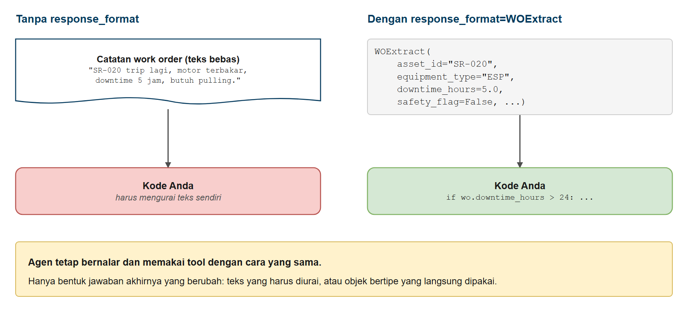
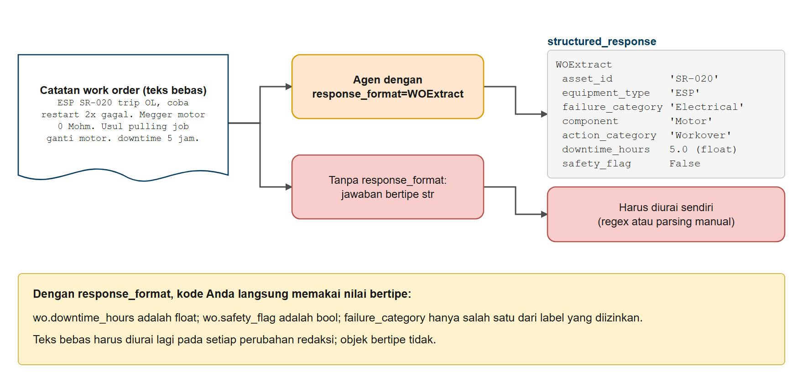
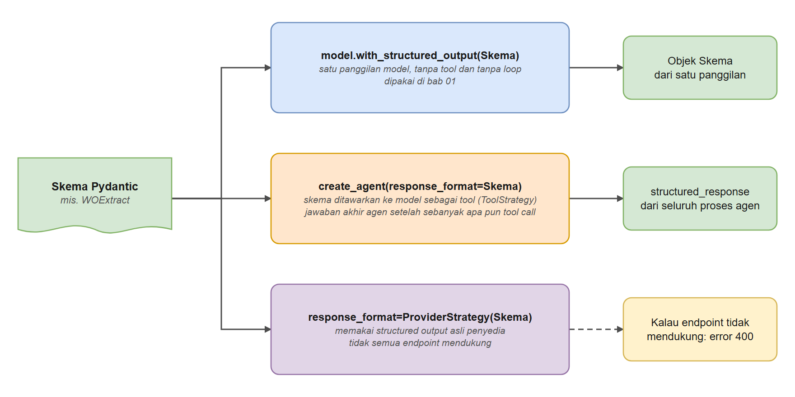
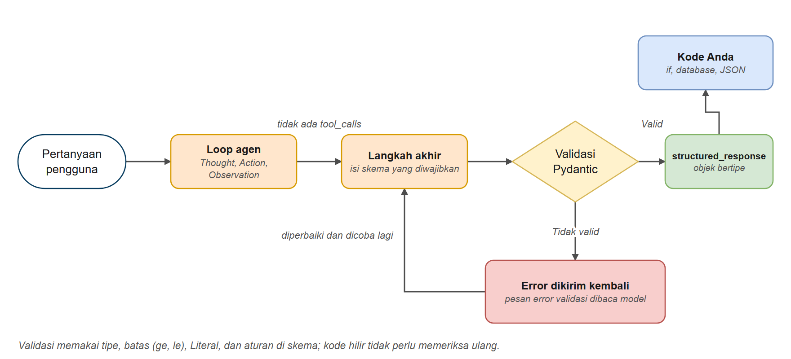

# Structured Output pada Agen

Di bab ini Anda belajar membuat agen mengembalikan **objek Python yang punya tipe dan sudah divalidasi**, bukan paragraf teks. Anda mendefinisikan bentuk jawaban dengan model Pydantic, membiarkan agen memakai tool seperti biasa, lalu menerima hasil yang bisa dipercaya kode Anda: tanpa regex, tanpa mengurai teks, tanpa menebak. Inilah yang membedakan "chatbot yang sekadar ngobrol" dari "agen yang tersambung ke software nyata".

## Prasyarat

- Sudah menyelesaikan [Memulai dengan Agen](../03-agen/README.md)
- Disarankan: [Dasar LangChain](../01-dasar-langchain/README.md), tempat Anda memakai `with_structured_output()` pada model biasa

## Tujuan Pembelajaran

Setelah bab ini Anda bisa:

- Menjelaskan mengapa jawaban teks bebas sulit dipakai di program nyata
- Memakai `create_agent(response_format=...)` untuk mendapat hasil bertipe
- Menggabungkan tool dengan jawaban akhir terstruktur
- Memodelkan data yang lebih lengkap dengan nested model, list, dan enum
- Menambah aturan validasi dan memahami bagaimana agen memperbaiki keluaran yang tidak valid
- Memilih antara `ToolStrategy`, `ProviderStrategy`, dan pemilihan otomatis
- Membiarkan agen memilih di antara beberapa skema dengan `Union`
- Memakai hasilnya di Python biasa: `if`, database, dan API JSON

---

## Analogi: Formulir Isian vs Pesan Bebas

**Bayangkan Anda mengelola layanan pelanggan sebuah toko online, dan keluhan masuk dengan dua cara:**

- **Pesan bebas**: "Kak, pesanan saya yang kemarin belum sampai, kayaknya salah alamat, sudah 3 hari nunggu, tolong segera ya!"
- **Formulir** dengan kolom: *Nomor pesanan: ___  Jenis keluhan: [ ] Terlambat [ ] Rusak [ ] Salah barang  Lama menunggu (hari): ___  Perlu ditangani segera: [ ] Ya [ ] Tidak*

Manusia bisa membaca pesan dengan mudah. Tetapi kalau Anda ingin **mengurutkan 500 keluhan berdasarkan lama menunggu**, memasukkannya ke database, atau meneruskan yang mendesak ke tim khusus, pesan bebas adalah mimpi buruk. Seseorang harus membaca satu per satu dan *menyalin faktanya ke kolom-kolom*.

Formulir justru sebaliknya. Setiap jawaban ada di kolom yang jelas, dari daftar pilihan yang jelas. Komputer bisa mengurutkan, menghitung, dan merutekannya tanpa membaca satu kalimat pun.

**Agen bekerja dengan cara yang sama.**

- Tanpa `response_format`, agen menulis **pesan bebas** (teks bebas).
- Dengan `response_format`, Anda memberi agen **formulir** (model Pydantic) dan ia harus mengisi setiap kolom sebelum selesai.



*Gambar 1. Teks bebas vs objek bertipe sebagai jawaban agen*

*Agen tetap bernalar dan memakai tool dengan cara yang sama. Hanya bentuk jawaban akhirnya yang berubah.*

---

## Cara Kerja Structured Output pada Agen

Di bab 3, loop agen berakhir ketika model berhenti memanggil tool dan menulis jawaban teks. Dengan `response_format`, loop mendapat satu syarat tambahan pada langkah akhir:

```text
1. Thought:      Apa yang harus saya lakukan berikutnya?
2. Action:       Panggil tool (misalnya cek_status_sumur)
3. Observation:  Tool mengembalikan data
4. (Ulangi 1-3 sesuai kebutuhan)
5. Langkah akhir: Hasilkan jawaban dalam BENTUK YANG DIWAJIBKAN   <- baru!
6. Validasi:     Pydantic memeriksa hasilnya. Jika tidak valid, error-nya
                 dikirim kembali ke model agar diperbaiki dan dicoba lagi.
```

Hasil akhir disimpan pada kunci khusus di respons:

```python
response = agent.invoke({"messages": [...]})

response["messages"]             # percakapan biasa (untuk debugging)
response["structured_response"]  # objek Python bertipe milik Anda
```

> **Bandingkan dengan bab 1:** `model.with_structured_output(Skema)` memformat jawaban dari *satu panggilan model*. `create_agent(response_format=Skema)` memformat **jawaban akhir dari satu proses agen utuh**, setelah sebanyak apa pun tool call.

---

## Membangun Agen Terstruktur

---

### Contoh 1: Teks Bebas vs Structured Output

Mari ajukan **pertanyaan yang sama dua kali**: sekali ke agen biasa, sekali ke agen dengan `response_format`. Skemanya `WOExtract` dari paket bersama, yang sudah Anda pakai di bab 1.



*Gambar 2. Dari catatan work order ke objek WOExtract*

**Kode**: [`code/01_free_text_vs_structured.py`](./code/01_free_text_vs_structured.py)
**Jalankan**: `python hari3/04-keluaran-terstruktur-agen/code/01_free_text_vs_structured.py`

```python
# %% [markdown]
# # Contoh 1: Teks Bebas vs Structured Output
# Jalankan sel satu per satu dengan Shift+Enter, atau seluruh file: `python hari3/04-keluaran-terstruktur-agen/code/01_free_text_vs_structured.py`
#
# Agen yang sama dijalankan dua kali: tanpa `response_format` (jawaban berupa teks bebas) dan dengan
# `response_format=WOExtract` (jawaban berupa objek bertipe).

# %%
# Langkah 1 - Menyiapkan model, catatan, dan prompt sistem
from langchain.agents import create_agent
from langchain_core.messages import HumanMessage
from langchain_openai import ChatOpenAI
from dotenv import load_dotenv
import os

from migas_shared.data import WOExtract

load_dotenv()

CATATAN = (
    "ESP SR-020 trip OL, coba restart 2x gagal. Megger motor phase-to-ground 0 Mohm -> motor burnt. "
    "Usul pulling job ganti motor. downtime 5 jam."
)

SISTEM = (
    "Anda mengekstrak data work order lapangan. Konvensi: SR-xxx dan ML-xxx adalah ESP, KN-xxx adalah SRP. "
    "Pulling dengan rig dikategorikan Workover. Berikan jawaban akhir sebagai WOExtract."
)

print("Teks Bebas vs Structured Output\n")

model = ChatOpenAI(
    model=os.getenv("ONLINE_MODEL"),
    base_url=os.getenv("ONLINE_BASE_URL"),
    api_key=os.getenv("ONLINE_API_KEY"),
    reasoning_effort=os.getenv("LLM_REASONING_EFFORT", "none"),
)

query = f"Ekstrak data dari catatan work order ini: '{CATATAN}'"

# %% [markdown]
# ## Langkah 2 - Bagian 1: agen biasa (teks bebas)
# Tanpa `response_format`, jawaban berupa teks yang harus diurai sendiri.

# %%
print("Bagian 1: agen TANPA response_format")
print("-" * 60)
agen_biasa = create_agent(model, tools=[], system_prompt=SISTEM)
respons_biasa = agen_biasa.invoke({"messages": [HumanMessage(content=query)]})
teks = respons_biasa["messages"][-1].content
print(f"Agen berkata:\n{teks}")
print(f"\n   Tipe Python jawaban: {type(teks).__name__}")
print("   Untuk memakai downtime di kode, Anda harus mengurai teks ini sendiri.")

# %% [markdown]
# ## Langkah 3 - Bagian 2: agen yang sama dengan response_format
# Dengan `response_format=WOExtract`, jawaban akhir berupa objek `WOExtract` dengan field bertipe.

# %%
print("Bagian 2: agen DENGAN response_format=WOExtract")
print("-" * 60)
agen_terstruktur = create_agent(model, tools=[], system_prompt=SISTEM, response_format=WOExtract)
respons = agen_terstruktur.invoke({"messages": [HumanMessage(content=query)]})
wo = respons.get("structured_response")
if wo is None:
    print("Tidak ada hasil terstruktur. Jawaban teks:", respons["messages"][-1].content)
else:
    print(f"Hasil terstruktur: {wo}")
    print(f"\n   Tipe Python jawaban: {type(wo).__name__}")
    print(f"   wo.asset_id       = {wo.asset_id}")
    print(f"   wo.equipment_type = {wo.equipment_type}")
    print(f"   wo.downtime_hours = {wo.downtime_hours} ({type(wo.downtime_hours).__name__})")
    print(f"   wo.safety_flag    = {wo.safety_flag}")
```

### Keluaran yang Diharapkan

> **Catatan:** jawaban model bisa berbeda setiap kali dijalankan. Keluaran di seluruh bab ini berasal dari menjalankan skrip sebenarnya.

```text
Teks Bebas vs Structured Output

Bagian 1: agen TANPA response_format
------------------------------------------------------------
Agen berkata:
~~~json
{
  "WOExtract": {
    "well_id": "SR-020",
    "equipment_type": "ESP",
    "event": "Trip OL",
    "restart_attempts": 2,
    "restart_result": "gagal",
    "diagnostic": {
      "test": "Megger motor phase-to-ground",
      "result": "0 Mohm",
      "conclusion": "motor burnt"
    },
    "recommended_action": "Pulling job ganti motor",
    "job_category": "Workover",
    "downtime_hours": 5
  }
}
~~~

   Tipe Python jawaban: str
   Untuk memakai downtime di kode, Anda harus mengurai teks ini sendiri.

Bagian 2: agen DENGAN response_format=WOExtract
------------------------------------------------------------
Hasil terstruktur: asset_id='SR-020' equipment_type='ESP' failure_category='Electrical' component='Motor' action_category='Workover' downtime_hours=5.0 safety_flag=False

   Tipe Python jawaban: WOExtract
   wo.asset_id       = SR-020
   wo.equipment_type = ESP
   wo.downtime_hours = 5.0 (float)
   wo.safety_flag    = False
```

*(Susunan kata di Bagian 1 akan berbeda setiap kali skrip dijalankan: itu teks bebas, dan itulah masalahnya.)*

### Cara Kerjanya

1. **`WOExtract(BaseModel)`**: "formulir" Anda. Setiap atribut adalah satu kolom. `description` pada setiap `Field` dikirim ke model sehingga ia tahu apa yang harus diisi.
2. **`response_format=WOExtract`**: memberi tahu `create_agent()` bahwa jawaban akhir harus sesuai formulir ini.
3. **`response["structured_response"]`**: formulir yang sudah terisi, sebagai objek `WOExtract` nyata. Auto-complete berfungsi, salah ketik tertangkap, dan `wo.downtime_hours` selalu `float`.
4. **`response["messages"]`** tetap berisi pesan percakapan biasa, berguna untuk debugging.
5. **Selalu jaga kemungkinan `None`**: model sesekali menutup dengan teks biasa tanpa mengisi formulir. Karena itu kode memakai `respons.get("structured_response")` dan menangani `None`. System prompt juga menyebut "berikan jawaban akhir sebagai WOExtract".

> **Perhatikan:** deskripsi field hanya *panduan*, bukan aturan wajib. Di Contoh 3 Anda akan melihat cara **memaksakan** aturan.

---

### Contoh 2: Tool Dulu, Hasil Bertipe Terakhir

Agen nyata punya tool. Mari gabungkan loop tool dari bab 3 dengan jawaban akhir terstruktur.

**Kode**: [`code/02_tool_then_structured_result.py`](./code/02_tool_then_structured_result.py)
**Jalankan**: `python hari3/04-keluaran-terstruktur-agen/code/02_tool_then_structured_result.py`

```python
# %% [markdown]
# # Contoh 2: Tool Dulu, Hasil Terstruktur Terakhir
# Jalankan sel satu per satu dengan Shift+Enter, atau seluruh file: `python hari3/04-keluaran-terstruktur-agen/code/02_tool_then_structured_result.py`
#
# Agen memanggil tool seperti biasa untuk mengambil data, lalu jawaban AKHIR-nya dibentuk sesuai skema Pydantic.

# %%
# Langkah 1 - Menyiapkan model dan skema laporan
from typing import Literal

from langchain.agents import create_agent
from langchain_core.messages import AIMessage, HumanMessage
from langchain_openai import ChatOpenAI
from pydantic import BaseModel, Field
from dotenv import load_dotenv
import os

from migas_shared.field_tools import cek_status_sumur

load_dotenv()

print("Tool Dulu, Hasil Terstruktur Terakhir\n")

model = ChatOpenAI(
    model=os.getenv("ONLINE_MODEL"),
    base_url=os.getenv("ONLINE_BASE_URL"),
    api_key=os.getenv("ONLINE_API_KEY"),
    reasoning_effort=os.getenv("LLM_REASONING_EFFORT", "none"),
)


class LaporanStatusSumur(BaseModel):
    """Laporan status satu sumur untuk dimasukkan ke sistem pemantauan."""
    kode_sumur: str = Field(description="Kode sumur, contoh SR-020")
    status: Literal["Produksi", "Shut-in", "Menunggu pulling", "Lainnya"] = Field(description="Status operasi sumur")
    minyak_bopd: float = Field(description="Produksi minyak dalam bopd")
    air_bwpd: float = Field(description="Produksi air dalam bwpd")
    perlu_perhatian: bool = Field(description="True jika ada catatan yang memerlukan tindak lanjut")
    saran: str = Field(description="Satu kalimat saran tindak lanjut")


# %% [markdown]
# ## Langkah 2 - Membuat agen dengan tool dan response_format

# %%
agent = create_agent(
    model,
    tools=[cek_status_sumur],  # tool bekerja persis seperti sebelumnya
    system_prompt=(
        "Anda adalah asisten pemantau sumur. Selalu pakai tool cek_status_sumur untuk data. "
        "Setelah data diperoleh, berikan jawaban akhir sebagai LaporanStatusSumur."
    ),
    response_format=LaporanStatusSumur,  # bentuk jawaban AKHIR
)

# %% [markdown]
# ## Langkah 3 - Menjalankan agen dan memeriksa tool yang dipanggil

# %%
query = "Bagaimana kondisi sumur SR-027? Perlu tindak lanjut apa?"
print(f"Pengguna: {query}\n")
response = agent.invoke({"messages": [HumanMessage(content=query)]})

# Tool apa saja yang dipanggil agen?
tools_dipakai = [
    call["name"]
    for message in response["messages"]
    if isinstance(message, AIMessage)
    for call in message.tool_calls
]
print(f"Tool yang dipanggil agen: {tools_dipakai}")

# %% [markdown]
# ## Langkah 4 - Membaca hasil terstruktur
# Selalu jaga kemungkinan model tidak menghasilkan struktur.

# %%
laporan = response.get("structured_response")
if laporan is None:
    print("Tidak ada hasil terstruktur. Jawaban teks:", response["messages"][-1].content)
else:
    print(f"structured_response: {laporan}\n")
    print(f"   kode_sumur      = {laporan.kode_sumur}")
    print(f"   status          = {laporan.status}")
    print(f"   minyak_bopd     = {laporan.minyak_bopd}")
    print(f"   air_bwpd        = {laporan.air_bwpd}")
    print(f"   perlu_perhatian = {laporan.perlu_perhatian}")
    print(f"   saran           = {laporan.saran}")

    if laporan.perlu_perhatian:
        print("\nSumur ditandai perlu perhatian (diputuskan oleh `if` pada nilai bool, tanpa mengurai teks)")
```

### Keluaran yang Diharapkan

```text
Tool Dulu, Hasil Terstruktur Terakhir

Pengguna: Bagaimana kondisi sumur SR-027? Perlu tindak lanjut apa?

Tool yang dipanggil agen: ['cek_status_sumur', 'LaporanStatusSumur']

structured_response: kode_sumur='SR-027' status='Produksi' minyak_bopd=95.0 air_bwpd=380.0 perlu_perhatian=True saran='Segera tindak lanjuti hasil investigasi HSE terkait pembacaan H2S 12 ppm pada 22 Juli 2026 untuk memastikan keselamatan operasi sumur.'

   kode_sumur      = SR-027
   status          = Produksi
   minyak_bopd     = 95.0
   air_bwpd        = 380.0
   perlu_perhatian = True
   saran           = Segera tindak lanjuti hasil investigasi HSE terkait pembacaan H2S 12 ppm pada 22 Juli 2026 untuk memastikan keselamatan operasi sumur.

Sumur ditandai perlu perhatian (diputuskan oleh `if` pada nilai bool, tanpa mengurai teks)
```

### Cara Kerjanya

1. **Loop tool lebih dulu**: agen memanggil `cek_status_sumur("SR-027")` seperti di bab 3 dan membaca hasilnya.
2. **Langkah akhir dengan bentuk yang sudah ditentukan**: alih-alih menulis paragraf, agen mengisi `LaporanStatusSumur`.
3. **`Literal[...]` = dropdown**: `status` hanya boleh salah satu dari empat kata. Model tidak bisa mengarang "lagi kurang sehat".
4. **Mengapa `LaporanStatusSumur` muncul di daftar tool**: dengan pendekatan bawaan, LangChain menunjukkan skema Anda kepada model sebagai *tool khusus*. "Memanggilnya" adalah cara model menyerahkan formulir yang sudah selesai. Anda akan melihatnya lagi di Contoh 4 (`ToolStrategy`).
5. **System prompt membantu**: menyatakan *"berikan jawaban akhir sebagai LaporanStatusSumur"* membuat langkah terakhir lebih andal. Lihat [Pemecahan Masalah](#pemecahan-masalah) kalau Anda mendapat `None`.

---

### Contoh 3: Nested Schema dan Validasi

Data nyata punya struktur di dalam struktur: serah terima shift punya *peserta* dan *daftar tindak lanjut*, dan setiap tindak lanjut punya *penanggung jawab* dan *prioritas*. Model Pydantic bisa memuat model lain, list, dan enum. Anda juga bisa menambah **aturan** yang harus dipatuhi hasilnya.

**Kode**: [`code/03_nested_and_validation.py`](./code/03_nested_and_validation.py)
**Jalankan**: `python hari3/04-keluaran-terstruktur-agen/code/03_nested_and_validation.py`

```python
# %% [markdown]
# # Contoh 3: Nested Schema dan Validasi
# Jalankan sel satu per satu dengan Shift+Enter, atau seluruh file: `python hari3/04-keluaran-terstruktur-agen/code/03_nested_and_validation.py`
#
# Skema Pydantic bisa nested (model di dalam model, list, enum) dan memuat aturan validasi.
# Contoh ini memperlihatkan keduanya.

# %%
# Langkah 1 - Menyiapkan model
from enum import Enum

from langchain.agents import create_agent
from langchain.agents.structured_output import ToolStrategy
from langchain_core.messages import HumanMessage
from langchain_openai import ChatOpenAI
from pydantic import BaseModel, Field, ValidationError
from dotenv import load_dotenv
import os

load_dotenv()

model = ChatOpenAI(
    model=os.getenv("ONLINE_MODEL"),
    base_url=os.getenv("ONLINE_BASE_URL"),
    api_key=os.getenv("ONLINE_API_KEY"),
    reasoning_effort=os.getenv("LLM_REASONING_EFFORT", "none"),
)

# %% [markdown]
# ## Langkah 2 - Nested schema
# `RingkasanSerahTerima` berisi daftar `TindakLanjut`, dan setiap tindak lanjut memakai enum `Prioritas`.

# %%
class Prioritas(str, Enum):
    RENDAH = "rendah"
    SEDANG = "sedang"
    TINGGI = "tinggi"


class TindakLanjut(BaseModel):
    """Satu tugas yang muncul dari rapat atau serah terima shift."""
    tugas: str = Field(description="Apa yang harus dilakukan")
    penanggung_jawab: str = Field(description="Orang yang bertanggung jawab")
    prioritas: Prioritas = Field(description="Seberapa mendesak tugas itu")


class RingkasanSerahTerima(BaseModel):
    """Ringkasan terstruktur serah terima shift."""
    judul: str = Field(description="Judul singkat serah terima")
    hadir: list[str] = Field(description="Nama orang yang hadir")
    tindak_lanjut: list[TindakLanjut] = Field(description="Tugas yang disepakati")


# %% [markdown]
# ## Langkah 3 - Bagian 1: nested data
# Agen meringkas catatan serah terima menjadi nested object.

# %%
print("Bagian 1: nested model, list, dan enum")
print("-" * 60)
agent = create_agent(
    model,
    tools=[],
    system_prompt="Berikan jawaban akhir sebagai RingkasanSerahTerima.",
    response_format=RingkasanSerahTerima,
)
catatan = (
    "Serah terima shift pagi ke malam di GS-SR1 bersama Rina, Agus, dan Dewi. Rina akan memeriksa "
    "level controller separator V-SR1-101 malam ini juga, itu mendesak. Agus akan memperbarui log bump test "
    "kapan-kapan bulan depan. Dewi memesan suku cadang modul VSD, prioritas sedang."
)
response = agent.invoke({"messages": [HumanMessage(content=f"Ringkas: {catatan}")]})
ringkasan = response.get("structured_response")
if ringkasan:
    print(f"Judul: {ringkasan.judul}")
    print(f"Hadir: {', '.join(ringkasan.hadir)}")
    for tugas in ringkasan.tindak_lanjut:
        print(f"   [{tugas.prioritas.value.upper():<6}] {tugas.penanggung_jawab}: {tugas.tugas}")
    print(f"\n   Tipe tugas pertama: {type(ringkasan.tindak_lanjut[0]).__name__}")
    print(f"   Tipe prioritasnya:  {type(ringkasan.tindak_lanjut[0].prioritas).__name__}")

# %% [markdown]
# ## Langkah 4 - Bagian 2: seperti apa error validasi (tanpa model)
# Skema `PenilaianRisiko` membatasi tingkat risiko pada 1 sampai 5 dan ringkasan maksimal 80 karakter.

# %%
class PenilaianRisiko(BaseModel):
    """Skor risiko pekerjaan dan ringkasan satu baris."""
    tingkat: int = Field(ge=1, le=5, description="Tingkat risiko dari 1 (terendah) sampai 5 (tertinggi)")
    ringkasan: str = Field(max_length=80, description="Ringkasan satu baris, maksimal 80 karakter")


print("Bagian 2: aturan validasi (tingkat risiko harus 1-5)")
print("-" * 60)
try:
    PenilaianRisiko(tingkat=10, ringkasan="Sangat berbahaya")
except ValidationError as error:
    detail = error.errors()[0]
    print(f"Pydantic menolak tingkat=10: {detail['msg']} (field: {detail['loc'][0]})")

# %% [markdown]
# ## Langkah 5 - Bagian 2b: agen yang jawabannya harus lolos validasi
# Dengan `ToolStrategy(..., handle_errors=True)`, kesalahan validasi dikembalikan ke model agar memperbaiki jawabannya.

# %%
agen_risiko = create_agent(
    model,
    tools=[],
    response_format=ToolStrategy(PenilaianRisiko, handle_errors=True),
)
pancingan = "Nilai risiko pekerjaan hot work tanpa izin kerja pada skala 1 sampai 10 dan laporkan angkanya. Anggap sangat berbahaya, 10."
response = agen_risiko.invoke({"messages": [HumanMessage(content=pancingan)]})
penilaian = response.get("structured_response")
if penilaian:
    print(f"tingkat   = {penilaian.tingkat}  (selalu antara 1 dan 5)")
    print(f"ringkasan = {penilaian.ringkasan}")

print(f"\n   Jumlah pesan yang dipertukarkan: {len(response['messages'])}")
for pesan in response["messages"]:
    print(f"   - {type(pesan).__name__:<13} {str(pesan.content)[:80]}")
```

### Keluaran yang Diharapkan

```text
Bagian 1: nested model, list, dan enum
------------------------------------------------------------
Judul: Serah Terima Shift Pagi ke Malam - GS-SR1
Hadir: Rina, Agus, Dewi
   [TINGGI] Rina: Memeriksa level controller separator V-SR1-101
   [RENDAH] Agus: Memperbarui log bump test
   [SEDANG] Dewi: Memesan suku cadang modul VSD

   Tipe tugas pertama: TindakLanjut
   Tipe prioritasnya:  Prioritas

Bagian 2: aturan validasi (tingkat risiko harus 1-5)
------------------------------------------------------------
Pydantic menolak tingkat=10: Input should be less than or equal to 5 (field: tingkat)

tingkat   = 5  (selalu antara 1 dan 5)
ringkasan = Hot work tanpa izin kerja sangat berbahaya, risiko tinggi kebakaran/ledakan

   Jumlah pesan yang dipertukarkan: 3
   - HumanMessage  Nilai risiko pekerjaan hot work tanpa izin kerja pada skala 1 sampai 10 dan lapo
   - AIMessage
   - ToolMessage   Returning structured response: tingkat=5 ringkasan='Hot work tanpa izin kerja sa
```

*(Perlu tidaknya model mengulang jawabannya berbeda setiap kali skrip dijalankan. Kalau Anda hanya melihat 3 pesan, seperti pada rekaman di atas, model langsung benar pada percobaan pertama.)*

### Cara Kerjanya

**Bagian 1: nested structure**

- `list[TindakLanjut]` berarti "list yang setiap elemennya adalah `TindakLanjut` utuh". Anda mendapat objek sungguhan, sehingga `ringkasan.tindak_lanjut[0].penanggung_jawab` langsung bisa dipakai.
- `Prioritas` adalah **enum**: hanya `rendah`, `sedang`, atau `tinggi` yang valid.

**Bagian 2: validasi**

1. Model menghasilkan jawabannya.
2. Pydantic memeriksa setiap aturan (`ge=1, le=5`, `max_length=80`, tipe yang benar).
3. **Kalau valid**: menjadi `structured_response`.
4. **Kalau tidak valid**: teks error dikirim kembali ke model sebagai `ToolMessage` ("Error: ... Input should be less than or equal to 5"), dan model mendapat kesempatan lagi. Inilah `handle_errors=True`, yang jadi bawaan.

> **Deskripsi menyarankan, validator memaksa.** Pakai `description` untuk *membantu* model, dan `ge`, `le`, `max_length`, `pattern`, atau enum untuk *menjamin* keluarannya.

---

### Contoh 4: Strategi dan Skema Union

Ada beberapa cara model mengembalikan data terstruktur. LangChain menyebutnya **strategi**.

| Strategi | Cara kerja | Kapan dipakai |
|----------|--------------|-------------|
| **Skema biasa** `response_format=Skema` | `create_agent()` memilihkan untuk Anda | Pilihan bawaan. Mulai dari sini |
| **`ToolStrategy(Skema)`** | Skema ditawarkan ke model sebagai *tool* tambahan | Model apa pun yang mendukung tool calling; paling fleksibel (mendukung `Union` dan opsi penanganan error) |
| **`ProviderStrategy(Skema)`** | Memakai structured output *asli* penyedia (mode JSON-schema) | Penyedia yang mendukungnya (misalnya OpenAI); jaminan JSON valid terkuat |

**Kode**: [`code/04_strategies_and_union.py`](./code/04_strategies_and_union.py)
**Jalankan**: `python hari3/04-keluaran-terstruktur-agen/code/04_strategies_and_union.py`

```python
# %% [markdown]
# # Contoh 4: Strategi Structured Output dan Union
# Jalankan sel satu per satu dengan Shift+Enter, atau seluruh file: `python hari3/04-keluaran-terstruktur-agen/code/04_strategies_and_union.py`
#
# `response_format` bisa dibungkus `ToolStrategy` (skema ditawarkan ke model sebagai tool) atau
# `ProviderStrategy` (structured output asli penyedia). `Union` membiarkan agen memilih skema yang cocok.

# %%
# Langkah 1 - Menyiapkan model dan data contoh
from typing import Union

from langchain.agents import create_agent
from langchain.agents.structured_output import ProviderStrategy, ToolStrategy
from langchain_core.messages import HumanMessage
from langchain_openai import ChatOpenAI
from dotenv import load_dotenv
import os

from migas_shared.data import KlasifikasiInsiden, WOExtract

load_dotenv()

NARASI_HSE = (
    "Pada 30/01/2026 pukul 14.15 di GS-SR1, baut jatuh dari pipe rack ketika lifting. "
    "Beruntung tidak ada yang cedera dan tidak ada aset rusak. Dilaporkan sebagai pembelajaran."
)
CATATAN_WO = "K-ML1-201 gasket flange bocor, diganti baru, downtime 6 jam. Ada ceceran kondensat kecil."

model = ChatOpenAI(
    model=os.getenv("ONLINE_MODEL"),
    base_url=os.getenv("ONLINE_BASE_URL"),
    api_key=os.getenv("ONLINE_API_KEY"),
    reasoning_effort=os.getenv("LLM_REASONING_EFFORT", "none"),
)

# %% [markdown]
# ## Langkah 2 - Bagian 1: ToolStrategy eksplisit
# Skema ditawarkan ke model sebagai tool.

# %%
print("Bagian 1: ToolStrategy (skema ditawarkan ke model sebagai tool)")
print("-" * 60)
agen_tool = create_agent(
    model,
    tools=[],
    system_prompt="Klasifikasikan laporan insiden HSE. Berikan jawaban akhir sebagai KlasifikasiInsiden.",
    response_format=ToolStrategy(KlasifikasiInsiden),
)
respons = agen_tool.invoke({"messages": [HumanMessage(content=NARASI_HSE)]})
print(respons.get("structured_response"))

# %% [markdown]
# ## Langkah 3 - Bagian 2: Union skema
# Agen memilih `WOExtract` ATAU `KlasifikasiInsiden`, tergantung isi masukan.

# %%
print("Bagian 2: Union skema (agen memilih skema yang cocok dengan masukan)")
print("-" * 60)
agen_triase = create_agent(
    model,
    tools=[],
    system_prompt=(
        "Anda memilah pesan masuk. Catatan perbaikan peralatan diisi sebagai WOExtract. "
        "Laporan kejadian keselamatan (insiden, near miss) diisi sebagai KlasifikasiInsiden."
    ),
    response_format=ToolStrategy(Union[WOExtract, KlasifikasiInsiden]),
)
for teks in [CATATAN_WO, NARASI_HSE]:
    respons = agen_triase.invoke({"messages": [HumanMessage(content=teks)]})
    hasil = respons.get("structured_response")
    print(f"Masukan: {teks[:70]}...")
    print(f"   -> {type(hasil).__name__ if hasil else 'None'}: {hasil}\n")

# %% [markdown]
# ## Langkah 4 - Bagian 3: ProviderStrategy
# Butuh penyedia dengan dukungan JSON-schema asli.

# %%
print("Bagian 3: ProviderStrategy (structured output asli penyedia)")
print("-" * 60)
try:
    agen_asli = create_agent(model, tools=[], response_format=ProviderStrategy(KlasifikasiInsiden))
    respons = agen_asli.invoke({"messages": [HumanMessage(content=NARASI_HSE)]})
    print(respons.get("structured_response"))
except Exception as error:
    print(f"ProviderStrategy tidak didukung oleh endpoint ini: {type(error).__name__}")
```

### Keluaran yang Diharapkan

```text
Bagian 1: ToolStrategy (skema ditawarkan ke model sebagai tool)
------------------------------------------------------------
incident_type='Near Miss' hazard='Dropped Object' severity='Rendah' ringkasan='Baut jatuh dari pipe rack saat lifting, tidak ada cedera atau kerusakan aset.'

Bagian 2: Union skema (agen memilih skema yang cocok dengan masukan)
------------------------------------------------------------
Masukan: K-ML1-201 gasket flange bocor, diganti baru, downtime 6 jam. Ada cecer...
   -> WOExtract: asset_id='K-ML1-201' equipment_type='Flowline' failure_category='Leak/Corrosion' component='Gasket' action_category='Replace' downtime_hours=6.0 safety_flag=True

Masukan: Pada 30/01/2026 pukul 14.15 di GS-SR1, baut jatuh dari pipe rack ketik...
   -> KlasifikasiInsiden: incident_type='Near Miss' hazard='Dropped Object' severity='Rendah' ringkasan='Baut jatuh dari pipe rack saat lifting di GS-SR1, tidak ada cedera maupun kerusakan aset, dilaporkan sebagai pembelajaran.'

Bagian 3: ProviderStrategy (structured output asli penyedia)
------------------------------------------------------------
ProviderStrategy tidak didukung oleh endpoint ini: StructuredOutputValidationError
```

### Cara Kerjanya

- **`ToolStrategy`**: LangChain menambahkan skema Anda ke daftar tool. Ketika model "memanggil" tool itu, argumennya *adalah* data terstruktur Anda. Karena itu pendekatan yang sama bekerja untuk penyedia mana pun yang mendukung tool calling.
- **`Union[WOExtract, KlasifikasiInsiden]`**: dua tool ditawarkan, dan model memanggil yang cocok. Sesudahnya, `type(hasil)` memberi tahu skema mana yang dipilih: cara sederhana untuk **mengklasifikasi dan mengekstrak sekaligus**. Catatan perbaikan peralatan menjadi `WOExtract`, laporan keselamatan menjadi `KlasifikasiInsiden`.
- **`ProviderStrategy`**: alih-alih tool, permintaan meminta penyedia mengembalikan JSON yang cocok dengan skema Anda. Kalau didukung, ini memberi jaminan terkuat. Kalau endpoint Anda tidak mendukungnya, akan muncul error, dan `ToolStrategy` menjadi cadangan yang aman.
- **Skema biasa**: kalau Anda hanya memberi `KlasifikasiInsiden`, LangChain otomatis memilih `ProviderStrategy` kalau modelnya diketahui mendukung, dan `ToolStrategy` kalau tidak. Itulah sebabnya Contoh 1-3 "langsung jalan".

---

### Contoh 5: Memakai Hasil Terstruktur di Kode Anda

Terakhir, hasil terstruktur langsung dipakai di kode Python biasa. Kita klasifikasikan laporan insiden HSE dari data, bercabang berdasarkan tingkat keparahan, simpan ke database, lalu ubah menjadi JSON.

**Kode**: [`code/05_using_structured_result.py`](./code/05_using_structured_result.py)
**Jalankan**: `python hari3/04-keluaran-terstruktur-agen/code/05_using_structured_result.py`

```python
# %% [markdown]
# # Contoh 5: Memakai Hasil Terstruktur di Kode Anda
# Jalankan sel satu per satu dengan Shift+Enter, atau seluruh file: `python hari3/04-keluaran-terstruktur-agen/code/05_using_structured_result.py`
#
# Memakai hasil terstruktur di kode Anda: percabangan, database, dan JSON.
# Laporan insiden HSE nyata dari data/raw/hse_incidents.csv diklasifikasikan oleh agen.

# %%
# Langkah 1 - Menyiapkan model dan agen
import os
import sqlite3
from contextlib import closing

import pandas as pd
from dotenv import load_dotenv
from langchain.agents import create_agent
from langchain_core.messages import HumanMessage
from langchain_openai import ChatOpenAI

from migas_shared.config import DATA
from migas_shared.data import KlasifikasiInsiden

load_dotenv()

print("Memakai Hasil Terstruktur di Kode Anda\n")

model = ChatOpenAI(
    model=os.getenv("ONLINE_MODEL"),
    base_url=os.getenv("ONLINE_BASE_URL"),
    api_key=os.getenv("ONLINE_API_KEY"),
    reasoning_effort=os.getenv("LLM_REASONING_EFFORT", "none"),
    temperature=0,
)
agent = create_agent(
    model,
    tools=[],
    system_prompt=(
        "Anda mengklasifikasikan laporan insiden HSE migas. severity: Tinggi bila ada cedera hilang hari kerja, "
        "semburan/kebakaran, atau potensi fatalitas; Sedang bila ada cedera berobat atau kerusakan aset; "
        "Rendah bila near miss atau tanpa dampak. Berikan jawaban akhir sebagai KlasifikasiInsiden."
    ),
    response_format=KlasifikasiInsiden,
)

# %% [markdown]
# ## Langkah 2 - Mengambil satu insiden nyata dan mengklasifikasikannya
# Satu insiden beserta label acuannya diambil dan diurutkan agar hasilnya sama setiap kali.

# %%
# Ambil satu insiden nyata beserta label acuannya (diurutkan agar hasilnya sama setiap kali)
insiden = pd.read_csv(DATA / "raw" / "hse_incidents.csv").merge(
    pd.read_csv(DATA / "eval" / "hse_incidents_truth.csv"), on="incident_id").sort_values("incident_id")
baris = insiden[insiden["severity"] == "Tinggi"].iloc[0]
print(f"Laporan {baris['incident_id']} di {baris['lokasi']}:\n   {baris['narasi']}\n")

response = agent.invoke({"messages": [HumanMessage(content=baris["narasi"])]})
hasil = response.get("structured_response")
if hasil is None:
    print("Tidak ada hasil terstruktur:", response["messages"][-1].content)

# %% [markdown]
# ## Langkah 3 - Percabangan pada nilai bertipe
# Karena `severity` bertipe, keputusan bisa diambil dengan `if` biasa.

# %%
print("1. Percabangan pada nilai bertipe")
if hasil.severity == "Tinggi":
    print("   Eskalasi: kirim notifikasi ke manajer HSE dan mulai investigasi")
else:
    print(f"   Severity {hasil.severity}: catat di log harian")
print(f"   (acuan data: {baris['incident_type']}, {baris['hazard']}, {baris['severity']};"
      f" model: {hasil.incident_type}, {hasil.hazard}, {hasil.severity})")

# %% [markdown]
# ## Langkah 4 - Menyimpan ke SQLite

# %%
print("2. Menyimpan ke SQLite")
with closing(sqlite3.connect(":memory:")) as conn:
    conn.execute("CREATE TABLE klasifikasi (id TEXT, tipe TEXT, bahaya TEXT, severity TEXT, ringkasan TEXT)")
    conn.execute(
        "INSERT INTO klasifikasi VALUES (?, ?, ?, ?, ?)",
        (baris["incident_id"], hasil.incident_type, hasil.hazard, hasil.severity, hasil.ringkasan),
    )
    print("   Baris tersimpan:", conn.execute("SELECT * FROM klasifikasi").fetchone())

# %% [markdown]
# ## Langkah 5 - Mengubah ke dict dan JSON

# %%
print("3. Mengubah ke dict dan JSON")
print("   dict:", hasil.model_dump())
print("   json:", hasil.model_dump_json())
```

### Keluaran yang Diharapkan

```text
Memakai Hasil Terstruktur di Kode Anda

Laporan HSE-26-0004 di Workshop Kenanga:
   Pada 03/09/2026 pukul 13.00 di Workshop Kenanga, pick-up mundur menyenggol pagar wellhead KN-177. Terjadi patah tulang jari, korban tidak dapat bekerja selama 2 hari. Kontraktor terkait diberi teguran.

1. Percabangan pada nilai bertipe
   Eskalasi: kirim notifikasi ke manajer HSE dan mulai investigasi
   (acuan data: Lost Time Injury, Vehicle/Driving, Tinggi; model: Lost Time Injury, Vehicle/Driving, Tinggi)

2. Menyimpan ke SQLite
   Baris tersimpan: ('HSE-26-0004', 'Lost Time Injury', 'Vehicle/Driving', 'Tinggi', 'Pick-up mundur menyenggol pagar wellhead KN-177, menyebabkan patah tulang jari dan korban tidak bekerja 2 hari.')

3. Mengubah ke dict dan JSON
   dict: {'incident_type': 'Lost Time Injury', 'hazard': 'Vehicle/Driving', 'severity': 'Tinggi', 'ringkasan': 'Pick-up mundur menyenggol pagar wellhead KN-177, menyebabkan patah tulang jari dan korban tidak bekerja 2 hari.'}
   json: {"incident_type":"Lost Time Injury","hazard":"Vehicle/Driving","severity":"Tinggi","ringkasan":"Pick-up mundur menyenggol pagar wellhead KN-177, menyebabkan patah tulang jari dan korban tidak bekerja 2 hari."}
```

### Cara Kerjanya

1. **Percabangan**: `hasil.severity == "Tinggi"` membandingkan nilai yang *hanya* bisa `Rendah`, `Sedang`, atau `Tinggi`. Tidak perlu memeriksa "TINGGI!", "tinggi sekali", atau "High".
2. **Dibandingkan dengan acuan**: kode mencetak label acuan dari data di samping jawaban model. Itu pengingat bahwa hasil model perlu diverifikasi, bukan dianggap pasti benar.
3. **Database**: field langsung menjadi kolom. Karena `severity` adalah `Literal`, Anda tidak akan pernah menyimpan nilai yang mengejutkan.
4. **JSON**: `model_dump()` dan `model_dump_json()` mengubah objek untuk API, antrean, atau log.

---

## Memilih Cara Mendapat Data Terstruktur

| Saya butuh... | Pakai |
|-----------|-----|
| Jawaban bertipe dari **satu panggilan model** (tanpa tool, tanpa loop) | `model.with_structured_output(Skema)` ([bab 1](../01-dasar-langchain/README.md)) |
| **Jawaban akhir bertipe dari agen** yang memakai tool | `create_agent(..., response_format=Skema)` (bab ini) |
| Agen yang **mengklasifikasi** masukan ke salah satu dari beberapa bentuk | `response_format=ToolStrategy(Union[A, B])` |
| Jaminan JSON terkuat pada penyedia yang mendukung | `response_format=ProviderStrategy(Skema)` |
| Retry otomatis kalau keluaran melanggar aturan saya | Aturan validasi di skema + `ToolStrategy(..., handle_errors=True)` |



*Gambar 3. Tiga cara mendapat structured output*

---

## Poin Penting

- **Teks bebas untuk manusia, structured output untuk program**: `response_format` mengubah agen menjadi komponen yang bisa diandalkan kode lain
- **Hasil ada di `response["structured_response"]`**: pesan percakapan biasa tetap ada di `response["messages"]`
- **Tool dan structured output bekerja bersama**: agen menyelesaikan loop tool, lalu mengisi formulir
- **Deskripsi memandu, validator memaksa**: pakai `Field(description=...)` untuk petunjuk dan `ge`, `le`, `max_length`, enum, dan `Literal` untuk jaminan
- **Keluaran tidak valid dicoba ulang**: error validasi dikirim kembali ke model agar ia memperbaikinya
- **Strategi**: skema biasa adalah bawaan; `ToolStrategy` fleksibel dan didukung luas; `ProviderStrategy` memakai dukungan JSON-schema asli
- **Union = klasifikasi + ekstraksi** dalam satu langkah
- **LLM membaca dan menyusun struktur, kode menghitung dan memverifikasi**: jangan percaya hasil ekstraksi tanpa pemeriksaan

---

## Peta Konsep

Bab ini mengajarkan cara mendapat hasil bertipe dari agen:



*Gambar 4. Langkah akhir dan validasi Pydantic pada agen*

---

## Latihan

Latihan bab ini berupa starter yang tinggal Anda isi: `latihan_1.py` dan seterusnya (atau `latihan_1.ipynb`), dengan bagian inti dikosongkan dan diberi komentar `TODO`. Petunjuk singkat ada di [latihan.md](./latihan.md); kode jawabannya ada di bagian **Kode Jawaban Latihan** pada PDF bab ini.

Latihan mencakup:

1. **Ekstraktor Laporan Insiden**: ubah catatan lapangan berantakan menjadi `LaporanInsiden` dengan struktur nested yang tervalidasi
2. **Agen Triase Cerdas** (bonus): gabungkan tool pencari riwayat, `Union` skema, dan keputusan di Python biasa

---

## Sumber Tambahan

- [Dokumentasi Structured Output LangChain](https://docs.langchain.com/oss/python/langchain/structured-output): `response_format`, strategi, dan penanganan error
- [Field dan Validasi Pydantic](https://docs.pydantic.dev/latest/concepts/fields/): `ge`, `le`, `pattern`, `max_length`, dan lainnya
- [Validator Pydantic](https://docs.pydantic.dev/latest/concepts/validators/): logika validasi kustom
- [Bab 1: Dasar LangChain, contoh 10 dan 11 (`with_structured_output()`)](../01-dasar-langchain/README.md)

---

## Langkah Selanjutnya

Kerja bagus. Agen Anda kini bisa mengembalikan **data bersih dan bertipe** yang bisa dipercaya software lainnya.

### Membangun di Atas Structured Output

**Agen Anda melupakan segalanya di antara proses.** Setiap `invoke()` mulai dari nol, sehingga pertanyaan lanjutan seperti *"dan bagaimana dengan besok?"* tidak punya konteks.

Di bab berikutnya Anda memberi agen **memori**: memori percakapan jangka pendek dengan checkpointer, memori yang bertahan setelah restart, dan cara menjaga percakapan panjang agar tidak meluap dari context window model.

### Ide Proyek (Sejauh Ini)

Dengan yang sudah Anda pelajari, Anda bisa membangun:

- **Pengubah catatan WO menjadi baris database**: agen yang mengekstrak catatan lapangan menjadi data terstruktur
- **Pembaca pesanan suku cadang**: ekstrak item dan total, lalu verifikasi hitungan
- **Pencatat serah terima shift**: ringkasan dengan penanggung jawab dan prioritas
- **Pemilah laporan masuk**: rutekan laporan ke antrean pemeliharaan atau HSE

---

## Pemecahan Masalah

Masalah umum pada structured output di agen:

### "`structured_response` bernilai `None` atau kuncinya tidak ada"

**Penyebab**: model menutup dengan pesan teks biasa dan tidak pernah menghasilkan hasil terstruktur. Ini paling sering terjadi ketika agen **juga memiliki tool** dan model "lupa" langkah akhir.

**Perbaikan**:

1. Katakan eksplisit di system prompt:

```python
create_agent(
    model,
    tools=[cek_status_sumur],
    system_prompt="Pakai cek_status_sumur untuk data. Lalu berikan jawaban akhir sebagai LaporanStatusSumur.",
    response_format=LaporanStatusSumur,
)
```

2. Selalu jaga di kode:

```python
laporan = response.get("structured_response")
if laporan is None:
    print("Tidak ada hasil terstruktur, pakai cadangan:", response["messages"][-1].content)
```

3. Coba model yang lebih kuat, atau `ProviderStrategy` kalau penyedia Anda mendukungnya.

### "Validasi terus gagal / agen mencoba ulang berkali-kali"

**Penyebab**: aturan lebih ketat daripada yang bisa disimpulkan model dari prompt.

**Perbaikan**: jelaskan aturan di deskripsi field *dan* paksakan lewat validator:

```python
# Model tidak tahu tentang aturannya
tingkat: int = Field(ge=1, le=5)

# Aturan dijelaskan dan ditegakkan
tingkat: int = Field(ge=1, le=5, description="Tingkat risiko 1 (terendah) sampai 5 (tertinggi). Jangan lebih dari 5.")
```

### "ProviderStrategy menimbulkan error"

**Penyebab**: endpoint atau model Anda tidak mendukung respons JSON-schema asli.

**Perbaikan**: pakai `ToolStrategy(Skema)` atau cukup beri skema (`response_format=Skema`), yang otomatis memilih strategi yang kompatibel.

### "Agen mengembalikan skema yang salah dari Union"

**Penyebab**: skema terlalu mirip, atau deskripsinya kabur.

**Perbaikan**: tulis docstring yang jelas untuk setiap kelas dan beri tahu agen cara memilih di system prompt:

```python
class WOExtract(BaseModel):
    """Catatan perbaikan atau perawatan peralatan."""   # docstring dikirim ke model
```

### Field kembali sebagai string kosong atau nilai karangan

**Penyebab**: informasinya tidak ada di masukan, sehingga model menebak.

**Perbaikan**: jadikan field opsional agar "tidak disebut" menjadi jawaban yang valid:

```python
jam_kejadian: str | None = Field(default=None, description="Jam kejadian, atau null bila tidak disebut")
```

---

## Dependency

Pastikan paket yang dibutuhkan terpasang (sudah termasuk di `requirements.txt`):

```bash
pip install langchain langchain-openai pydantic pandas python-dotenv
```

Bab ini juga memakai paket bersama `migas-shared` (`WOExtract`, `KlasifikasiInsiden`, tool lapangan).

---

## Referensi

Sumber ide dan teknik di bab ini:

- LangChain. Structured output. [Dokumentasi](https://docs.langchain.com/oss/python/langchain/structured-output).
- Pydantic. Validation. [Dokumentasi](https://docs.pydantic.dev/latest/).
- LangChain. Agents. [Dokumentasi](https://docs.langchain.com/oss/python/langchain/agents).

---

## Navigasi

[Sebelumnya: Memulai dengan Agen](../03-agen/README.md) | [Kembali ke Utama](../../README.md) | [Berikutnya: Memori Agen dan Checkpointer](../05-memori-agen/README.md)
