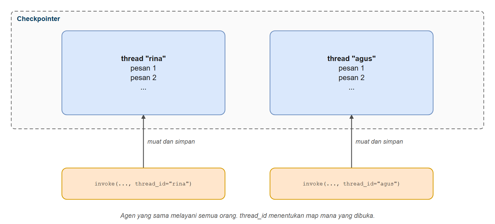
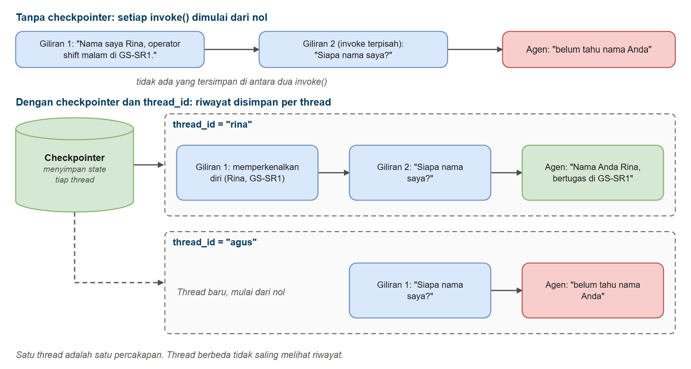
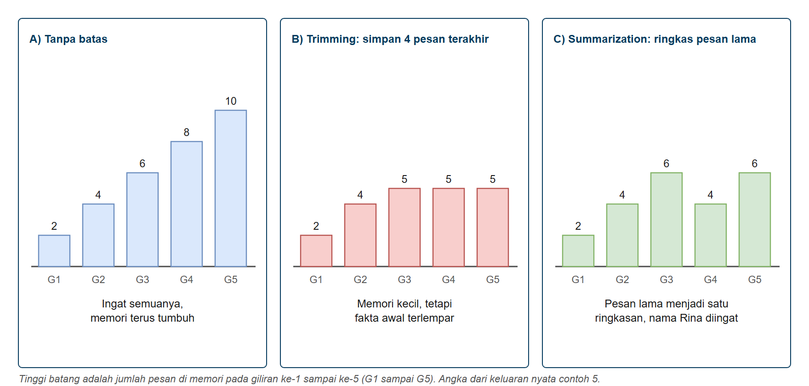
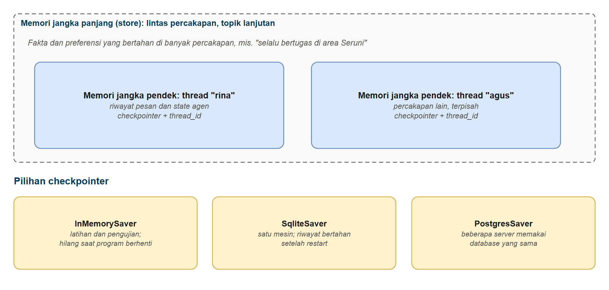

# Memori Agen dan Checkpointer

Di bab ini Anda belajar memberi agen **memori**. Anda akan tahu mengapa agen biasa melupakan segalanya di antara pemanggilan, bagaimana **checkpointer** menyimpan percakapan, bagaimana **thread** memisahkan pengguna yang berbeda, dan bagaimana menjaga memori tetap ada setelah program di-restart. Anda juga belajar apa yang harus dilakukan ketika percakapan terlalu panjang bagi model. Kemampuan ini mengubah agen tanya-jawab sekali pakai menjadi asisten yang benar-benar bisa diajak bicara dari waktu ke waktu.

## Prasyarat

- Sudah menyelesaikan [Memulai dengan Agen](../03-agen/README.md)
- Sudah menyelesaikan [Structured Output pada Agen](../04-keluaran-terstruktur-agen/README.md) (membantu, tetapi tidak wajib untuk bab ini)

## Tujuan Pembelajaran

Setelah bab ini Anda bisa:

- Menjelaskan mengapa agen tidak punya memori secara bawaan
- Menambah memori jangka pendek dengan checkpointer (`InMemorySaver`)
- Memakai `thread_id` untuk memisahkan percakapan dan pengguna
- Memeriksa dan men-debug state tersimpan dengan `get_state()` dan `get_state_history()`
- Mempertahankan memori setelah restart dengan `SqliteSaver`
- Menjaga percakapan panjang tetap terkendali dengan trimming dan summarization
- Memilih checkpointer yang tepat untuk pengembangan dan produksi

---

## Analogi: Customer Service yang Mencatat Riwayat

**Bayangkan Anda menelepon layanan pelanggan sebuah toko.**

Anda berkata: *"Saya Rina. Pesanan saya kemarin terlambat, sekarang sudah sampai. Tolong catat ya."* Petugas menjawab *"Siap!"*

Lima menit kemudian Anda menelepon lagi: *"Tadi pesanan yang mana yang saya minta dicatat?"*

Kalau petugas **tidak mencatat apa pun**, ia harus menjawab *"Maaf, Anda tadi bilang apa ya?"* Itulah agen **tanpa memori**.

Sekarang bayangkan toko itu punya **arsip catatan pelanggan**:

- **Lemari arsip** = **checkpointer**: tempat percakapan disimpan
- **Satu map per pelanggan** = **thread** (diidentifikasi oleh `thread_id`)
- **Menulis catatan setiap selesai berbicara** = **checkpoint**
- **Ringkasan satu halaman di sampul map yang sudah sangat tebal** = **summarization**

Dan ada beberapa jenis tempat arsip:

| Tempat arsip | Checkpointer | Apa yang terjadi saat toko tutup untuk malam hari? |
|---------|--------------|---------------------------------------------------|
| Papan tulis di meja | `InMemorySaver` | Terhapus bersih. Cocok untuk latihan |
| Lemari arsip di ruang belakang | `SqliteSaver` | Semua masih ada besok pagi |
| Sistem arsip seluruh cabang toko | `PostgresSaver` | Dipakai bersama oleh semua cabang, dibuat untuk produksi |

**Agen bekerja dengan cara yang sama.**



*Gambar 1. Satu agen, satu checkpointer, banyak thread*

*Agen yang sama melayani semua orang. `thread_id` menentukan map mana yang dibuka.*

---

## Memori Jangka Pendek vs Jangka Panjang

| | Memori jangka pendek (bab ini) | Memori jangka panjang (topik lanjutan) |
|--|----------------------------------|--------------------------------|
| **Cakupan** | Satu percakapan (satu thread) | Lintas banyak percakapan |
| **Menyimpan** | Riwayat pesan dan state agen | Fakta, preferensi, pengetahuan yang dipelajari |
| **Alat** | Checkpointer + `thread_id` | Sebuah *store* (key-value atau database vektor) |
| **Contoh** | "Seperti yang saya sebut semenit lalu..." | "Anda selalu bertugas di area Seruni" |

Bab ini membahas **memori jangka pendek**: riwayat percakapan sebuah thread.

---

## Menambahkan Memori ke Agen

---

### Contoh 1: Agen Tanpa Memori

Pertama, mari *buktikan* masalahnya. Kita ajukan pertanyaan kepada agen, lalu pertanyaan lanjutan pada pemanggilan `invoke()` yang **terpisah**.

**Kode**: [`code/01_without_memory.py`](./code/01_without_memory.py)
**Jalankan**: `python hari3/05-memori-agen/code/01_without_memory.py`

```python
# %% [markdown]
# # Contoh 1: Agen Tanpa Memori
# Jalankan sel satu per satu dengan Shift+Enter, atau seluruh file: `python hari3/05-memori-agen/code/01_without_memory.py`
#
# Tanpa checkpointer, setiap pemanggilan `invoke()` berdiri sendiri: agen tidak mengingat giliran sebelumnya.

# %%
# Langkah 1 - Menyiapkan model dan agen
from langchain.agents import create_agent
from langchain_core.messages import HumanMessage
from langchain_openai import ChatOpenAI
from dotenv import load_dotenv
import os

load_dotenv()

print("Agen Tanpa Memori\n")

model = ChatOpenAI(
    model=os.getenv("ONLINE_MODEL"),
    base_url=os.getenv("ONLINE_BASE_URL"),
    api_key=os.getenv("ONLINE_API_KEY"),
    reasoning_effort=os.getenv("LLM_REASONING_EFFORT", "none"),
)

# Tanpa checkpointer, tidak ada memori antar pemanggilan invoke()
agent = create_agent(model, tools=[], system_prompt="Anda asisten operasi yang ramah. Jawab singkat dalam Bahasa Indonesia.")


def tanya(agent, teks: str) -> str:
    """Kirim satu pesan dan kembalikan jawaban teks agen."""
    response = agent.invoke({"messages": [HumanMessage(content=teks)]})
    return response["messages"][-1].content


# %% [markdown]
# ## Langkah 2 - Giliran 1
# Pengguna memperkenalkan diri.

# %%
print("Giliran 1")
print("-" * 60)
pertama = "Halo! Nama saya Rina, saya operator shift malam di GS-SR1."
print(f"Pengguna: {pertama}")
print(f"Agen: {tanya(agent, pertama)}")

# %% [markdown]
# ## Langkah 3 - Giliran 2
# Pemanggilan `invoke()` yang terpisah: agen tidak tahu apa yang dikatakan pada giliran 1.

# %%
print("Giliran 2 (pemanggilan invoke() yang terpisah)")
print("-" * 60)
kedua = "Siapa nama saya dan di mana saya bertugas?"
print(f"Pengguna: {kedua}")
print(f"Agen: {tanya(agent, kedua)}")
```

### Keluaran yang Diharapkan

> **Catatan:** jawaban model bisa berbeda setiap kali dijalankan. Keluaran di seluruh bab ini berasal dari menjalankan skrip sebenarnya.

```text
Agen Tanpa Memori

Giliran 1
------------------------------------------------------------
Pengguna: Halo! Nama saya Rina, saya operator shift malam di GS-SR1.
Agen: Halo Rina! Senang berkenalan dengan Anda. Ada yang bisa saya bantu untuk operasi shift malam di GS-SR1? Silakan sampaikan kebutuhan atau pertanyaan Anda.

Giliran 2 (pemanggilan invoke() yang terpisah)
------------------------------------------------------------
Pengguna: Siapa nama saya dan di mana saya bertugas?
Agen: Maaf, saya tidak memiliki informasi tentang nama atau tempat tugas Anda. Boleh beri tahu saya?
```

### Cara Kerjanya

1. Setiap `invoke()` membuat **state baru** yang hanya berisi pesan yang Anda kirim.
2. Ketika Giliran 2 berjalan, agen belum pernah melihat Giliran 1. Model itu **tanpa state (stateless)**.
3. Anda *bisa* memperbaikinya secara manual: simpan daftar pesan dan kirim seluruh daftar setiap kali (Anda melakukannya di [bab 1](../01-dasar-langchain/README.md)). **Checkpointer** mengurus pembukuan itu untuk Anda, dan banyak lagi.

---

### Contoh 2: Checkpointer dan Thread

Sekarang kita tambahkan lemari arsipnya. Dua perubahan: berikan `checkpointer=InMemorySaver()` saat membuat agen, dan berikan `thread_id` pada setiap pemanggilan.



*Gambar 2. Checkpointer dan thread_id memisahkan percakapan*

**Kode**: [`code/02_checkpointer_thread.py`](./code/02_checkpointer_thread.py)
**Jalankan**: `python hari3/05-memori-agen/code/02_checkpointer_thread.py`

```python
# %% [markdown]
# # Contoh 2: Checkpointer dan Thread
# Jalankan sel satu per satu dengan Shift+Enter, atau seluruh file: `python hari3/05-memori-agen/code/02_checkpointer_thread.py`
#
# Checkpointer adalah lemari arsip agen. `thread_id` menentukan percakapan mana yang dibuka: thread yang sama
# berbagi memori, thread berbeda mulai dari nol.

# %%
# Langkah 1 - Menyiapkan model dan agen dengan checkpointer
from langchain.agents import create_agent
from langchain_core.messages import HumanMessage
from langchain_openai import ChatOpenAI
from langgraph.checkpoint.memory import InMemorySaver
from dotenv import load_dotenv
import os

load_dotenv()

print("Checkpointer dan Thread\n")

model = ChatOpenAI(
    model=os.getenv("ONLINE_MODEL"),
    base_url=os.getenv("ONLINE_BASE_URL"),
    api_key=os.getenv("ONLINE_API_KEY"),
    reasoning_effort=os.getenv("LLM_REASONING_EFFORT", "none"),
)

# Checkpointer adalah lemari arsip agen
agent = create_agent(
    model,
    tools=[],
    system_prompt="Anda asisten operasi yang ramah. Jawab singkat dalam Bahasa Indonesia.",
    checkpointer=InMemorySaver(),
)


def tanya(agent, teks: str, thread_id: str) -> str:
    """Kirim satu pesan pada thread tertentu dan kembalikan jawaban teks agen."""
    config = {"configurable": {"thread_id": thread_id}}
    response = agent.invoke({"messages": [HumanMessage(content=teks)]}, config)
    return response["messages"][-1].content


# %% [markdown]
# ## Langkah 2 - Thread 'rina', giliran 1

# %%
print("Thread 'rina', giliran 1")
print("-" * 60)
pesan = "Halo! Nama saya Rina, saya operator shift malam di GS-SR1."
print(f"Pengguna: {pesan}")
print(f"Agen: {tanya(agent, pesan, 'rina')}")

# %% [markdown]
# ## Langkah 3 - Thread 'rina', giliran 2
# Thread sama, jadi agen ingat.

# %%
print("Thread 'rina', giliran 2 (thread sama, agen ingat)")
print("-" * 60)
pesan = "Siapa nama saya dan di mana saya bertugas?"
print(f"Pengguna: {pesan}")
print(f"Agen: {tanya(agent, pesan, 'rina')}")

# %% [markdown]
# ## Langkah 4 - Thread 'agus', giliran 1
# Thread berbeda, jadi agen mulai dari nol dan tidak tahu apa pun tentang Rina.

# %%
print("Thread 'agus', giliran 1 (thread berbeda, mulai dari nol)")
print("-" * 60)
print(f"Pengguna: {pesan}")
print(f"Agen: {tanya(agent, pesan, 'agus')}")

# %% [markdown]
# ## Langkah 5 - Thread 'rina', giliran 3
# Kembali ke thread pertama: memorinya masih utuh.

# %%
print("Thread 'rina', giliran 3 (kembali ke thread pertama)")
print("-" * 60)
pesan = "Tadi saya menyebut gathering station yang mana?"
print(f"Pengguna: {pesan}")
print(f"Agen: {tanya(agent, pesan, 'rina')}")
```

### Keluaran yang Diharapkan

```text
Checkpointer dan Thread

Thread 'rina', giliran 1
------------------------------------------------------------
Pengguna: Halo! Nama saya Rina, saya operator shift malam di GS-SR1.
Agen: Halo, Rina! Selamat malam. Ada yang bisa saya bantu untuk shift malam ini?

Thread 'rina', giliran 2 (thread sama, agen ingat)
------------------------------------------------------------
Pengguna: Siapa nama saya dan di mana saya bertugas?
Agen: Nama Anda Rina, dan Anda bertugas sebagai operator shift malam di GS-SR1.

Thread 'agus', giliran 1 (thread berbeda, mulai dari nol)
------------------------------------------------------------
Pengguna: Siapa nama saya dan di mana saya bertugas?
Agen: Maaf, saya tidak memiliki informasi mengenai nama dan lokasi tugas Anda. Bisa ceritakan lebih detail?

Thread 'rina', giliran 3 (kembali ke thread pertama)
------------------------------------------------------------
Pengguna: Tadi saya menyebut gathering station yang mana?
Agen: Anda menyebut **GS-SR1** (Gathering Station SR1).
```

### Cara Kerjanya

**Yang terjadi pada setiap `invoke()` dengan checkpointer:**

1. **Muat**: checkpointer mencari `thread_id` dan memuat pesan tersimpan (kosong untuk thread baru).
2. **Tambah**: pesan baru Anda ditambahkan ke riwayat yang dimuat.
3. **Jalankan**: agen menjalankan loop normalnya dengan **seluruh riwayat** sebagai konteks.
4. **Simpan**: state terbaru (termasuk jawaban agen dan panggilan tool) disimpan kembali sebagai checkpoint baru.

**Mengapa penting:**

- **Anda hanya mengirim pesan baru.** Riwayat datang dari checkpointer, bukan dari Anda.
- **Thread saling terisolasi.** Thread `agus` tidak tahu apa pun tentang `rina`.
- **`thread_id` adalah batas privasi Anda.** Kalau dua pengguna memakai `thread_id` yang sama, mereka berbagi percakapan. Di aplikasi nyata, bentuk `thread_id` dari id pengguna yang sudah diautentikasi.

> **Catatan penamaan:** tutorial lama, dan `03_agent_with_memory.py` di bab 3, memakai `MemorySaver`. Itu kelas yang sama dengan `InMemorySaver` dengan nama sebelumnya.

---

### Contoh 3: Memeriksa State Tersimpan

Checkpointer bukan kotak hitam. Anda bisa membuka bukunya dan membacanya, yang sangat berharga untuk debugging.

**Kode**: [`code/03_inspect_state.py`](./code/03_inspect_state.py)
**Jalankan**: `python hari3/05-memori-agen/code/03_inspect_state.py`

```python
# %% [markdown]
# # Contoh 3: Memeriksa state yang tersimpan
# Jalankan sel satu per satu dengan Shift+Enter, atau seluruh file: `python hari3/05-memori-agen/code/03_inspect_state.py`
#
# Checkpointer bukan kotak hitam. Anda bisa meminta state terkini sebuah thread dan
# menelusuri riwayatnya, satu checkpoint demi satu.

# %%
# Langkah 1 - Menyiapkan model dan agen dengan checkpointer
import os

from dotenv import load_dotenv
from langchain.agents import create_agent
from langchain_core.messages import HumanMessage
from langchain_openai import ChatOpenAI
from langgraph.checkpoint.memory import InMemorySaver

from migas_shared.field_tools import cek_status_sumur

load_dotenv()

print("Memeriksa State yang Tersimpan\n")

model = ChatOpenAI(
    model=os.getenv("ONLINE_MODEL"),
    base_url=os.getenv("ONLINE_BASE_URL"),
    api_key=os.getenv("ONLINE_API_KEY"),
    reasoning_effort=os.getenv("LLM_REASONING_EFFORT", "none"),
)

agent = create_agent(
    model,
    tools=[cek_status_sumur],
    system_prompt="Anda menjawab status sumur dengan tool. Jawab singkat dalam Bahasa Indonesia.",
    checkpointer=InMemorySaver(),
)
config = {"configurable": {"thread_id": "periksa-demo"}}

# %% [markdown]
# ## Langkah 2 - Dua percakapan pada thread yang sama
# Dua pertanyaan dikirim agar ada riwayat yang bisa diperiksa.

# %%
agent.invoke({"messages": [HumanMessage(content="Bagaimana status sumur SR-020?")]}, config)
agent.invoke({"messages": [HumanMessage(content="Dan sumur ML-012?")]}, config)

# %% [markdown]
# ## Langkah 3 - State terkini sebuah thread

# %%
snapshot = agent.get_state(config)
messages = snapshot.values["messages"]
print(f"1. State terkini: {len(messages)} pesan tersimpan\n")
for message in messages:
    jenis = type(message).__name__
    if message.content:
        teks = str(message.content).replace("\n", " ")[:60]
    else:
        teks = f"(panggilan tool: {[call['name'] for call in message.tool_calls]})"
    print(f"   - {jenis:13} {teks}")

# %% [markdown]
# ## Langkah 4 - Apa yang berjalan berikutnya?
# Tuple kosong berarti agen sudah selesai.

# %%
print(f"2. Langkah berikutnya: {snapshot.next or 'tidak ada - proses sudah selesai'}")

# %% [markdown]
# ## Langkah 5 - Riwayat checkpoint
# Terbaru lebih dulu.

# %%
riwayat = list(agent.get_state_history(config))
print(f"3. Thread memiliki {len(riwayat)} checkpoint. Terbaru lebih dulu:")
for checkpoint in riwayat[:4]:
    jumlah = len(checkpoint.values.get("messages", []))
    print(f"   - langkah {checkpoint.metadata.get('step'):>2} -> {jumlah} pesan")

# %% [markdown]
# ## Ide Utama
# - `agent.get_state(config)` mengembalikan state tersimpan satu thread
# - `snapshot.values['messages']` adalah percakapan penuh, termasuk panggilan tool
# - `get_state_history()` memungkinkan Anda memeriksa setiap checkpoint (bagus untuk debugging)
# - Data yang sama itulah yang dibaca agen pada `invoke()` berikutnya
```

### Keluaran yang Diharapkan

```text
Memeriksa State yang Tersimpan

1. State terkini: 8 pesan tersimpan

   - HumanMessage  Bagaimana status sumur SR-020?
   - AIMessage
   - ToolMessage   Sumur SR-020 (Seruni, ESP): status Produksi, minyak 120 bopd
   - AIMessage     Berikut ringkasan status sumur **SR-020**:  - **Area**: Seru
   - HumanMessage  Dan sumur ML-012?
   - AIMessage
   - ToolMessage   Sumur ML-012 (Melati, ESP): status Produksi, minyak 85 bopd,
   - AIMessage     Berikut ringkasan status sumur **ML-012**:  - **Area**: Mela

2. Langkah berikutnya: tidak ada - proses sudah selesai

3. Thread memiliki 10 checkpoint. Terbaru lebih dulu:
   - langkah  8 -> 8 pesan
   - langkah  7 -> 7 pesan
   - langkah  6 -> 6 pesan
   - langkah  5 -> 5 pesan
```

### Cara Kerjanya

1. **`get_state(config)`** mengembalikan *snapshot*: `values` tersimpan (di sini `messages`), langkah `next` yang akan berjalan, dan metadata.
2. **Panggilan tool juga bagian dari memori.** Perhatikan `AIMessage` yang berisi panggilan tool dan `ToolMessage` hasilnya. Agen bisa merujuk *"status SR-020 yang saya cek tadi"*.
3. **`get_state_history(config)`** mengembalikan setiap checkpoint, terbaru lebih dulu. Setiap pesan yang dihasilkan agen membuat satu checkpoint baru, sehingga Anda bisa melihat persis bagaimana percakapan tumbuh. (Jumlah persisnya bisa sedikit berbeda tergantung berapa langkah yang diambil agen.)

---

### Contoh 4: Memori yang Bertahan Setelah Restart

`InMemorySaver` hidup di RAM. Ketika program berhenti, memorinya juga hilang. Untuk menyimpan percakapan antar proses, ganti dengan checkpointer berbasis database. Kode agen tidak berubah, hanya lemarinya.

**Kode**: [`code/04_sqlite_persistence.py`](./code/04_sqlite_persistence.py)
**Jalankan**: `python hari3/05-memori-agen/code/04_sqlite_persistence.py`

```python
# %% [markdown]
# # Contoh 4: Memori yang Bertahan Setelah Restart
# Jalankan sel satu per satu dengan Shift+Enter, atau seluruh file: `python hari3/05-memori-agen/code/04_sqlite_persistence.py`
#
# `SqliteSaver` menyimpan checkpoint di file SQLite, sehingga percakapan bertahan walau program dihentikan dan
# dijalankan lagi. Contoh ini menirukan dua kali menjalankan program dengan file database yang sama.

# %%
# Langkah 1 - Impor dan fungsi bantu
import os
import sqlite3
import tempfile

from langchain.agents import create_agent
from langchain_core.messages import HumanMessage
from langchain_openai import ChatOpenAI
from langgraph.checkpoint.sqlite import SqliteSaver
from dotenv import load_dotenv

load_dotenv()

print("Memori yang Bertahan Setelah Restart\n")


def buat_agen(db_path: str):
    """Buat agen yang memorinya disimpan di file SQLite."""
    model = ChatOpenAI(
        model=os.getenv("ONLINE_MODEL"),
        base_url=os.getenv("ONLINE_BASE_URL"),
        api_key=os.getenv("ONLINE_API_KEY"),
        reasoning_effort=os.getenv("LLM_REASONING_EFFORT", "none"),
    )
    connection = sqlite3.connect(db_path, check_same_thread=False)
    agent = create_agent(
        model,
        tools=[],
        system_prompt="Anda asisten operasi yang ramah. Jawab singkat dalam Bahasa Indonesia.",
        checkpointer=SqliteSaver(connection),
    )
    return agent, connection


def tanya(agent, teks: str) -> str:
    config = {"configurable": {"thread_id": "rina-shift-malam"}}
    response = agent.invoke({"messages": [HumanMessage(content=teks)]}, config)
    return response["messages"][-1].content


def jumlah_pesan(agent) -> int:
    config = {"configurable": {"thread_id": "rina-shift-malam"}}
    return len(agent.get_state(config).values.get("messages", []))


# Folder sementara untuk file database; dibersihkan di sel terakhir
folder = tempfile.TemporaryDirectory()
db_path = os.path.join(folder.name, "memori_agen.db")

# %% [markdown]
# ## Langkah 2 - Fase 1: program dijalankan pertama kali
# Agen menyimpan percakapan ke file SQLite, lalu koneksi ditutup untuk menirukan program berhenti.

# %%
print("Fase 1: program dijalankan pertama kali")
print("-" * 60)
agent, connection = buat_agen(db_path)
pesan = "Halo, saya Rina. Tolong ingat: sumur yang saya awasi malam ini adalah SR-020 dan ML-012."
print(f"Pengguna: {pesan}")
print(f"Agen: {tanya(agent, pesan)}")
connection.close()  # "program" berakhir di sini
print(f"\n   Ukuran file database: {os.path.getsize(db_path):,} byte")
print("   Program 'berhenti'. Semua yang ada di RAM hilang.")

# %% [markdown]
# ## Langkah 3 - Fase 2: program dijalankan lagi
# Agen dan koneksi yang benar-benar baru, file yang sama. Riwayat masih ada di disk.

# %%
print("Fase 2: program dijalankan lagi (agen baru, koneksi baru)")
print("-" * 60)
agent, connection = buat_agen(db_path)
print(f"   Pesan yang sudah ada di disk sebelum bertanya: {jumlah_pesan(agent)}\n")
pesan = "Sumur mana saja yang saya awasi malam ini?"
print(f"Pengguna: {pesan}")
print(f"Agen: {tanya(agent, pesan)}")
connection.close()

# %% [markdown]
# ## Langkah 4 - Membersihkan folder sementara

# %%
folder.cleanup()
```

### Keluaran yang Diharapkan

```text
Memori yang Bertahan Setelah Restart

Fase 1: program dijalankan pertama kali
------------------------------------------------------------
Pengguna: Halo, saya Rina. Tolong ingat: sumur yang saya awasi malam ini adalah SR-020 dan ML-012.
Agen: Halo Rina, saya ingat. Sumur yang Anda awasi malam ini adalah SR-020 dan ML-012. Ada yang bisa saya bantu?

   Ukuran file database: 20,480 byte
   Program 'berhenti'. Semua yang ada di RAM hilang.

Fase 2: program dijalankan lagi (agen baru, koneksi baru)
------------------------------------------------------------
   Pesan yang sudah ada di disk sebelum bertanya: 2

Pengguna: Sumur mana saja yang saya awasi malam ini?
Agen: Sumur yang Anda awasi malam ini adalah SR-020 dan ML-012.
```

### Cara Kerjanya

1. **Interface sama, penyimpanan berbeda**: `SqliteSaver` punya interface checkpointer yang sama dengan `InMemorySaver`, tetapi menulis ke file SQLite.
2. **Agen kedua adalah objek yang berbeda.** Ia belum pernah berbicara dengan Rina dalam proses ini. Ia menemukan percakapan Rina hanya lewat `thread_id` di dalam file.
3. **`check_same_thread=False`**: agen bisa mengakses database dari lebih dari satu thread secara internal, dan SQLite ketat soal ini secara bawaan.
4. **Demo ini memakai folder sementara** sehingga tidak meninggalkan apa pun. Di aplikasi nyata Anda memakai path tetap seperti `"memori_agen.db"`.

**Checkpointer mana yang sebaiknya dipakai?**

| Checkpointer | Paket | Dipakai untuk |
|--------------|---------|------------|
| `InMemorySaver` | `langgraph` | Belajar, pengujian, prototipe cepat |
| `SqliteSaver` | `langgraph-checkpoint-sqlite` | Aplikasi satu mesin, alat lokal, demo |
| `PostgresSaver` | `langgraph-checkpoint-postgres` | Server produksi dan banyak instance |

---

### Contoh 5: Menjaga Percakapan Panjang Tetap Terkendali

Memori ada biayanya. Setiap pesan di thread dikirim ke model pada setiap giliran, sehingga percakapan panjang menjadi **lebih lambat, lebih mahal**, dan akhirnya **terlalu besar untuk context window model**. Dua solusi umum:



*Gambar 3. Trimming dan summarization pada percakapan panjang*

| Strategi | Yang dilakukan | Konsekuensinya |
|----------|--------------|-----------|
| **Trimming** | Simpan hanya *N* pesan terakhir | Sederhana dan murah, tetapi melupakan fakta awal |
| **Summarization** | Ganti pesan lama dengan ringkasan singkat | Menjaga inti, tetapi butuh satu panggilan model tambahan |

Keduanya dibangun dengan **middleware**, kode tambahan yang dipasang di loop agen (dikenalkan di [bab 6](../06-persetujuan-manusia/README.md)).

**Kode**: [`code/05_long_conversation.py`](./code/05_long_conversation.py)
**Jalankan**: `python hari3/05-memori-agen/code/05_long_conversation.py`

```python
# %% [markdown]
# # Contoh 5: Menjaga percakapan panjang tetap terkendali
# Jalankan sel satu per satu dengan Shift+Enter, atau seluruh file: `python hari3/05-memori-agen/code/05_long_conversation.py`
#
# Memori bertambah dengan setiap pesan. Dibiarkan, percakapan panjang menjadi lambat, mahal, dan akhirnya
# terlalu besar untuk context window model. Dua solusi umum:
#
# 1. Trimming       : simpan hanya pesan terbaru
# 2. Summarization  : ganti pesan lama dengan ringkasan singkat (SummarizationMiddleware)

# %%
# Langkah 1 - Menyiapkan model
import os

from dotenv import load_dotenv
from langchain.agents import create_agent
from langchain.agents.middleware import SummarizationMiddleware, before_model
from langchain_core.messages import HumanMessage, RemoveMessage
from langchain_openai import ChatOpenAI
from langgraph.checkpoint.memory import InMemorySaver
from langgraph.graph.message import REMOVE_ALL_MESSAGES

load_dotenv()

print("Menjaga Percakapan Panjang Tetap Terkendali\n")

model = ChatOpenAI(
    model=os.getenv("ONLINE_MODEL"),
    base_url=os.getenv("ONLINE_BASE_URL"),
    api_key=os.getenv("ONLINE_API_KEY"),
    reasoning_effort=os.getenv("LLM_REASONING_EFFORT", "none"),
)
system_prompt = "Anda asisten operasi yang ramah. Jawab singkat dalam Bahasa Indonesia."

# %% [markdown]
# ## Langkah 2 - Percakapan uji dan middleware trimming
# Percakapan yang sama dipakai untuk ketiga strategi. `simpan_pesan_terbaru` berjalan sebelum setiap panggilan model
# dan membuang semua pesan kecuali beberapa yang terakhir.

# %%
SIMPAN_TERAKHIR = 4  # jumlah pesan yang dipertahankan oleh middleware trimming


@before_model
def simpan_pesan_terbaru(state, runtime):
    """Berjalan sebelum setiap panggilan model. Membuang semua kecuali beberapa pesan terakhir."""
    messages = state["messages"]
    if len(messages) <= SIMPAN_TERAKHIR:
        return None  # tidak ada yang diubah
    # REMOVE_ALL_MESSAGES mengosongkan daftar, lalu kita kembalikan hanya pesan terbaru
    return {"messages": [RemoveMessage(id=REMOVE_ALL_MESSAGES), *messages[-SIMPAN_TERAKHIR:]]}


PERCAKAPAN = [
    "Halo, saya Rina. Saya supervisor produksi di GS-SR1.",
    "Kami mengelola sumur ESP dan SRP di tiga area: Seruni, Kenanga, dan Melati.",
    "Kemarin sore ESP SR-020 trip overload saat jam sibuk.",
    "Teknisi datang hari Jumat untuk mengganti motor ESP.",
    "Ingatkan saya: siapa nama saya, gathering station mana yang saya awasi, dan apa yang rusak?",
]


def jalankan_percakapan(agent, label: str):
    config = {"configurable": {"thread_id": label}}
    for nomor, teks in enumerate(PERCAKAPAN, start=1):
        response = agent.invoke({"messages": [HumanMessage(content=teks)]}, config)
        tersimpan = agent.get_state(config).values["messages"]
        print(f"   Giliran {nomor}: {len(tersimpan):>2} pesan di memori")
    print(f"\n   Jawaban akhir: {response['messages'][-1].content}\n")
    return agent.get_state(config).values["messages"]


# %% [markdown]
# ## Langkah 3 - A) Tanpa batas
# Pembanding: memori bertambah di setiap giliran.

# %%
print("A) Tanpa batas: memori bertambah di setiap giliran")
print("-" * 60)
biasa = create_agent(model, tools=[], system_prompt=system_prompt, checkpointer=InMemorySaver())
jalankan_percakapan(biasa, "biasa")

# %% [markdown]
# ## Langkah 4 - B) Trimming
# Hanya beberapa pesan terakhir yang disimpan.

# %%
print(f"B) Trimming: hanya simpan {SIMPAN_TERAKHIR} pesan terakhir")
print("-" * 60)
dipangkas = create_agent(
    model,
    tools=[],
    system_prompt=system_prompt,
    middleware=[simpan_pesan_terbaru],
    checkpointer=InMemorySaver(),
)
jalankan_percakapan(dipangkas, "dipangkas")
print("   Trimming sederhana tetapi pelupa: fakta awal bisa hilang.\n")

# %% [markdown]
# ## Langkah 5 - C) Summarization
# Pesan lama diringkas menjadi satu ringkasan oleh `SummarizationMiddleware`.

# %%
print("C) Summarization: ringkas pesan lama menjadi satu ringkasan")
print("-" * 60)
meringkas = create_agent(
    model,
    tools=[],
    system_prompt=system_prompt,
    middleware=[
        SummarizationMiddleware(
            model=model,
            trigger=("messages", 6),  # mulai meringkas setelah 6 pesan atau lebih
            keep=("messages", 2),     # pertahankan 2 pesan terbaru apa adanya
        )
    ],
    checkpointer=InMemorySaver(),
)
tersimpan = jalankan_percakapan(meringkas, "meringkas")
pertama = tersimpan[0]
print("   Pesan tertua di memori kini berupa ringkasan:")
print(f"      {str(pertama.content)[:160].replace(chr(10), ' ')}...\n")

# %% [markdown]
# ## Ide Utama
# - Setiap pesan tetap berada di checkpoint kecuali Anda menghapusnya
# - Middleware `@before_model` bisa mengubah pesan sebelum tiap panggilan model
# - `RemoveMessage` memberi tahu LangGraph pesan mana yang dihapus dari state
# - `SummarizationMiddleware` menjaga inti giliran lama dan menghemat token
```

Contoh ini menjalankan percakapan lima giliran yang *sama* tiga kali (tanpa batas, trimming, summarization) dan mencetak berapa banyak pesan di memori setelah tiap giliran. Pertanyaan terakhir meminta agen mengingat detail dari pesan pertama.

### Keluaran yang Diharapkan

```text
Menjaga Percakapan Panjang Tetap Terkendali

A) Tanpa batas: memori bertambah di setiap giliran
------------------------------------------------------------
   Giliran 1:  2 pesan di memori
   Giliran 2:  4 pesan di memori
   Giliran 3:  6 pesan di memori
   Giliran 4:  8 pesan di memori
   Giliran 5: 10 pesan di memori

   Jawaban akhir: Tentu, Bu Rina. Berikut ringkasannya untuk Anda:

- **Nama:** Rina
- **Gathering station yang diawasi:** GS-SR1
- **Peran:** Supervisor produksi
- **Ruang lingkup:** Sumur ESP dan SRP di area Seruni, Kenanga, dan Melati
- **Kejadian terkini:** ESP SR-020 *trip overload* kemarin sore saat jam sibuk, dan direncanakan penggantian motor ESP oleh teknisi pada hari Jumat.

Apakah ada lagi yang perlu disiapkan, Bu?

B) Trimming: hanya simpan 4 pesan terakhir
------------------------------------------------------------
   Giliran 1:  2 pesan di memori
   Giliran 2:  4 pesan di memori
   Giliran 3:  5 pesan di memori
   Giliran 4:  5 pesan di memori
   Giliran 5:  5 pesan di memori

   Jawaban akhir: Tentu, Rina. Berikut catatan identitas dan status terakhir yang saya pegang:

1. **Nama Anda**: **Rina** (saya tidak punya info nama lengkap atau jabatan, hanya "Rina" dari percakapan).
2. **Gathering station yang Anda awasi**: **Belum disebutkan secara spesifik** — Anda hanya menyebut area ESP SR-020 (kemungkinan Seruni, Kenanga, atau Melati), tapi tidak menyebut nama gathering station-nya.
3. **Yang rusak**: **Motor ESP SR-020** — overload trip kemarin sore, dan teknisi dijadwalkan mengganti motor pada **hari Jumat**.

Kalau boleh, mohon konfirmasi **nama gathering station** yang Anda awasi (misal GS-1, GS-2, dll) supaya catatan saya lengkap. Terima kasih.

   Trimming sederhana tetapi pelupa: fakta awal bisa hilang.

C) Summarization: ringkas pesan lama menjadi satu ringkasan
------------------------------------------------------------
   Giliran 1:  2 pesan di memori
   Giliran 2:  4 pesan di memori
   Giliran 3:  6 pesan di memori
   Giliran 4:  4 pesan di memori
   Giliran 5:  6 pesan di memori

   Jawaban akhir: Tentu, Bu Rina. Berikut ringkasannya:

- **Nama:** Rina
- **Gathering Station:** GS-SR1
- **Yang rusak:** Motor ESP pada sumur SR-020 (trip overload, rencana diganti hari Jumat)

   Pesan tertua di memori kini berupa ringkasan:
      Here is a summary of the conversation to date:  ## SESSION INTENT  User Rina, a production supervisor at GS-SR1, is managing ESP and SRP wells across three area...
```

### Cara Kerjanya

**Trimming (B):**

1. `@before_model` berjalan tepat sebelum model dipanggil pada setiap giliran.
2. Kalau ada lebih dari 4 pesan, ia mengembalikan pembaruan yang **menghapus semuanya** (`REMOVE_ALL_MESSAGES`) lalu memasang kembali hanya empat pesan terakhir.
3. Percakapan tetap kecil, **tetapi fakta awal terlempar dari ujung**. Pada rekaman di atas, agen tidak lagi tahu gathering station yang disebut di giliran pertama ("belum disebutkan secara spesifik"), sedangkan pada varian tanpa batas dan varian summarization ia menyebut GS-SR1. Fakta mana yang hilang bergantung pada pesan mana yang kebetulan masih dalam empat pesan terakhir.

**Summarization (C):**

1. Setelah ada 6 pesan, `SummarizationMiddleware` meminta model menulis ringkasan pesan-pesan lama.
2. Pesan lama diganti dengan satu pesan ringkasan, dan 2 pesan terbaru dipertahankan apa adanya (lihat jumlah pesan yang turun di tengah percakapan).
3. Agen masih mengingat nama Rina, karena informasinya ada di dalam ringkasan. Kerangka ringkasan pada keluaran di atas (kalimat pembuka dan judul bagian seperti `## SESSION INTENT`) berbahasa Inggris karena prompt ringkasan bawaan `SummarizationMiddleware` memang berbahasa Inggris, sedangkan isinya mengikuti bahasa percakapan; ganti dengan parameter `summary_prompt` kalau Anda menginginkan kerangka dalam bahasa lain.

> **Biaya sebenarnya:** ringkasan tidak gratis. Ia butuh satu panggilan model tambahan, dan pada chat *pendek* ringkasan bahkan bisa lebih panjang dari pesan yang digantikannya. Summarization terbayar pada percakapan **panjang**. Coba sendiri di tantangan bonus.

> **Panggilan tool dan trimming:** kalau agen Anda memakai tool, jangan pernah memotong percakapan di antara `AIMessage` yang meminta tool dan `ToolMessage` yang menjawabnya. Model menolak riwayat dengan panggilan tool tanpa hasil (orphan). Summarization menangani ini untuk Anda; trimming manual harus menanganinya sendiri.

---

## Memilih Pendekatan Memori

| Situasi | Pakai |
|-----------|-----|
| Berlatih atau menulis pengujian | `InMemorySaver` |
| Aplikasi kecil di satu mesin, memori harus bertahan setelah restart | `SqliteSaver` |
| Layanan web dengan beberapa server | `PostgresSaver` (database yang dipakai semua instance) |
| Chat yang tetap pendek | Tidak perlu yang lain, cukup checkpointer |
| Chat panjang yang hanya butuh konteks terbaru | Trimming (`@before_model`) |
| Chat panjang yang butuh fakta awal | `SummarizationMiddleware` |
| Fakta yang harus diingat **lintas** percakapan | Memori jangka panjang (store), topik lanjutan |

---

## Poin Penting

- **Agen tanpa state secara bawaan**: setiap `invoke()` mulai dari nol
- **Checkpointer menyimpan state agen** setelah setiap langkah, dan **`thread_id`** memilih percakapan tersimpan mana yang dilanjutkan
- **Thread saling terisolasi**: pakai id pengguna terautentikasi saat membentuk `thread_id`
- **Anda hanya mengirim pesan baru**: checkpointer menyediakan riwayatnya
- **`get_state()` dan `get_state_history()`** memungkinkan Anda memeriksa dan men-debug percakapan
- **`InMemorySaver` untuk latihan**, `SqliteSaver` untuk penyimpanan lokal, `PostgresSaver` untuk produksi
- **Memori tumbuh tanpa batas**: pakai trimming atau summarization untuk melindungi biaya, kecepatan, dan context window
- **Panggilan tool juga bagian dari memori**: tangani dengan hati-hati saat memangkas

---

## Peta Konsep

Bab ini mengajarkan bagaimana agen mengingat percakapan:



*Gambar 4. Memori jangka pendek, jangka panjang, dan pilihan checkpointer*

---

## Latihan

Latihan bab ini berupa starter yang tinggal Anda isi: `latihan_1.py` dan seterusnya (atau `latihan_1.ipynb`), dengan bagian inti dikosongkan dan diberi komentar `TODO`. Petunjuk singkat ada di [latihan.md](./latihan.md); kode jawabannya ada di bagian **Kode Jawaban Latihan** pada PDF bab ini.

Latihan mencakup:

1. **Asisten Serah Terima Shift Persisten**: asisten baris perintah dengan memori SQLite, satu thread per pengguna, dan perintah chat
2. **Bandingkan Strategi Memori** (bonus): ukur pesan, token, dan kemampuan mengingat untuk simpan-semua, trimming, dan summarization

---

## Sumber Tambahan

- [Dokumentasi Short-Term Memory LangChain](https://docs.langchain.com/oss/python/langchain/short-term-memory)
- [Panduan Persistence LangGraph](https://docs.langchain.com/oss/python/langgraph/persistence): thread, checkpoint, dan checkpointer
- [Middleware Bawaan LangChain](https://docs.langchain.com/oss/python/langchain/middleware/built-in): `SummarizationMiddleware` dan lainnya

---

## Langkah Selanjutnya

Kerja bagus. Agen Anda kini bisa **mengingat** percakapan, bahkan setelah restart.

### Membangun di Atas Memori

**Agen Anda menjawab hanya setelah selesai berpikir.** Untuk jawaban panjang atau proses tool bertahap, pengguna menatap layar kosong.

Di bab berikutnya Anda menggabungkan memori dengan **persetujuan manusia** (yang *butuh* checkpointer), lalu **guardrail**. Bab bonus [Streaming Agen](../bonus-streaming-agen/README.md) (mengalirkan token dan langkah tool) bisa dikerjakan kapan saja setelah bab ini.

### Ide Proyek (Sejauh Ini)

Dengan yang sudah Anda pelajari, Anda bisa membangun:

- **Asisten serah terima shift**: mengingat setiap operator dan areanya
- **Asisten laporan**: melanjutkan percakapan tentang satu insiden beberapa hari kemudian
- **Pendamping belajar**: menjaga sesi pelatihan panjang tetap koheren dengan summarization
- **Penampil debug**: alat yang mencetak `get_state_history()` untuk proses yang gagal

---

## Pemecahan Masalah

Masalah umum saat menambahkan memori ke agen:

### "Agen tetap melupakan segalanya"

**Penyebab**: agen tidak punya checkpointer, atau setiap pemanggilan memakai `thread_id` berbeda.

**Perbaikan**: periksa keduanya:

```python
agent = create_agent(model, tools=[], checkpointer=InMemorySaver())   # checkpointer ada

config = {"configurable": {"thread_id": "rina"}}                      # id sama setiap kali
agent.invoke({"messages": [...]}, config)                             # config sebagai argumen kedua
```

### "ValueError: Checkpointer requires one or more of the following 'configurable' keys: thread_id, checkpoint_ns, checkpoint_id"

**Penyebab**: agen punya checkpointer tetapi Anda memanggil `invoke()` tanpa `thread_id`.

**Perbaikan**: selalu berikan `config={"configurable": {"thread_id": "..."}}`.

### "ModuleNotFoundError: No module named 'langgraph.checkpoint.sqlite'"

**Penyebab**: checkpointer SQLite adalah paket terpisah.

**Perbaikan**:

```bash
pip install langgraph-checkpoint-sqlite
```

### "SQLite objects created in a thread can only be used in that same thread"

**Penyebab**: koneksi dibuka tanpa `check_same_thread=False`.

**Perbaikan**:

```python
connection = sqlite3.connect("memori_agen.db", check_same_thread=False)
```

### "Memori saya hilang saat restart"

**Penyebab**: Anda memakai `InMemorySaver`, yang hidup di RAM.

**Perbaikan**: pakai `SqliteSaver` (atau `PostgresSaver` di produksi) dengan path file yang tidak berubah antar proses.

### "Error tentang panggilan tool tanpa hasil tool setelah trimming"

**Penyebab**: trimming Anda memotong di antara `AIMessage` yang berisi `tool_calls` dan `ToolMessage`-nya.

**Perbaikan**: pangkas pada batas yang aman (mulai pesan yang dipertahankan dari sebuah `HumanMessage`), atau pakai `SummarizationMiddleware`, yang menjaga pasangan itu tetap bersama.

### "Percakapan lambat dan mahal"

**Penyebab**: seluruh thread dikirim ke model pada setiap giliran.

**Perbaikan**: tambahkan trimming atau summarization (Contoh 5), dan mulai `thread_id` baru ketika topik berganti.

### "File .db terkunci di Windows"

**Penyebab**: koneksi SQLite belum ditutup.

**Perbaikan**: panggil `connection.close()` saat selesai, atau bungkus dengan `contextlib.closing`. Perintah `with sqlite3.connect(...)` saja tidak menutup koneksi; ia hanya mengurus transaksi.

---

## Dependency

Pastikan paket yang dibutuhkan terpasang (sudah termasuk di `requirements.txt`):

```bash
pip install langchain langchain-openai langgraph langgraph-checkpoint-sqlite python-dotenv
```

---

## Referensi

Sumber ide dan teknik di bab ini:

- LangChain. Short-term memory. [Dokumentasi](https://docs.langchain.com/oss/python/langchain/short-term-memory).
- LangGraph. Persistence. [Dokumentasi](https://docs.langchain.com/oss/python/langgraph/persistence).
- Liu, N. F. et al. (2023). Lost in the Middle: How Language Models Use Long Contexts. [Makalah](https://arxiv.org/abs/2307.03172).
- Packer, C. et al. (2023). MemGPT: Towards LLMs as Operating Systems. [Makalah](https://arxiv.org/abs/2310.08560).
- Anthropic (2025). Effective context engineering for AI agents. [Artikel teknik](https://www.anthropic.com/engineering/effective-context-engineering-for-ai-agents).

---

## Navigasi

[Sebelumnya: Structured Output pada Agen](../04-keluaran-terstruktur-agen/README.md) | [Kembali ke Utama](../../README.md) | [Berikutnya: Persetujuan Manusia](../06-persetujuan-manusia/README.md)
