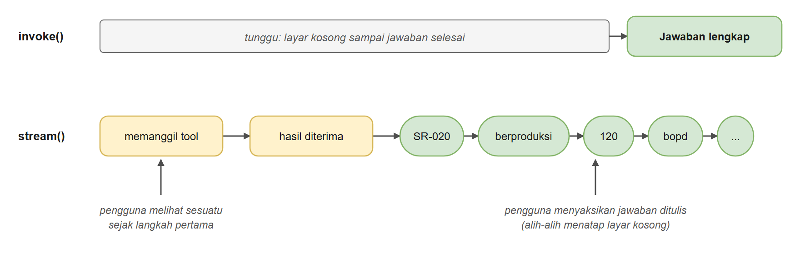
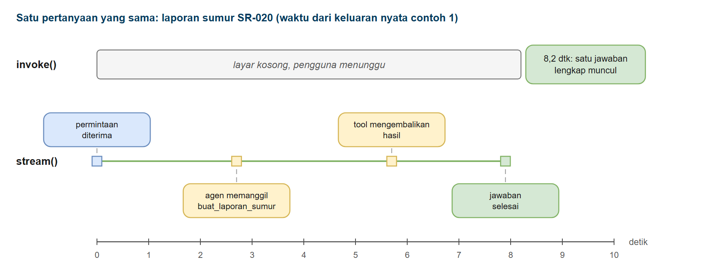
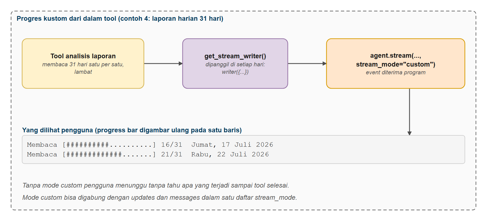
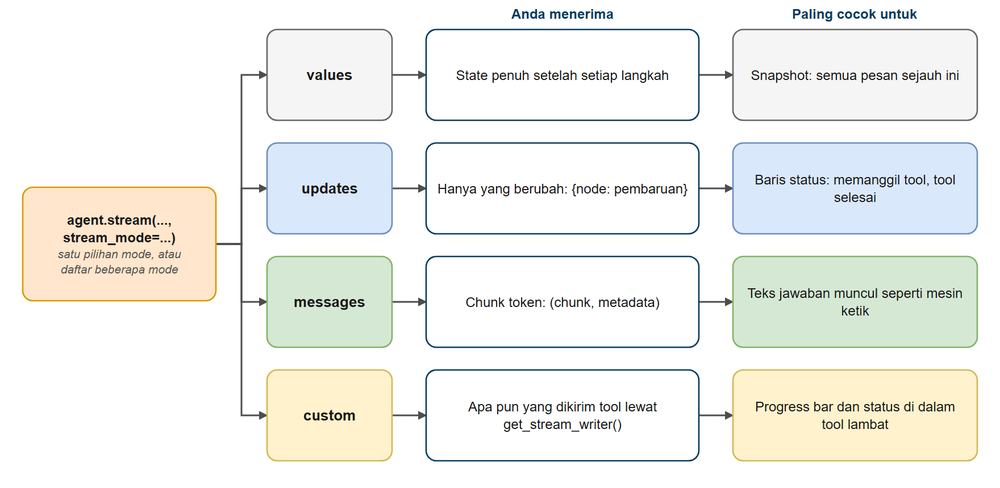

# Streaming Agen

Di bab ini Anda belajar **mengalirkan (stream)** pekerjaan agen kepada pengguna saat pekerjaan itu terjadi. Alih-alih menatap layar kosong sampai semuanya selesai, pengguna melihat langkah agen, panggilan tool, progres langsung dari tool yang lambat, dan jawaban yang muncul kata demi kata. Anda akan mempelajari empat mode stream, menggabungkannya dalam satu loop, dan melayani banyak pengguna sekaligus dengan kode async dan Server-Sent Events.

> **Bab bonus.** Bab ini opsional. Bab-bab berikutnya tidak bergantung padanya, jadi boleh dilewati atau dikerjakan di akhir jika waktu tersisa.

## Prasyarat

- Sudah menyelesaikan [Memori Agen dan Checkpointer](../05-memori-agen/README.md) (latihan bonus memakai memori)
- Sudah menyelesaikan [Memulai dengan Agen](../03-agen/README.md)
- Membantu: pemahaman dasar generator Python (`for x in sesuatu():`) dan, untuk Contoh 5, `async`/`await`

## Tujuan Pembelajaran

Setelah bab ini Anda bisa:

- Menjelaskan mengapa streaming memperbaiki pengalaman walaupun total waktunya tetap sama
- Memakai `agent.stream()` sebagai ganti `agent.invoke()`
- Memilih antara mode stream `values`, `updates`, `messages`, dan `custom`
- Menampilkan jawaban token demi token (efek mesin ketik)
- Menampilkan apa yang dikerjakan agen (panggilan tool dan hasilnya) sebagai tampilan progres
- Mengirim event progres kustom dari dalam tool yang berjalan lama
- Menggabungkan beberapa mode dalam satu loop
- Mengalirkan ke banyak pengguna dengan `astream()` dan Server-Sent Events

---

## Analogi: Skor Akhir vs Siaran Langsung Pertandingan

**Bayangkan Anda ingin mengikuti pertandingan sepak bola.**

- **Pilihan A: hanya skor akhir.** Dua jam kemudian Anda menerima "Tim kita menang 2-1". Akurat, tetapi Anda tidak tahu apa yang terjadi di tengah jalan
- **Pilihan B: siaran langsung.** *"Operan ke depan... tendangan... gol!"* Pertandingannya berlangsung selama waktu yang sama, tetapi Anda **ikut mengikuti** sejak menit pertama

Siaran langsung juga punya beberapa lapisan:

| Siaran pertandingan | Agen yang dialirkan | Mode LangChain |
|----------|-----------------|----------------|
| Komentator bicara kata demi kata | Jawaban muncul token demi token | `messages` |
| "Gol! Pergantian pemain!" | "Memeriksa status sumur... selesai" | `updates` |
| Papan skor lengkap setelah setiap kejadian | Seluruh state percakapan setelah setiap langkah | `values` |
| Layar stadion ("Menit ke-30 dari 90") | Apa pun yang *Anda* pilih untuk dikirim, seperti "membaca hari ke-12 dari 31" | `custom` |

**Agen bekerja dengan cara yang sama.** `invoke()` adalah "hanya skor akhir". `stream()` adalah siaran langsungnya.



*Gambar 1. invoke() menunggu, stream() menyiarkan langsung*

---

## Empat Mode Stream Sekilas

Anda memilih mode dengan `agent.stream(input, stream_mode="...")`:

| Mode | Anda menerima... | Paling cocok untuk |
|------|----------------|----------|
| `"values"` | **State penuh** setelah setiap langkah (semua pesan sejauh ini) | Skrip sederhana; debugging; "tunjukkan semuanya" |
| `"updates"` | **Hanya yang berubah** pada tiap langkah: `{nama_node: pembaruan}` | Tampilan progres ("memanggil tool X", "tool selesai") |
| `"messages"` | **Token**: `(message_chunk, metadata)` saat model menulis | Efek mesin ketik |
| `"custom"` | **Apa pun yang dikirim tool Anda** lewat `get_stream_writer()` | Progress bar dan status di dalam tool yang lambat |

> Halaman streaming agen di dokumentasi LangChain mencantumkan mode `updates`, `messages`, dan `custom`; mode `values` berasal dari LangGraph (runtime di bawah `create_agent`) dan dibahas di dokumentasi streaming LangGraph.

Anda juga bisa memberi **daftar** mode, dan setiap item tiba sebagai `(nama_mode, data)`.

---

## Mengalirkan Agen

---

### Contoh 1: Menunggu vs Menonton

Mari ukur bedanya. Agen punya tool yang lambat (3 detik). Kita jalankan pertanyaan yang sama dengan `invoke()` dan dengan `stream(stream_mode="values")`.



*Gambar 2. invoke() dan stream(): kapan pengguna melihat sesuatu*

**Kode**: [`code/01_invoke_vs_stream.py`](./code/01_invoke_vs_stream.py)
**Jalankan**: `python hari3/bonus-streaming-agen/code/01_invoke_vs_stream.py`

```python
# %% [markdown]
# # Contoh 1: Menunggu vs Menonton
# Jalankan sel satu per satu dengan Shift+Enter, atau seluruh file: `python hari3/bonus-streaming-agen/code/01_invoke_vs_stream.py`
#
# `agent.invoke()` baru kembali ketika SEMUANYA selesai: setiap panggilan tool dan seluruh jawaban.
# Untuk tugas yang memakan 10 detik, pengguna menatap layar kosong selama 10 detik.
#
# `agent.stream()` memberi hasil SAAT TERJADI. Total waktunya sama, tetapi pengguna langsung melihat kemajuan.
#
# Contoh ini menjalankan pertanyaan yang sama dengan dua cara dan mengukur kapan hal pertama muncul.

# %%
# Langkah 1 - Menyiapkan model
import os
import time

from dotenv import load_dotenv
from langchain.agents import create_agent
from langchain_core.messages import AIMessage, HumanMessage
from langchain_core.tools import tool
from langchain_openai import ChatOpenAI

load_dotenv()

model = ChatOpenAI(
    model=os.getenv("ONLINE_MODEL"),
    base_url=os.getenv("ONLINE_BASE_URL"),
    api_key=os.getenv("ONLINE_API_KEY"),
    reasoning_effort=os.getenv("LLM_REASONING_EFFORT", "none"),
)

# %% [markdown]
# ## Langkah 2 - Tool lambat dan agen
# Tool `buat_laporan_sumur` sengaja tidur 3 detik untuk meniru query database yang lambat.

# %%
@tool
def buat_laporan_sumur(kode_sumur: str) -> str:
    """Buat laporan produksi harian sebuah sumur. Perhitungannya memakan waktu.

    Args:
        kode_sumur: Kode sumur, contoh "SR-020"
    """
    time.sleep(3)  # anggap ini query basis data yang lambat
    return f"{kode_sumur}: 120 bopd minyak, 480 bwpd air, water cut 80%, 1 alarm tekanan dalam 24 jam terakhir"


agent = create_agent(
    model,
    tools=[buat_laporan_sumur],
    system_prompt="Anda asisten operasi. Pakai tool untuk menjawab. Jawab singkat dalam Bahasa Indonesia.",
)
request = {"messages": [HumanMessage(content="Bagaimana kinerja sumur SR-020 hari ini?")]}

# %% [markdown]
# ## Langkah 3 - Bagian 1: invoke(), satu jawaban di akhir

# %%
print("Bagian 1: invoke(), satu jawaban di akhir")
print("-" * 60)
mulai = time.time()
response = agent.invoke(request)
total = time.time() - mulai
print("   (layar kosong selama agen bekerja...)")
print(f"   [{total:5.1f} dtk] Agen: {response['messages'][-1].content}\n")

# %% [markdown]
# ## Langkah 4 - Bagian 2: stream(), kemajuan saat terjadi
# `stream_mode="values"` memberi snapshot state penuh setelah setiap langkah.

# %%
print("Bagian 2: stream(stream_mode='values'), snapshot setelah setiap langkah")
print("-" * 60)
mulai = time.time()
output_pertama = None
terlihat = 0
for snapshot in agent.stream(request, stream_mode="values"):
    pesan = snapshot["messages"][-1]
    lewat = time.time() - mulai
    if len(snapshot["messages"]) == terlihat:
        continue  # tidak ada yang baru
    terlihat = len(snapshot["messages"])

    if isinstance(pesan, HumanMessage):
        label = "permintaan diterima"
    elif isinstance(pesan, AIMessage) and pesan.tool_calls:
        label = f"agen memutuskan memanggil {pesan.tool_calls[0]['name']}"
    elif isinstance(pesan, AIMessage):
        label = f"Agen: {pesan.content}"
    else:
        label = f"tool mengembalikan: {pesan.content}"
    if output_pertama is None and not isinstance(pesan, HumanMessage):
        output_pertama = lewat
    print(f"   [{lewat:5.1f} dtk] {label}")
total_stream = time.time() - mulai

# %% [markdown]
# ## Langkah 5 - Perbandingan

# %%
print("Perbandingan")
print(f"   invoke(): hal pertama yang dilihat pengguna muncul setelah {total:.1f} dtk")
print(f"   stream(): hal pertama yang dilihat pengguna muncul setelah {output_pertama:.1f} dtk (total {total_stream:.1f} dtk)")

# %% [markdown]
# ## Ide Utama
# - Total pekerjaannya sama. Yang berubah adalah KAPAN pengguna melihat sesuatu
# - `stream()` adalah generator: loop `for` menerima satu pembaruan setiap kali
# - `stream_mode='values'` memberi state penuh setelah setiap langkah
# - Berikutnya: alirkan kata-kata jawaban dan pilih seberapa rinci yang Anda perlukan
```

### Keluaran yang Diharapkan

> **Catatan:** jawaban model dan waktu bisa berbeda setiap kali dijalankan. Keluaran di seluruh bab ini berasal dari menjalankan skrip sebenarnya.

```text
Bagian 1: invoke(), satu jawaban di akhir
------------------------------------------------------------
   (layar kosong selama agen bekerja...)
   [  8.2 dtk] Agen: Berikut ringkasan kinerja sumur **SR-020** hari ini:

- **Produksi minyak:** 120 bopd
- **Produksi air:** 480 bwpd
- **Water cut:** 80%
- **Alarm:** 1 alarm tekanan dalam 24 jam terakhir

Secara keseluruhan, sumur masih berproduksi normal, namun water cut cukup tinggi (80%) dan terdapat satu alarm tekanan yang perlu diperhatikan. Perlu dicek lebih lanjut apakah ada indikasi masalah pada tekanan sumur.

Bagian 2: stream(stream_mode='values'), snapshot setelah setiap langkah
------------------------------------------------------------
   [  0.0 dtk] permintaan diterima
   [  2.7 dtk] agen memutuskan memanggil buat_laporan_sumur
   [  5.7 dtk] tool mengembalikan: SR-020: 120 bopd minyak, 480 bwpd air, water cut 80%, 1 alarm tekanan dalam 24 jam terakhir
   [  7.9 dtk] Agen: Berikut ringkasan kinerja sumur **SR-020** hari ini:

- **Produksi minyak:** 120 bopd
- **Produksi air:** 480 bwpd
- **Water cut:** 80%
- **Alarm:** 1 alarm tekanan dalam 24 jam terakhir

Secara umum, sumur masih berproduksi, namun water cut cukup tinggi (80%) dan ada **1 alarm tekanan** yang perlu diperhatikan untuk memastikan tidak ada masalah pada tekanan formasi maupun peralatan. Disarankan untuk mengecek riwayat alarm tersebut.

Perbandingan
   invoke(): hal pertama yang dilihat pengguna muncul setelah 8.2 dtk
   stream(): hal pertama yang dilihat pengguna muncul setelah 2.7 dtk (total 7.9 dtk)
```

### Cara Kerjanya

1. **`invoke()` memblokir.** Tidak ada yang kembali sampai langkah terakhir selesai.
2. **`stream()` adalah generator.** Loop `for` menerima nilai setiap kali agen menyelesaikan satu langkah. Kode Anda berjalan di antara langkah, sehingga Anda bisa mencetak, memperbarui UI, atau mencatat log.
3. **Mode `"values"` memberi state lengkap setiap kali.** Itu sebabnya `snapshot["messages"]` tumbuh dari 1 pesan menjadi 4. Kita melihat yang terbaru (`[-1]`).
4. **Total waktunya hampir sama.** Yang berubah adalah *kapan pengguna pertama kali melihat sesuatu*: lebih cepat dengan `stream()`.

> **Mengapa ini penting:** orang jauh lebih sabar menunggu kalau melihat kemajuan. Pada rekaman di atas pengguna melihat langkah pertama setelah 2,7 detik dengan `stream()`, sedangkan dengan `invoke()` ia menatap layar kosong selama 8,2 detik.

---

### Contoh 2: Streaming Token (Efek Mesin Ketik)

Model menulis jawabannya beberapa karakter demi beberapa karakter. Dengan `stream_mode="messages"` Anda menerima setiap chunk saat dihasilkan.

**Kode**: [`code/02_stream_token.py`](./code/02_stream_token.py)
**Jalankan**: `python hari3/bonus-streaming-agen/code/02_stream_token.py`

```python
# %% [markdown]
# # Contoh 2: Streaming Token (Efek Mesin Ketik)
# Jalankan sel satu per satu dengan Shift+Enter, atau seluruh file: `python hari3/bonus-streaming-agen/code/02_stream_token.py`
#
# Model menulis jawabannya sepotong kecil demi sepotong (satu "token"). Dengan `stream_mode="messages"`
# Anda menerima setiap chunk begitu dihasilkan, sehingga jawaban bisa ditampilkan tumbuh di layar
# seperti ChatGPT.
#
# Setiap item adalah sepasang: `(message_chunk, metadata)`
# - `message_chunk`: chunk kecil pesan AI
# - `metadata`: antara lain node graf mana yang menghasilkannya

# %%
# Langkah 1 - Menyiapkan model
import os
import time

from dotenv import load_dotenv
from langchain.agents import create_agent
from langchain_core.messages import AIMessageChunk, HumanMessage
from langchain_core.tools import tool
from langchain_openai import ChatOpenAI

load_dotenv()

model = ChatOpenAI(
    model=os.getenv("ONLINE_MODEL"),
    base_url=os.getenv("ONLINE_BASE_URL"),
    api_key=os.getenv("ONLINE_API_KEY"),
    reasoning_effort=os.getenv("LLM_REASONING_EFFORT", "none"),
)

# %% [markdown]
# ## Langkah 2 - Tool dan agen

# %%
@tool
def info_pompa(jenis: str) -> str:
    """Ambil fakta tentang jenis pompa angkat buatan.

    Args:
        jenis: Jenis pompa, contoh "ESP" atau "SRP"
    """
    fakta = {
        "esp": "ESP (Electrical Submersible Pump): pompa sentrifugal benam di dasar sumur, digerakkan motor listrik, "
               "cocok untuk laju cairan tinggi, sensitif terhadap pasir dan gas bebas",
        "srp": "SRP (Sucker Rod Pump): pompa piston di dasar sumur yang digerakkan batang pompa dari pumping unit di permukaan, "
               "cocok untuk laju rendah sampai sedang, tahan kondisi kasar tetapi dibatasi kedalaman",
    }
    return fakta.get(jenis.lower(), "Tidak ada data")


agent = create_agent(
    model,
    tools=[info_pompa],
    system_prompt="Anda menjelaskan pompa sumur kepada operator baru. Pakai tool untuk setiap jenis pompa, lalu jawab dalam 3-4 kalimat Bahasa Indonesia.",
)
request = {"messages": [HumanMessage(content="Jelaskan perbedaan ESP dan SRP.")]}

# %% [markdown]
# ## Langkah 3 - Bagian 1: seperti apa aliran mentahnya
# Cetak empat chunk pertama beserta node yang menghasilkannya.

# %%
print("Bagian 1: seperti apa aliran mentahnya")
print("-" * 60)
ditampilkan = 0
for chunk, metadata in agent.stream(request, stream_mode="messages"):
    if ditampilkan < 4:
        print(f"   {type(chunk).__name__:<16} text={chunk.text!r:<12} node={metadata['langgraph_node']}")
        ditampilkan += 1
print("   ... (masih banyak chunk kecil lainnya)\n")

# %% [markdown]
# ## Langkah 4 - Bagian 2: efek mesin ketik
# Hanya teks dari node `model` yang dicetak (hasil tool dan chunk kosong dari panggilan tool diabaikan).

# %%
print("Bagian 2: cetak hanya teks jawaban, saat tiba")
print("-" * 60)
print("Agen: ", end="", flush=True)
mulai = time.time()
waktu_token_pertama = None
jumlah_chunk = 0
for chunk, metadata in agent.stream(request, stream_mode="messages"):
    # Hanya teks dari node MODEL (abaikan hasil tool dan chunk kosong dari panggilan tool)
    if isinstance(chunk, AIMessageChunk) and metadata["langgraph_node"] == "model" and chunk.text:
        if waktu_token_pertama is None:
            waktu_token_pertama = time.time() - mulai
        jumlah_chunk += 1
        print(chunk.text, end="", flush=True)  # tanpa baris baru: teks tumbuh pada satu baris
total = time.time() - mulai

print(f"\n\nTeks pertama muncul setelah {waktu_token_pertama:.1f} dtk; "
      f"jawaban penuh selesai dalam {total:.1f} dtk ({jumlah_chunk} chunk)")

# %% [markdown]
# ## Ide Utama
# - `stream_mode='messages'` menghasilkan `(chunk, metadata)` saat model menulis
# - `chunk.text` adalah chunk teks baru; cetak dengan `end=''` dan `flush=True`
# - Filter `metadata['langgraph_node'] == 'model'` untuk melewati keluaran tool
# - Di aplikasi web, Anda mengirim tiap chunk ke browser, bukan `print()`
```

### Keluaran yang Diharapkan

```text
Bagian 1: seperti apa aliran mentahnya
------------------------------------------------------------
   AIMessageChunk   text='S'          node=model
   AIMessageChunk   text='aya akan mengambil informasi tentang' node=model
   AIMessageChunk   text=' kedua jenis pompa tersebut' node=model
   AIMessageChunk   text='.'          node=model
   ... (masih banyak chunk kecil lainnya)

Bagian 2: cetak hanya teks jawaban, saat tiba
------------------------------------------------------------
Agen:

Berikut penjelasan perbedaan ESP dan SRP untuk operator baru:

**ESP (Electrical Submersible Pump)** adalah pompa sentrifugal yang terbenam di dasar sumur dan digerakkan langsung oleh motor listrik di bawah permukaan. Pompa ini cocok untuk laju produksi cairan tinggi, namun sensitif terhadap kandungan pasir dan gas bebas yang dapat mengganggu kinerjanya.

**SRP (Sucker Rod Pump)** adalah pompa piston di dasar sumur yang digerakkan dari permukaan melalui batang pompa (sucker rod) oleh pumping unit. Pompa ini cocok untuk laju produksi rendah hingga sedang, lebih tahan terhadap kondisi kasar (seperti pasir dan fluida korosif), tetapi penggunaannya dibatasi oleh kedalaman sumur karena keterbatasan kekuatan batang pompa.

Intinya, ESP unggul untuk sumur berkapasitas tinggi dan kedalaman besar, sedangkan SRP lebih fleksibel untuk sumur kecil-menengah dengan kondisi fluida yang lebih keras dan biaya perawatan yang lebih sederhana. Pilihannya bergantung pada kapasitas produksi, kedalaman, dan karakteristik fluida sumur Anda.

Teks pertama muncul setelah 1.6 dtk; jawaban penuh selesai dalam 5.9 dtk (80 chunk)
```

### Cara Kerjanya

1. **Setiap item adalah sepasang** `(chunk, metadata)`. Chunk adalah `AIMessageChunk` kecil; metadata menyebut, antara lain, node graf mana yang menghasilkannya.
2. **Chunk pertama kosong.** Ketika model memutuskan memanggil tool, ia mengalirkan panggilan tool, bukan teks. `chunk.text` kosong untuk chunk itu, sehingga pemeriksaan `and chunk.text` melewatinya.
3. **Mengapa memfilter `"model"`?** Tanpa filter Anda mungkin ikut mencetak chunk dari node lain. `metadata["langgraph_node"] == "model"` menyisakan hanya kata-kata model sendiri.
4. **`print(..., end="", flush=True)`:** `end=""` mencegah Python menambah baris baru setelah tiap chunk, dan `flush=True` mendorongnya ke layar segera (kalau tidak, Python bisa menahannya di buffer).
5. **Kata pertama muncul agak lama** karena agen lebih dulu harus memanggil tool, dan panggilan itu tidak dialirkan sebagai teks. Kadang model juga menulis kalimat pembuka sebelum memanggil tool (pada Bagian 1 di atas: "Saya akan mengambil informasi tentang kedua jenis pompa tersebut."), sehingga teks sebelum dan sesudah tool bisa menyatu dalam satu aliran tanpa pemisah. Kalimat pembuka itu perilaku model, bukan error streaming; pada Bagian 2 di atas model langsung menulis jawaban sehingga hanya baris kosong yang muncul sebelum "Berikut penjelasan ...". Pada agen, token mulai mengalir ketika model mulai menulis jawaban **akhir**. Karena itu Contoh 3 penting: ia mengisi waktu tunggu sebelum teks mulai.

> **`chunk.text`** adalah properti kemudahan: ia menggabungkan bagian teks sebuah chunk menjadi satu string, apa pun format penyedia. Pakai ini sebagai ganti `chunk.content`, yang pada sebagian penyedia berupa daftar blok.

---

### Contoh 3: Menampilkan Progres dengan `stream_mode="updates"`

Token memberi tahu pengguna apa yang *dikatakan* model. Sering mereka juga ingin tahu apa yang *dikerjakan* agen. Pada mode `"updates"`, setiap langkah menghasilkan satu item: `{nama_node: pembaruan_state}`.

| Node | Artinya | Isi pesannya |
|------|---------|-----------------------|
| `model` | Model berjalan | `tool_calls` (apa yang akan terjadi) atau jawaban akhir |
| `tools` | Satu atau lebih tool selesai | `ToolMessage` berisi setiap hasil |

**Kode**: [`code/03_stream_progress.py`](./code/03_stream_progress.py)
**Jalankan**: `python hari3/bonus-streaming-agen/code/03_stream_progress.py`

```python
# %% [markdown]
# # Contoh 3: Menampilkan Progres dengan stream_mode="updates"
# Jalankan sel satu per satu dengan Shift+Enter, atau seluruh file: `python hari3/bonus-streaming-agen/code/03_stream_progress.py`
#
# Token menjawab "apa yang DIKATAKAN model?". Sering pengguna juga ingin tahu "apa yang DIKERJAKAN agen?".
# `stream_mode="updates"` memancarkan satu item per LANGKAH, dengan nama node yang berjalan:
#
# - `{"model": {...}}`: model berjalan (mungkin memutuskan memanggil tool)
# - `{"tools": {...}}`: satu atau lebih tool berjalan dan mengembalikan hasil
#
# Itulah yang dibutuhkan untuk tampilan progres: "Memeriksa status sumur... selesai".

# %%
# Langkah 1 - Menyiapkan model
import os
import time

import pandas as pd
from dotenv import load_dotenv
from langchain.agents import create_agent
from langchain_core.messages import AIMessage, HumanMessage
from langchain_core.tools import tool
from langchain_openai import ChatOpenAI

from migas_shared.config import DATA
from migas_shared.field_tools import cek_status_sumur

load_dotenv()

model = ChatOpenAI(
    model=os.getenv("ONLINE_MODEL"),
    base_url=os.getenv("ONLINE_BASE_URL"),
    api_key=os.getenv("ONLINE_API_KEY"),
    reasoning_effort=os.getenv("LLM_REASONING_EFFORT", "none"),
)

# %% [markdown]
# ## Langkah 2 - Dua tool lambat dan agen
# Kedua tool diberi `time.sleep` agar progresnya terlihat. Nama teknis tool dipetakan ke label ramah di `NAMA_RAMAH`.

# %%
_WO = pd.read_csv(DATA / "eval" / "work_orders_truth.csv")


@tool
def riwayat_work_order(kode_aset: str) -> str:
    """Hitung jumlah work order dan total downtime sebuah aset sepanjang data yang tersedia.

    Args:
        kode_aset: Kode aset, contoh "SR-020"
    """
    time.sleep(1.5)  # anggap query ke sistem pemeliharaan
    baris = _WO[_WO["asset_id"] == kode_aset.strip().upper()]
    if baris.empty:
        return f"{kode_aset}: tidak ada work order"
    return f"{kode_aset}: {len(baris)} work order, total downtime {baris['downtime_hours'].sum():.1f} jam"


@tool
def status_sumur_lambat(kode_sumur: str) -> str:
    """Cek status operasi sebuah sumur (data real-time, sedikit lambat).

    Args:
        kode_sumur: Kode sumur, contoh "SR-020"
    """
    time.sleep(1.5)
    return cek_status_sumur.invoke({"kode_sumur": kode_sumur})


NAMA_RAMAH = {
    "status_sumur_lambat": "Memeriksa status sumur",
    "riwayat_work_order": "Membuka riwayat work order",
}

agent = create_agent(
    model,
    tools=[status_sumur_lambat, riwayat_work_order],
    system_prompt=(
        "Anda asisten operasi. Untuk laporan kondisi sumur, panggil KEDUA tool dalam langkah yang sama, "
        "lalu ringkas dalam dua kalimat Bahasa Indonesia."
    ),
)

# %% [markdown]
# ## Langkah 3 - Menampilkan progres per langkah
# Setiap update berbentuk `{"<nama node>": {"messages": [...]}}`. Kita tampilkan tool yang diminta,
# tool yang selesai, dan jawaban akhir.

# %%
pertanyaan = "Berikan laporan kondisi sumur SR-020 lengkap dengan riwayat perbaikannya."
print(f"Pengguna: {pertanyaan}\n")
mulai = time.time()

for update in agent.stream({"messages": [HumanMessage(content=pertanyaan)]}, stream_mode="updates"):
    # Setiap update berbentuk {"<nama node>": {"messages": [...]}}
    for node, isi in update.items():
        lewat = time.time() - mulai
        if not isinstance(isi, dict):
            continue  # sebagian langkah (misalnya hook middleware) melaporkan None
        for pesan in isi.get("messages", []):
            if node == "model" and isinstance(pesan, AIMessage) and pesan.tool_calls:
                for call in pesan.tool_calls:
                    langkah = NAMA_RAMAH.get(call["name"], call["name"])
                    print(f"   [{lewat:4.1f} dtk] {langkah}...  args={call['args']}")
            elif node == "tools":
                print(f"   [{lewat:4.1f} dtk] {pesan.name} selesai")
            elif node == "model":
                print(f"   [{lewat:4.1f} dtk] Menulis jawaban...\n")
                print(f"Agen: {pesan.content}")

# %% [markdown]
# ## Ide Utama
# - `stream_mode='updates'` memancarkan satu item per langkah: `{nama_node: pembaruan_state}`
# - node `model` = model berjalan; pesannya bisa berisi `tool_calls` (apa yang akan terjadi)
# - node `tools` = tool selesai; pesannya berisi hasil
# - Petakan nama tool teknis ke label yang ramah untuk pengguna
# - Kedua tool diminta bersamaan, sehingga berjalan paralel
```

### Keluaran yang Diharapkan

```text
Pengguna: Berikan laporan kondisi sumur SR-020 lengkap dengan riwayat perbaikannya.

   [ 7.1 dtk] Memeriksa status sumur...  args={'kode_sumur': 'SR-020'}
   [ 7.1 dtk] Membuka riwayat work order...  args={'kode_aset': 'SR-020'}
   [ 8.6 dtk] status_sumur_lambat selesai
   [ 8.7 dtk] riwayat_work_order selesai
   [12.0 dtk] Menulis jawaban...

Agen: Berikut laporan kondisi sumur SR-020:

**Status Operasional:** Sumur SR-020 (Seruni, ESP) saat ini berstatus **Produksi** dengan produksi minyak **120 bopd** dan air **480 bwpd**. Terdapat catatan bahwa ESP sempat mengalami *trip overload* kemarin sore, namun sudah stabil kembali sejak pukul 18.00.

**Riwayat Perbaikan:** Sumur ini memiliki total **5 work order** dengan akumulasi **downtime 25 jam** sepanjang data yang tersedia.
```

### Cara Kerjanya

1. **Satu langkah = satu node berjalan.** Pertama node `model` memutuskan apa yang dilakukan, lalu node `tools` mengeksekusi, lalu `model` lagi menulis jawaban.
2. **`tool_calls` memberi tahu lebih dulu.** Ketika pesan model berisi `tool_calls`, Anda tahu tool mana yang *akan* berjalan, saat yang tepat untuk menampilkan "Memeriksa status sumur...".
3. **Kedua tool diminta bersamaan** (waktu yang sama) dan selesai bersamaan: keduanya berjalan paralel.
4. **Nama ramah.** Pengguna tidak ingin membaca `riwayat_work_order`. Petakan nama teknis ke label yang mudah dibaca.
5. **Kode defensif.** Sebagian langkah (misalnya hook middleware) melaporkan `None`, bukan dictionary, karena itu ada pemeriksaan `isinstance(isi, dict)`.

---

### Contoh 4: Progres Kustom dari Dalam Tool

Tool yang memakan waktu lama tampak membeku: `"updates"` hanya melapor ketika **seluruh tool** selesai. Tool bisa mengirim progres **miliknya sendiri** saat berjalan, memakai `get_stream_writer()`. Di sini tool membaca laporan harian GS-SR1 selama 31 hari satu per satu (data sungguhan dari `data/raw/daily_reports`).



*Gambar 3. Progres kustom dari dalam tool*

**Kode**: [`code/04_custom_events.py`](./code/04_custom_events.py)
**Jalankan**: `python hari3/bonus-streaming-agen/code/04_custom_events.py`

```python
# %% [markdown]
# # Contoh 4: Progres Kustom dari Dalam Tool
# Jalankan sel satu per satu dengan Shift+Enter, atau seluruh file: `python hari3/bonus-streaming-agen/code/04_custom_events.py`
#
# Tool yang memakan waktu lama (misalnya membaca laporan harian 31 hari satu per satu) tampak membeku:
# aliran "updates" hanya melapor ketika seluruh tool selesai. Tool bisa mengirim pesan progresnya SENDIRI
# saat berjalan, memakai `get_stream_writer()`. Pesan itu tiba pada `stream_mode="custom"`.
#
# Lalu kita gabungkan tiga mode dalam satu aliran, seperti UI chat sungguhan:
# - `"custom"`: baris status ("Hari ke-12 dari 31...")
# - `"messages"`: teks jawaban langsung
# - `"updates"`: batas antar langkah

# %%
# Langkah 1 - Menyiapkan model
import os
import re
import time

from dotenv import load_dotenv
from langchain.agents import create_agent
from langchain_core.messages import AIMessageChunk, HumanMessage
from langchain_core.tools import tool
from langchain_openai import ChatOpenAI
from langgraph.config import get_stream_writer

from migas_shared.config import DATA

load_dotenv()

model = ChatOpenAI(
    model=os.getenv("ONLINE_MODEL"),
    base_url=os.getenv("ONLINE_BASE_URL"),
    api_key=os.getenv("ONLINE_API_KEY"),
    reasoning_effort=os.getenv("LLM_REASONING_EFFORT", "none"),
)

# %% [markdown]
# ## Langkah 2 - Tool yang mengirim progres sendiri
# `writer = get_stream_writer()` mengirim event kustom ke `stream_mode="custom"` pada setiap hari yang dibaca.

# %%
LAPORAN = DATA / "raw" / "daily_reports" / "GS-SR1_2026-07.md"
POLA_MINYAK = re.compile(r"Produksi minyak bersih tercatat ([\d.]+) bopd")
POLA_WC = re.compile(r"water cut ([\d,]+)%")


@tool
def analisis_laporan_harian_juli() -> str:
    """Baca laporan harian GS-SR1 bulan Juli 2026 hari demi hari (31 hari) lalu hitung statistik produksi minyak dan water cut.
    Lambat: pakai hanya bila diminta menganalisis laporan sebulan penuh."""
    writer = get_stream_writer()  # mengirim event kustom ke stream_mode="custom"
    bagian = re.split(r"^## ", LAPORAN.read_text(encoding="utf-8"), flags=re.MULTILINE)[1:]
    minyak, wc = [], []
    for nomor, teks in enumerate(bagian, start=1):
        judul = teks.splitlines()[0]
        writer({"type": "progress", "selesai": nomor - 1, "total": len(bagian), "hari": judul})
        time.sleep(0.15)  # anggap setiap hari memerlukan sedikit waktu untuk dibaca
        m, w = POLA_MINYAK.search(teks), POLA_WC.search(teks)
        if m and w:
            minyak.append((int(m.group(1).replace(".", "")), judul))
            wc.append(float(w.group(1).replace(",", ".")))
    writer({"type": "progress", "selesai": len(bagian), "total": len(bagian), "hari": "-"})
    terendah = min(minyak)
    return (f"Dibaca {len(minyak)} dari {len(bagian)} hari. Produksi minyak rata-rata {sum(v for v, _ in minyak) / len(minyak):,.0f} bopd; "
            f"terendah {terendah[0]:,} bopd pada {terendah[1]}. Water cut rata-rata {sum(wc) / len(wc):.1f}% "
            f"(rentang {min(wc):.1f}% sampai {max(wc):.1f}%).")


def bar_progres(selesai: int, total: int, lebar: int = 20) -> str:
    terisi = int(lebar * selesai / total)
    return "#" * terisi + "." * (lebar - terisi)


agent = create_agent(
    model,
    tools=[analisis_laporan_harian_juli],
    system_prompt="Anda asisten operasi. Pakai tool analisis untuk laporan bulanan. Jawab dalam dua kalimat Bahasa Indonesia.",
)

# %% [markdown]
# ## Langkah 3 - Menggabungkan tiga mode dalam satu aliran
# Dengan daftar mode, setiap item menjadi `(nama_mode, data)`. Baris progres ditimpa dengan `\r`.

# %%
pertanyaan = "Analisis laporan harian GS-SR1 bulan Juli dan beri tahu saya tren produksi dan water cut-nya."
print(f"Pengguna: {pertanyaan}\n")

jawaban_dimulai = False
# Beberapa mode sekaligus: setiap item menjadi (nama_mode, data)
for mode, data in agent.stream(
    {"messages": [HumanMessage(content=pertanyaan)]},
    stream_mode=["custom", "messages", "updates"],
):
    if mode == "custom" and data.get("type") == "progress":
        # Timpa baris terminal yang sama dengan \r
        bar = bar_progres(data["selesai"], data["total"])
        print(f"\r   Membaca [{bar}] {data['selesai']}/{data['total']}  {data['hari'][:28]:<28}", end="", flush=True)
    elif mode == "messages":
        chunk, metadata = data
        if isinstance(chunk, AIMessageChunk) and metadata["langgraph_node"] == "model" and chunk.text:
            if not jawaban_dimulai:
                print("\n\nAgen: ", end="")
                jawaban_dimulai = True
            print(chunk.text, end="", flush=True)
    elif mode == "updates" and "tools" in data:
        print("\n   Tool analisis selesai", end="")

# %% [markdown]
# ## Ide Utama
# - `get_stream_writer()` memungkinkan tool mengirim progres SAAT berjalan
# - `stream_mode='custom'` menyampaikan persis apa yang ditulis tool (dictionary apa pun)
# - Berikan DAFTAR mode untuk mendapat pasangan `(mode, data)` dalam satu loop
# - custom = status/progres, messages = teks langsung, updates = perubahan langkah
# - Kombinasi itu adalah inti UI chat yang responsif
```

### Keluaran yang Diharapkan

Di terminal sungguhan, progress bar digambar ulang pada satu baris berkat `\r`. Saat keluaran ditangkap ke file seperti di bawah, setiap pembaruan tampak berurutan pada baris yang sama:

```text
Pengguna: Analisis laporan harian GS-SR1 bulan Juli dan beri tahu saya tren produksi dan water cut-nya.


Agen: Saya akan menganalisis laporan harian GS-SR1 untuk bulan Juli 2026.


   Membaca [....................] 0/31  Rabu, 01 Juli 2026
   Membaca [....................] 1/31  Kamis, 02 Juli 2026
   Membaca [#...................] 2/31  Jumat, 03 Juli 2026
   Membaca [#...................] 3/31  Sabtu, 04 Juli 2026
   Membaca [##..................] 4/31  Minggu, 05 Juli 2026
   Membaca [###.................] 5/31  Senin, 06 Juli 2026
   Membaca [###.................] 6/31  Selasa, 07 Juli 2026
   Membaca [####................] 7/31  Rabu, 08 Juli 2026
   Membaca [#####...............] 8/31  Kamis, 09 Juli 2026
   Membaca [#####...............] 9/31  Jumat, 10 Juli 2026
   Membaca [######..............] 10/31  Sabtu, 11 Juli 2026
   Membaca [#######.............] 11/31  Minggu, 12 Juli 2026
   Membaca [#######.............] 12/31  Senin, 13 Juli 2026
   Membaca [########............] 13/31  Selasa, 14 Juli 2026
   Membaca [#########...........] 14/31  Rabu, 15 Juli 2026
   Membaca [#########...........] 15/31  Kamis, 16 Juli 2026
   Membaca [##########..........] 16/31  Jumat, 17 Juli 2026
   Membaca [##########..........] 17/31  Sabtu, 18 Juli 2026
   Membaca [###########.........] 18/31  Minggu, 19 Juli 2026
   Membaca [############........] 19/31  Senin, 20 Juli 2026
   Membaca [############........] 20/31  Selasa, 21 Juli 2026
   Membaca [#############.......] 21/31  Rabu, 22 Juli 2026
   Membaca [##############......] 22/31  Kamis, 23 Juli 2026
   Membaca [##############......] 23/31  Jumat, 24 Juli 2026
   Membaca [###############.....] 24/31  Sabtu, 25 Juli 2026
   Membaca [################....] 25/31  Minggu, 26 Juli 2026
   Membaca [################....] 26/31  Senin, 27 Juli 2026
   Membaca [#################...] 27/31  Selasa, 28 Juli 2026
   Membaca [##################..] 28/31  Rabu, 29 Juli 2026
   Membaca [##################..] 29/31  Kamis, 30 Juli 2026
   Membaca [###################.] 30/31  Jumat, 31 Juli 2026
   Membaca [####################] 31/31  -
   Tool analisis selesaiProduksi minyak bulan Juli relatif stabil dengan rata-rata 4.312 bopd, namun menunjukkan titik terendah 4.020 bopd pada 14 Juli, sementara water cut tetap tinggi dan konsisten pada kisaran 89,8%–90,7% dengan rata-rata 90,2%. Tren menunjukkan produksi cenderung menurun seiring tingginya water cut yang menandakan lapangan sudah berada pada tahap matang produksi.
```

### Cara Kerjanya

1. **`get_stream_writer()`** mengembalikan sebuah fungsi. Dictionary apa pun yang Anda berikan akan muncul di aliran sebagai event `"custom"`. Anda yang menentukan formatnya.
2. **Tool tetap bekerja** setelah mengirim event. Event mengalir *selama* tool berjalan, bukan sesudahnya.
3. **Daftar mode** memberi pasangan `(nama_mode, data)` dari satu loop:
   - `custom` -> baris status
   - `messages` -> teks jawaban langsung
   - `updates` -> perubahan langkah (di sini, "tool selesai")
4. **Kombinasi itu adalah inti UI chat:** baris status, teks langsung, dan batas langkah yang jelas.
5. **`\r` (carriage return)** memindahkan kursor ke awal baris, sehingga setiap cetakan progres menimpa yang sebelumnya.

> **Di mana ini bekerja:** `get_stream_writer()` bisa dipanggil di dalam tool (dan node graf) saat agen sedang dialirkan. Kalau tidak ada yang mengalirkan, writer tidak melakukan apa-apa, sehingga tool yang sama tetap berfungsi dengan `invoke()`.

---

### Contoh 5: Streaming Async untuk Banyak Pengguna

Server menangani banyak pengguna sekaligus. Kalau setiap panggilan agen **memblokir** sambil menunggu model, satu jawaban lambat menahan semua yang lain. Dengan kode async, server bisa menunggu banyak respons model pada saat yang sama.

**Kode**: [`code/05_streaming_async.py`](./code/05_streaming_async.py)
**Jalankan**: `python hari3/bonus-streaming-agen/code/05_streaming_async.py`

```python
# %% [markdown]
# # Contoh 5: Streaming Async untuk Banyak Pengguna
# Jalankan sel satu per satu dengan Shift+Enter, atau seluruh file: `python hari3/bonus-streaming-agen/code/05_streaming_async.py`
#
# Server melayani banyak pengguna sekaligus. Kalau setiap panggilan agen MEMBLOKIR sambil menunggu model,
# satu jawaban lambat menahan semua yang lain. Dengan kode async (`astream`), server menunggu banyak
# respons model pada saat yang sama.
#
# - Bagian 1: dua "pengguna" dilayani bersamaan. Chunk jawaban mereka berselang-seling dalam waktu.
# - Bagian 2: aliran yang sama diubah menjadi Server-Sent Events (SSE), format teks yang dipakai browser
#   untuk menerima aliran langsung. Generator inilah yang dikembalikan endpoint web (misalnya di FastAPI).
#
# Kode async dijalankan lewat `jalankan(...)` dari `migas_shared.tampil`. Pembantu ini bekerja di skrip biasa
# maupun di Jupyter/Interactive Window, yang sudah memiliki event loop sendiri.

# %%
# Langkah 1 - Menyiapkan agen
import asyncio
import json
import os
import time

from dotenv import load_dotenv
from langchain.agents import create_agent
from langchain_core.messages import AIMessageChunk, HumanMessage
from langchain_openai import ChatOpenAI

from migas_shared.tampil import jalankan

load_dotenv()

model = ChatOpenAI(
    model=os.getenv("ONLINE_MODEL"),
    base_url=os.getenv("ONLINE_BASE_URL"),
    api_key=os.getenv("ONLINE_API_KEY"),
    reasoning_effort=os.getenv("LLM_REASONING_EFFORT", "none"),
)
agent = create_agent(
    model,
    tools=[],
    system_prompt="Anda asisten operasi produksi migas. Jawab dalam 3 kalimat pendek Bahasa Indonesia.",
)

# %% [markdown]
# ## Langkah 2 - Dua pengguna pada saat yang sama
# `alirkan_satu_pengguna` mengalirkan jawaban satu pengguna dan mencatat (waktu, pengguna, teks) tiap chunk.
# `asyncio.gather` menjalankan dua aliran sekaligus.

# %%
async def alirkan_satu_pengguna(pengguna: str, pertanyaan: str, kejadian: list, mulai: float) -> float:
    """Alirkan jawaban satu pengguna, catat (waktu, pengguna, teks) untuk setiap chunk."""
    async for chunk, metadata in agent.astream(
        {"messages": [HumanMessage(content=pertanyaan)]}, stream_mode="messages"
    ):
        if isinstance(chunk, AIMessageChunk) and chunk.text:
            kejadian.append((time.time() - mulai, pengguna, chunk.text))
    return time.time() - mulai


async def layani_dua_pengguna():
    kejadian: list[tuple[float, str, str]] = []
    mulai = time.time()
    selesai = await asyncio.gather(
        alirkan_satu_pengguna("Rina", "Apa itu water cut? Singkat saja.", kejadian, mulai),
        alirkan_satu_pengguna("Agus", "Apa itu bump test? Singkat saja.", kejadian, mulai),
    )
    return kejadian, selesai


print("Bagian 1: dua pengguna, dilayani bersamaan")
print("-" * 60)
kejadian, selesai = jalankan(layani_dua_pengguna())

# %% [markdown]
# ## Langkah 3 - Apakah aliran mereka tumpang tindih?

# %%
jendela = {}
for pengguna in ("Rina", "Agus"):
    waktu = [w for w, siapa, _ in kejadian if siapa == pengguna]
    jendela[pengguna] = (min(waktu), max(waktu))
    print(f"   {pengguna:<5} teks mengalir dari {min(waktu):4.1f} dtk sampai {max(waktu):4.1f} dtk ({len(waktu)} chunk)")

awal_tumpang = max(awal for awal, _ in jendela.values())
akhir_tumpang = min(akhir for _, akhir in jendela.values())
if akhir_tumpang > awal_tumpang:
    print(f"   Kedua jawaban mengalir bersamaan antara {awal_tumpang:.1f} dtk dan {akhir_tumpang:.1f} dtk")
print(f"\n   Total waktu nyata: {max(selesai):.1f} dtk")
print(f"   Dilayani satu per satu akan memakan sekitar {sum(selesai):.1f} dtk\n")

# %% [markdown]
# ## Langkah 4 - Server-Sent Events (SSE)
# Setiap event berupa teks dengan bentuk `data: <json>\n\n`. Kerangka kerja web bisa mengirim generator ini
# langsung ke browser.

# %%
async def aliran_sse(pertanyaan: str):
    """Async generator yang menghasilkan Server-Sent Events (SSE)."""
    async for chunk, metadata in agent.astream(
        {"messages": [HumanMessage(content=pertanyaan)]}, stream_mode="messages"
    ):
        if isinstance(chunk, AIMessageChunk) and chunk.text:
            yield f"data: {json.dumps({'type': 'token', 'text': chunk.text})}\n\n"
    yield f"data: {json.dumps({'type': 'done'})}\n\n"


async def kumpulkan_event(pertanyaan: str) -> list[str]:
    return [event async for event in aliran_sse(pertanyaan)]


events = jalankan(kumpulkan_event("Sebutkan satu manfaat LOTO dalam satu kalimat."))
for event in events[:5]:
    print(f"   {event.strip()!r}")
print(f"   ... total {len(events)} event, diakhiri event 'done'")

# %% [markdown]
# ## Ide Utama
# - `astream()` / `ainvoke()` adalah versi async; pakai di dalam `async def`
# - `asyncio.gather()` menjalankan beberapa aliran sekaligus tanpa thread tambahan
# - Panggilan model yang lambat sebagian besar MENUNGGU, sehingga satu proses bisa melayani banyak pengguna
# - SSE (baris `data: ...`) adalah cara termudah mendorong aliran langsung ke browser
```

### Keluaran yang Diharapkan

```text
Bagian 1: dua pengguna, dilayani bersamaan
------------------------------------------------------------

   Rina  teks mengalir dari  1.7 dtk sampai  2.3 dtk (22 chunk)
   Agus  teks mengalir dari  2.1 dtk sampai  3.2 dtk (27 chunk)
   Kedua jawaban mengalir bersamaan antara 2.1 dtk dan 2.3 dtk

   Total waktu nyata: 3.2 dtk
   Dilayani satu per satu akan memakan sekitar 5.5 dtk

   'data: {"type": "token", "text": "L"}'
   'data: {"type": "token", "text": "OTO m"}'
   'data: {"type": "token", "text": "encegah energi"}'
   'data: {"type": "token", "text": " ber"}'
   'data: {"type": "token", "text": "bahaya aktif"}'
   ... total 13 event, diakhiri event 'done'
```

### Cara Kerjanya

1. **`astream()` / `ainvoke()`** adalah versi async dari `stream()` / `invoke()`. Pakai di dalam `async def`, dengan `async for` / `await`.
2. **`asyncio.gather()`** menjalankan beberapa coroutine sekaligus. Ketika permintaan satu pengguna menunggu model, pengguna lain maju. Total waktunya jauh lebih kecil daripada menjumlahkan keduanya.
3. **Mengapa murah:** sebagian besar waktu dipakai *menunggu* jaringan. Satu proses Python bisa menangani ratusan permintaan yang sedang menunggu.
4. **Server-Sent Events (SSE)** adalah baris teks polos `data: <sesuatu>` diikuti baris kosong, dikirim lewat respons HTTP yang tetap terbuka dengan `Content-Type: text/event-stream`. Browser membacanya dengan API `EventSource` bawaan. Ini lebih sederhana daripada WebSocket kalau data hanya mengalir dari server ke klien.
5. **Framework web bisa mengembalikan generator apa adanya.** Misalnya di FastAPI: `StreamingResponse(aliran_sse(agent, q), media_type="text/event-stream")`. Tantangan bonus membangun server SSE kecil hanya dengan library standar Python.

> **Menjalankan ini di Jupyter?** Notebook sudah punya event loop yang berjalan, jadi `asyncio.run(...)` gagal dengan *"asyncio.run() cannot be called from a running event loop"*. Skrip kursus memakai `jalankan(...)` dari paket bersama, yang sudah mengurus ini. Kalau Anda menulis kode async sendiri di notebook, cukup tulis `await nama_fungsi()`.

---

## Memilih Mode Stream

| Saya ingin... | Pakai |
|--------------|-----|
| Mencetak tiap langkah percakapan di skrip | `"values"` |
| Menampilkan "memanggil tool X... selesai" | `"updates"` |
| Menampilkan jawaban saat ditulis | `"messages"` |
| Menampilkan progres *di dalam* tool yang lambat | `"custom"` (dengan `get_stream_writer()`) |
| Membangun UI chat lengkap | Daftar: `["updates", "messages", "custom"]` |
| Melayani banyak pengguna | `astream()` dengan mode yang sama, di dalam `async def` |

### Streaming dan Bab Lain

| Bab | Bagaimana streaming berpadu |
|---------|-------------------|
| **5: Memori** | `stream()` menerima `config` yang sama (dengan `thread_id`), sehingga percakapan yang dialirkan juga diingat |
| **7: Persetujuan manusia** | Agen yang berhenti mengakhiri alirannya; aliran memuat `__interrupt__` ketika terjadi interrupt. Lanjutkan dengan `stream(Command(resume=...), config)` |
| **8: Guardrail** | Output guard (`@after_agent`) berjalan saat agen selesai, **setelah** token sudah terkirim. Untuk keluaran penting keselamatan, saring *sebelum* menampilkan aliran, atau alirkan hanya setelah pemeriksaan lolos |
| **9: Multi-agen** | Spesialis berjalan di dalam tool. Token internal mereka tidak ditampilkan secara bawaan, tetapi tool bisa meneruskan progres dengan `get_stream_writer()` |

> **Streaming dan keamanan keluaran:** begitu sebuah token terkirim ke pengguna, Anda tidak bisa menariknya kembali. Kalau jawaban harus diperiksa sebelum dilihat siapa pun (kata-kata kepatuhan, data pribadi), jangan alirkan langsung: validasi dulu, baru tampilkan.

---

## Poin Penting

- **Streaming tidak membuat agen lebih cepat, tetapi membuatnya terasa lebih cepat** dengan menampilkan progres segera
- **`agent.stream()` adalah generator:** loop `for` menerima hasil saat terjadi (`astream()` untuk async)
- **Empat mode:** `values` (state penuh), `updates` (yang berubah), `messages` (token), `custom` (event Anda sendiri)
- **Filter aliran token** ke node `model` dan pakai `chunk.text` untuk teksnya
- **`flush=True` dan `end=""`** membuat keluaran terminal muncul langsung
- **`tool_calls` pada update model** memberi tahu tool mana yang akan berjalan: sempurna untuk pesan status
- **`get_stream_writer()`** memungkinkan tool yang lambat melaporkan progres dari dalam
- **Beri daftar mode** untuk mendapat pasangan `(mode, data)` dalam satu loop; begitulah UI chat dibangun
- **Async + SSE** melayani banyak pengguna dan berbicara dengan browser
- **Teks yang sudah dialirkan tidak bisa ditarik:** validasi jawaban penting-keselamatan sebelum mengalirkannya

---

## Peta Konsep

Bab ini mengajarkan cara menampilkan pekerjaan agen saat terjadi:



*Gambar 4. Empat mode stream dan kegunaannya*

---

## Latihan

Latihan bab ini berupa starter yang tinggal Anda isi: `latihan_1.py` dan seterusnya (atau `latihan_1.ipynb`), dengan bagian inti dikosongkan dan diberi komentar `TODO`. Petunjuk singkat ada di [latihan.md](./latihan.md); kode jawabannya ada di bagian **Kode Jawaban Latihan** pada PDF bab ini.

Latihan mencakup:

1. **Asisten Operasi Langsung**: chat terminal yang mengalirkan teks, menampilkan baris status dan progres tool, dan mengingat percakapan
2. **Endpoint HTTP Streaming** (bonus): sajikan aliran agen sebagai Server-Sent Events hanya dengan library standar

---

## Sumber Tambahan

- [Dokumentasi Streaming LangChain](https://docs.langchain.com/oss/python/langchain/streaming): semua mode dan opsi
- [Streaming LangGraph](https://docs.langchain.com/oss/python/langgraph/streaming): `get_stream_writer()` dan event kustom
- [MDN: Menggunakan Server-Sent Events](https://developer.mozilla.org/en-US/docs/Web/API/Server-sent_events/Using_server-sent_events): sisi browser dari SSE
- [Python `asyncio`](https://docs.python.org/3/library/asyncio.html): dasar-dasar async

---

## Langkah Selanjutnya

Kerja bagus. Agen Anda kini **menampilkan pekerjaannya saat terjadi**.

### Membangun di Atas Streaming

**Pengguna kini bisa menonton agen, tetapi bagaimana kalau agen akan melakukan sesuatu yang berisiko?** Menonton bukan mengendalikan.

Di bab berikutnya Anda menambahkan **persetujuan manusia (human-in-the-loop)**: agen berhenti sebelum tool berisiko berjalan, menampilkan tindakan yang diusulkan, dan menunggu seseorang menyetujui, mengubah, atau menolaknya.

### Ide Proyek (Sejauh Ini)

Dengan yang sudah Anda pelajari, Anda bisa membangun:

- **Widget bantuan langsung**: baris status ditambah jawaban mengalir lewat SSE
- **Pembuat laporan dengan progress bar**: tool lambat melaporkan "hari ke-12 dari 31"
- **Asisten dashboard operasi**: mengalirkan jawaban sambil membaca data lapangan
- **Asisten di terminal**: CLI yang menampilkan pemakaian tool saat terjadi

---

## Pemecahan Masalah

Masalah umum saat mengalirkan agen:

### "Tidak ada yang muncul sampai akhir"

**Penyebab**: Anda memakai `invoke()`, Python menahan keluaran di buffer, atau penyedia atau proxy tidak melakukan streaming.

**Perbaikan**:

```python
for chunk, metadata in agent.stream(request, stream_mode="messages"):   # stream(), bukan invoke()
    print(chunk.text, end="", flush=True)                              # flush=True sangat penting
```

Kalau seluruh jawaban tetap tiba sekaligus, endpoint atau proxy di tengah sedang menahan data. Coba koneksi langsung.

### "Saya melihat banyak string kosong"

**Penyebab**: banyak chunk tidak membawa teks, misalnya chunk yang mengalirkan panggilan tool.

**Perbaikan**: lewati: `if chunk.text:`.

### "Hasil tool atau teks lain muncul di keluaran mesin ketik saya"

**Penyebab**: mode `"messages"` mencakup chunk dari setiap node yang memanggil model.

**Perbaikan**: filter pada node: `metadata["langgraph_node"] == "model"`.

### "AttributeError: 'NoneType' object has no attribute 'get'" (pada mode `updates`)

**Penyebab**: sebagian langkah, seperti hook middleware, melaporkan `None` (atau dictionary tanpa `"messages"`).

**Perbaikan**:

```python
for node, isi in update.items():
    if not isinstance(isi, dict):
        continue
    for pesan in isi.get("messages", []):
        ...
```

### "Teks pertama sangat lama muncul"

**Penyebab**: agen sibuk memanggil tool, dan token baru mengalir setelah model menulis teks.

**Perbaikan**: pakai mode `"updates"` dan/atau `"custom"` untuk menampilkan **status** selama waktu itu (Contoh 3-4).

### "RuntimeError: asyncio.run() cannot be called from a running event loop"

**Penyebab**: Anda di Jupyter (atau lingkungan lain dengan loop yang sedang berjalan).

**Perbaikan**: pakai `await nama_fungsi()` langsung, bukan `asyncio.run(nama_fungsi())`, atau pakai `jalankan(...)` dari `migas_shared.tampil`.

### "Event kustom saya tidak pernah tiba"

**Penyebab**: Anda tidak meminta mode `"custom"`, atau memanggil `invoke()`.

**Perbaikan**: `agent.stream(..., stream_mode="custom")` atau daftar yang memuat `"custom"`.

### "Terminal menampilkan karakter rusak" (Windows)

**Penyebab**: encoding bawaan konsol tidak bisa mencetak sebagian karakter.

**Perbaikan**: jalankan dengan UTF-8: atur `PYTHONUTF8=1` (PowerShell: `$env:PYTHONUTF8=1`) sebelum menjalankan, atau pakai Windows Terminal.

---

## Dependency

Pastikan paket yang dibutuhkan terpasang (server SSE di tantangan bonus hanya memakai library standar):

```bash
pip install langchain langchain-openai langgraph pandas python-dotenv
```

---

## Referensi

Sumber ide dan teknik di bab ini:

- LangChain. Streaming. [Dokumentasi](https://docs.langchain.com/oss/python/langchain/streaming).
- WHATWG. HTML Standard: Server-sent events. [Spesifikasi](https://html.spec.whatwg.org/multipage/server-sent-events.html).

---

## Navigasi

[Sebelumnya: Memori Agen dan Checkpointer](../05-memori-agen/README.md) | [Kembali ke Utama](../../README.md) | [Berikutnya: Persetujuan Manusia](../06-persetujuan-manusia/README.md)
