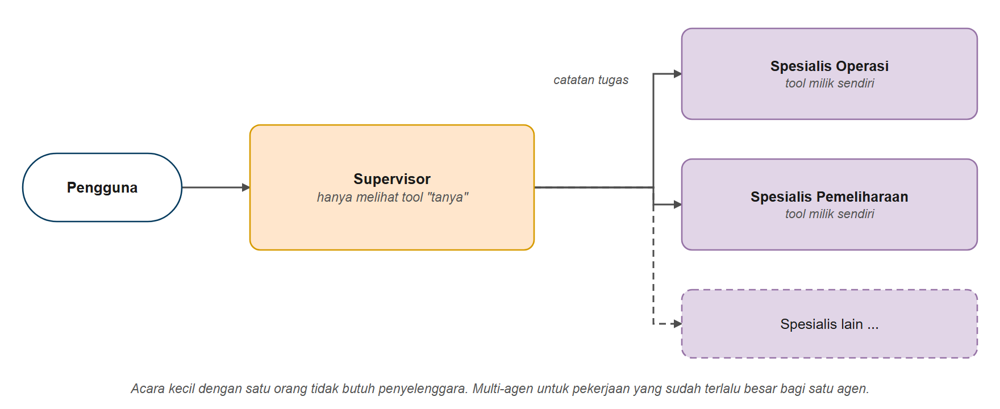
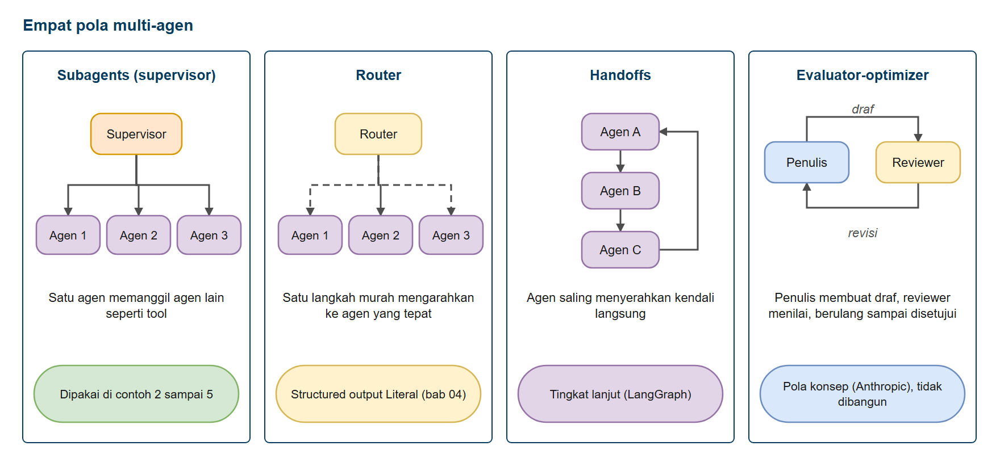
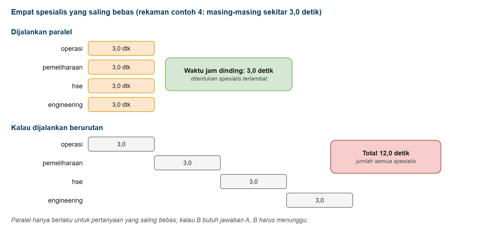
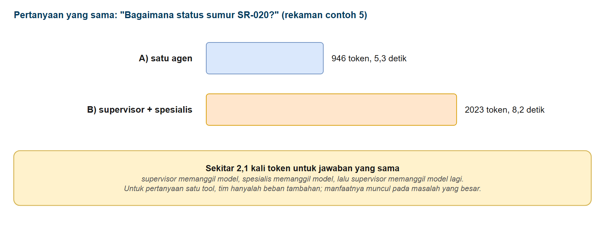
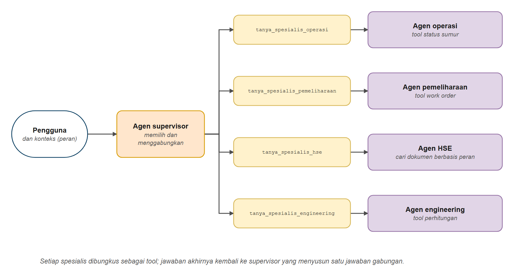

# Sistem Multi-Agen

Di bab ini Anda belajar membangun **tim agen**: seorang supervisor yang mendelegasikan pekerjaan ke spesialis, masing-masing dengan tool dan instruksinya sendiri. Anda akan membungkus agen sebagai tool, meneruskan konteks tepercaya (seperti peran dan area pengguna) ke bawah tanpa membiarkan model menyentuhnya, menjalankan spesialis secara paralel, dan mengukur berapa sebenarnya biaya semua ini. Di akhir bab Anda tahu cara membangun sistem multi-agen, dan sama pentingnya, kapan *tidak* perlu membangunnya.

## Prasyarat

- Sudah menyelesaikan [Memulai dengan Agen](../../hari3/03-agen/README.md)
- Sudah menyelesaikan [Guardrails dan Middleware Keamanan](../../hari3/07-guardrails-middleware/README.md) (disarankan; pemeriksaan peran di Contoh 3 adalah sebuah guardrail)
- Membantu: [Structured Output pada Agen](../../hari3/04-keluaran-terstruktur-agen/README.md) (dipakai pada tantangan bonus)

## Tujuan Pembelajaran

Setelah bab ini Anda bisa:

- Menjelaskan mengapa satu agen raksasa menjadi sulit dikelola
- Membangun agen spesialis dan membungkusnya sebagai tool untuk supervisor
- Meneruskan konteks tepercaya ke spesialis dengan `ToolRuntime`
- Memasang izin akses di kode, bukan di prompt
- Menjalankan spesialis yang saling bebas secara paralel
- Menangani spesialis yang gagal
- Mengukur biaya rancangan multi-agen dan memutuskan kapan layak dipakai

---

## Analogi: Penyelenggara Acara dan Tim Spesialis

**Bayangkan seorang penyelenggara acara (event organizer) yang menangani sebuah pesta pernikahan.**

- **Penyelenggara acara** membaca setiap permintaan dan memutuskan siapa yang menangani apa. Ia sendiri tidak memasak maupun memasang dekorasi
- **Tim katering** paham menu, jumlah porsi, dan dapurnya sendiri
- **Tim dekorasi** paham panggung, bunga, dan pencahayaan
- **Tim dokumentasi** paham foto dan video
- **Tim keuangan** paham anggaran dan tagihan

Sebuah permintaan masuk: *"Berapa porsi katering untuk 300 tamu, kapan dekorasi selesai, dan berapa total biayanya?"* Penyelenggara mengirim **satu catatan ke tiap tim**. Ketiga tim bekerja **bersamaan**, lalu penyelenggara merangkum jawabannya.

Perhatikan apa yang *tidak* terjadi:

- Tim katering tidak berbicara langsung dengan pemesan
- Tim dekorasi tidak perlu tahu cara menghitung porsi katering
- Penyelenggara tidak perlu tahu di mana letak bahan di gudang katering

**Agen bekerja dengan cara yang sama.**

| Penyelenggara acara | Sistem multi-agen |
|---------------|--------------------|
| Penyelenggara acara | **Agen supervisor**: memahami permintaan, mendelegasikan, merangkai jawaban |
| Tim-tim | **Agen spesialis**: tiap agen punya prompt terfokus dan sedikit tool |
| Catatan tugas | **Permintaan** yang diteruskan supervisor ke spesialis |
| Laporan selesai | **Jawaban akhir** spesialis yang kembali ke supervisor |
| Gelang tanda pengenal setiap orang (peran, area) | **Konteks runtime**: fakta yang diteruskan dan tidak bisa diubah siapa pun |



*Gambar 1. Supervisor yang mendelegasikan ke spesialis*

*Acara kecil dengan satu orang tidak membutuhkan penyelenggara. Multi-agen untuk pekerjaan yang sudah terlalu besar bagi satu orang.*

---

## Mengapa Memecah Satu Agen Menjadi Banyak?

| Masalah pada satu agen besar | Bagaimana tim membantu |
|------------------------------|------------------------|
| Definisi sembilan tool dikirim pada **setiap** panggilan model | Tiap spesialis hanya membawa beberapa tool miliknya |
| Prompt panjang yang mencampur tiga pekerjaan jadi saling bertentangan | Tiap spesialis punya satu prompt pendek yang terfokus |
| Siapa pun yang memakai agen bisa memakai setiap tool | Beri spesialis yang sensitif aturan akses sendiri |
| Sulit menguji semuanya sekaligus | Uji dan perbaiki tiap spesialis secara terpisah |
| Tim berbeda punya domain berbeda | Tiap tim punya spesialisnya sendiri |

**Tetapi tidak gratis.** Setiap delegasi menambah panggilan model. Contoh 5 mengukur biayanya.

---

## Pola Multi-Agen Sekilas

| Pola | Cara kerja | Di mana Anda melihatnya |
|------|-----------|--------------------------|
| **Supervisor dengan spesialis sebagai tool** (di dokumentasi LangChain disebut pola *Subagents*) | Satu agen memanggil agen lain seperti tool | Contoh 2-5 |
| **Router** | Satu langkah murah mengarahkan permintaan ke agen yang tepat | Mudah dibuat dengan structured output `Literal` (bab 4) |
| **Handoffs** | Agen saling menyerahkan kendali secara langsung | Tingkat lanjut; dibangun dengan LangGraph |
| **Evaluator-optimizer** (penulis dan reviewer) | Satu agen membuat draf, agen lain menilai, diulang sampai disetujui | Pola konsep; tidak dibangun di kursus |



*Gambar 2. Empat pola multi-agen*

Nama tiga pola pertama mengikuti [dokumentasi Multi-agent LangChain](https://docs.langchain.com/oss/python/langchain/multi-agent), yang juga mencatat dua pola lain: *Skills* (satu agen memuat prompt dan pengetahuan khusus saat diperlukan) dan *Custom workflow* (alur buatan sendiri dengan LangGraph). Evaluator-optimizer berasal dari artikel Anthropic [Building effective agents](https://www.anthropic.com/engineering/building-effective-agents), bukan dari daftar LangChain.

Bab ini berfokus pada pola pertama: paling sederhana, paling umum, dan bekerja dengan semua yang sudah Anda pelajari.

---

## Membangun Sistem Multi-Agen

---

### Contoh 1: Masalah Satu Agen Raksasa

Pertama, *ukur* masalahnya. Kita membangun "monolit" dengan sembilan tool dari tiga departemen dan membandingkannya dengan spesialis yang hanya memegang tiga tool miliknya.

**Kode**: [`code/01_too_many_tools.py`](./code/01_too_many_tools.py)
**Jalankan**: `python hari4/08-sistem-multi-agen/code/01_too_many_tools.py`

```python
# %% [markdown]
# # Contoh 1: Masalah Satu Agen Raksasa
# Jalankan sel satu per satu dengan Shift+Enter, atau seluruh file: `python hari4/08-sistem-multi-agen/code/01_too_many_tools.py`
#
# Satu agen dengan semua tool adalah rancangan paling sederhana, dan ia berhasil... sampai ia membesar.
# Contoh ini membangun agen "monolit" dengan sembilan tool dari tiga departemen, lalu mengukur
# biayanya dibandingkan dengan seorang spesialis yang hanya memegang tiga tool miliknya sendiri.

# %%
# Langkah 1 - Menyiapkan model
import json
import os

from dotenv import load_dotenv
from langchain.agents import create_agent
from langchain_core.messages import AIMessage, HumanMessage
from langchain_core.messages.utils import count_tokens_approximately
from langchain_core.tools import tool
from langchain_core.utils.function_calling import convert_to_openai_tool
from langchain_openai import ChatOpenAI

from migas_shared.field_tools import cek_status_sumur, hitung_water_cut, konversi_satuan

load_dotenv()

model = ChatOpenAI(
    model=os.getenv("ONLINE_MODEL"),
    base_url=os.getenv("ONLINE_BASE_URL"),
    api_key=os.getenv("ONLINE_API_KEY"),
    reasoning_effort=os.getenv("LLM_REASONING_EFFORT", "none"),
)

# %% [markdown]
# ## Langkah 2 - Sembilan tool dari tiga departemen
# Departemen Operasi, Pemeliharaan, dan Engineering masing-masing punya tiga tool.

# %%
# ---------- Departemen Operasi ----------
@tool
def daftar_sumur_bermasalah() -> str:
    """Daftar sumur yang sedang bermasalah atau tidak berproduksi normal di semua area."""
    return "Sumur bermasalah: KN-033 (menunggu pulling), SR-027 (investigasi H2S)"


@tool
def jadwal_pulling() -> str:
    """Jadwal pekerjaan pulling dan workover rig yang akan datang."""
    return "Jadwal rig: KN-033 pulling sucker rod Selasa 08.00; SR-020 ganti motor ESP Kamis 14.00"


# ---------- Departemen Pemeliharaan ----------
@tool
def daftar_wo_terbuka() -> str:
    """Daftar work order pemeliharaan yang masih terbuka."""
    return "WO terbuka: WO-26-12501 kebocoran seal ESP SR-020 (tinggi), WO-26-12502 lampu manifold Seruni (rendah)"


@tool
def cek_status_peralatan(kode_peralatan: str) -> str:
    """Cek kondisi satu peralatan (pompa, separator, kompresor).

    Args:
        kode_peralatan: Kode peralatan, contoh "P-SR1-101"
    """
    return f"{kode_peralatan}: {'tekanan discharge rendah' if kode_peralatan.endswith('101') else 'normal'}"


@tool
def ketersediaan_teknisi() -> str:
    """Kapan teknisi pemeliharaan dapat bekerja."""
    return "Teknisi mekanik tersedia Jumat 09.00-15.00"


# ---------- Departemen Engineering ----------
@tool
def cek_tekanan_vs_desain(tekanan_psi: float, mawp_psi: float) -> str:
    """Bandingkan tekanan operasi dengan tekanan kerja maksimum yang diizinkan (MAWP).

    Args:
        tekanan_psi: Tekanan operasi dalam psi
        mawp_psi: MAWP peralatan dalam psi
    """
    persen = tekanan_psi / mawp_psi * 100
    return f"Tekanan operasi {persen:.0f}% dari MAWP ({'AMAN' if persen < 90 else 'MENDEKATI BATAS'})"


TOOL_OPERASI = [cek_status_sumur, daftar_sumur_bermasalah, jadwal_pulling]
TOOL_PEMELIHARAAN = [daftar_wo_terbuka, cek_status_peralatan, ketersediaan_teknisi]
TOOL_ENGINEERING = [hitung_water_cut, konversi_satuan, cek_tekanan_vs_desain]

# %% [markdown]
# ## Langkah 3 - Seberapa besar definisi tool?
# Definisi setiap tool dikirim ke model pada SETIAP panggilan. `token_skema_tool` memperkirakan ukurannya.

# %%
def token_skema_tool(tools) -> int:
    """Perkiraan token yang dipakai definisi tool pada SETIAP panggilan ke model."""
    skema = [convert_to_openai_tool(t) for t in tools]
    return count_tokens_approximately([json.dumps(skema)])


def token_masukan_panggilan_pertama(response) -> int:
    """Token masukan pada panggilan model pertama dalam satu proses (sudah termasuk prompt dan definisi tool)."""
    ai_pertama = next(m for m in response["messages"] if isinstance(m, AIMessage))
    return (ai_pertama.usage_metadata or {}).get("input_tokens", 0)


semua_tool = TOOL_OPERASI + TOOL_PEMELIHARAAN + TOOL_ENGINEERING

print("1. Seberapa besar definisi tool?")
print("-" * 60)
print(f"   Spesialis Operasi: {len(TOOL_OPERASI)} tool  = sekitar {token_skema_tool(TOOL_OPERASI):>4} token per panggilan")
print(f"   Agen monolit:      {len(semua_tool)} tool  = sekitar {token_skema_tool(semua_tool):>4} token per panggilan\n")

# %% [markdown]
# ## Langkah 4 - Agen monolit dan spesialis
# Monolit memegang kesembilan tool; spesialis Operasi hanya tiga.

# %%
monolit = create_agent(
    model, tools=semua_tool, system_prompt="Anda asisten koordinator. Pakai tool. Jawab singkat."
)
spesialis_operasi = create_agent(
    model,
    tools=TOOL_OPERASI,
    system_prompt="Anda spesialis Operasi. Pakai tool. Jawab singkat.",
)

# %% [markdown]
# ## Langkah 5 - Pertanyaan yang sama untuk keduanya
# Bandingkan token masukan pada panggilan model pertama.

# %%
pertanyaan = "Bagaimana status sumur SR-020?"
print(f"2. Pertanyaan yang sama untuk keduanya: \"{pertanyaan}\"")
print("-" * 60)
besar = monolit.invoke({"messages": [HumanMessage(content=pertanyaan)]})
kecil = spesialis_operasi.invoke({"messages": [HumanMessage(content=pertanyaan)]})
print(f"   Monolit:           {besar['messages'][-1].content}")
print(f"      token masukan pada panggilan model pertama: {token_masukan_panggilan_pertama(besar)}")
print(f"   Spesialis Operasi: {kecil['messages'][-1].content}")
print(f"      token masukan pada panggilan model pertama: {token_masukan_panggilan_pertama(kecil)}\n")

# %% [markdown]
# ## Yang ditunjukkan contoh ini
# - Kedua agen menjawab dengan benar: monolit BERHASIL pada ukuran ini
# - Tetapi setiap panggilan membawa kesembilan definisi tool, bahkan untuk pertanyaan Operasi
# - Lebih banyak tool berarti lebih banyak token, lebih mahal, dan lebih besar peluang salah pilih tool
# - Satu system prompt panjang untuk tiga pekerjaan juga makin sulit dirawat
# - Solusinya: spesialis dengan sedikit tool, dan seorang koordinator yang mendelegasikan
```

### Keluaran yang Diharapkan

> **Catatan:** jawaban model bisa berbeda setiap kali dijalankan. Keluaran di seluruh bab ini berasal dari menjalankan skrip sebenarnya.

```text
1. Seberapa besar definisi tool?
------------------------------------------------------------
   Spesialis Operasi: 3 tool  = sekitar  198 token per panggilan
   Agen monolit:      9 tool  = sekitar  748 token per panggilan

2. Pertanyaan yang sama untuk keduanya: "Bagaimana status sumur SR-020?"
------------------------------------------------------------
   Monolit:           Berikut status sumur **SR-020**:

- **Lokasi**: Seruni
- **Jenis Pompa**: ESP (Electric Submersible Pump)
- **Status**: Produksi (normal)
- **Produksi Minyak**: 120 bopd
- **Produksi Air**: 480 bwpd
- **Catatan**: ESP sempat trip overload kemarin sore, namun sudah stabil kembali sejak pukul **18.00**.

Mau saya cek water cut atau hal lain terkait sumur ini?
      token masukan pada panggilan model pertama: 1109
   Spesialis Operasi: Berikut status sumur **SR-020**:

- **Area**: Seruni
- **Jenis Pompa**: ESP
- **Status**: Produksi
- **Produksi**: Minyak 120 bopd, Air 480 bwpd
- **Catatan**: ESP sempat *trip overload* kemarin sore, namun sudah stabil sejak pukul 18.00.

Sumur saat ini beroperasi normal kembali.
      token masukan pada panggilan model pertama: 451
```

*(Jumlah token mutlak bergantung pada model dan penyedia Anda, yang menambahkan overhead sendiri. Yang penting adalah selisih antara keduanya.)*

### Cara Kerjanya

1. **Definisi tool adalah bagian dari setiap permintaan.** Model perlu nama, deskripsi, dan parameter tiap tool untuk memutuskan apa yang dipanggil. Sembilan tool membutuhkan beberapa ratus token yang dikirim pada *setiap* panggilan model dalam satu proses.
2. **Kedua agen menjawab dengan benar.** Monolit *berhasil* pada ukuran ini, itulah sebabnya Anda tidak boleh memecah agen terlalu dini.
3. **Biaya naik seiring jumlah tool.** Lebih banyak tool berarti lebih banyak token, latensi lebih tinggi, dan lebih besar peluang model memilih tool yang salah. Tambahkan system prompt panjang yang bercampur dan agen makin sulit dirawat.

> **Tanda sudah saatnya memecah:** daftar tool terus bertambah, prompt punya bagian untuk pekerjaan yang tidak berhubungan, Anda melihat kesalahan pilih tool, atau orang yang berbeda membutuhkan izin akses berbeda.

---

### Contoh 2: Spesialis sebagai Tool

Pola inti: bangun agen spesialis kecil, **bungkus masing-masing dalam `@tool`**, lalu beri tool wrapper itu ke supervisor.

**Kode**: [`code/02_subagent_as_tool.py`](./code/02_subagent_as_tool.py)
**Jalankan**: `python hari4/08-sistem-multi-agen/code/02_subagent_as_tool.py`

```python
# %% [markdown]
# # Contoh 2: Spesialis sebagai Tool
# Jalankan sel satu per satu dengan Shift+Enter, atau seluruh file: `python hari4/08-sistem-multi-agen/code/02_subagent_as_tool.py`
#
# Rancangan multi-agen paling sederhana: bangun agen spesialis kecil, lalu bungkus masing-masing dalam
# sebuah `@tool`. Agen "supervisor" menerima tool wrapper itu dan memutuskan siapa yang ditanya.
#
#     Pengguna -> Supervisor -> tanya_spesialis_operasi ------> Agen Operasi ------> tool sumur
#                          \--> tanya_spesialis_pemeliharaan -> Agen Pemeliharaan -> tool work order
#
# Bagi supervisor, spesialis hanyalah tool lain. DESKRIPSI spesialis adalah cara supervisor tahu kapan
# memanggilnya.

# %%
# Langkah 1 - Menyiapkan model
import os

from dotenv import load_dotenv
from langchain.agents import create_agent
from langchain_core.messages import AIMessage, HumanMessage
from langchain_core.tools import tool
from langchain_openai import ChatOpenAI

from migas_shared.field_tools import cek_status_sumur

load_dotenv()

model = ChatOpenAI(
    model=os.getenv("ONLINE_MODEL"),
    base_url=os.getenv("ONLINE_BASE_URL"),
    api_key=os.getenv("ONLINE_API_KEY"),
    reasoning_effort=os.getenv("LLM_REASONING_EFFORT", "none"),
)

# %% [markdown]
# ## Langkah 2 - Tool tingkat rendah dan agen spesialis
# Tiap spesialis adalah agen biasa dengan sedikit tool dan prompt yang terfokus.

# %%
@tool
def jadwal_pulling() -> str:
    """Jadwal pekerjaan pulling dan workover rig yang akan datang."""
    return "Jadwal rig: KN-033 pulling sucker rod Selasa 08.00; SR-020 ganti motor ESP Kamis 14.00"


@tool
def daftar_wo_terbuka() -> str:
    """Daftar work order pemeliharaan yang masih terbuka."""
    return (
        "WO terbuka: WO-26-12501 sucker rod KN-033 patah, menunggu rig (tinggi); "
        "WO-26-12502 lampu manifold Seruni berkedip (rendah)"
    )


@tool
def ketersediaan_teknisi() -> str:
    """Kapan teknisi pemeliharaan dapat bekerja."""
    return "Teknisi mekanik tersedia Jumat 09.00-15.00"


agen_operasi = create_agent(
    model,
    tools=[cek_status_sumur, jadwal_pulling],
    system_prompt="Anda spesialis Operasi produksi. Pakai tool Anda. Jawab dalam 1-2 kalimat pendek.",
)
agen_pemeliharaan = create_agent(
    model,
    tools=[daftar_wo_terbuka, ketersediaan_teknisi],
    system_prompt="Anda spesialis Pemeliharaan. Pakai tool Anda. Jawab dalam 1-2 kalimat pendek.",
)

# %% [markdown]
# ## Langkah 3 - Membungkus tiap spesialis dalam sebuah tool
# Hanya jawaban AKHIR spesialis yang dikembalikan ke supervisor.

# %%
@tool
def tanya_spesialis_operasi(permintaan: str) -> str:
    """Tanya spesialis Operasi tentang status sumur, produksi, dan jadwal pulling atau workover.
    Tulis pertanyaan sebagai kalimat lengkap."""
    hasil = agen_operasi.invoke({"messages": [HumanMessage(content=permintaan)]})
    return hasil["messages"][-1].content  # hanya jawaban AKHIR yang dikembalikan


@tool
def tanya_spesialis_pemeliharaan(permintaan: str) -> str:
    """Tanya spesialis Pemeliharaan tentang kerusakan peralatan, work order terbuka, dan jadwal teknisi.
    Tulis pertanyaan sebagai kalimat lengkap."""
    hasil = agen_pemeliharaan.invoke({"messages": [HumanMessage(content=permintaan)]})
    return hasil["messages"][-1].content

# %% [markdown]
# ## Langkah 4 - Supervisor
# Supervisor hanya mengenal dua tool wrapper. Fungsi `tampilkan_delegasi` mencetak spesialis mana yang ditanya.

# %%
supervisor = create_agent(
    model,
    tools=[tanya_spesialis_operasi, tanya_spesialis_pemeliharaan],
    system_prompt=(
        "Anda koordinator yang mengoordinasi tim spesialis. Anda tidak memegang data sendiri. "
        "Delegasikan ke spesialis yang tepat, lalu beri pengguna satu jawaban yang jelas."
    ),
)


def tampilkan_delegasi(response) -> None:
    """Cetak spesialis mana yang ditanya supervisor, dan apa yang ditanyakan."""
    for pesan in response["messages"]:
        if isinstance(pesan, AIMessage):
            for panggilan in pesan.tool_calls:
                print(f"   Supervisor -> {panggilan['name']}: \"{panggilan['args']['permintaan']}\"")


def tanya_supervisor(pertanyaan: str) -> None:
    print(f"Pengguna: {pertanyaan}")
    response = supervisor.invoke({"messages": [HumanMessage(content=pertanyaan)]})
    tampilkan_delegasi(response)
    print(f"Supervisor: {response['messages'][-1].content}\n")

# %% [markdown]
# ## Langkah 5 - Pertanyaan 1: satu spesialis (Operasi)

# %%
tanya_supervisor("Bagaimana status sumur SR-020?")

# %% [markdown]
# ## Langkah 6 - Pertanyaan 2: satu spesialis (Pemeliharaan)

# %%
tanya_supervisor("Ada peralatan yang rusak, dan kapan teknisi bisa memperbaikinya?")

# %% [markdown]
# ## Langkah 7 - Pertanyaan 3: butuh kedua spesialis

# %%
tanya_supervisor("Apakah sumur KN-033 bisa segera berproduksi lagi, dan adakah work order yang menahannya?")

# %% [markdown]
# ## Yang baru saja terjadi
# - Tiap spesialis adalah agen biasa dengan sedikit tool dan prompt yang terfokus
# - Membungkusnya dalam `@tool` membuatnya bisa dipanggil oleh agen lain
# - Supervisor memilih spesialis dari DESKRIPSI tool wrapper
# - Pertanyaan ke-3 butuh kedua spesialis, jadi supervisor memanggil dua
# - Hanya jawaban akhir yang naik ke atas. Supervisor tidak pernah melihat panggilan tool mentahnya
```

### Keluaran yang Diharapkan

```text
Pengguna: Bagaimana status sumur SR-020?
   Supervisor -> tanya_spesialis_operasi: "Bagaimana status terbaru dari sumur SR-020?"
Supervisor: Berikut adalah status terbaru sumur **SR-020** di area Seruni:

- **Status:** Produksi dengan ESP (Electric Submersible Pump)
- **Produksi minyak:** 120 bopd
- **Produksi air:** 480 bwpd
- **Catatan penting:** ESP sempat mengalami *trip overload* kemarin sore, namun sudah **stabil kembali** sejak pukul 18.00.

Secara keseluruhan, sumur SR-020 masih beroperasi normal dalam produksi. Jika ada indikasi masalah lebih lanjut atau perlu tindak lanjut terkait trip overload tadi, saya bisa koordinasikan lebih lanjut dengan tim terkait. Ada yang ingin ditanyakan lagi?

Pengguna: Ada peralatan yang rusak, dan kapan teknisi bisa memperbaikinya?
   Supervisor -> tanya_spesialis_pemeliharaan: "Ada peralatan yang rusak, dan kapan teknisi bisa memperbaikinya? Tolong informasikan detail kerusakan peralatan dan jadwal teknisi yang tersedia untuk perbaikan."
Supervisor: Berdasarkan informasi dari Spesialis Pemeliharaan, berikut ringkasan untuk Anda:

---

###  Peralatan Rusak & Jadwal Teknisi

| No | Work Order | Kerusakan | Prioritas |
|----|-----------|-----------|-----------|
| 1 | **WO-26-12501** | Sucker rod **KN-033** patah |  **Tinggi** — masih menunggu rig |
| 2 | **WO-26-12502** | Lampu manifold **Seruni** berkedip |  **Rendah** |

###  Ketersediaan Teknisi
**Teknisi mekanik** tersedia pada:
> **Jumat, pukul 09.00 – 15.00**

Namun, untuk WO prioritas tinggi (sucker rod patah), perbaikannya masih menunggu ketersediaan rig — jadi perlu koordinasi lebih lanjut dengan tim Operasi untuk jadwal rig-nya.

Apakah ada yang ingin saya tanyakan lebih detail ke spesialis terkait salah satu work order tersebut?

Pengguna: Apakah sumur KN-033 bisa segera berproduksi lagi, dan adakah work order yang menahannya?
   Supervisor -> tanya_spesialis_operasi: "Bagaimana status produksi sumur KN-033 dan apakah sumur tersebut bisa segera berproduksi lagi?"
   Supervisor -> tanya_spesialis_pemeliharaan: "Apakah ada work order terbuka yang menahan sumur KN-033 dari produksi?"
Supervisor: Berdasarkan informasi dari kedua spesialis, berikut rangkumannya untuk sumur **KN-033**:

---

### Jawaban Singkat:
**Belum bisa berproduksi sekarang, tetapi sudah terjadwal untuk segera ditangani.**

---

### Rinciannya:

| Aspek | Status |
|---|---|
| **Status Produksi** | Tidak berproduksi (0 bopd, 0 bwpd) |
| **Penyebab** | Sucker rod patah |
| **Work Order Penahan** | **WO-26-12501** (masih terbuka) |
| **Jadwal Penanganan** | Rig sudah dijadwalkan pada **Selasa pukul 08.00** untuk pekerjaan pulling sucker rod |

---

### Kesimpulan:
Sumur KN-033 memang **ditahan oleh WO-26-12501** karena sucker rod patah. Namun, kabar baiknya, jadwal rig sudah dipastikan untuk hari **Selasa pukul 08.00**, sehingga setelah pekerjaan pulling sucker rod selesai, sumur ini diharapkan bisa segera kembali berproduksi.
```

### Cara Kerjanya

1. **Spesialis hanyalah agen.** Prompt kecil, beberapa tool, satu pekerjaan.
2. **Tool wrapper adalah jembatannya.** Bagi supervisor, `tanya_spesialis_operasi(permintaan)` tampak seperti tool lain. Di dalamnya, ia menjalankan seluruh loop agen dan mengembalikan teks akhirnya.
3. **Docstring adalah deskripsi tugasnya.** Supervisor memilih spesialis dengan cara yang sama seperti memilih tool di bab 3, dari nama dan deskripsi. Deskripsi yang kabur menghasilkan delegasi yang salah.
4. **Supervisor menulis "catatan tugas".** Lihat baris `Supervisor ->`: ia *menulis ulang* pertanyaan pengguna menjadi permintaan untuk spesialis. Beri tahu di system prompt kalau Anda ingin permintaan lebih lengkap.
5. **Hanya jawaban akhir yang kembali.** Panggilan tool perantara spesialis tetap di dalamnya, sehingga konteks supervisor kecil. (Artinya juga supervisor tidak bisa melihat *bagaimana* spesialis sampai pada jawabannya.)
6. **Supervisor hanya menanyai spesialis yang perlu.** Pada rekaman di atas pertanyaan pertama (status sumur) cukup dijawab spesialis Operasi, pertanyaan kedua (peralatan rusak dan jadwal teknisi) cukup spesialis Pemeliharaan, dan pertanyaan ketiga (sumur bisa produksi lagi dan work order yang menahannya) membutuhkan keduanya sehingga supervisor memanggil dua tool pada satu langkah. Jumlah dan pilihan spesialis bisa berbeda pada eksekusi lain.

---

### Contoh 3: Meneruskan Konteks ke Spesialis

Beberapa fakta tidak boleh diputuskan model: peran pengguna dan areanya. Kalau model harus mengetik `"hse"` di setiap panggilan, ia bisa keliru, atau dibujuk untuk bertanya tentang area lain.

Sebagai gantinya, teruskan sebagai **konteks runtime**. Tool wrapper menerima `ToolRuntime` dan membaca konteks langsung. Model tidak pernah melihatnya dan tidak bisa mengubahnya.

Pada tim multi-agen ada satu langkah tambahan: wrapper harus **meneruskan konteks itu ke agen spesialis** (`context=runtime.context`), supaya tool di dalam spesialis, misalnya `cari_dokumen`, juga bisa membaca peran pengguna.

**Kode**: [`code/03_shared_context.py`](./code/03_shared_context.py)
**Jalankan**: `python hari4/08-sistem-multi-agen/code/03_shared_context.py`

```python
# %% [markdown]
# # Contoh 3: Meneruskan Konteks ke Spesialis
# Jalankan sel satu per satu dengan Shift+Enter, atau seluruh file: `python hari4/08-sistem-multi-agen/code/03_shared_context.py`
#
# Ada fakta yang tidak boleh diputuskan model: peran pengguna dan area kerjanya. Kalau model harus
# mengetik `role="hse"` di setiap panggilan, ia bisa keliru, atau dibujuk untuk bertanya tentang area lain.
#
# Karena itu fakta itu diteruskan sebagai KONTEKS RUNTIME. Model tidak melihatnya dan tidak bisa
# mengubahnya. Tool membaca konteks lewat `ToolRuntime`. Pada tim multi-agen ada satu langkah tambahan:
# tool wrapper harus MENERUSKAN konteks itu ke agen spesialis (`context=runtime.context`), supaya tool di
# dalam spesialis juga bisa membacanya.
#
# Tiga aturan akses dipasang di KODE pada contoh ini:
# 1. Operator hanya boleh melihat sumur di areanya sendiri (cek di dalam tool sumur)
# 2. Spesialis Engineering hanya melayani peran engineer dan management (cek di tool wrapper)
# 3. Dokumen berstatus akses hse hanya terlihat oleh peran hse dan management (cek di pencarian dokumen)

# %%
# Langkah 1 - Menyiapkan model
import os

from dotenv import load_dotenv
from langchain.agents import create_agent
from langchain.tools import ToolRuntime
from langchain_core.messages import HumanMessage
from langchain_core.tools import tool
from langchain_openai import ChatOpenAI

from migas_shared.rag_tools import KonteksPengguna, cari_dokumen
from migas_shared.field_tools import DATA_SUMUR, hitung_water_cut

load_dotenv()

model = ChatOpenAI(
    model=os.getenv("ONLINE_MODEL"),
    base_url=os.getenv("ONLINE_BASE_URL"),
    api_key=os.getenv("ONLINE_API_KEY"),
    reasoning_effort=os.getenv("LLM_REASONING_EFFORT", "none"),
)

# %% [markdown]
# ## Langkah 2 - Tool tingkat rendah dengan aturan akses di kode
# `cek_sumur_di_area` membaca konteks lewat `ToolRuntime`: operator hanya melihat sumur di areanya.

# %%
@tool
def cek_sumur_di_area(kode_sumur: str, runtime: ToolRuntime[KonteksPengguna]) -> str:
    """Cek status operasi sebuah sumur.

    Args:
        kode_sumur: Kode sumur, contoh "SR-020"
    """
    data = DATA_SUMUR.get(kode_sumur.strip().upper())
    if data is None:
        return f"Sumur {kode_sumur} tidak ditemukan. Sumur yang terdaftar: {', '.join(DATA_SUMUR)}"
    # Aturan akses di KODE: operator hanya melihat sumur di areanya
    if runtime.context.role == "operator" and data["area"] != runtime.context.area:
        return f"Akses ditolak: sumur {kode_sumur} berada di area {data['area']}, bukan area Anda ({runtime.context.area})."
    return (f"Sumur {kode_sumur} ({data['area']}): status {data['status']}, minyak {data['minyak_bopd']} bopd, "
            f"air {data['air_bwpd']} bwpd. Catatan: {data['catatan']}")

# %% [markdown]
# ## Langkah 3 - Agen spesialis
# Spesialis Operasi dan HSE memakai `context_schema=KonteksPengguna` agar tool-nya bisa membaca konteks.

# %%
agen_operasi = create_agent(
    model,
    tools=[cek_sumur_di_area],
    context_schema=KonteksPengguna,
    system_prompt="Anda spesialis Operasi. Pakai cek_sumur_di_area untuk setiap sumur yang ditanyakan. Jawab 1-2 kalimat.",
)
agen_hse = create_agent(
    model,
    tools=[cari_dokumen],
    context_schema=KonteksPengguna,
    system_prompt=(
        "Anda spesialis HSE. Jawab HANYA dari hasil cari_dokumen dan sebutkan id dokumen sumbernya. "
        "Jika tidak ada dokumen yang relevan, katakan terus terang. Jawab 2-3 kalimat."
    ),
)
agen_engineering = create_agent(
    model,
    tools=[hitung_water_cut],
    system_prompt="Anda spesialis Engineering. Hitung dengan tool, jangan menebak. Jawab 1-2 kalimat.",
)

# %% [markdown]
# ## Langkah 4 - Tool wrapper yang meneruskan konteks
# Tiap wrapper meneruskan `context=runtime.context` ke spesialisnya. Wrapper Engineering juga memeriksa peran di kode.

# %%
@tool
def tanya_spesialis_operasi(permintaan: str, runtime: ToolRuntime[KonteksPengguna]) -> str:
    """Tanya spesialis Operasi tentang status dan produksi sumur."""
    hasil = agen_operasi.invoke(
        {"messages": [HumanMessage(content=permintaan)]},
        context=runtime.context,  # konteks diteruskan ke dalam spesialis
    )
    return hasil["messages"][-1].content


@tool
def tanya_spesialis_hse(permintaan: str, runtime: ToolRuntime[KonteksPengguna]) -> str:
    """Tanya spesialis HSE tentang prosedur keselamatan (SOP) dan laporan insiden atau investigasi."""
    hasil = agen_hse.invoke(
        {"messages": [HumanMessage(content=permintaan)]},
        context=runtime.context,  # peran pengguna menentukan dokumen yang terlihat
    )
    return hasil["messages"][-1].content


@tool
def tanya_spesialis_engineering(permintaan: str, runtime: ToolRuntime[KonteksPengguna]) -> str:
    """Tanya spesialis Engineering untuk perhitungan teknis, misalnya water cut dari angka produksi.
    Sertakan angka produksinya dalam permintaan."""
    # Aturan akses di KODE: model tidak bisa membujuk if ini
    if runtime.context.role not in ("engineer", "management"):
        return "Akses ditolak: analisis Engineering hanya untuk peran engineer dan management."
    hasil = agen_engineering.invoke({"messages": [HumanMessage(content=permintaan)]})
    return hasil["messages"][-1].content

# %% [markdown]
# ## Langkah 5 - Supervisor dan fungsi skenario
# `context_schema` memberi tahu agen bentuk konteksnya. Konteks dikirim bersama pesan saat `invoke`.

# %%
supervisor = create_agent(
    model,
    tools=[tanya_spesialis_operasi, tanya_spesialis_hse, tanya_spesialis_engineering],
    context_schema=KonteksPengguna,  # memberi tahu agen bentuk konteksnya
    system_prompt=(
        "Anda koordinator yang mengoordinasi spesialis. Delegasikan ke spesialis yang tepat dan "
        "minta SEMUA yang relevan pada langkah yang sama. Jika spesialis menolak akses, sampaikan "
        "dengan jelas kepada pengguna dan jangan mencoba menyiasatinya. Jawab ringkas."
    ),
)


def jalankan_skenario(label: str, konteks: KonteksPengguna, pertanyaan: str) -> None:
    print(f"{label}")
    print("-" * 60)
    print(f"Pengguna: {pertanyaan}")
    response = supervisor.invoke(
        {"messages": [HumanMessage(content=pertanyaan)]},
        context=konteks,  # diteruskan bersama pesan
    )
    print(f"Supervisor: {response['messages'][-1].content}\n")

# %% [markdown]
# ## Langkah 6 - Skenario 1: operator menanyakan dua sumur
# SR-027 ada di areanya (Seruni), KN-033 di area lain.

# %%
jalankan_skenario(
    "Operator, area Seruni",
    KonteksPengguna(role="operator", area="Seruni", user_id="OP-114"),
    "Bagaimana status sumur SR-027 dan sumur KN-033?",
)

# %% [markdown]
# ## Langkah 7 - Skenario 2: operator menanyakan laporan investigasi
# Dokumen berakses HSE tidak terlihat oleh operator.

# %%
jalankan_skenario(
    "Operator, area Seruni",
    KonteksPengguna(role="operator", area="Seruni", user_id="OP-114"),
    "Apa temuan utama laporan investigasi INV-2026-011?",
)

# %% [markdown]
# ## Langkah 8 - Skenario 3: petugas HSE menanyakan hal yang sama

# %%
jalankan_skenario(
    "Petugas HSE, area Seruni",
    KonteksPengguna(role="hse", area="Seruni", user_id="HSE-031"),
    "Apa temuan utama laporan investigasi INV-2026-011?",
)

# %% [markdown]
# ## Langkah 9 - Skenario 4: operator meminta analisis Engineering
# Wrapper Engineering menolak karena peran bukan engineer atau management.

# %%
jalankan_skenario(
    "Operator, area Seruni",
    KonteksPengguna(role="operator", area="Seruni", user_id="OP-114"),
    "Hitung water cut untuk produksi 120 bopd minyak dan 480 bwpd air.",
)

# %% [markdown]
# ## Langkah 10 - Skenario 5: engineer meminta analisis yang sama

# %%
jalankan_skenario(
    "Engineer, area Kenanga",
    KonteksPengguna(role="engineer", area="Kenanga", user_id="ENG-208"),
    "Hitung water cut untuk produksi 120 bopd minyak dan 480 bwpd air.",
)

# %% [markdown]
# ## Yang baru saja terjadi
# - Pertanyaan yang sama memberi jawaban berbeda karena KONTEKS-nya berbeda
# - Peran dan area tidak pernah diketik model, jadi tidak bisa keliru atau dipalsukan
# - Penolakan datang dari kode di dalam tool, bukan dari kebaikan hati model
# - Konteks tidak terlihat oleh model; hanya tool Anda yang bisa membacanya
```

### Keluaran yang Diharapkan

Contoh ini memakai pencarian dokumen sungguhan dari paket bersama (tool `cari_dokumen` di atas indeks hybrid yang sama dengan bab 10), sehingga pada eksekusi pertama indeks dibangun lebih dulu.

```text
Operator, area Seruni
------------------------------------------------------------
Pengguna: Bagaimana status sumur SR-027 dan sumur KN-033?
Supervisor: Berdasarkan informasi dari spesialis Operasi:

**Sumur SR-027:**
- Berstatus **Produksi**
- Produksi minyak: 95 bopd
- Produksi air: 380 bwpd
- Ada catatan pembacaan H2S 12 ppm yang sedang dalam investigasi HSE.

**Sumur KN-033:**
- Tidak dapat dicek oleh spesialis Operasi karena berada di area **Kenanga**, bukan area Anda (Seruni).

Mohon konfirmasi apakah Anda ingin saya menanyakan status KN-033 ke spesialis yang berwenang di area Kenanga, atau lanjutkan dengan detail lebih lanjut terkait sumur SR-027?

Operator, area Seruni
------------------------------------------------------------
Pengguna: Apa temuan utama laporan investigasi INV-2026-011?
Supervisor: Spesialis HSE melaporkan bahwa mereka **tidak menemukan** laporan investigasi dengan kode **INV-2026-011** di basis data yang tersedia.

Dokumen yang ditemukan hanyalah laporan bulanan produksi (RPT-SR-2026-07) yang menyebutkan adanya kejadian yang sedang diinvestigasi oleh HSE, namun bukan laporan investigasi INV-2026-011 itu sendiri.

Apakah Anda ingin saya meminta spesialis lain untuk mencarinya, atau ada informasi tambahan yang bisa membantu (misalnya departemen yang menerbitkan laporan tersebut)?

Petugas HSE, area Seruni
------------------------------------------------------------
Pengguna: Apa temuan utama laporan investigasi INV-2026-011?
Supervisor: Berdasarkan laporan investigasi **INV-2026-011**, berikut temuan utamanya:

1. **Detector kontraktor tidak di-bump test** sesuai ketentuan harian, dan sensornya tidak responsif.
2. **Pekerja kontraktor masih mengacu pada SOP-HSE-001 Rev. 2** (evakuasi pada 20 ppm), karena sosialisasi Rev. 3 belum dilakukan.
3. **Posisi pekerja berada di sisi downwind** dan windsock dalam kondisi robek (sehingga tidak dapat menunjukkan arah angin dengan baik).
4. **Hal positif:** Sistem *buddy* sudah diterapkan dan operator bertindak tepat.

Apakah ada aspek lain dari laporan ini yang ingin Anda ketahui lebih lanjut?

Operator, area Seruni
------------------------------------------------------------
Pengguna: Hitung water cut untuk produksi 120 bopd minyak dan 480 bwpd air.
Supervisor: Spesialis Engineering menolak akses karena peran saya tidak memiliki otorisasi untuk analisis tersebut. Saya tidak akan mencoba menyiasati pembatasan ini.

Mohon maaf, saya tidak dapat menghitung water cut untuk Anda karena akses ke spesialis Engineering ditolak. Untuk menghitung water cut secara manual, rumusnya adalah:

**Water Cut = (Volume Air) / (Volume Air + Volume Minyak) × 100%**

Dengan data Anda:
- Minyak: 120 bopd
- Air: 480 bwpd
- Water Cut = 480 / (480 + 120) × 100% = **80%**

Namun, untuk perhitungan resmi/validasi, Anda perlu menghubungi tim Engineering atau pihak yang memiliki akses ke analisis teknis tersebut.

Engineer, area Kenanga
------------------------------------------------------------
Pengguna: Hitung water cut untuk produksi 120 bopd minyak dan 480 bwpd air.
Supervisor: Hasil perhitungan **water cut** untuk produksi tersebut adalah **80%**.

Perhitungannya:
- Total cairan = 120 bopd + 480 bwpd = **600 bpd**
- Water cut = (480 / 600) × 100% = **80%**
```

### Cara Kerjanya

1. **`KonteksPengguna`** mendefinisikan fakta tepercaya. **Kode Anda** yang mengisinya (misalnya dari sesi login), bukan model.
2. **`context_schema=KonteksPengguna`** memberi tahu agen bentuk konteksnya. `invoke(..., context=...)` menyuplainya untuk satu proses.
3. **`runtime: ToolRuntime[KonteksPengguna]`** adalah parameter khusus. Model tidak melihatnya pada skema tool, dan LangChain mengisinya otomatis. `runtime.context.role` adalah nilai yang Anda berikan.
4. **Aturan di prompt vs aturan di kode.** "Hanya HSE boleh membaca laporan investigasi" di prompt bisa dibantah. Pernyataan `if` tidak. Pencarian dokumen memfilter hasil berdasarkan peran *di kode*, sehingga INV-2026-011 tidak pernah sampai ke model ketika penanyanya operator.
5. **Konteks harus diteruskan turun.** Wrapper HSE memanggil `agen_hse.invoke(..., context=runtime.context)`. Tanpa argumen itu, `cari_dokumen` di dalam spesialis tidak punya konteks sama sekali.
6. **Jawaban berbeda karena konteks berbeda.** Satu supervisor bisa melayani banyak pengguna dengan aman.

> **Ada lebih banyak di `runtime`:** `runtime.state` memberi akses baca ke state agen, dan tool bisa mengembalikan `Command` untuk memperbaruinya. Anda akan bertemu agen berbasis state di topik lanjutan.

---

### Contoh 4: Menjalankan Spesialis Secara Paralel

Kalau pertanyaan butuh beberapa spesialis yang *saling bebas*, supervisor bisa bertanya ke semuanya pada **langkah yang sama**, dan LangChain menjalankan panggilan tool itu bersamaan.



*Gambar 3. Spesialis paralel vs berurutan*

Agar waktunya terlihat, setiap spesialis di contoh ini adalah pengganti yang tidur 3 detik dan mencatat kapan mulai dan selesai. (Agen spesialis sungguhan berperilaku sama.)

**Kode**: [`code/04_parallel_subagents.py`](./code/04_parallel_subagents.py)
**Jalankan**: `python hari4/08-sistem-multi-agen/code/04_parallel_subagents.py`

```python
# %% [markdown]
# # Contoh 4: Menjalankan Spesialis Secara Paralel
# Jalankan sel satu per satu dengan Shift+Enter, atau seluruh file: `python hari4/08-sistem-multi-agen/code/04_parallel_subagents.py`
#
# Kalau sebuah pertanyaan butuh beberapa spesialis yang saling bebas, supervisor bisa bertanya ke
# semuanya pada langkah yang SAMA. LangChain menjalankan panggilan tool itu bersamaan, sehingga empat
# pekerjaan 3 detik selesai dalam sekitar 3 detik, bukan 12.
#
# Agar waktunya terlihat, setiap spesialis di sini adalah pengganti yang tidur 3 detik dan mencatat kapan
# ia mulai dan selesai. (Agen spesialis sungguhan berperilaku sama.)

# %%
# Langkah 1 - Menyiapkan model
import os
import time

from dotenv import load_dotenv
from langchain.agents import create_agent
from langchain_core.messages import AIMessage, HumanMessage
from langchain_core.tools import tool
from langchain_openai import ChatOpenAI

load_dotenv()

model = ChatOpenAI(
    model=os.getenv("ONLINE_MODEL"),
    base_url=os.getenv("ONLINE_BASE_URL"),
    api_key=os.getenv("ONLINE_API_KEY"),
    reasoning_effort=os.getenv("LLM_REASONING_EFFORT", "none"),
)

# %% [markdown]
# ## Langkah 2 - Empat spesialis pengganti yang lambat
# `spesialis_lambat` tidur 3 detik dan mencatat waktu mulai dan selesai ke `LINIMASA`.

# %%
LINIMASA: list[tuple[str, float, float]] = []  # (spesialis, mulai, selesai)
T0 = 0.0


def spesialis_lambat(nama: str, jawaban: str) -> str:
    """Pura-pura bekerja 3 detik (misalnya subagent yang memanggil tool) dan catat waktunya."""
    mulai = time.time() - T0
    time.sleep(3)
    LINIMASA.append((nama, mulai, time.time() - T0))
    return jawaban


@tool
def tanya_spesialis_operasi(permintaan: str) -> str:
    """Tanya spesialis Operasi tentang produksi dan status sumur."""
    return spesialis_lambat("operasi", "SR-020 produksi 120 bopd minyak, KN-033 menunggu pulling, SR-027 dalam investigasi H2S")


@tool
def tanya_spesialis_pemeliharaan(permintaan: str) -> str:
    """Tanya spesialis Pemeliharaan tentang work order yang terbuka."""
    return spesialis_lambat("pemeliharaan", "2 WO terbuka: WO-26-12501 sucker rod KN-033 patah (tinggi), WO-26-12502 lampu manifold (rendah)")


@tool
def tanya_spesialis_hse(permintaan: str) -> str:
    """Tanya spesialis HSE tentang insiden dan investigasi yang sedang berjalan."""
    return spesialis_lambat("hse", "1 investigasi aktif: INV-2026-011 paparan H2S di SR-027, tindakan korektif berjalan")


@tool
def tanya_spesialis_engineering(permintaan: str) -> str:
    """Tanya spesialis Engineering tentang kondisi teknis dan water cut sumur."""
    return spesialis_lambat("engineering", "Water cut SR-020 sekitar 80%, perlu evaluasi ukuran pompa ESP")


def cetak_linimasa() -> None:
    """Gambar waktu kerja tiap spesialis sebagai batang. Batang yang tumpang tindih = kerja paralel."""
    if not LINIMASA:
        return
    skala = 4  # karakter per detik
    awal = min(mulai for _, mulai, _ in LINIMASA)
    for nama, mulai, selesai in sorted(LINIMASA, key=lambda baris: baris[1]):
        geser = int((mulai - awal) * skala)
        panjang = max(1, int((selesai - mulai) * skala))
        print(f"   {nama:<13}|{' ' * geser}{'#' * panjang}  ({selesai - mulai:.1f} dtk)")
    total = max(selesai for _, _, selesai in LINIMASA) - awal
    kerja = sum(selesai - mulai for _, mulai, selesai in LINIMASA)
    print(f"\n   Total kerja spesialis: {kerja:.1f} dtk   Waktu jam dinding: {total:.1f} dtk")

# %% [markdown]
# ## Langkah 3 - Supervisor yang bertanya ke semua spesialis sekaligus
# Prompt meminta supervisor memanggil semua tool pada langkah yang sama.

# %%
supervisor = create_agent(
    model,
    tools=[tanya_spesialis_operasi, tanya_spesialis_pemeliharaan, tanya_spesialis_hse, tanya_spesialis_engineering],
    system_prompt=(
        "Anda koordinator. Untuk laporan status, tanya SEMUA spesialis yang relevan pada langkah "
        "yang sama (panggil tool-nya bersamaan), lalu ringkas dalam 4 butir."
    ),
)

pertanyaan = "Beri saya laporan status shift ini: produksi, work order, HSE, dan kondisi teknis."
print(f"Pengguna: {pertanyaan}\n")
T0 = time.time()
response = supervisor.invoke({"messages": [HumanMessage(content=pertanyaan)]})

panggilan_per_langkah = [len(m.tool_calls) for m in response["messages"] if isinstance(m, AIMessage) and m.tool_calls]
print(f"Panggilan tool per langkah supervisor: {panggilan_per_langkah}\n")

# %% [markdown]
# ## Langkah 4 - Timeline kerja spesialis
# Batang yang tumpang tindih berarti spesialis berjalan bersamaan.

# %%
print("Timeline kerja spesialis (setiap # = sekitar 0,25 detik):")
cetak_linimasa()

print(f"\nSupervisor:\n{response['messages'][-1].content}\n")

# %% [markdown]
# ## Yang baru saja terjadi
# - Supervisor bertanya ke keempat spesialis dalam SATU langkah
# - Batang mereka tumpang tindih pada timeline: mereka berjalan bersamaan
# - Waktu jam dinding sekitar spesialis TERLAMBAT, bukan jumlah semuanya
# - Ini hanya berlaku untuk pertanyaan yang SALING BEBAS; kalau B butuh jawaban A, B harus menunggu
```

### Keluaran yang Diharapkan

```text
Pengguna: Beri saya laporan status shift ini: produksi, work order, HSE, dan kondisi teknis.

Panggilan tool per langkah supervisor: [4]

Timeline kerja spesialis (setiap # = sekitar 0,25 detik):
   pemeliharaan |############  (3.0 dtk)
   operasi      |############  (3.0 dtk)
   hse          |############  (3.0 dtk)
   engineering  |############  (3.0 dtk)

   Total kerja spesialis: 12.0 dtk   Waktu jam dinding: 3.0 dtk

Supervisor:
Berikut laporan status shift ini yang dirangkum dari keempat spesialis:

**1. Produksi (Operasi)**
- SR-020: berproduksi 120 bopd minyak.
- KN-033: menunggu jadwal pulling.
- SR-027: dalam investigasi terkait paparan H2S.

**2. Work Order (Pemeliharaan)**
- 2 work order terbuka:
  - **WO-26-12501** (prioritas tinggi): sucker rod KN-033 patah — menunggu pulling.
  - **WO-26-12502** (prioritas rendah): perbaikan lampu manifold.

**3. HSE**
- 1 investigasi aktif: **INV-2026-011** paparan H2S di SR-027; tindakan korektif sedang berjalan.

**4. Kondisi Teknis (Engineering)**
- Water cut SR-020 sekitar **80%** — perlu dievaluasi ukuran pompa ESP karena potensi kinerja yang menurun.

**Inti yang perlu diwaspadai:** masalah sucker rod patah di KN-033 (WO prioritas tinggi) dan paparan H2S di SR-027 yang masih dalam investigasi.
```

### Cara Kerjanya

1. **Satu langkah, beberapa panggilan tool.** Model mengembalikan satu pesan berisi beberapa panggilan tool (angka di `Panggilan tool per langkah supervisor`).
2. **Batang tumpang tindih pada timeline.** Node tool menjalankan keempat tool wrapper bersamaan: 12 detik kerja selesai dalam sekitar 3 detik jam dinding.
3. **Prompt berpengaruh.** Model hanya mengelompokkan panggilan kalau ia sadar pertanyaannya saling bebas. Kalimat *"panggil tool-nya bersamaan"* membantu.
4. **Hanya untuk pertanyaan yang saling bebas.** Kalau spesialis Pemeliharaan membutuhkan *jawaban* Operasi, supervisor harus menunggu hasil pertama dan memanggil yang kedua pada langkah berikutnya.

> **Versi asinkron:** pada kode async, pakai `await agent.ainvoke(...)` di dalam tool wrapper `async def`. Paralelismenya sama, dan lebih mudah diskalakan ketika banyak pengguna berbagi satu server.

---

### Contoh 5: Berapa Biaya Multi-Agen?

Mari jawab pertanyaan sederhana yang *sama* dengan dua cara, lalu ukur.



*Gambar 4. Biaya token dan waktu: satu agen vs tim*

**Kode**: [`code/05_multi_agent_cost.py`](./code/05_multi_agent_cost.py)
**Jalankan**: `python hari4/08-sistem-multi-agen/code/05_multi_agent_cost.py`

```python
# %% [markdown]
# # Contoh 5: Berapa Biaya Multi-Agen?
# Jalankan sel satu per satu dengan Shift+Enter, atau seluruh file: `python hari4/08-sistem-multi-agen/code/05_multi_agent_cost.py`
#
# Multi-agen tidak gratis. Setiap agen tambahan berarti panggilan model tambahan. Contoh ini menjawab
# pertanyaan sederhana yang SAMA dengan dua cara:
# - A) satu agen yang memegang tool
# - B) supervisor yang mendelegasikan ke spesialis, yang memegang tool
#
# ...lalu mengukur jumlah panggilan model, token, dan waktu. Pakai hasilnya untuk memutuskan kapan sebuah tim layak.

# %%
# Langkah 1 - Menyiapkan model
import os
import time

from dotenv import load_dotenv
from langchain.agents import create_agent
from langchain_core.callbacks import UsageMetadataCallbackHandler
from langchain_core.messages import HumanMessage
from langchain_core.tools import tool
from langchain_openai import ChatOpenAI

from migas_shared.field_tools import cek_status_sumur

load_dotenv()

model = ChatOpenAI(
    model=os.getenv("ONLINE_MODEL"),
    base_url=os.getenv("ONLINE_BASE_URL"),
    api_key=os.getenv("ONLINE_API_KEY"),
    reasoning_effort=os.getenv("LLM_REASONING_EFFORT", "none"),
)

# %% [markdown]
# ## Langkah 2 - Fungsi pengukur
# `ukur` menjalankan agen sekali, lalu mengembalikan jumlah token dan detik.

# %%
def ukur(label: str, agent, pertanyaan: str) -> dict:
    """Jalankan agen sekali, lalu kembalikan jumlah panggilan model, token, dan detik."""
    handler = UsageMetadataCallbackHandler()
    mulai = time.time()
    response = agent.invoke(
        {"messages": [HumanMessage(content=pertanyaan)]},
        config={"callbacks": [handler]},
    )
    detik = time.time() - mulai

    pemakaian = list(handler.usage_metadata.values())
    return {
        "label": label,
        "jawaban": response["messages"][-1].content,
        "token": sum(u.get("total_tokens", 0) for u in pemakaian),
        "detik": detik,
    }

# %% [markdown]
# ## Langkah 3 - Rancangan A dan B
# A adalah satu agen dengan tool. B adalah supervisor yang mendelegasikan ke spesialis dengan tool yang sama.

# %%
# A) Satu agen dengan tool
tunggal = create_agent(
    model,
    tools=[cek_status_sumur],
    system_prompt="Anda asisten lapangan. Pakai tool. Jawab singkat.",
)

# B) Supervisor yang mendelegasikan ke spesialis dengan tool yang sama
spesialis = create_agent(
    model,
    tools=[cek_status_sumur],
    system_prompt="Anda spesialis Operasi. Pakai tool. Jawab singkat.",
)


@tool
def tanya_spesialis_operasi(permintaan: str) -> str:
    """Tanya spesialis Operasi tentang status sumur."""
    return spesialis.invoke({"messages": [HumanMessage(content=permintaan)]})["messages"][-1].content


supervisor = create_agent(
    model,
    tools=[tanya_spesialis_operasi],
    system_prompt="Anda supervisor. Delegasikan ke spesialis, lalu jawab. Jawab singkat.",
)

# %% [markdown]
# ## Langkah 4 - Ukur rancangan A (satu agen)

# %%
pertanyaan = "Bagaimana status sumur SR-020?"
print(f"Pertanyaan: {pertanyaan}\n")

hasil_a = ukur("A) satu agen", tunggal, pertanyaan)

# %% [markdown]
# ## Langkah 5 - Ukur rancangan B (supervisor + spesialis)

# %%
hasil_b = ukur("B) supervisor + spesialis", supervisor, pertanyaan)

# %% [markdown]
# ## Langkah 6 - Perbandingan

# %%
hasil = [hasil_a, hasil_b]

print(f"{'':<30}{'Token':>10}{'Detik':>10}")
print("-" * 50)
for baris in hasil:
    print(f"{baris['label']:<30}{baris['token']:>10}{baris['detik']:>10.1f}")
rasio = hasil[1]["token"] / max(hasil[0]["token"], 1)
print(f"\n   Multi-agen memakai sekitar {rasio:.1f}x token untuk jawaban yang sama.\n")

# %% [markdown]
# ## Multi-agen layak kalau
# - Satu agen memegang begitu banyak tool atau aturan sampai ia kebingungan
# - Bagian berbeda butuh prompt, model, atau izin akses yang berbeda
# - Sub-tugas yang saling bebas bisa berjalan paralel
# - Tim berbeda memiliki spesialis berbeda dan ingin mengujinya terpisah
#
# ## Tetap dengan satu agen kalau
# - Tugasnya kecil dan muat dalam satu prompt
# - Latensi atau biaya lebih penting daripada modularitas
# - Anda tergoda menambah agen "sekadar karena bisa"
```

### Keluaran yang Diharapkan

```text
Pertanyaan: Bagaimana status sumur SR-020?

                                   Token     Detik
--------------------------------------------------
A) satu agen                         946       5.3
B) supervisor + spesialis           2023       8.2

   Multi-agen memakai sekitar 2.1x token untuk jawaban yang sama.
```

*(Angka pastinya bervariasi menurut model dan penyedia; yang perlu dilihat adalah rasionya.)*

### Cara Kerjanya

1. **Agen B membuat panggilan model dua kali lipat.** Supervisor memanggil model (untuk memilih spesialis), spesialis memanggil model (untuk memilih tool dan menulis jawabannya), lalu supervisor memanggil model lagi untuk menulis jawaban akhir.
2. **`UsageMetadataCallbackHandler`** mengumpulkan jumlah token dari *setiap* panggilan model dalam proses, termasuk panggilan model yang berjalan di dalam spesialis (nested).
3. **Untuk pertanyaan satu tool, tim hanyalah beban tambahan.** Manfaatnya muncul ketika masalahnya *besar*: banyak tool, banyak domain, kerja paralel, izin akses terpisah.

| Multi-agen layak kalau... | Tetap dengan satu agen kalau... |
|--------------------------|--------------------------------|
| Satu agen punya begitu banyak tool atau aturan sampai kebingungan | Tugasnya kecil dan muat dalam satu prompt |
| Domain butuh prompt, model, atau izin akses berbeda | Latensi atau biaya lebih penting daripada modularitas |
| Sub-tugas yang saling bebas bisa berjalan paralel | Anda menambah agen "sekadar karena bisa" |
| Tim berbeda punya dan menguji spesialis berbeda | Satu orang merawat semuanya |

---

## Membuat Tim yang Tahan Gangguan

| Kekhawatiran | Yang dilakukan |
|--------------|----------------|
| **Spesialis macet** | Bungkus panggilan spesialis dengan `try/except` dan kembalikan pesan error singkat. Tanpa itu, exception di dalam spesialis menghentikan **seluruh** proses supervisor |
| **Spesialis mengembalikan data salah** | Kembalikan **error yang membantu** dari tool ("Sumur 'SR-99' tidak ada di area Seruni. Sumur di area ini: SR-020, SR-027") dan bukan nilai default diam-diam seperti `0`. Model bisa memperbaiki dirinya |
| **Biaya tak terkendali** | Tambahkan `ModelCallLimitMiddleware` ke supervisor (bab 7) dan jaga jawaban spesialis tetap pendek |
| **Tindakan berisiko dalam spesialis** | Biarkan tool tulis di balik persetujuan manusia (bab 6). Interrupt butuh checkpointer, jadi uji alur interrupt dan resume pada agen nested sebelum diandalkan |
| **Debugging** | Cetak spesialis mana yang ditanya, dan apa (baris `Supervisor ->` di Contoh 2). Di produksi, pakai tracing (LangSmith) untuk melihat proses nested |

Solusi di bab ini memperlihatkan dua pola pertama:

```python
def tanya_spesialis(agen, teks: str) -> str:
    """Panggil agen spesialis. Jika gagal, kembalikan pesan, jangan menjatuhkan seluruh tim."""
    try:
        return agen.invoke({"messages": [HumanMessage(content=teks)]})["messages"][-1].content
    except Exception as error:
        return f"Spesialis tidak tersedia ({type(error).__name__}). Minta pengguna mencoba lagi nanti."
```

---

## Poin Penting

- **Pecah saat sakit, bukan sebelumnya**: satu agen lebih sederhana dan lebih murah sampai tool, prompt, atau izin akses menjadi sulit dikelola
- **Spesialis adalah agen biasa** dengan prompt pendek dan beberapa tool
- **Bungkus spesialis dalam `@tool`** dan berikan ke supervisor; docstring-nya adalah uraian pekerjaannya
- **Hanya jawaban akhir yang kembali** ke supervisor; langkah perantara tetap di dalam spesialis
- **Teruskan fakta tepercaya sebagai konteks runtime** (`context_schema`, `ToolRuntime`) agar model tidak bisa mengarang atau mengubahnya, dan teruskan ke dalam spesialis dengan `context=runtime.context`
- **Pasang izin akses di kode**: sebuah `if` di dalam tool tidak bisa dibantah
- **Spesialis yang saling bebas berjalan paralel** kalau supervisor memanggilnya pada langkah yang sama
- **Multi-agen memakai lebih banyak panggilan model**: ukur, dan jangan menambah agen "sekadar karena bisa"
- **Rencanakan kegagalan**: tangkap error spesialis dan kembalikan pesan tool yang membantu dan jujur

---

## Peta Konsep

Bab ini mengajarkan cara mengoordinasi tim agen:



*Gambar 5. Supervisor dengan spesialis sebagai tool*

---

## Latihan

Latihan bab ini berupa starter yang tinggal Anda isi: `latihan_1.py` dan seterusnya (atau `latihan_1.ipynb`), dengan bagian inti dikosongkan dan diberi komentar `TODO`. Petunjuk singkat ada di [latihan.md](./latihan.md); kode jawabannya ada di bagian **Kode Jawaban Latihan** pada PDF bab ini.

Latihan mencakup:

1. **Tim Koordinator** - Bangun supervisor dengan tiga spesialis, izin akses berbasis konteks, dan laporan pemakaian
2. **Tim yang Mengembalikan Hasil Bertipe** (Bonus) - Spesialis mengembalikan temuan terstruktur dan supervisor menghasilkan laporan bertipe

---

## Sumber Tambahan

- [Dokumentasi Multi-Agen LangChain](https://docs.langchain.com/oss/python/langchain/multi-agent) - Pola dan pertimbangannya
- [Panduan Subagents](https://docs.langchain.com/oss/python/langchain/multi-agent/subagents) - Pola supervisor-dengan-tool secara mendalam
- [Tool dan Runtime LangChain](https://docs.langchain.com/oss/python/langchain/tools) - `ToolRuntime`, konteks, dan state
- [Bab 7: Guardrails](../../hari3/07-guardrails-middleware/README.md) - Batas dan izin akses untuk tim


---

## Apa Selanjutnya?

Kerja bagus! Sekarang Anda bisa membangun **tim agen** dan tahu berapa biayanya.

### Membangun di Atas Sistem Multi-Agen

**Spesialis di bab ini sebagian besar membaca data contoh yang tersimpan dalam dictionary.** Spesialis yang paling berguna di kebanyakan perusahaan adalah yang bisa menjawab pertanyaan dari **database** sungguhan.

Di bab berikutnya Anda menghubungkan agen ke layanan eksternal lewat **Model Context Protocol (MCP)**. Bab bonus [Agen SQL](../bonus-agen-sql/README.md) (agen yang menjelajahi tabel database dan menulis SQL dengan aman) bisa dikerjakan kapan saja.

### Ide Proyek (Sejauh Ini)

Dengan yang sudah Anda pelajari, Anda bisa membangun:

- **Koordinator operasi** - Supervisor di atas spesialis Operasi, Pemeliharaan, HSE, dan Engineering
- **Penyusun laporan harian** - Spesialis mengumpulkan data secara paralel, supervisor menulis ringkasannya
- **Alur tinjauan dokumen** - Penulis dan reviewer berulang sampai draf lolos daftar periksa
- **Router helpdesk** - Mengarahkan tiap permintaan ke agen departemen yang tepat

---

## Pemecahan Masalah

Masalah umum yang mungkin Anda temui pada sistem multi-agen:

### "Supervisor menjawab sendiri dan tidak pernah memanggil spesialis"

**Penyebab**: Deskripsi tool wrapper kabur, atau system prompt tidak melarang menjawab langsung.

**Perbaikan**: Buat docstring tool spesifik dan beri tahu supervisor bahwa ia tidak memegang data sendiri:

```python
@tool
def tanya_spesialis_operasi(permintaan: str) -> str:
    """Tanya spesialis Operasi tentang status sumur, produksi, dan jadwal pulling."""   # spesifik
    ...

system_prompt="Anda tidak memegang data sendiri. Selalu delegasikan ke spesialis."     # eksplisit
```

### "Supervisor memanggil spesialis yang salah"

**Penyebab**: Dua spesialis punya deskripsi yang tumpang tindih.

**Perbaikan**: Nyatakan apa yang ditangani masing-masing **dan apa yang tidak**:

```python
"""Tanya tentang work order dan kerusakan peralatan. TIDAK mencakup status produksi sumur atau dokumen HSE."""
```

### "Spesialis menanyakan informasi yang sudah diberikan pengguna"

**Penyebab**: Supervisor hanya meneruskan sebagian konteks. Spesialis tidak melihat pesan asli pengguna, hanya permintaan yang ditulis supervisor.

**Perbaikan**: Minta supervisor menulis permintaan lengkap ("sertakan semua detail yang relevan"), dan teruskan fakta yang stabil lewat konteks runtime, bukan lewat teks.

### "Seluruh tim macet karena satu spesialis gagal"

**Penyebab**: Exception di dalam spesialis merambat melalui tool wrapper dan menghentikan supervisor.

**Perbaikan**: Tangkap di wrapper (lihat `tanya_spesialis` di atas) agar supervisor tetap bisa menjawab dengan apa yang dimilikinya.

### "Lambat, dan tagihannya tinggi"

**Penyebab**: Setiap delegasi menambah panggilan model (lihat Contoh 5), dan panggilan berurutan menumpuk.

**Perbaikan**: Pakai spesialis yang lebih sedikit dan lebih luas; tanya spesialis yang saling bebas pada langkah yang sama; pakai model lebih kecil untuk spesialis; tambahkan `ModelCallLimitMiddleware` ke supervisor.

### "AttributeError: 'NoneType' object has no attribute 'role'"

**Penyebab**: Tool membaca `runtime.context`, tetapi Anda tidak mengirim `context=...` ke `invoke()`, sehingga nilainya `None`. Pada tim multi-agen, penyebab yang sama muncul kalau wrapper lupa meneruskan `context=runtime.context` ke agen spesialis yang tool-nya membutuhkan konteks.

**Perbaikan**: Kirim konteks pada setiap panggilan (dan deklarasikan `context_schema` agar tool dan editor tahu bentuknya):

```python
supervisor = create_agent(model, tools=[...], context_schema=KonteksPengguna)
supervisor.invoke({"messages": [...]}, context=KonteksPengguna(role="operator", area="Seruni", user_id="OP-114"))
```

Untuk tool yang tidak boleh berjalan tanpa konteks, periksa secara eksplisit: `if runtime.context is None: return "Tidak ada konteks pengguna"`.

---

## Dependency

Pastikan paket yang dibutuhkan terpasang (sudah termasuk di `requirements.txt`):

```bash
pip install langchain langchain-openai langgraph python-dotenv
```

Contoh 1, 2, 3, dan 5 juga memakai paket bersama `migas-shared`.

---

## Referensi

Sumber ide dan teknik di bab ini:

- Anthropic (2025). How we built our multi-agent research system. [Artikel teknik](https://www.anthropic.com/engineering/multi-agent-research-system).
- Anthropic (2024). Building effective agents. [Artikel teknik](https://www.anthropic.com/engineering/building-effective-agents).
- LangChain. Multi-agent. [Dokumentasi](https://docs.langchain.com/oss/python/langchain/multi-agent).
- Wu, Q. et al. (2023). AutoGen: Enabling Next-Gen LLM Applications via Multi-Agent Conversation. [Makalah](https://arxiv.org/abs/2308.08155).

---

## Navigasi

[Sebelumnya: Guardrails dan Middleware Keamanan](../../hari3/07-guardrails-middleware/README.md) | [Kembali ke Utama](../../README.md) | [Berikutnya: Model Context Protocol (MCP)](../09-mcp/README.md)
