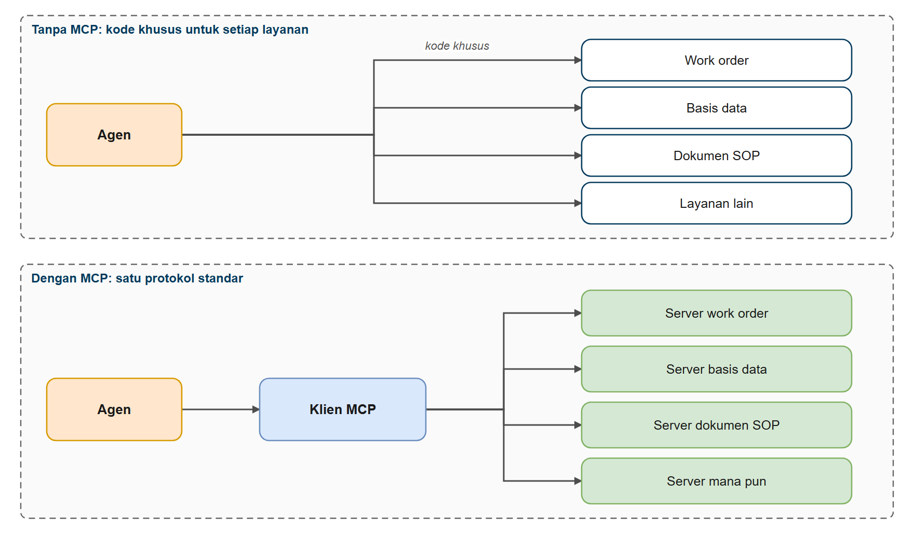
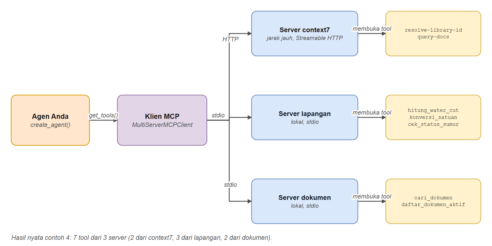
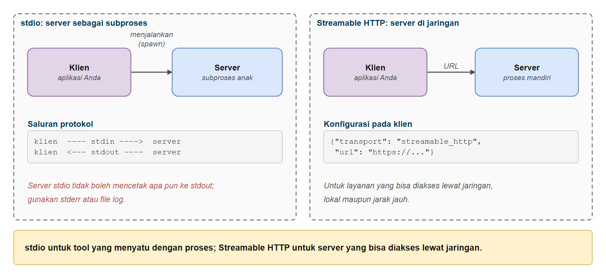
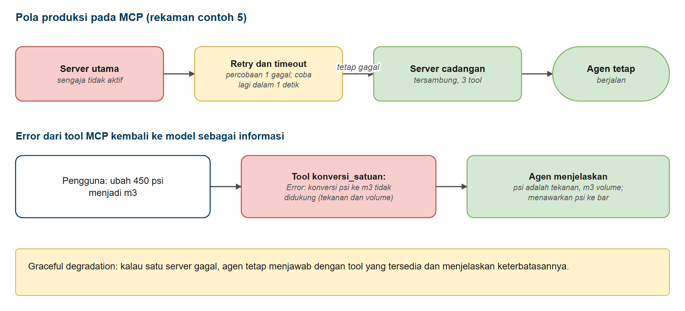

# Model Context Protocol (MCP)

Di bab ini Anda belajar menghubungkan agen AI ke layanan eksternal dengan **Model Context Protocol (MCP)**, standar terbuka yang menyediakan interface universal bagi aplikasi AI untuk mengakses tool dan sumber data. Anda akan melihat bagaimana MCP menyederhanakan integrasi dengan layanan seperti dokumentasi, database, dan arsip dokumen perusahaan, dan bagaimana memakai tool MCP dengan agen yang sudah Anda bangun di [Memulai dengan Agen](../../hari3/03-agen/README.md). Anda juga akan membangun **server MCP sendiri**, yaitu pencarian dokumen perusahaan yang sama dengan yang Anda pakai di bab-bab lain, kini bisa dipakai oleh klien MCP apa pun.

## Prasyarat

- Sudah menyelesaikan [Memulai dengan Agen](../../hari3/03-agen/README.md)
- Membantu: [Guardrails dan Middleware Keamanan](../../hari3/07-guardrails-middleware/README.md) (kontrol akses berbasis peran muncul lagi di Contoh 3)

## Tujuan Pembelajaran

Setelah bab ini Anda bisa:

- Memahami apa itu Model Context Protocol (MCP) dan mengapa penting
- Terhubung ke server MCP eksternal lewat **transport Streamable HTTP**
- Memakai **transport stdio** untuk server MCP yang berjalan sebagai subproses
- Memadukan tool MCP dengan agen LangChain (pola `create_agent()` yang sama!)
- Memakai **beberapa server MCP sekaligus** dalam satu agen
- Menerapkan **penanganan error yang kuat** (retry, timeout, server fallback)
- Memilih jenis transport yang tepat untuk kebutuhan Anda
- Membangun **server MCP sendiri** untuk membuka tool Anda, dengan identitas pengguna yang aman
- Men-debug masalah koneksi dan integrasi MCP yang umum

---

## Tentang Contoh Kode

Contoh di bab ini memakai server MCP **lokal** sebanyak mungkin supaya bisa dijalankan tanpa internet:

- `code/servers/field_stdio_server.py`: perhitungan water cut, konversi satuan, dan status sumur
- `code/servers/documents_stdio_server.py`: pencarian SOP dan laporan perusahaan (indeks hybrid dari paket bersama)

Hanya Contoh 1 (dan satu server opsional di Contoh 4) memakai server jarak jauh publik **Context7** yang butuh internet. Kalau server itu tidak bisa dijangkau, skrip mencetak pesan error yang jelas dan sisa bab tetap bisa dijalankan.

---

## Analogi: Colokan dan Charger Standar

**Bayangkan Anda membeli berbagai perangkat elektronik baru.**

### Tanpa standar (integrasi buatan sendiri)

- Setiap merek memakai charger dan colokan yang berbeda
- Setiap perangkat baru berarti membeli kabel baru
- Laci Anda dipenuhi charger dan adaptor khusus

### Dengan standar (USB-C)

- Satu jenis sambungan untuk banyak perangkat
- Perangkat dari merek berbeda bisa memakai charger yang sama
- Menambah perangkat baru jauh lebih mudah

**MCP adalah "colokan standar" itu untuk aplikasi AI** (sering disebut USB-C-nya AI): satu protokol bagi agen untuk menemukan dan memakai tool dari program apa pun yang "berbicara MCP".



*Gambar 1. Tanpa MCP dan dengan MCP*

*MCP menyediakan cara standar bagi agen untuk terhubung ke tool eksternal, seperti USB-C untuk aplikasi AI.*

---

## Model Context Protocol (MCP)

**Anda sudah membangun agen dengan tool buatan sendiri, tetapi bagaimana dengan layanan yang sudah ada?**

Di [Function Calling dan Tools](../../hari3/02-tools-function-calling/README.md) dan [Memulai dengan Agen](../../hari3/03-agen/README.md) Anda membuat tool dengan menulis implementasinya sendiri (menghitung water cut, mengonversi satuan, membaca status sumur), lalu memakai tool pencarian dokumen dari paket bersama. Itu bagus untuk tool khusus aplikasi Anda.

**Tetapi bagaimana kalau Anda perlu terhubung ke layanan yang sudah ada, atau tool yang harus dipakai lintas aplikasi AI?** Bayangkan butuh tool untuk:

- Sistem work order (membuat dan mencari work order)
- Kalender (cek ketersediaan, buat acara)
- Database perusahaan (query data, ambil skema)
- Sistem dokumentasi dan arsip SOP (ambil dokumen, rujuk revisi)

Menulis integrasi khusus untuk tiap layanan berarti menghadapi API, metode autentikasi, dan format data yang berbeda-beda. Di sinilah **Model Context Protocol (MCP)** berperan.

### Apa itu MCP?

**Model Context Protocol (MCP)** adalah standar terbuka yang memungkinkan aplikasi AI terhubung ke tool dan sumber data eksternal lewat interface universal.

**Masalahnya**: membangun asisten AI yang perlu mengakses kalender, database, sistem work order, dan arsip SOP berarti menulis integrasi khusus untuk tiap layanan dengan API, autentikasi, dan format data yang berbeda.

**Solusi MCP**: layanan membuka kemampuannya lewat protokol standar. Agen Anda terhubung sekali dan mendapat akses ke semuanya.

### Arsitektur



*Gambar 2. Arsitektur MCP: agen, klien, tiga server*

Setiap **Server MCP** adalah program yang membuka tool lewat protokol. Agen Anda terhubung dan bisa memakai semua tool yang tersedia.

### Jenis Transport

MCP mendefinisikan dua mekanisme transport standar untuk komunikasi klien-server:



*Gambar 3. Dua transport MCP: stdio dan Streamable HTTP*

| Transport | Cara komunikasi | Kapan dipakai | Contoh |
|-----------|-----------------|---------------|--------|
| **Streamable HTTP** | Berbasis jaringan (klien ke server lewat jaringan) | Saat server MCP diakses lewat URL (lokal atau jarak jauh) | `{"transport": "streamable_http", "url": "https://api.perusahaan.com/mcp"}` |
| **stdio** | Berbasis proses (induk dan anak lewat aliran) | Saat server MCP berjalan sebagai subproses aplikasi Anda | `{"transport": "stdio", "command": "python", "args": ["server.py"]}` |

> **Catatan evolusi transport**: spesifikasi MCP saat ini memakai **Streamable HTTP** sebagai transport jaringan standar. Pada kode Python LangChain Anda menulis `transport: "streamable_http"` dan library menangani protokolnya.

**Memahami stdin dan stdout**:

- **stdin** (masukan standar): tempat program membaca masukan, misalnya teks dari keyboard atau data yang dialirkan
- **stdout** (keluaran standar): tempat program menulis keluaran, misalnya teks ke konsol
- Dengan transport stdio, klien dan server berbicara lewat aliran ini, seperti dua program yang dihubungkan oleh pipa. **Karena stdout dipakai oleh protokol, server stdio tidak boleh mencetak apa pun ke stdout.** Log harus ke `stderr`

> **Pilihan arsitektur**: Streamable HTTP untuk server yang *bisa diakses lewat jaringan* (bayangkan layanan web). stdio untuk tool yang *menyatu dengan proses* (bayangkan subproses).

### Mengapa MCP Penting

| Tanpa MCP | Dengan MCP |
|-----------|------------|
| Integrasi khusus untuk tiap layanan | Satu protokol standar |
| Autentikasi terpisah untuk tiap layanan | Pendekatan seragam |
| Menambah layanan butuh banyak waktu | Menambah layanan lebih cepat |

**Intinya**: di [Function Calling dan Tools](../../hari3/02-tools-function-calling/README.md) Anda membangun *implementasi* tool. Dengan MCP Anda terhubung ke *penyedia* tool yang membuka kemampuannya lewat protokol standar. Pola `create_agent()` yang sama, sumber tool yang berbeda!

### Memakai MCP di LangChain

> **Catatan maintenance paket (dicek 2026-10-10).** Kursus ini memakai `langchain-mcp-adapters` (versi 0.3.x) karena memiliki `MultiServerMCPClient`, sesi persisten (`client.session`), dan `load_mcp_tools` yang dibutuhkan contoh 3. README repositori paket itu kini menyatakan **tidak lagi di-maintain**: dukungan MCP pindah ke LangChain sebagai `langchain[mcp]` (namespace `langchain.mcp`, berstatus beta). API barunya berbeda (`MCPAdapter` sebagai async context manager, `list_tools()`, tanpa `session()` dan `load_mcp_tools`). Paket lama masih berfungsi untuk kursus ini, tetapi untuk proyek baru periksa [panduan migrasi](https://docs.langchain.com/oss/python/migrate/langchain-mcp-adapters) lebih dulu.

LangChain menyediakan paket `langchain-mcp-adapters` untuk integrasi MCP:

```bash
pip install langchain-mcp-adapters
```

Sekarang mari lihat cara terhubung ke server MCP dan memakai tool-nya dengan `create_agent()`.

---

## Membangun Agen dengan Tool MCP

### Contoh 1: Agen dengan Server MCP Jarak Jauh (Context7)

Contoh ini memakai `MultiServerMCPClient` untuk terhubung ke Context7 (server MCP dokumentasi) dan memakai tool-nya dengan `create_agent()`. Pola agennya sama dengan yang sudah Anda pelajari; hanya sumber tool yang berbeda.

**Kode**: [`code/01_mcp_context7.py`](./code/01_mcp_context7.py)
**Jalankan**: `python hari4/09-mcp/code/01_mcp_context7.py`

**Tentang Context7**: server MCP dokumentasi yang menyediakan dokumen library terkini. Kemampuannya diambil klien secara dinamis, jadi nama tool bisa berubah mengikuti pembaruan server (itulah gunanya tool discovery dinamis).

```python
# %% [markdown]
# # Contoh 1: Agen dengan Integrasi Server MCP (Context7)
# Jalankan sel satu per satu dengan Shift+Enter, atau seluruh file: `python hari4/09-mcp/code/01_mcp_context7.py`
#
# Contoh ini menghubungkan agen ke server MCP Context7, penyedia dokumentasi library software
# yang terkini dan spesifik versi, langsung ke agen Anda. Ini server MCP JARAK JAUH publik, diakses lewat
# transport Streamable HTTP, sehingga butuh koneksi internet.
#
# Tool Context7 yang diambil klien (nama dan jumlahnya bisa berubah mengikuti pembaruan server):
#
# - `resolve-library-id`: mengubah nama library menjadi ID Context7
# - `query-docs`: mengambil dokumentasi library untuk sebuah pertanyaan
#
# Prasyarat:
#
# 1. Pasang langchain-mcp-adapters: `pip install langchain-mcp-adapters`
# 2. Opsional: API key Context7 untuk rate limit lebih tinggi (https://context7.com)
#
# Kode async dijalankan lewat `jalankan(...)` dari `migas_shared.tampil`, yang bekerja di skrip biasa maupun
# di Jupyter/Interactive Window.

# %%
# Langkah 1 - Menyiapkan klien MCP dan model
import asyncio
import os

from dotenv import load_dotenv
from langchain.agents import create_agent
from langchain_mcp_adapters.client import MultiServerMCPClient
from langchain_openai import ChatOpenAI

from migas_shared.tampil import jalankan

load_dotenv()

# Server MCP Context7 - menyediakan dokumentasi library
# Jarak jauh (HTTP): https://mcp.context7.com/mcp (disarankan)
# Lokal (HTTP): http://localhost:3000/mcp (kalau Context7 dijalankan sendiri)
url_server_mcp = os.getenv("MCP_SERVER_URL", "https://mcp.context7.com/mcp")

print(f"Menghubungkan ke server MCP di: {url_server_mcp}\n")

# Buat klien MCP dengan transport HTTP ke Context7.
# Klien membuka sesi per panggilan dan menutupnya sendiri, jadi tidak ada yang perlu ditutup antar sel.
client = MultiServerMCPClient(
    {
        "context7": {
            "transport": "streamable_http",
            "url": url_server_mcp,
            # Opsional: tambahkan API key Context7 untuk rate limit lebih tinggi
            # "headers": {
            #     "Authorization": f"Bearer {os.getenv('CONTEXT7_API_KEY')}"
            # }
        },
    }
)

model = ChatOpenAI(
    model=os.getenv("ONLINE_MODEL"),
    base_url=os.getenv("ONLINE_BASE_URL"),
    api_key=os.getenv("ONLINE_API_KEY"),
    reasoning_effort=os.getenv("LLM_REASONING_EFFORT", "none"),
)

# %% [markdown]
# ## Langkah 2 - Mengambil tool dari server Context7
# `client.get_tools()` menghubungi server dan mengembalikan tool MCP sebagai tool LangChain biasa.
# Kalau koneksi gagal (misalnya tanpa internet), pesan error dicetak dan daftar tool dibiarkan kosong.

# %%
print("Mengambil tool dari server MCP Context7...")
try:
    tools = jalankan(asyncio.wait_for(client.get_tools(), timeout=30))

    print(f"Berhasil mengambil {len(tools)} tool dari Context7:")
    for tool in tools:
        print(f"   - {tool.name}: {tool.description[:90].strip()}...")
    print()
except Exception as error:
    tools = []
    print(f"Error saat menghubungi server MCP Context7: {type(error).__name__}: {error}")
    print("Periksa koneksi internet Anda. Contoh berikutnya memakai server lokal dan tidak butuh internet.")

# %% [markdown]
# ## Langkah 3 - Membuat agen dengan tool MCP
# Pola `create_agent()` yang sama. Tool dari server MCP adalah satu-satunya perbedaan.

# %%
print("Membuat agen dengan tool MCP...\n")
agent = create_agent(model, tools)

# %% [markdown]
# ## Langkah 4 - Meminta dokumentasi lewat agen
# Pertanyaan yang berguna bagi analis data lapangan. Agen memutuskan sendiri tool Context7 mana yang dipanggil.

# %%
pertanyaan = (
    "Bagaimana cara membaca file CSV dengan pustaka pandas lalu menghitung rata-rata per kolom? "
    "Ambil dokumentasi terbaru. Jawab singkat dalam Bahasa Indonesia."
)
print(f"Pengguna: {pertanyaan}\n")

try:
    response = jalankan(asyncio.wait_for(agent.ainvoke({"messages": [("human", pertanyaan)]}), timeout=180))
    panggilan = [c["name"] for m in response["messages"] for c in getattr(m, "tool_calls", [])]
    print(f"Tool MCP yang dipanggil agen: {panggilan}\n")
    print(f"Agen: {response['messages'][-1].content}\n")
except Exception as error:
    print(f"Error saat menghubungi server MCP Context7: {type(error).__name__}: {error}")
    print("Periksa koneksi internet Anda. Contoh berikutnya memakai server lokal dan tidak butuh internet.")

# %% [markdown]
# ## Konsep Utama
# - MCP menyediakan akses terstandar ke tool eksternal
# - `MultiServerMCPClient` menghubungkan ke satu atau lebih server MCP
# - Transport HTTP bekerja dengan server jarak jauh seperti Context7
# - Tool dari server MCP bekerja mulus dengan `create_agent()`
# - Pola `create_agent()` yang sama, sumber tool yang berbeda!
```

### Keluaran yang Diharapkan

> **Catatan:** jawaban model bisa berbeda setiap kali dijalankan, dan isi Context7 berubah mengikuti pembaruan dokumentasinya. Keluaran di seluruh bab ini berasal dari menjalankan skrip sebenarnya.

```text
Menghubungkan ke server MCP di: https://mcp.context7.com/mcp

Mengambil tool dari server MCP Context7...
Berhasil mengambil 2 tool dari Context7:
   - resolve-library-id: Resolves a package/product name to a Context7-compatible library ID and returns matching l...
   - query-docs: Retrieves and queries up-to-date documentation and code examples from Context7 for any pro...

Membuat agen dengan tool MCP...

Pengguna: Bagaimana cara membaca file CSV dengan pustaka pandas lalu menghitung rata-rata per kolom? Ambil dokumentasi terbaru. Jawab singkat dalam Bahasa Indonesia.

Tool MCP yang dipanggil agen: ['resolve-library-id', 'query-docs']

Agen: Berikut jawaban singkatnya dalam Bahasa Indonesia.

## Cara Membaca CSV dan Menghitung Rata-rata per Kolom dengan pandas

~~~python
import pandas as pd

# 1. Baca file CSV
df = pd.read_csv("data.csv")

# 2. Hitung rata-rata per kolom
rata_rata = df.mean()
print(rata_rata)
~~~

### Penjelasan singkat

- **`pd.read_csv("data.csv")`** — membaca file CSV menjadi DataFrame. Defaultnya pemisah adalah koma (`sep=','`), header otomatis dideteksi dari baris pertama.
- **`df.mean()`** — menghitung rata-rata untuk setiap kolom numerik. Kolom non-numerik diabaikan secara otomatis.

### Opsi umum yang sering dipakai
~~~python
df = pd.read_csv("data.csv", sep=";", encoding="utf-8")
~~~

### Contoh output
~~~
...
```

---

### Contoh 2: MCP dengan Transport stdio

Contoh ini memakai **transport stdio** untuk menjalankan server MCP sebagai subproses. Berbeda dengan HTTP (komunikasi lewat jaringan), stdio memakai aliran input/output standar.

**Server**: [`code/servers/field_stdio_server.py`](./code/servers/field_stdio_server.py)
**Kode**: [`code/02_mcp_local_stdio.py`](./code/02_mcp_local_stdio.py)
**Jalankan**: `python hari4/09-mcp/code/02_mcp_local_stdio.py`

Server-nya sendiri sangat pendek berkat `FastMCP`: fungsi Python biasa diberi decorator `@mcp.tool()`, dan docstring-nya menjadi deskripsi tool bagi model:

```python
"""
Server MCP Sederhana untuk Transport stdio: Perhitungan Lapangan

Server ini berjalan sebagai subproses dan berkomunikasi lewat stdio. Ia membuka tiga alat lapangan
(water cut, konversi satuan, status sumur) kepada klien MCP mana pun, bukan hanya program LangChain Anda.

Dipakai oleh code/02_mcp_local_stdio.py dan code/04_mcp_multi_server.py.

Jalankan (jarang perlu; klien MCP menjalankannya sendiri): python hari4/09-mcp/code/servers/field_stdio_server.py
"""

import sys

from mcp.server.fastmcp import FastMCP

from migas_shared.field_tools import DATA_SUMUR

# Buat server MCP
mcp = FastMCP("lapangan-stdio")


@mcp.tool()
def hitung_water_cut(oil_bopd: float, water_bwpd: float) -> str:
    """
    Hitung water cut (persentase air dalam total cairan produksi) sebuah sumur.

    Args:
        oil_bopd: Produksi minyak dalam barel per hari (bopd)
        water_bwpd: Produksi air dalam barel per hari (bwpd)

    Returns:
        Water cut dalam persen beserta total cairan.
    """
    total = oil_bopd + water_bwpd
    if total <= 0:
        raise ValueError("Total produksi cairan harus lebih dari 0")
    return f"Water cut = {water_bwpd / total * 100:.1f}% (total cairan {total:.0f} bpd)"


@mcp.tool()
def konversi_satuan(nilai: float, dari: str, ke: str) -> str:
    """
    Konversi satuan volume (bbl dan m3) atau tekanan (psi dan bar).

    Args:
        nilai: Angka yang dikonversi
        dari: Satuan asal: 'bbl', 'm3', 'psi', atau 'bar'
        ke: Satuan tujuan: 'bbl', 'm3', 'psi', atau 'bar'

    Returns:
        Hasil konversi sebagai teks.
    """
    faktor = {("bbl", "m3"): 0.158987, ("m3", "bbl"): 1 / 0.158987, ("psi", "bar"): 0.0689476, ("bar", "psi"): 14.5038}
    dari, ke = dari.lower(), ke.lower()
    if dari == ke:
        return f"{nilai} {ke}"
    if (dari, ke) not in faktor:
        raise ValueError(f"Konversi {dari} ke {ke} tidak didukung (volume dan tekanan tidak dapat saling dikonversi)")
    return f"{nilai} {dari} = {nilai * faktor[(dari, ke)]:.3f} {ke}"


@mcp.tool()
def cek_status_sumur(kode_sumur: str) -> str:
    """
    Cek status operasi sebuah sumur: area, pompa, status, produksi, dan catatan terakhir.

    Args:
        kode_sumur: Kode sumur, contoh 'SR-020' atau 'KN-033'

    Returns:
        Ringkasan status sumur.
    """
    data = DATA_SUMUR.get(kode_sumur.strip().upper())
    if not data:
        return f"Sumur {kode_sumur} tidak ditemukan. Sumur yang terdaftar: {', '.join(DATA_SUMUR)}"
    return (f"Sumur {kode_sumur} ({data['area']}, {data['pompa']}): status {data['status']}, "
            f"minyak {data['minyak_bopd']} bopd, air {data['air_bwpd']} bwpd. Catatan: {data['catatan']}")


if __name__ == "__main__":
    # Log ke stderr (stdout dipakai untuk komunikasi MCP)
    print("Server MCP lapangan (stdio) berjalan...", file=sys.stderr)
    print("Tool: hitung_water_cut, konversi_satuan, cek_status_sumur", file=sys.stderr)

    # Jalankan dengan transport stdio
    mcp.run(transport="stdio")
```

**Kode klien:**

```python
# %% [markdown]
# # Contoh 2: MCP dengan Transport stdio
# Jalankan sel satu per satu dengan Shift+Enter, atau seluruh file: `python hari4/09-mcp/code/02_mcp_local_stdio.py`
#
# Contoh ini memakai transport stdio untuk terhubung ke server MCP yang berjalan sebagai SUBPROSES,
# berkomunikasi lewat aliran input/output standar. Tanpa internet dan tanpa server yang harus dijalankan
# terpisah: klien yang menjalankan dan mengelola prosesnya.
#
# Perbandingan:
#
# - Contoh 1: transport HTTP (komunikasi lewat jaringan)
# - Contoh 2: transport stdio (komunikasi antarproses)
#
# Kode async dijalankan lewat `jalankan(...)` dari `migas_shared.tampil`, yang bekerja di skrip biasa maupun
# di Jupyter/Interactive Window.

# %%
# Langkah 1 - Menyiapkan klien MCP stdio dan model
import os
import sys

from dotenv import load_dotenv
from langchain.agents import create_agent
from langchain_mcp_adapters.client import MultiServerMCPClient
from langchain_openai import ChatOpenAI

from migas_shared.config import ROOT
from migas_shared.tampil import jalankan

load_dotenv()

# Path ke server lapangan lokal
path_server = ROOT / "hari4" / "09-mcp" / "code" / "servers" / "field_stdio_server.py"

# Buat klien MCP dengan transport stdio - menjalankan server sebagai subproses.
# Klien membuka sesi per panggilan dan menutupnya sendiri, jadi tidak ada yang perlu ditutup antar sel.
client = MultiServerMCPClient(
    {
        "lapangan": {
            "transport": "stdio",
            "command": sys.executable,  # interpreter Python yang sama dengan skrip ini
            "args": [str(path_server)],
        }
    }
)

model = ChatOpenAI(
    model=os.getenv("ONLINE_MODEL"),
    base_url=os.getenv("ONLINE_BASE_URL"),
    api_key=os.getenv("ONLINE_API_KEY"),
    reasoning_effort=os.getenv("LLM_REASONING_EFFORT", "none"),
)

# %% [markdown]
# ## Langkah 2 - Mengambil tool dari server lokal
# Klien menjalankan server sebagai subproses dan meminta daftar tool-nya.

# %%
print("Menghubungkan ke server MCP stdio...")
tools = jalankan(client.get_tools())

print(f"Terhubung! Mengambil {len(tools)} tool dari server lokal:")
for tool in tools:
    print(f"   - {tool.name}: {tool.description.strip().splitlines()[0]}")
print()

# %% [markdown]
# ## Langkah 3 - Membuat agen dengan tool MCP stdio
# Fungsi `tanya_agen` mengirim satu pertanyaan ke agen dan mencetak tool MCP yang dipanggil.

# %%
agent = create_agent(model, tools)


def tanya_agen(pertanyaan: str) -> None:
    print(f"Pengguna: {pertanyaan}")
    response = jalankan(agent.ainvoke({"messages": [("human", pertanyaan)]}))
    panggilan = [c["name"] for m in response["messages"] for c in getattr(m, "tool_calls", [])]
    print(f"   Tool MCP yang dipanggil: {panggilan}")
    print(f"Agen: {response['messages'][-1].content}\n")

# %% [markdown]
# ## Langkah 4 - Pertanyaan 1: water cut
# Agen perlu memanggil tool perhitungan water cut dari server lapangan.

# %%
tanya_agen("Sumur SR-020 memproduksi 120 bopd minyak dan 480 bwpd air. Berapa water cut-nya?")

# %% [markdown]
# ## Langkah 5 - Pertanyaan 2: konversi satuan

# %%
tanya_agen("Ubah tekanan wellhead 450 psi menjadi bar.")

# %% [markdown]
# ## Langkah 6 - Pertanyaan 3: status sumur dan konversi
# Pertanyaan gabungan: status sumur dari server, lalu konversi ke meter kubik per hari.

# %%
tanya_agen("Bagaimana status sumur KN-033, dan berapa produksi hariannya dalam meter kubik per hari bila 1 bbl = 0,159 m3?")

# %% [markdown]
# ## Konsep Utama
# - Transport stdio menjalankan server MCP sebagai subproses
# - Komunikasi lewat aliran input/output standar
# - Server berjalan sebagai proses anak dari klien
# - Transport HTTP memakai komunikasi jaringan
# - Transport stdio memakai komunikasi antarproses
# - Kode agen yang sama bekerja dengan kedua transport!
#
# ## Perbandingan Transport
# - stdio: komunikasi proses lewat stdin/stdout
# - HTTP: komunikasi jaringan lewat permintaan HTTP
# - Pilih sesuai kebutuhan arsitektur Anda!
```

**Perbandingan Transport**:

| Fitur | Streamable HTTP (Contoh 1) | stdio (Contoh 2) |
|-------|---------------------------|-------------------|
| **Komunikasi** | Berbasis jaringan (permintaan HTTP) | Berbasis proses (aliran stdin/stdout) |
| **Penempatan server** | Berjalan mandiri dari klien | Berjalan sebagai subproses klien |
| **Koneksi** | Klien terhubung lewat URL | Klien menjalankan dan mengelola proses |
| **Siklus hidup** | Server berjalan sendiri | Siklus hidup server terikat klien |
| **Cocok untuk** | Layanan yang bisa diakses jaringan (lokal atau jarak jauh) | Tool yang menyatu dengan proses |

**Kedua transport bisa**:

- Mengautentikasi pengguna (Streamable HTTP: token atau kunci, stdio: kredensial subproses)
- Mengakses sumber daya jaringan (Streamable HTTP: langsung, stdio: subproses bisa melakukan panggilan jaringan)
- Dipakai di produksi (pilihan bergantung pada arsitektur dan kebutuhan)

> **Perbedaan sesungguhnya**:
>
> - **Streamable HTTP**: server MCP adalah layanan web terpisah yang dihubungi klien
> - **stdio**: server MCP adalah subproses yang diakses langsung oleh klien
>
> Bayangkan: Streamable HTTP = memanggil API web, stdio = menjalankan program lalu berbicara dengannya.

### Keluaran yang Diharapkan

```text
Menghubungkan ke server MCP stdio...
Terhubung! Mengambil 3 tool dari server lokal:
   - hitung_water_cut: Hitung water cut (persentase air dalam total cairan produksi) sebuah sumur.
   - konversi_satuan: Konversi satuan volume (bbl dan m3) atau tekanan (psi dan bar).
   - cek_status_sumur: Cek status operasi sebuah sumur: area, pompa, status, produksi, dan catatan terakhir.

Pengguna: Sumur SR-020 memproduksi 120 bopd minyak dan 480 bwpd air. Berapa water cut-nya?
   Tool MCP yang dipanggil: ['hitung_water_cut']
Agen: Water cut untuk sumur **SR-020** adalah **80%**.

Perhitungannya:
- Minyak: 120 bopd
- Air: 480 bwpd
- Total cairan: 120 + 480 = 600 bpd
- Water cut = (480 / 600) × 100% = **80%**

Ini berarti 80% dari total cairan yang diproduksi adalah air, dan hanya 20% yang merupakan minyak.

Pengguna: Ubah tekanan wellhead 450 psi menjadi bar.
   Tool MCP yang dipanggil: ['konversi_satuan']
Agen: Tekanan wellhead **450 psi** setara dengan **31.026 bar**.

Pengguna: Bagaimana status sumur KN-033, dan berapa produksi hariannya dalam meter kubik per hari bila 1 bbl = 0,159 m3?
   Tool MCP yang dipanggil: ['cek_status_sumur', 'konversi_satuan']
Agen: Berikut adalah ringkasan lengkap untuk sumur **KN-033**:

## Status Sumur KN-033
- **Lokasi/Area:** Kenanga (SRP)
- **Status:** **Menunggu pulling** (waiting for workover/pulling)
- **Catatan:** Sucker rod patah, menunggu jadwal rig

## Produksi Harian
- **Minyak:** 0 bopd = **0 m³/hari**
- **Air:** 0 bwpd = **0 m³/hari**

Karena sucker rod pada sumur ini **patah** dan sedang menunggu jadwal rig untuk diangkat (pulling), sumur **tidak berproduksi** saat ini. Total produksi cairan adalah **0 m³/hari** karena seluruh produksi terhenti akibat masalah pada pompa/rod tersebut.

Dengan kata lain, sumur KN-033 sedang dalam kondisi **tidak berproduksi (offline)** menunggu perbaikan.
```

### Cara Kerjanya

1. **Klien menjalankan server.** Anda tidak menjalankan server secara manual; klien MCP membuat subproses dari `command` dan `args`.
2. **Tool discovery dinamis.** `client.get_tools()` meminta daftar tool ke server, termasuk nama, deskripsi, dan skema argumen yang diambil dari signature fungsi dan docstring-nya.
3. **Pola agen tidak berubah.** `create_agent(model, tools)` menerima tool MCP persis seperti tool buatan sendiri. Agen memilih tool dari deskripsinya.
4. **`sys.executable`, bukan `"python"`.** Dengan memakai interpreter yang sama dengan skrip induk, server selalu berjalan di virtual environment yang benar.
5. **Setiap panggilan tool membuka sesi baru** kalau Anda memakai `client.get_tools()` seperti ini. Itu sederhana, tetapi untuk server yang mahal dijalankan Anda memakai persistent session (Contoh 3).

---

### Contoh 3: Server MCP Buatan Sendiri untuk Dokumen Perusahaan

Sekarang yang paling berguna: membungkus pencarian dokumen perusahaan (SOP, laporan, manual; indeks hybrid yang sama dengan bab 10) sebagai **server MCP**. Agen tidak lagi mengimpor kode pencarian; ia menghubungi server lewat protokol, persis seperti ke server mana pun di internet.

Dua hal penting di contoh ini:

1. **Persistent session.** `client.get_tools()` biasa memulai sesi baru (subproses baru) untuk setiap panggilan tool. Untuk server berat seperti pencarian dokumen (memuat model embedding), buka satu sesi dengan `client.session(...)` dan `load_mcp_tools(sesi)`.
2. **Identitas milik konfigurasi server.** Server MCP tidak memiliki `ToolRuntime` dan tidak melihat konteks LangChain Anda. Karena itu **peran pengguna ditentukan oleh konfigurasi server** (variabel lingkungan `PERAN_PENGGUNA` yang Anda atur ketika menjalankan subproses), bukan argumen yang diisi model. Tidak ada tool yang menerima `role` sebagai parameter.

Di sisi server, peran dibaca sekali ketika server mulai dan dipakai pada setiap pencarian:

```python
PERAN = os.getenv("PERAN_PENGGUNA", "operator")

@mcp.tool()
def cari_dokumen(pertanyaan: str, k: int = 4) -> str:
    """Cari chunk dokumen SOP, laporan, atau manual yang relevan dengan pertanyaan."""
    return rag_tools._cari(pertanyaan, max(1, min(k, 8)), PERAN)    # peran dari konfigurasi, bukan argumen
```

**Server**: [`code/servers/documents_stdio_server.py`](./code/servers/documents_stdio_server.py)
**Kode**: [`code/03_mcp_local_documents.py`](./code/03_mcp_local_documents.py)
**Jalankan**: `python hari4/09-mcp/code/03_mcp_local_documents.py`

```python
"""
Server MCP Pencarian Dokumen (stdio)

Membuka pencarian dokumen SOP dan laporan perusahaan (indeks hybrid yang sama dengan bab 10)
sebagai tool MCP. Klien MCP mana pun dapat memakainya: agen LangChain, editor kode, atau aplikasi lain.

PERHATIKAN soal keamanan: server MCP tidak punya `ToolRuntime` dan tidak melihat konteks LangChain Anda.
Siapa penggunanya dan perannya harus ditentukan oleh KONFIGURASI SERVER, bukan oleh argumen yang diisi model.
Di sini peran dibaca dari variabel lingkungan PERAN_PENGGUNA yang diatur klien ketika menjalankan server.
Model tidak dapat mengubahnya, dan tidak ada tool yang menerima `role` sebagai argumen.

Dipakai oleh code/03_mcp_local_documents.py dan code/04_mcp_multi_server.py.

Jalankan (jarang perlu; klien MCP menjalankannya sendiri):
  PERAN_PENGGUNA=hse python hari4/09-mcp/code/servers/documents_stdio_server.py
"""

import os
import sys

from mcp.server.fastmcp import FastMCP

from migas_shared import rag_tools
from migas_shared.rag_pipeline import ROLE_GROUPS

PERAN = os.getenv("PERAN_PENGGUNA", "operator")
if PERAN not in ROLE_GROUPS:
    raise SystemExit(f"PERAN_PENGGUNA '{PERAN}' tidak valid. Pilihan: {', '.join(ROLE_GROUPS)}")

mcp = FastMCP("dokumen-migas")


@mcp.tool()
def cari_dokumen(pertanyaan: str, k: int = 4) -> str:
    """
    Cari chunk dokumen SOP, laporan, atau manual yang relevan dengan pertanyaan.
    Hasil hanya memuat dokumen berstatus aktif yang boleh dilihat oleh peran pengguna ini.

    Args:
        pertanyaan: Pertanyaan atau kata kunci pencarian, contoh 'alarm H2S 10 ppm'
        k: Jumlah chunk dokumen yang dikembalikan

    Returns:
        Chunk dokumen dengan id dokumen, revisi, dan bagian.
    """
    return rag_tools._cari(pertanyaan, max(1, min(k, 8)), PERAN)


@mcp.tool()
def daftar_dokumen_aktif(jenis: str | None = None) -> str:
    """
    Daftar dokumen aktif yang boleh dilihat oleh peran pengguna ini.

    Args:
        jenis: Filter jenis dokumen, contoh 'SOP' atau 'Laporan' (kosong = semua)

    Returns:
        Satu baris per dokumen: id, revisi, jenis, dan judul.
    """
    return rag_tools._daftar(jenis, PERAN)


if __name__ == "__main__":
    # Log ke stderr (stdout dipakai untuk komunikasi MCP)
    print(f"Server MCP dokumen (stdio) berjalan untuk peran: {PERAN}", file=sys.stderr)
    mcp.run(transport="stdio")
```

```python
# %% [markdown]
# # Contoh 3: Server MCP Buatan Sendiri untuk Dokumen Perusahaan
# Jalankan sel satu per satu dengan Shift+Enter, atau seluruh file: `python hari4/09-mcp/code/03_mcp_local_documents.py`
#
# Pencarian dokumen yang Anda kenal dari bab sebelumnya dibungkus sebagai SERVER MCP (code/servers/
# documents_stdio_server.py). Agen tidak lagi mengimpor kode pencarian: ia hanya menghubungi server lewat
# protokol, seperti ke server mana pun di internet.
#
# Dua hal baru di contoh ini:
#
# 1. PERSISTENT SESSION. `client.get_tools()` biasa memulai sesi baru (artinya subproses baru) untuk SETIAP
#    tool call. Untuk server yang mahal dijalankan, buka satu sesi dengan `client.session(...)`.
# 2. IDENTITAS ada di konfigurasi server. Server MCP tidak melihat konteks LangChain, jadi peran pengguna
#    dikirim lewat variabel lingkungan subproses (`env`), bukan lewat argumen yang bisa diisi model.
#
# Kode async dijalankan lewat `jalankan(...)` dari `migas_shared.tampil`, yang bekerja di skrip biasa maupun
# di Jupyter/Interactive Window.

# %%
# Langkah 1 - Menyiapkan model dan fungsi bantu
import os
import re
import sys

from dotenv import load_dotenv
from langchain.agents import create_agent
from langchain_mcp_adapters.client import MultiServerMCPClient
from langchain_mcp_adapters.tools import load_mcp_tools
from langchain_openai import ChatOpenAI

from migas_shared.config import ROOT
from migas_shared.tampil import jalankan

load_dotenv()

PATH_SERVER = ROOT / "hari4" / "09-mcp" / "code" / "servers" / "documents_stdio_server.py"

model = ChatOpenAI(
    model=os.getenv("ONLINE_MODEL"),
    base_url=os.getenv("ONLINE_BASE_URL"),
    api_key=os.getenv("ONLINE_API_KEY"),
    reasoning_effort=os.getenv("LLM_REASONING_EFFORT", "none"),
)
pertanyaan = "Apa temuan utama laporan investigasi INV-2026-011? Jawab singkat dan sebut id dokumen sumbernya."


def klien_untuk_peran(peran: str) -> MultiServerMCPClient:
    """Klien MCP yang menjalankan server dokumen dengan peran pengguna tertentu."""
    # Subproses hanya mewarisi variabel dasar; teruskan sendiri yang dibutuhkan server
    env = {"PERAN_PENGGUNA": peran, "PYTHONUTF8": "1"}
    for nama in ("EMBED_PROVIDER", "EMBED_MODEL", "EMBED_CACHE_DIR", "EMBED_BASE_URL", "EMBED_API_KEY"):
        if os.getenv(nama):
            env[nama] = os.environ[nama]
    return MultiServerMCPClient(
        {"dokumen": {"transport": "stdio", "command": sys.executable, "args": [str(PATH_SERVER)], "env": env}}
    )


def id_dokumen(teks: str) -> list[str]:
    """Ambil id dokumen unik (SOP-..., INV-..., RPT-...) dari teks hasil pencarian."""
    return sorted(set(re.findall(r"\b(?:SOP|INV|RPT|LL|MAN)-[A-Z0-9-]+\d\b", teks)))

# %% [markdown]
# ## Langkah 2 - Bagian 1: tool MCP dipanggil langsung, tanpa model
# `cari_langsung` membuka satu sesi persisten (`client.session`) untuk satu peran, lalu memanggil tool
# `cari_dokumen` langsung. Satu subproses dipakai untuk seluruh blok `async with`.

# %%
async def cari_langsung(peran: str) -> None:
    client = klien_untuk_peran(peran)
    async with client.session("dokumen") as sesi:  # satu subproses untuk seluruh blok ini
        tools = await load_mcp_tools(sesi)
        if peran == "operator":
            print(f"Tool yang ditawarkan server: {[t.name for t in tools]}")
        cari = next(t for t in tools if t.name == "cari_dokumen")
        hasil = await cari.ainvoke({"pertanyaan": "investigasi paparan H2S sumur SR-027 INV-2026-011", "k": 6})
        print(f"   peran {peran:<8} -> dokumen yang terlihat: {id_dokumen(str(hasil))}")


jalankan(cari_langsung("operator"))

# %% [markdown]
# ## Langkah 3 - Bagian 1: peran HSE
# Pencarian yang sama dari peran `hse`. Bandingkan dokumen yang terlihat dengan peran operator.

# %%
jalankan(cari_langsung("hse"))

# %% [markdown]
# ## Langkah 4 - Bagian 2: agen yang sama, dua peran berbeda
# `tanya_dengan_peran` membuka sesi persisten untuk satu peran, membangun agen dari tool server, lalu
# mengajukan pertanyaan yang sama.

# %%
async def tanya_dengan_peran(peran: str) -> None:
    client = klien_untuk_peran(peran)
    async with client.session("dokumen") as sesi:
        tools = await load_mcp_tools(sesi)
        agent = create_agent(
            model,
            tools,
            system_prompt=(
                "Anda asisten dokumen perusahaan. Jawab HANYA dari hasil cari_dokumen dan sebut id dokumennya. "
                "Jika tidak ada dokumen yang relevan, katakan terus terang. Jawab maksimal 4 kalimat."
            ),
        )
        print(f"Peran {peran} | Pengguna: {pertanyaan}")
        response = await agent.ainvoke({"messages": [("human", pertanyaan)]})
        print(f"Agen: {response['messages'][-1].content}\n")


jalankan(tanya_dengan_peran("operator"))

# %% [markdown]
# ## Langkah 5 - Bagian 2: agen dengan peran HSE

# %%
jalankan(tanya_dengan_peran("hse"))

# %% [markdown]
# ## Konsep Utama
# - Pencarian dokumen kini server MCP: agen mana pun yang bisa 'berbicara MCP' bisa memakainya
# - Peran pengguna ditentukan oleh konfigurasi server (env), bukan argumen tool yang diisi model
# - Operator tidak pernah melihat INV-2026-011; petugas HSE melihatnya
# - `client.session(...)` menjaga satu subproses tetap hidup, berguna untuk server yang berat
```

### Keluaran yang Diharapkan

Pada eksekusi pertama, indeks dokumen dibangun lebih dulu (butuh model embedding lokal).

```text
Tool yang ditawarkan server: ['cari_dokumen', 'daftar_dokumen_aktif']
   peran operator -> dokumen yang terlihat: ['RPT-SR-2026-07', 'SOP-HSE-001', 'SOP-OPS-012']

   peran hse      -> dokumen yang terlihat: ['INV-2026-011', 'SOP-HSE-001']

Peran operator | Pengguna: Apa temuan utama laporan investigasi INV-2026-011? Jawab singkat dan sebut id dokumen sumbernya.
Agen: Tidak ditemukan dokumen dengan ID **INV-2026-011** dalam hasil pencarian. Dokumen yang muncul adalah laporan produksi bulanan (RPT-SR-2026-07), bukan laporan investigasi. Kemungkinan dokumen tersebut tidak tersedia atau tidak ditemukan di sistem.

Peran hse | Pengguna: Apa temuan utama laporan investigasi INV-2026-011? Jawab singkat dan sebut id dokumen sumbernya.
Agen: Temuan utama laporan investigasi INV-2026-011 (id dokumen: **INV-2026-011**) adalah: (1) detektor H2S kontraktor tidak di-bump test harian dan sensornya sudah tidak responsif, (2) kontraktor masih menggunakan SOP lama (Rev. 2) karena sosialisasi Rev. 3 belum dilakukan, (3) windsock robek sehingga arah angin tidak terbaca, dan (4) sistem buddy sudah berjalan dengan baik.
```

### Cara Kerjanya

1. **Bagian 1 menguji server tanpa model.** Dua klien menjalankan server yang sama dengan peran berbeda. Operator tidak pernah melihat INV-2026-011; petugas HSE melihatnya. Pemeriksaan ini deterministik karena filtering terjadi di kode.
2. **Bagian 2 memperlihatkan agen yang sama dengan dua peran.** Agen operator jujur mengatakan tidak menemukan dokumen; agen HSE menjawab dari laporan investigasi.
3. **Variabel lingkungan subproses.** Klien stdio hanya mewarisi variabel dasar (PATH dan sejenisnya). Apa pun yang dibutuhkan server (peran, lokasi cache model embedding) harus dikirim lewat `env`.
4. **Satu implementasi, banyak klien.** Karena sekarang berupa server MCP, editor kode atau aplikasi lain yang mendukung MCP bisa memakai pencarian dokumen yang sama, tanpa menyalin kode.

> **Keamanan**: server MCP yang menjalankan tindakan atas nama pengguna harus memutuskan identitas dan izin akses sendiri (konfigurasi, token autentikasi untuk HTTP). Jangan pernah memercayai argumen `role` atau `user_id` yang diisi model.

---

### Contoh 4: Integrasi Beberapa Server

Contoh ini memperlihatkan kekuatan sesungguhnya MCP: terhubung ke **beberapa server MCP sekaligus**. Agen menerima tool dari semua server dan memilih sendiri sesuai pertanyaan!

**Kode**: [`code/04_mcp_multi_server.py`](./code/04_mcp_multi_server.py)
**Jalankan**: `python hari4/09-mcp/code/04_mcp_multi_server.py`

**Yang membuatnya kuat:**

- Memadukan transport berbeda (Streamable HTTP + stdio)
- Menggabungkan tool dari layanan berbeda
- Agen otomatis mengarahkan pertanyaan ke tool yang tepat
- Skala ke puluhan server tanpa mengubah kode agen
- Server yang gagal tidak mematikan agen

**Kasus pemakaian nyata:**

- Data produksi + dokumen SOP + sistem work order dalam satu agen
- Alat internal perusahaan + layanan eksternal dalam satu interface

```python
# %% [markdown]
# # Contoh 4: Integrasi Beberapa Server MCP Sekaligus
# Jalankan sel satu per satu dengan Shift+Enter, atau seluruh file: `python hari4/09-mcp/code/04_mcp_multi_server.py`
#
# Contoh ini menghubungkan satu agen ke BEBERAPA server MCP bersamaan. Agen menerima tool dari semua server
# dan memilih sendiri tool yang cocok untuk setiap pertanyaan.
#
# Server yang dipakai:
#
# - lapangan: perhitungan water cut, konversi satuan, status sumur (stdio, lokal)
# - dokumen: pencarian SOP dan laporan perusahaan (stdio, lokal, peran 'engineer')
# - context7: dokumentasi library software (HTTP, jarak jauh, OPSIONAL)
#
# Server yang gagal dihubungi dilewati dan agen tetap berjalan dengan server yang tersisa.
#
# Kekuatan MCP: satu klien, banyak server, interface seragam!
#
# Catatan: tool diambil per server dengan `client.get_tools(server_name=...)`. Setiap tool call membuka sesi
# sendiri (untuk server stdio berarti subproses baru) dan menutupnya sesudah selesai, sehingga tidak ada sesi
# yang perlu dijaga tetap terbuka antar sel. Untuk sesi tunggal yang bertahan lama, lihat Contoh 3.
#
# Kode async dijalankan lewat `jalankan(...)` dari `migas_shared.tampil`, yang bekerja di skrip biasa maupun
# di Jupyter/Interactive Window.

# %%
# Langkah 1 - Menyiapkan konfigurasi server, klien, dan model
import asyncio
import os
import sys

from dotenv import load_dotenv
from langchain.agents import create_agent
from langchain_mcp_adapters.client import MultiServerMCPClient
from langchain_openai import ChatOpenAI

from migas_shared.config import ROOT
from migas_shared.tampil import jalankan

load_dotenv()

FOLDER_SERVER = ROOT / "hari4" / "09-mcp" / "code" / "servers"


def konfigurasi_server() -> dict:
    env_dokumen = {"PERAN_PENGGUNA": "engineer", "PYTHONUTF8": "1"}
    for nama in ("EMBED_PROVIDER", "EMBED_MODEL", "EMBED_CACHE_DIR", "EMBED_BASE_URL", "EMBED_API_KEY"):
        if os.getenv(nama):
            env_dokumen[nama] = os.environ[nama]
    return {
        "lapangan": {
            "transport": "stdio",
            "command": sys.executable,
            "args": [str(FOLDER_SERVER / "field_stdio_server.py")],
        },
        "dokumen": {
            "transport": "stdio",
            "command": sys.executable,
            "args": [str(FOLDER_SERVER / "documents_stdio_server.py")],
            "env": env_dokumen,
        },
        "context7": {
            "transport": "streamable_http",
            "url": "https://mcp.context7.com/mcp",
        },
    }


client = MultiServerMCPClient(konfigurasi_server())

model = ChatOpenAI(
    model=os.getenv("ONLINE_MODEL"),
    base_url=os.getenv("ONLINE_BASE_URL"),
    api_key=os.getenv("ONLINE_API_KEY"),
    reasoning_effort=os.getenv("LLM_REASONING_EFFORT", "none"),
)

# %% [markdown]
# ## Langkah 2 - Mengambil tool dari SEMUA server
# `ambil_semua_tool` mencoba tiap server satu per satu. Server yang gagal dilewati (graceful degradation).

# %%
async def ambil_semua_tool(client: MultiServerMCPClient) -> dict[str, list]:
    """Ambil tool per server. Server yang gagal dilewati. Mengembalikan {server: [tool]}."""
    tool_per_server: dict[str, list] = {}
    for nama in client.connections:
        try:
            tool_per_server[nama] = await asyncio.wait_for(client.get_tools(server_name=nama), timeout=60)
        except Exception as error:
            print(f"   Server '{nama}' dilewati: {type(error).__name__}")
    return tool_per_server


print("Mengambil tool dari semua server...")
tool_per_server = jalankan(ambil_semua_tool(client))
semua_tool = [t for daftar in tool_per_server.values() for t in daftar]

print(f"\nBerhasil mengambil {len(semua_tool)} tool dari {len(tool_per_server)} server:")
for server, daftar in tool_per_server.items():
    print(f"   Dari {server}:")
    for tool in daftar:
        print(f"      - {tool.name}")
print()

# %% [markdown]
# ## Langkah 3 - Membuat agen dengan tool dari SEMUA server
# Pola `create_agent()` yang sama. Agen memilih tool dari nama dan deskripsinya, apa pun servernya.

# %%
agent = create_agent(
    model,
    semua_tool,
    system_prompt=(
        "Anda asisten teknis lapangan migas. Pakai tool yang tersedia, jangan menebak angka, dan jawab "
        "singkat dalam Bahasa Indonesia. Untuk prosedur, rujuk id dokumennya."
    ),
)


def uji(judul: str, pertanyaan: str) -> None:
    print(f"{judul}\n")
    print(f"Pengguna: {pertanyaan}")
    response = jalankan(agent.ainvoke({"messages": [("human", pertanyaan)]}))
    panggilan = [c["name"] for m in response["messages"] for c in getattr(m, "tool_calls", [])]
    print(f"   Tool yang dipanggil: {panggilan}")
    print(f"Agen: {response['messages'][-1].content}\n")

# %% [markdown]
# ## Langkah 4 - Uji 1: pertanyaan hitungan
# Seharusnya memakai server lapangan.

# %%
uji("Uji 1: pertanyaan hitungan (seharusnya server lapangan)",
    "Sumur dengan produksi 120 bopd minyak dan 480 bwpd air, berapa water cut-nya?")

# %% [markdown]
# ## Langkah 5 - Uji 2: pertanyaan prosedur
# Seharusnya memakai server dokumen.

# %%
uji("Uji 2: pertanyaan prosedur (seharusnya server dokumen)",
    "Bagaimana prosedur bump test detektor gas portabel menurut SOP yang berlaku?")

# %% [markdown]
# ## Langkah 6 - Uji 3: pertanyaan gabungan
# Seharusnya memakai KEDUA server.

# %%
uji("Uji 3: pertanyaan gabungan (seharusnya KEDUA server)",
    "Cek status sumur SR-027, lalu cari di dokumen apa yang harus dilakukan bila alarm H2S berbunyi di sumur itu.")

# %% [markdown]
# ## Konsep Utama
# - `MultiServerMCPClient` menghubungkan banyak server sekaligus
# - Agen menerima tool dari SEMUA server yang tersambung
# - Agen memilih tool yang tepat dari nama dan deskripsinya, apa pun servernya
# - Campur transport berbeda (HTTP + stdio) tanpa mengubah kode agen
# - Server yang gagal dilewati: agen tetap bekerja dengan sisanya (graceful degradation)
# - Skala ke puluhan server tanpa mengubah kode agen!
#
# ## Kasus Penggunaan Nyata
# - Data produksi (SCADA) + dokumen SOP + sistem work order dalam satu agen
# - Alat internal perusahaan + layanan eksternal dalam satu interface
```

### Keluaran yang Diharapkan

```text
Mengambil tool dari semua server...

Berhasil mengambil 7 tool dari 3 server:
   Dari lapangan:
      - hitung_water_cut
      - konversi_satuan
      - cek_status_sumur
   Dari dokumen:
      - cari_dokumen
      - daftar_dokumen_aktif
   Dari context7:
      - resolve-library-id
      - query-docs

Uji 1: pertanyaan hitungan (seharusnya server lapangan)

Pengguna: Sumur dengan produksi 120 bopd minyak dan 480 bwpd air, berapa water cut-nya?
   Tool yang dipanggil: ['hitung_water_cut']
Agen: Water cut sumur tersebut adalah **80%**, dengan total cairan produksi **600 bpd** (120 bopd minyak + 480 bwpd air).

Perhitungan: 480 / (120 + 480) × 100% = 80%.

Uji 2: pertanyaan prosedur (seharusnya server dokumen)

Pengguna: Bagaimana prosedur bump test detektor gas portabel menurut SOP yang berlaku?
   Tool yang dipanggil: ['cari_dokumen', 'daftar_dokumen_aktif', 'cari_dokumen', 'cari_dokumen']
Agen: Berdasarkan pencarian dokumen SOP yang tersedia, berikut ringkasan prosedur bump test detektor gas portabel menurut SOP yang berlaku:

## Prosedur Bump Test Detektor Gas Portabel

Berdasarkan **SOP-HSE-001 Rev.3** (Penanganan Bahaya Gas H₂S), ketentuan bump test yang berlaku:

**Frekuensi:**
- Bump test dilakukan **harian** sebelum shift dimulai (sebelumnya mingguan—ini adalah perubahan utama dari Rev. 2 ke Rev. 3).

**Cakupan:**
- Setiap pekerja di area H₂S wajib memakai **personal H₂S detector** yang sudah **lulus bump test harian** sebelum mulai bekerja.
- Hasil bump test dicatat pada **form HSE-F-09**.

**Kalibrasi:**
- Kalibrasi penuh detector dilakukan setiap **6 bulan** oleh vendor terakreditasi.

**Catatan penting:**
- Dokumen SOP yang tersedia mengatur *kewajiban* dan *frekuensi* bump test serta pencatatan, tetapi **tidak memuat langkah teknis rinci** (seperti paparan gas uji, toleransi pembacaan, atau prosedur kalibrasi) — untuk langkah operasional detail Anda perlu merujuk ke manual vendor alat atau form prosedur pendukung lain.

Kesimpulan: bump test dilakukan **harian sebelum shift**, hasilnya **dicatat di form HSE-F-09**, dan kalibrasi penuh tiap **6 bulan oleh vendor**.

Uji 3: pertanyaan gabungan (seharusnya KEDUA server)

Pengguna: Cek status sumur SR-027, lalu cari di dokumen apa yang harus dilakukan bila alarm H2S berbunyi di sumur itu.
   Tool yang dipanggil: ['cek_status_sumur', 'cari_dokumen']
Agen: Berikut hasilnya:

**Status sumur SR-027 (Seruni, ESP):**
- Status: **Produksi**
- Minyak: 95 bopd
- Air: 380 bwpd
- Catatan penting: Pembacaan H2S **12 ppm** pada 22 Juli 2026, **dalam investigasi HSE**

**Yang harus dilakukan saat alarm H2S berbunyi (SOP-HSE-001 Rev.3):**

Karena pembacaan 12 ppm sudah **≥ 10 ppm = Alarm 2 (merah)**, maka tindakan wajib:

1. **Hentikan semua pekerjaan dan evakuasi** ke muster point arah angin atas (upwind), jarak minimal **50 m**.
2. Bergerak **tegak lurus terhadap arah angin** sambil menahan napas, menuju muster point upwind.
3. **Lapor** ke supervisor/control room via radio: lokasi, pembacaan ppm, jumlah orang.
4. Lakukan **head count** di muster point.
5. Masuk kembali ke area **hanya dengan SCBA**, dan hanya setelah pembacaan dikonfirmasi **< 5 ppm** oleh petugas gas test.

Catatan penting: Pembacaan 12 ppm di SR-027 ini sudah menembus ambang evakuasi (Alarm 2), konsisten dengan status "dalam investigasi HSE". Prosedur harus mengacu pada **SOP-HSE-001 Rev.3** (bagian 4 dan 6).
```

### Cara Kerjanya

1. **Satu klien, tiga server.** Tool dari semua server digabung menjadi satu daftar untuk `create_agent()`.
2. **Pemilihan berdasarkan deskripsi.** Agen tidak tahu tool mana milik server mana; ia memilih dari nama dan docstring. Itu sebabnya deskripsi tool yang jelas dan spesifik begitu penting.
3. **Pertanyaan gabungan memakai beberapa server.** Uji 3 butuh status sumur (server lapangan) dan prosedur alarm (server dokumen).
4. **Graceful degradation.** `ambil_semua_tool` melewati server yang gagal, dan hanya mencetak peringatan.
5. **Sesi per panggilan.** Tool diambil per server dengan `client.get_tools(server_name=...)`, sehingga setiap panggilan tool membuka sesinya sendiri dan menutupnya sesudah selesai. Untuk satu sesi yang bertahan lama, lihat Contoh 3.

---

### Contoh 5: Penanganan Error dan Pola Produksi

Contoh ini memperlihatkan **praktik terbaik** menghadapi kegagalan MCP: retry dengan delay yang bertambah, timeout, server fallback, graceful degradation, error tool yang kembali ke model, dan pemeriksaan kesehatan. Server "utama" di contoh ini sengaja tidak aktif supaya Anda melihat pola cadangan bekerja.

**Kode**: [`code/05_mcp_error_handling.py`](./code/05_mcp_error_handling.py)
**Jalankan**: `python hari4/09-mcp/code/05_mcp_error_handling.py`

**Pola yang dicakup:**

1. **Retry dengan exponential backoff** untuk gangguan sementara
2. **Timeout** pada setiap operasi jaringan
3. **Server utama + cadangan**
4. **Graceful degradation**: aplikasi tetap bekerja walau MCP tidak tersedia
5. **Error tool kembali ke model**: tool MCP yang melempar error tidak menjatuhkan agen
6. **Pemeriksaan kesehatan** untuk monitoring

```python
# %% [markdown]
# # Contoh 5: Penanganan Error dan Pola Produksi pada MCP
# Jalankan sel satu per satu dengan Shift+Enter, atau seluruh file: `python hari4/09-mcp/code/05_mcp_error_handling.py`
#
# Contoh ini memperlihatkan pola yang dipakai di produksi ketika server MCP bermasalah:
#
# - Retry dengan delay yang makin panjang (exponential backoff)
# - Timeout pada setiap operasi jaringan
# - Server utama + server fallback
# - Graceful degradation: aplikasi tetap bekerja walau sebagian server tidak tersedia
# - Error dari tool MCP yang kembali ke model sebagai informasi
# - Pemeriksaan kesehatan (health check)
#
# Pola ini penting untuk integrasi MCP yang andal!
#
# Kode async dijalankan lewat `jalankan(...)` dari `migas_shared.tampil`, yang bekerja di skrip biasa maupun
# di Jupyter/Interactive Window.

# %%
# Langkah 1 - Impor, fungsi bantu retry, dan konfigurasi server
import asyncio
import os
import sys

from dotenv import load_dotenv
from langchain.agents import create_agent
from langchain_mcp_adapters.client import MultiServerMCPClient
from langchain_openai import ChatOpenAI

from migas_shared.config import ROOT
from migas_shared.tampil import jalankan

load_dotenv()

SERVER_LAPANGAN = ROOT / "hari4" / "09-mcp" / "code" / "servers" / "field_stdio_server.py"


async def dengan_coba_ulang(fungsi, percobaan: int = 3, delay_awal: float = 1.0):
    """Jalankan fungsi async; bila gagal, tunggu 1 dtk, lalu 2 dtk, lalu 4 dtk... dan coba lagi."""
    for ke in range(1, percobaan + 1):
        try:
            return await fungsi()
        except Exception as error:
            if ke == percobaan:
                raise
            delay = delay_awal * 2 ** (ke - 1)
            print(f"   Percobaan {ke} gagal ({type(error).__name__}); mencoba lagi dalam {delay:.0f} dtk")
            await asyncio.sleep(delay)


async def ambil_tool(konfigurasi: dict, label: str, batas_waktu: float = 20.0) -> list:
    """Ambil tool dari satu server dengan batas waktu dan coba ulang. Mengembalikan [] bila tetap gagal."""
    client = MultiServerMCPClient(konfigurasi)
    try:
        tools = await dengan_coba_ulang(lambda: asyncio.wait_for(client.get_tools(), timeout=batas_waktu), percobaan=2)
        print(f"   {label}: tersambung, {len(tools)} tool")
        return tools
    except Exception as error:
        print(f"   {label}: GAGAL ({type(error).__name__})")
        return []


async def cek_kesehatan(konfigurasi: dict) -> bool:
    """Server dianggap sehat bila daftar tool dapat diambil dalam 5 detik dan tidak kosong."""
    try:
        tools = await asyncio.wait_for(MultiServerMCPClient(konfigurasi).get_tools(), timeout=5.0)
        return len(tools) > 0
    except Exception:
        return False


# Utama: server yang SENGAJA tidak ada (simulasi server mati). Cadangan: server lapangan lokal.
utama = {"gudang_data": {"transport": "streamable_http", "url": "http://127.0.0.1:9/mcp"}}
cadangan = {"lapangan": {"transport": "stdio", "command": sys.executable, "args": [str(SERVER_LAPANGAN)]}}

# %% [markdown]
# ## Langkah 2 - Pola 1: server utama + cadangan, dengan retry dan timeout
# Server utama sengaja tidak aktif. `ambil_tool` mencoba dua kali dengan delay, lalu agen beralih ke server cadangan.
# Klien MCP membuka sesi per panggilan dan menutupnya sendiri, jadi tidak ada yang perlu ditutup.

# %%
print("Mencoba server utama (sengaja tidak aktif)...")
tools = jalankan(ambil_tool(utama, "utama", batas_waktu=5.0))
if not tools:
    print("Server utama gagal, beralih ke server fallback...")
    tools = jalankan(ambil_tool(cadangan, "cadangan"))
print(f"Tool yang tersedia untuk agen: {[t.name for t in tools]}\n")

# %% [markdown]
# ## Langkah 3 - Pola 2: graceful degradation
# Kalau tidak ada tool MCP sama sekali, agen tetap dibuat dan berjalan tanpa tool.

# %%
model = ChatOpenAI(
    model=os.getenv("ONLINE_MODEL"),
    base_url=os.getenv("ONLINE_BASE_URL"),
    api_key=os.getenv("ONLINE_API_KEY"),
    reasoning_effort=os.getenv("LLM_REASONING_EFFORT", "none"),
)
if not tools:
    print("Tidak ada tool MCP: agen tetap berjalan tanpa tool (aplikasi tidak mati)\n")
agent = create_agent(model, tools, system_prompt="Anda asisten lapangan migas. Pakai tool bila ada. Jawab singkat.")

# %% [markdown]
# ## Langkah 4 - Pola 3: eksekusi pertanyaan dengan timeout
# Panggilan agen dibungkus `asyncio.wait_for`. Kalau melewati batas, pengguna menerima pesan yang ramah.

# %%
pertanyaan_timeout = "Berapa water cut sumur dengan produksi 150 bopd minyak dan 450 bwpd air?"
print(f"Pengguna: {pertanyaan_timeout}")
try:
    response_timeout = jalankan(asyncio.wait_for(agent.ainvoke({"messages": [("human", pertanyaan_timeout)]}), timeout=120))
    print(f"Agen: {response_timeout['messages'][-1].content}\n")
except asyncio.TimeoutError:
    print("Pertanyaan melewati timeout")
    print("Agen: Saya sedang mengalami gangguan koneksi. Silakan coba lagi nanti.\n")

# %% [markdown]
# ## Langkah 5 - Pola 4: error dari tool MCP kembali ke model sebagai informasi
# Tool `konversi_satuan` diminta melakukan konversi yang tidak valid (psi ke m3). Server membalas dengan error,
# dan model membacanya sebagai informasi.

# %%
pertanyaan_error = ("Panggil tool konversi_satuan dengan dari='psi' dan ke='m3' untuk nilai 450, persis seperti itu, "
                    "lalu laporkan hasilnya.")
print(f"Pengguna: {pertanyaan_error}")
response_error = jalankan(asyncio.wait_for(agent.ainvoke({"messages": [("human", pertanyaan_error)]}), timeout=120))
for pesan in response_error["messages"]:
    for panggilan in getattr(pesan, "tool_calls", []) or []:
        print(f"   Agen memanggil tool: {panggilan['name']}({panggilan['args']})")
    if pesan.type == "tool":
        print(f"   Hasil tool (status {getattr(pesan, 'status', '?')}): {str(pesan.content)[:140]}")
print(f"Agen: {response_error['messages'][-1].content}\n")

# %% [markdown]
# ## Langkah 6 - Pola 5: pemeriksaan kesehatan
# Server dianggap sehat kalau daftar tool bisa diambil dalam 5 detik dan tidak kosong.

# %%
async def periksa_semua() -> None:
    for label, konfigurasi in [("utama (gudang_data)", utama), ("cadangan (lapangan)", cadangan)]:
        sehat = await cek_kesehatan(konfigurasi)
        print(f"   Server {label}: {'SEHAT' if sehat else 'TIDAK SEHAT'}")


jalankan(periksa_semua())

# %% [markdown]
# ## Praktik Terbaik Penanganan Error
# - Retry dengan exponential backoff untuk gangguan sementara
# - Beri timeout pada semua operasi jaringan (`asyncio.wait_for`)
# - Siapkan server fallback untuk ketersediaan tinggi
# - Graceful degradation saat MCP tidak tersedia
# - Pemeriksaan kesehatan untuk monitoring
# - Catat error untuk debugging dan peringatan
# - Berikan pesan error yang ramah kepada pengguna
```

### Keluaran yang Diharapkan

```text
Mencoba server utama (sengaja tidak aktif)...
   Percobaan 1 gagal (ExceptionGroup); mencoba lagi dalam 1 dtk
   utama: GAGAL (ExceptionGroup)
Server utama gagal, beralih ke server fallback...
   cadangan: tersambung, 3 tool
Tool yang tersedia untuk agen: ['hitung_water_cut', 'konversi_satuan', 'cek_status_sumur']

Pengguna: Berapa water cut sumur dengan produksi 150 bopd minyak dan 450 bwpd air?
Agen: Water cut sumur tersebut adalah **75%**, dengan total cairan produksi **600 bopd** (150 bopd minyak + 450 bwpd air).

Pengguna: Panggil tool konversi_satuan dengan dari='psi' dan ke='m3' untuk nilai 450, persis seperti itu, lalu laporkan hasilnya.
   Agen memanggil tool: konversi_satuan({'nilai': 450, 'dari': 'psi', 'ke': 'm3'})
   Hasil tool (status error): [{'type': 'text', 'text': 'Error executing tool konversi_satuan: Konversi psi ke m3 tidak didukung (volume dan tekanan tidak dapat saling di
Agen: Hasilnya: **Gagal / error.** Tool `konversi_satuan` tidak mendukung konversi dari **psi** ke **m3** karena kedua satuan tersebut berbeda dimensi — psi adalah satuan **tekanan**, sedangkan m3 adalah satuan **volume**. Keduanya tidak dapat saling dikonversi.

Catatan: tool ini hanya mendukung konversi bbl<->m3 (volume) atau psi<->bar (tekanan). Untuk nilai 450 psi, jika ingin konversi tekanan, gunakan ke **bar**.

   Server utama (gudang_data): TIDAK SEHAT
   Server cadangan (lapangan): SEHAT
```

### Cara Kerjanya

1. **Server utama gagal, cadangan mengambil alih.** Percobaan pertama gagal, klien menunggu 1 detik, percobaan kedua juga gagal, lalu klien beralih ke server lapangan lokal.
2. **Error tool menjadi informasi.** Konversi psi ke meter kubik tidak valid. Server melempar `ValueError`, klien MCP mengubahnya menjadi error tool (lihat baris "Hasil tool" beserta statusnya), dan agen membaca pesan itu lalu menjelaskannya kepada pengguna, tidak crash.
3. **Pemeriksaan kesehatan** hanyalah `get_tools()` dengan timeout pendek dan hasil tidak kosong. Hasilnya bisa dikirim ke sistem monitoring. Pada rekaman di atas server utama dilaporkan TIDAK SEHAT (memang sengaja tidak aktif) dan server cadangan SEHAT. Di mesin yang lambat, start subproses stdio yang dingin bisa melewati batas 5 detik sehingga server cadangan pun dilaporkan TIDAK SEHAT, padahal ia sempat tersambung dengan 3 tool di langkah sebelumnya (yang diberi batas 20 detik). Batas waktu pemeriksaan kesehatan perlu disetel sesuai lingkungan Anda.

**Daftar periksa produksi:**

- [ ] Retry dengan backoff untuk gangguan sementara
- [ ] Timeout pada setiap operasi jaringan
- [ ] Server fallback atau data cache
- [ ] Monitoring kesehatan
- [ ] Pencatatan error dan metrik
- [ ] Graceful degradation
- [ ] Autentikasi pada server HTTP, dan identitas yang ditentukan server (bukan model)

---

## Pola Tambahan

### Contoh Tambahan: Membuat Server MCP dengan Transport HTTP

Server stdio dijalankan klien sebagai subproses. Untuk server yang dipakai banyak klien lewat jaringan, Anda menjalankannya **mandiri** dengan transport Streamable HTTP.

**Kode kunci yang akan Anda pakai:**

```python
from mcp.server.fastmcp import FastMCP

mcp = FastMCP("lapangan-http", host="127.0.0.1", port=3000)

@mcp.tool()
def hitung_water_cut(oil_bopd: float, water_bwpd: float) -> str:
    """Hitung water cut (persentase air dalam total cairan produksi)."""
    ...

mcp.run(transport="streamable-http")      # endpoint: http://localhost:3000/mcp
```

**Sambungkan ke server buatan Anda**:

```python
client = MultiServerMCPClient({
    "lapangan": {"transport": "streamable_http", "url": "http://localhost:3000/mcp"}
})
```

**Praktik terbaik**:

- Pakai nama dan deskripsi tool yang deskriptif
- Validasi parameter masukan
- Tangani error dengan baik dan kembalikan pesan yang membantu
- Tulis log ke `stderr` (server stdio) atau ke sistem log, bukan `stdout`
- Untuk server HTTP: wajib autentikasi, dan batasi tool berisiko (menulis, mengirim) dengan persetujuan manusia (bab 6)

**Pelajari lebih lanjut**:

- [Dokumentasi SDK MCP](https://modelcontextprotocol.io/docs) - Rujukan SDK resmi
- [Registry MCP](https://github.com/mcp) - Implementasi server MCP

---

### Cara Kerjanya (Secara Umum)

**Perbedaan dari Memulai dengan Agen**:

1. **Sumber tool**: alih-alih membuat tool secara manual, Anda mengambilnya dari server MCP
2. **Tool discovery**: `client.get_tools()` mengambil semua tool yang tersedia dari server
3. **Eksekusi tool**: klien MCP menangani komunikasi dengan server
4. **Pola `create_agent()` yang sama**: agen bekerja identik; hanya sumber tool yang berubah

**Manfaat integrasi MCP**:

- **Tanpa kode integrasi khusus**: MCP menangani koneksi
- **Tool discovery dinamis**: server bisa menambah atau menghapus tool tanpa mengubah kode klien
- **Protokol standar**: bekerja dengan server mana pun yang mendukung MCP
- **Siap produksi**: transport Streamable HTTP skalabel untuk deployment jarak jauh

**Menyiapkan Context7**:

Contoh bekerja langsung dengan server Context7 publik, tanpa konfigurasi. Kode otomatis terhubung ke `https://mcp.context7.com/mcp`.

**Kustomisasi opsional**:

- Untuk memakai server Context7 lokal, atur `MCP_SERVER_URL=http://localhost:3000/mcp` di `.env`, lalu jalankan:

  ```bash
  npx -y @upstash/context7-mcp --transport http --port 3000
  ```

- Untuk rate limit lebih tinggi pada server publik, dapatkan API key di [context7.com](https://context7.com) dan aktifkan bagian `headers` di kode

---

## Poin Penting

- **MCP adalah standar universal**: seperti USB-C untuk aplikasi AI, satu protokol untuk semua layanan
- **Dua jenis transport melayani kebutuhan berbeda**:
  - **Streamable HTTP**: komunikasi jaringan, bekerja dengan server lokal atau jarak jauh
  - **stdio**: komunikasi proses lewat aliran masukan/keluaran standar
- **Bekerja mulus dengan agen**: pola `create_agent()` yang sama, hanya sumber tool yang berbeda
- **Kekuatan multi-server**: terhubung ke puluhan server, agen memilih tool yang tepat
- **Identitas milik server, bukan model**: peran dan izin akses ditentukan oleh konfigurasi server
- **Pola produksi penting**: selalu terapkan penanganan error, retry, timeout, dan server fallback
- **Tool discovery dinamis**: server bisa menambah atau menghapus tool tanpa mengubah kode klien
- **Buat server sendiri**: buka alat perusahaan, bungkus API, dan bagikan ke ekosistem MCP
- **Kemampuan men-debug itu kunci**: kenali cara men-debug masalah koneksi, transport, dan kegagalan tool

---

## Peta Konsep

Bab ini mengajarkan bagaimana MCP menyeragamkan integrasi tool AI:



*Gambar 4. Pola produksi pada MCP*

---

## Latihan

Latihan bab ini berupa starter yang tinggal Anda isi: `latihan_1.py` dan seterusnya (atau `latihan_1.ipynb`), dengan bagian inti dikosongkan dan diberi komentar `TODO`. Petunjuk singkat ada di [latihan.md](./latihan.md); kode jawabannya ada di bagian **Kode Jawaban Latihan** pada PDF bab ini.

Latihan mencakup:

1. **Hubungkan ke Server MCP** - Siapkan integrasi Context7
2. **Agen Multi-Tool** - Gabungkan tool MCP dengan tool buatan sendiri
3. **Server MCP Buatan Sendiri** (Bonus) - Tulis server work order dengan FastMCP
4. **Klien Penguji Server** (Bonus) - Uji tool server langsung tanpa model, lalu hubungkan agen

---

## Sumber Tambahan

- [MCP for Beginners](https://github.com/microsoft/mcp-for-beginners) - Kursus lengkap tentang MCP
- [Model Context Protocol](https://modelcontextprotocol.io/) - Spesifikasi dan dokumentasi resmi MCP
- [LangChain MCP Adapters](https://pypi.org/project/langchain-mcp-adapters/) - Paket integrasi MCP untuk LangChain Python
- [Registry MCP](https://github.com/mcp) - Jelajahi server MCP yang tersedia
- [Server MCP Context7](https://github.com/upstash/context7) - Server dokumentasi yang dipakai di bab ini

---

## Apa Selanjutnya?

Kerja bagus! Anda sudah belajar menghubungkan agen AI ke layanan eksternal dengan **Model Context Protocol (MCP)**, cara terstandar untuk mengintegrasikan tool tanpa menulis implementasi khusus untuk tiap layanan.

### Membangun di Atas MCP

**Agen Anda kini bisa memakai tool dari layanan eksternal, tetapi bagaimana pencarian di dokumen dan knowledge base Anda sendiri bekerja dari dalam?** Di bab-bab berikutnya Anda belajar:

1. **Dokumen, Embedding, dan Pencarian Semantik** - Memproses dokumen, membuat embedding, dan membangun pencarian semantik
2. **RAG Agentik** - Menggabungkan agen dengan pencarian dokumen untuk membangun sistem tanya-jawab yang cerdas

---

## Pemecahan Masalah

Masalah umum yang mungkin Anda temui saat bekerja dengan MCP:

### "Failed to connect to MCP server" atau koneksi timeout

**Penyebab**: Server MCP tidak berjalan, tidak terjangkau, atau berada di balik firewall.

**Perbaikan**:

1. **Untuk transport Streamable HTTP**: pastikan URL benar dan server berjalan:

```python
# Uji endpoint secara manual lebih dulu
url = "https://mcp.context7.com/mcp"
print(f"Menguji koneksi ke {url}...")
```

2. **Untuk transport stdio**: pastikan path file server benar:

```python
# Pakai path absolut atau pastikan path relatif benar
from pathlib import Path
path_server = Path(__file__).parent / "servers" / "field_stdio_server.py"
print(f"Path server: {path_server}, ada: {path_server.exists()}")
```

3. **Tambahkan timeout dan retry** (lihat Contoh 5):

```python
import asyncio
tools = await asyncio.wait_for(client.get_tools(), timeout=10.0)
```

---

### "Tidak ada tool yang dikembalikan dari server MCP"

**Penyebab**: Server berjalan tetapi tidak membuka tool apa pun, atau otorisasi gagal.

**Perbaikan**:

1. **Periksa log server** untuk error pendaftaran tool
2. **Verifikasi autentikasi** kalau server butuh API key:

```python
client = MultiServerMCPClient({
    "context7": {
        "transport": "streamable_http",
        "url": "https://mcp.context7.com/mcp",
        "headers": {"Authorization": f"Bearer {os.getenv('CONTEXT7_API_KEY')}"},   # tambahkan header autentikasi
    }
})
```

3. **Uji server langsung** dengan klien MCP sederhana untuk mengisolasi masalah

---

### Server stdio gagal start atau macet saat mengimpor modul

**Penyebab**: Path file server salah, dependency server belum terpasang, atau server berjalan di interpreter Python yang berbeda.

**Perbaikan**:

1. Pakai `sys.executable` sebagai `command` agar server memakai virtual environment yang sama dengan klien
2. Pastikan file server ada: `ls hari4/09-mcp/code/servers/field_stdio_server.py`
3. Jalankan server langsung di terminal untuk melihat error impor. Server stdio akan menunggu masukan; tekan Ctrl+C untuk keluar
4. Pastikan semua dependency server terpasang di lingkungan itu (`pip install -e .` untuk `migas_shared`)

---

### Server stdio tidak menemukan konfigurasi (model embedding, peran)

**Penyebab**: Klien stdio hanya meneruskan sebagian kecil variabel lingkungan ke subproses.

**Perbaikan**: kirim variabel yang dibutuhkan lewat `env`:

```python
{"transport": "stdio", "command": sys.executable, "args": [path],
 "env": {"PERAN_PENGGUNA": "hse", "EMBED_CACHE_DIR": os.environ["EMBED_CACHE_DIR"]}}
```

---

### Server stdio mencetak sesuatu ke stdout lalu klien error

**Penyebab**: Di transport stdio, `stdout` adalah saluran protokol. Satu `print()` biasa merusak pesan.

**Perbaikan**: tulis log ke stderr: `print("...", file=sys.stderr)`.

---

### Agen tidak memakai tool MCP

**Penyebab**: Tool tidak diteruskan ke agen dengan benar, atau deskripsi tool tidak jelas.

**Perbaikan**:

1. **Pastikan tool diambil dan diteruskan ke agen**:

```python
tools = await client.get_tools()
print(f"Mengambil {len(tools)} tool:", [t.name for t in tools])

agent = create_agent(model, tools)       # pastikan daftar tool diteruskan di sini
```

2. **Periksa deskripsi tool jelas.** Deskripsi yang kabur membingungkan agen. Server MCP harus membuka tool dengan deskripsi yang baik (docstring + bagian `Args:`)
3. **Uji dengan permintaan eksplisit**:

```python
pertanyaan = "Pakai tool hitung_water_cut untuk 120 bopd minyak dan 480 bwpd air"
```

---

### Error "Session terminated" atau "Transport closed"

**Penyebab**: Koneksi MCP tertutup tiba-tiba atau terjadi timeout.

**Perbaikan**:

1. Tutup sesi dengan benar. Pakai `async with client.session(nama)` agar sesi dibersihkan otomatis
2. Tangani kegagalan koneksi dengan baik (lihat Contoh 5)
3. Untuk transport stdio: pastikan subproses tidak crash. Server stdio menulis lognya ke stderr

---

### Beberapa server MCP konflik atau tool bernama sama

**Penyebab**: Server berbeda membuka tool dengan nama yang sama.

**Perbaikan**:

1. Periksa server mana yang menyediakan tool mana:

```python
for server, daftar in tool_per_server.items():
    print(server, [t.name for t in daftar])
```

2. **Andalkan deskripsi tool.** Agen memakai deskripsi untuk memilih tool yang tepat
3. **Pertimbangkan mengganti nama tool** di implementasi server kalau konflik menjadi masalah

---

### Performa lambat dengan transport stdio

**Penyebab**: Biaya memulai subproses atau latensi komunikasi.

**Perbaikan**:

1. **Pilih transport sesuai kebutuhan arsitektur**:

```python
# Jika server MCP harus dapat diakses lewat jaringan (dipakai bersama banyak proses atau mesin):
konfigurasi_http = {"transport": "streamable_http", "url": "https://server.perusahaan.com/mcp"}

# Jika server MCP menyatu erat dengan proses klien:
konfigurasi_stdio = {"transport": "stdio", "command": sys.executable, "args": ["server.py"]}
```

2. **Jaga proses server tetap hidup** untuk panggilan berulang dengan `client.session(...)` (Contoh 3)
3. **Simpan daftar tool** kalau tidak berubah antarpanggilan

---

## Dependency

```bash
pip install langchain langchain-openai langchain-mcp-adapters mcp python-dotenv
```

Semuanya sudah termasuk di `requirements.txt`. Contoh 3 dan 4 juga memakai paket bersama `migas-shared`.

---

## Referensi

Sumber ide dan teknik di bab ini:

- Model Context Protocol. What is MCP? [Dokumentasi](https://modelcontextprotocol.io/docs/getting-started/intro).
- Model Context Protocol. Specification (2025-06-18). [Spesifikasi](https://modelcontextprotocol.io/specification/2025-06-18).
- Anthropic (2024). Introducing the Model Context Protocol. [Artikel teknik](https://www.anthropic.com/news/model-context-protocol).
- Model Context Protocol. Python SDK (termasuk FastMCP). [Kode sumber](https://github.com/modelcontextprotocol/python-sdk).
- LangChain. langchain-mcp-adapters. [Kode sumber](https://github.com/langchain-ai/langchain-mcp-adapters).
- LangChain. Model Context Protocol (MCP). [Dokumentasi](https://docs.langchain.com/oss/python/langchain/mcp).

---

## Navigasi

[Sebelumnya: Sistem Multi-Agen](../08-sistem-multi-agen/README.md) | [Kembali ke Utama](../../README.md) | [Berikutnya: RAG Agentik](../10-agentic-rag/README.md)
