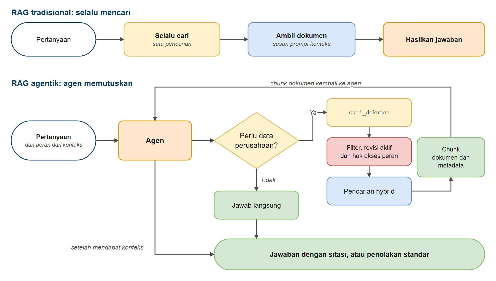

# RAG Agentik

Di hari 2 Anda sudah membangun RAG yang **selalu** mencari lalu menjawab. Bab ini tidak mengulang konsepnya. Yang baru di sini: **agen yang memutuskan sendiri kapan perlu mencari**. Pencarian dibungkus sebagai tool (`cari_dokumen`), agen memanggilnya kalau perlu, dan kode memeriksa apakah keputusan agen sudah tepat.

## Prasyarat

- Sudah menyelesaikan [Function Calling dan Tools](../../hari3/02-tools-function-calling/README.md) dan [Memulai dengan Agen](../../hari3/03-agen/README.md)
- Sudah mengikuti workshop hari 2 (RAG): chunking, embedding, retrieval hybrid, dan prompt dengan sitasi. Bab ini memakai hasilnya lewat tool `cari_dokumen` dari paket bersama, jadi tidak perlu menulis ulang pipeline pencarian

## Tujuan Pembelajaran

Setelah bab ini Anda bisa:

- Menjelaskan perbedaan RAG tradisional (selalu mencari) dan RAG agentik (agen memutuskan)
- Memilih antara prompt biasa, RAG tradisional, dan RAG agentik untuk sebuah kebutuhan
- Memberikan tool pencarian dokumen ke agen, dengan peran penanya dari konteks runtime
- Memeriksa di kode apakah agen mencari atau menjawab langsung

---

## Analogi: Mahasiswa yang Tahu Kapan Membuka Buku

**Bayangkan dua mahasiswa yang mengerjakan ujian dengan buku terbuka.**

- **Mahasiswa A** membuka buku untuk setiap soal, termasuk "Berapa 2 + 2?". Hasilnya selalu berdasarkan buku, tetapi banyak waktu terbuang.
- **Mahasiswa B** langsung menjawab yang sudah ia tahu, dan hanya membuka buku untuk soal yang memang butuh data dari buku.

| Mahasiswa | Di LangChain |
|---|---|
| Mahasiswa A: selalu membuka buku | RAG tradisional |
| Mahasiswa B: membuka buku kalau perlu | RAG agentik |
| Buku catatan | Dokumen perusahaan (SOP, manual, laporan) |
| Membuka buku | Memanggil tool `cari_dokumen` |

---

## RAG Tradisional vs RAG Agentik



*Gambar 1. RAG tradisional dan RAG agentik*

| | RAG tradisional | RAG agentik |
|---|---|---|
| Pencarian | Setiap pertanyaan | Hanya bila agen menilai perlu |
| Perilaku | Mudah diprediksi | Bergantung keputusan model, jadi perlu diperiksa |
| Biaya | Satu pencarian per pertanyaan | Bisa nol, bisa lebih dari satu pencarian |
| Cocok untuk | Setiap pertanyaan memang butuh dokumen | Pertanyaan campuran: pengetahuan umum dan data perusahaan |

### Kapan RAG, Kapan Cukup Prompt Biasa?

| Situasi | Pilihan | Alasan |
|---|---|---|
| Beberapa FAQ pendek yang muat di prompt | Prompt biasa | Sederhana, tanpa pencarian |
| Ratusan SOP dan manual yang sering direvisi | RAG | Tidak muat di prompt, mudah diperbarui, bisa memberi sitasi |
| Pertanyaan campuran umum dan dokumen | RAG agentik | Agen memutuskan kapan mencari |
| Semua pertanyaan pasti butuh dokumen | RAG tradisional | Perilaku mudah diprediksi |

---

## Contoh 1: RAG Tradisional (Pola Selalu-Mencari)

Sebagai pembanding, polanya ditulis dengan LangChain: pencarian dijalankan untuk **setiap** pertanyaan, bahkan "Berapa 2 + 2?".

**Kode**: [`code/01_traditional_rag.py`](./code/01_traditional_rag.py)
**Jalankan**: `python hari4/10-agentic-rag/code/01_traditional_rag.py`

```python
# %% [markdown]
# # Contoh 1: RAG Tradisional (Pola Selalu-Mencari)
# Jalankan sel satu per satu dengan Shift+Enter, atau seluruh file: `python hari4/10-agentic-rag/code/01_traditional_rag.py`
#
# Pada RAG tradisional, SETIAP pertanyaan memicu pencarian dokumen, lalu hasilnya ditempel ke prompt:
#
# `pertanyaan -> SELALU cari -> ambil dokumen -> hasilkan jawaban`
#
# Itu sederhana dan mudah diprediksi, tetapi boros: pertanyaan "Berapa 2 + 2?" pun menjalankan pencarian
# dan membawa chunk SOP yang tidak relevan ke model.

# %%
# Langkah 1 - Menyiapkan model dan retriever
import os
import time

from dotenv import load_dotenv
from langchain_core.messages import HumanMessage, SystemMessage
from langchain_openai import ChatOpenAI

from migas_shared.rag_pipeline import format_context
from migas_shared.rag_tools import build_retriever

load_dotenv()

model = ChatOpenAI(
    model=os.getenv("ONLINE_MODEL"),
    base_url=os.getenv("ONLINE_BASE_URL"),
    api_key=os.getenv("ONLINE_API_KEY"),
    reasoning_effort=os.getenv("LLM_REASONING_EFFORT", "none"),
)
retriever = build_retriever()
jumlah_pencarian = 0

# %% [markdown]
# ## Langkah 2 - Fungsi RAG tradisional
# Langkah pertama SELALU mencari dokumen (walau tidak dibutuhkan), langkah kedua menghasilkan jawaban dengan konteks itu.

# %%
def rag_tradisional(pertanyaan: str) -> tuple[str, list[str]]:
    global jumlah_pencarian
    # Langkah 1: SELALU cari dokumen (walau tidak dibutuhkan!)
    dokumen = retriever.search(pertanyaan, k=5, mode="hybrid", role="operator", active_only=True)
    jumlah_pencarian += 1
    konteks = format_context(dokumen)
    # Langkah 2: hasilkan jawaban dengan konteks itu
    pesan = [
        SystemMessage(content="Jawab berdasarkan konteks yang diberikan. Jawab singkat dalam Bahasa Indonesia."),
        HumanMessage(content=f"<konteks>\n{konteks}\n</konteks>\n\nPertanyaan: {pertanyaan}"),
    ]
    return model.invoke(pesan).content, sorted({d.metadata["doc_id"] for d in dokumen})


def coba(label: str, pertanyaan: str) -> None:
    print(f"[{label}] Pertanyaan: {pertanyaan}")
    mulai = time.time()
    jawaban, id_dokumen = rag_tradisional(pertanyaan)
    print(f"   Pencarian dijalankan: ya, dokumen yang dibawa ke model: {id_dokumen}")
    print(f"   Jawaban: {jawaban[:220]}")
    print(f"   Waktu: {time.time() - mulai:.1f} dtk")

# %% [markdown]
# ## Langkah 3 - Pertanyaan pengetahuan umum: 2 + 2

# %%
coba("Pengetahuan umum", "Berapa 2 + 2?")

# %% [markdown]
# ## Langkah 4 - Pertanyaan yang butuh dokumen

# %%
coba("Butuh dokumen", "Pada konsentrasi H2S berapa pekerja wajib menghentikan pekerjaan dan evakuasi?")

# %% [markdown]
# ## Langkah 5 - Pertanyaan pengetahuan umum: ibu kota

# %%
coba("Pengetahuan umum", "Apa ibu kota Prancis?")

# %% [markdown]
# ## Langkah 6 - Rekap

# %%
print(f"Total pencarian: {jumlah_pencarian} dari 3 pertanyaan")

# %% [markdown]
# ## Masalahnya
# - Pertanyaan pengetahuan umum tetap menjalankan pencarian, dan chunk SOP yang tidak relevan ikut ke model
# - Setiap pertanyaan membayar biaya pencarian dan token konteks tambahan
# - Konteks yang tidak relevan bisa membingungkan model
# - Tetapi pola ini sederhana, bisa diprediksi, dan tepat kalau SETIAP pertanyaan memang butuh dokumen
```

### Keluaran yang Diharapkan

> **Catatan:** jawaban model bisa berbeda setiap kali dijalankan. Keluaran di seluruh bab ini berasal dari menjalankan skrip sebenarnya.

```text
[Pengetahuan umum] Pertanyaan: Berapa 2 + 2?
   Pencarian dijalankan: ya, dokumen yang dibawa ke model: ['SOP-ENV-003', 'SOP-HSE-001', 'SOP-OPS-021']
   Jawaban: 4
   Waktu: 2.1 dtk

[Butuh dokumen] Pertanyaan: Pada konsentrasi H2S berapa pekerja wajib menghentikan pekerjaan dan evakuasi?
   Pencarian dijalankan: ya, dokumen yang dibawa ke model: ['GLS-001', 'SOP-HSE-001', 'SOP-HSE-004']
   Jawaban: Berdasarkan SOP-HSE-001 Rev.3, pekerja wajib menghentikan semua pekerjaan dan evakuasi pada **Alarm 2 (merah)** yaitu saat pembacaan detector **≥ 10 ppm**.
   Waktu: 2.2 dtk

[Pengetahuan umum] Pertanyaan: Apa ibu kota Prancis?
   Pencarian dijalankan: ya, dokumen yang dibawa ke model: ['GLS-001', 'SOP-ENV-003', 'SOP-HSE-001', 'SOP-HSE-004']
   Jawaban: Ibu kota Prancis adalah Paris.
   Waktu: 1.8 dtk

Total pencarian: 3 dari 3 pertanyaan
```

### Cara Kerjanya

1. **Setiap pertanyaan menjalankan pencarian**: "Total pencarian: 3 dari 3 pertanyaan", termasuk "Berapa 2 + 2?" dan "Apa ibu kota Prancis?". Dokumen SOP yang tidak relevan ikut dibawa ke model setiap kali.
2. **Konteks yang tidak relevan membebani jawaban.** Untuk "Berapa 2 + 2?" dan pertanyaan ibu kota, pencarian tetap membawa tiga sampai empat dokumen SOP yang tidak ada hubungannya. Pada rekaman ini model tetap menjawab benar ("4" dan "Paris"), tetapi prompt menyuruhnya menjawab dari konteks, sehingga model yang lebih patuh pada prompt bisa menjawab "Tidak tercantum dalam konteks yang diberikan" untuk pengetahuan umum yang mudah.
3. **Pertanyaan yang benar-benar butuh dokumen berhasil** (ambang evakuasi H2S): pencarian membawa SOP yang tepat ke model.
4. **Polanya sederhana dan mudah diprediksi**, jadi tepat kalau setiap pertanyaan memang butuh dokumen. Kelemahannya: biaya pencarian dan token konteks dibayar setiap kali, juga untuk pertanyaan yang tidak membutuhkannya. Contoh 2 memperbaikinya.

---

## Contoh 2: RAG Agentik dengan Tool Pencarian

`cari_dokumen` dari paket bersama adalah tool yang membungkus pencarian hybrid dari hari 2. Agen memutuskan sendiri apakah memakainya.

**Kode**: [`code/02_agentic_rag.py`](./code/02_agentic_rag.py)
**Jalankan**: `python hari4/10-agentic-rag/code/02_agentic_rag.py`

```python
# %% [markdown]
# # Contoh 2: RAG Agentik
# Jalankan sel satu per satu dengan Shift+Enter, atau seluruh file: `python hari4/10-agentic-rag/code/02_agentic_rag.py`
#
# Pada RAG agentik, agen memutuskan SENDIRI apakah perlu mencari di dokumen atau cukup menjawab dari pengetahuan
# umum. Tool pencarian `cari_dokumen` (dari paket bersama) dipakai seperti tool biasa; agen memutuskan kapan
# memanggilnya dari deskripsi tool dan prompt sistem.
#
# Contoh ini mengajukan campuran pertanyaan, lalu MEMERIKSA DI KODE apakah agen mencari atau tidak.

# %%
# Langkah 1 - Membuat agen dengan tool pencarian
import os

from dotenv import load_dotenv
from langchain.agents import create_agent
from langchain_core.messages import HumanMessage
from langchain_openai import ChatOpenAI

from migas_shared.rag_tools import KonteksPengguna, cari_dokumen
from migas_shared.tampil import jawaban_akhir, jejak_tool

load_dotenv()

model = ChatOpenAI(
    model=os.getenv("ONLINE_MODEL"),
    base_url=os.getenv("ONLINE_BASE_URL"),
    api_key=os.getenv("ONLINE_API_KEY"),
    reasoning_effort=os.getenv("LLM_REASONING_EFFORT", "none"),
)

PROMPT = """Anda asisten dokumen untuk operasi lapangan migas.
Untuk pertanyaan tentang prosedur, batas alarm, kode alarm perangkat, atau isi laporan perusahaan, pakai tool
cari_dokumen lebih dulu. Untuk pengetahuan umum yang tidak terkait dokumen perusahaan (hitungan sederhana, fakta umum),
jawab langsung tanpa mencari.
Jawab dokumen hanya dari hasil pencarian dan beri sitasi [DOC_ID bagian]. Kalau hasil pencarian tidak memuat
jawabannya, katakan terus terang bahwa informasinya tidak ditemukan.
Jawab dalam Bahasa Indonesia, ringkas."""

agent = create_agent(model, tools=[cari_dokumen], system_prompt=PROMPT, context_schema=KonteksPengguna)
konteks = KonteksPengguna(role="engineer", area="Seruni", user_id="ENG-208")

# %% [markdown]
# ## Langkah 2 - Fungsi untuk satu pertanyaan
# `periksa` menanyakan agen, menampilkan keputusannya (mencari atau tidak) dari daftar tool call, dan membandingkannya
# dengan harapan. Peran penanya dikirim lewat `context`, bukan diisi oleh model.

# %%
def periksa(pertanyaan: str, seharusnya_mencari: bool) -> bool:
    print(f"Pertanyaan: {pertanyaan}")
    response = agent.invoke({"messages": [HumanMessage(content=pertanyaan)]}, context=konteks)
    pencarian = jejak_tool(response["messages"])
    if pencarian:
        print(f"   Keputusan agen: MENCARI di dokumen -> {pencarian}")
    else:
        print("   Keputusan agen: menjawab langsung dari pengetahuan umum (tanpa mencari)")
    print(f"   Jawaban: {jawaban_akhir(response)[:300]}")
    cocok = bool(pencarian) == seharusnya_mencari
    print(f"   Pemeriksaan: {'LOLOS' if cocok else 'GAGAL'} (diharapkan {'mencari' if seharusnya_mencari else 'tidak mencari'})")
    return cocok


hasil_pemeriksaan = []

# %% [markdown]
# ## Langkah 3 - Pertanyaan umum: seharusnya tidak mencari

# %%
hasil_pemeriksaan.append(periksa("Berapa 2 + 2?", seharusnya_mencari=False))

# %%
hasil_pemeriksaan.append(periksa("Apa ibu kota Prancis?", seharusnya_mencari=False))

# %% [markdown]
# ## Langkah 4 - Pertanyaan tentang dokumen perusahaan: seharusnya mencari

# %%
hasil_pemeriksaan.append(periksa("Berapa nilai IDLH untuk gas H2S menurut SOP kita?", seharusnya_mencari=True))

# %%
hasil_pemeriksaan.append(
    periksa("VSD FD-500 menampilkan kode F12. Apa artinya dan apa yang harus dilakukan?", seharusnya_mencari=True)
)

# %% [markdown]
# ## Langkah 5 - Rekap

# %%
print(f"Keputusan agen sesuai harapan pada {sum(hasil_pemeriksaan)} dari {len(hasil_pemeriksaan)} pertanyaan")

# %% [markdown]
# ## Ide Utama
# - Agen menjawab pengetahuan umum langsung tanpa mencari, dan memakai tool pencarian untuk pertanyaan tentang dokumen perusahaan
# - Agen memutuskan SENDIRI kapan mencari, dari deskripsi tool dan prompt; keputusannya diperiksa di kode lewat daftar tool call
# - Panggilan pencarian lebih sedikit dan respons lebih cepat untuk pertanyaan umum dibandingkan RAG tradisional
# - Pola yang sama bisa diperluas dengan beberapa sumber pencarian dan tool lain
```

### Keluaran yang Diharapkan

```text
Pertanyaan: Berapa 2 + 2?
   Keputusan agen: menjawab langsung dari pengetahuan umum (tanpa mencari)
   Jawaban: 2 + 2 = 4.
   Pemeriksaan: LOLOS (diharapkan tidak mencari)

Pertanyaan: Apa ibu kota Prancis?
   Keputusan agen: menjawab langsung dari pengetahuan umum (tanpa mencari)
   Jawaban: Ibu kota Prancis adalah **Paris**.
   Pemeriksaan: LOLOS (diharapkan tidak mencari)

Pertanyaan: Berapa nilai IDLH untuk gas H2S menurut SOP kita?
   Keputusan agen: MENCARI di dokumen -> ["cari_dokumen({'query': 'IDLH gas H2S hidrogen sulfida nilai batas'})"]
   Jawaban: Berdasarkan SOP-HSE-001 Rev.3, nilai **IDLH untuk gas H2S adalah 100 ppm** [SOP-HSE-001 3].
   Pemeriksaan: LOLOS (diharapkan mencari)

Pertanyaan: VSD FD-500 menampilkan kode F12. Apa artinya dan apa yang harus dilakukan?
   Keputusan agen: MENCARI di dokumen -> ["cari_dokumen({'query': 'VSD FD-500 kode F12 arti dan tindakan'})"]
   Jawaban: Berdasarkan Manual Operasi VSD FD-500 (Rev. 1.2), kode **F12** berarti:

**Motor Underload (UL)** — kondisi beban motor rendah, yang dapat disebabkan oleh:
- Gas lock (gas terperangkap di pompa)
- Inflow (aliran masuk) rendah
- Poros patah

**Tindakan yang harus dilakukan:**
1. **Tunggu fluid level
   Pemeriksaan: LOLOS (diharapkan mencari)

Keputusan agen sesuai harapan pada 4 dari 4 pertanyaan
```

### Cara Kerjanya

1. **Keputusan terjadi di model, pemeriksaannya di kode.** Prompt dan deskripsi tool membuat model memutuskan; skrip lalu memeriksa daftar tool call (`jejak_tool`) untuk tahu apakah agen benar-benar mencari. Pada rekaman di atas keputusan sesuai harapan pada 4 dari 4 pertanyaan.
2. **Pertanyaan umum dijawab langsung**, tanpa satu pun pencarian. Inilah penghematan dibanding Contoh 1.
3. **Agen menyusun query sendiri.** Pada kedua pertanyaan dokumen, agen menulis query pencarian sendiri ("IDLH gas H2S hidrogen sulfida nilai batas" dan "VSD FD-500 kode F12 arti dan tindakan") dan bukan menyalin pertanyaan mentah. Agen juga boleh mengirim lebih dari satu query per giliran kalau perlu (tidak terjadi pada rekaman ini), sesuatu yang tidak dilakukan pipeline tradisional. Argumen `k` pada tool call hanyalah jumlah dokumen yang diambil per pencarian; model memakai nilai bawaan tool (5), dan Anda tidak perlu mengubahnya di bab ini.
4. **Peran datang dari konteks.** `cari_dokumen` membaca peran penanya dari `context`; model tidak bisa mengubahnya (lihat [Function Calling dan Tools](../../hari3/02-tools-function-calling/README.md) dan [Guardrails](../../hari3/07-guardrails-middleware/README.md)).
5. **Model bisa keliru memutuskan.** Kalau agen mencari untuk pertanyaan umum, atau tidak mencari untuk pertanyaan dokumen, pemeriksaan melaporkan GAGAL. Itu tanda perlu memperbaiki prompt atau deskripsi tool.

---

## Poin Penting

- **RAG agentik** membiarkan agen memutuskan kapan mencari; RAG tradisional mencari setiap kali
- Bungkus pencarian dokumen sebagai **tool**, dan teruskan peran lewat konteks runtime, bukan argumen yang diisi model
- **Periksa di kode** apakah agen mencari atau menjawab langsung (daftar tool call), jangan hanya membaca jawabannya
- Keputusan agen bergantung pada **deskripsi tool dan prompt**; kalau agen keliru mencari atau tidak mencari, perbaiki keduanya
- Pilih sesuai kebutuhan: prompt biasa untuk bahan kecil, RAG tradisional bila selalu butuh dokumen, RAG agentik untuk pertanyaan campuran

---

## Peta Konsep

- Pertanyaan dan peran pengguna masuk ke agen.
- Pertanyaan umum dijawab langsung; pertanyaan tentang data perusahaan memanggil `cari_dokumen`.
- Tool hanya mengembalikan dokumen aktif yang boleh dibaca peran pengguna.
- Agen menjawab dengan sitasi, atau mengatakan informasinya tidak ditemukan.
- Kode memeriksa keputusan agen lewat daftar tool call.

---

## Latihan

Latihan bab ini berupa starter yang tinggal Anda isi: `latihan_1.py` dan seterusnya (atau `latihan_1.ipynb`), dengan bagian inti dikosongkan dan diberi komentar `TODO`. Petunjuk singkat ada di [latihan.md](./latihan.md); kode jawabannya ada di bagian **Kode Jawaban Latihan** pada PDF bab ini.

Latihan mencakup:

1. **Asisten SOP dengan Uji Otomatis**: enam uji yang diperiksa di kode (pengetahuan umum, sitasi, konflik revisi, kode alarm, penolakan, dokumen terlarang)
2. **RAG Percakapan** (bonus): tambahkan memori untuk follow-up question

---

## Langkah Berikutnya

Anda sudah membangun agen RAG yang tahu kapan perlu mencari. Lanjutkan ke [Mini Project](../11-mini-project/README.md) untuk menyusun prototipe agen secara berkelompok dari tool, prompt, dan persetujuan manusia.

---

## Dependency

```bash
pip install langchain langchain-openai langchain-core langgraph python-dotenv
```

Bab ini juga memakai paket bersama `migas-shared` (tool `cari_dokumen` dan retriever hybrid dari hari 2). Indeks dokumen dibangun otomatis saat pertama dipakai, dan model embedding lokal (sekitar 220 MB) di-download sekali.

---

## Referensi

Sumber ide dan teknik di bab ini:

- Lewis, P. et al. (2020). Retrieval-Augmented Generation for Knowledge-Intensive NLP Tasks. [Makalah](https://arxiv.org/abs/2005.11401).
- LangChain. Retrieval. [Dokumentasi](https://docs.langchain.com/oss/python/langchain/retrieval).
- LangGraph. Build a custom RAG agent. [Dokumentasi](https://docs.langchain.com/oss/python/langgraph/agentic-rag).
- Asai, A. et al. (2023). Self-RAG: Learning to Retrieve, Generate, and Critique through Self-Reflection. [Makalah](https://arxiv.org/abs/2310.11511).
- Singh, A. et al. (2025). Agentic Retrieval-Augmented Generation: A Survey on Agentic RAG. [Makalah](https://arxiv.org/abs/2501.09136).

---

## Navigasi

[Sebelumnya: Model Context Protocol (MCP)](../09-mcp/README.md) | [Kembali ke Utama](../../README.md) | [Berikutnya: Mini Project](../11-mini-project/README.md)
