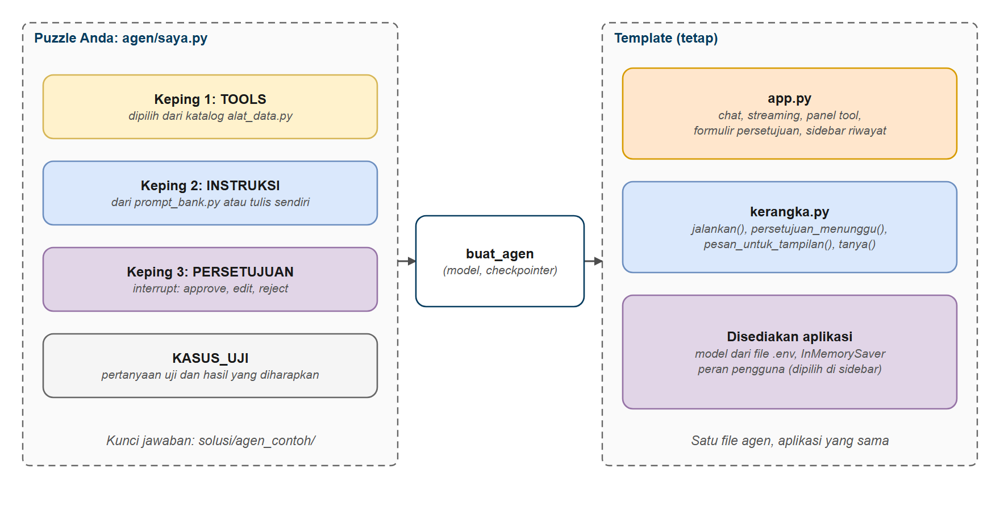
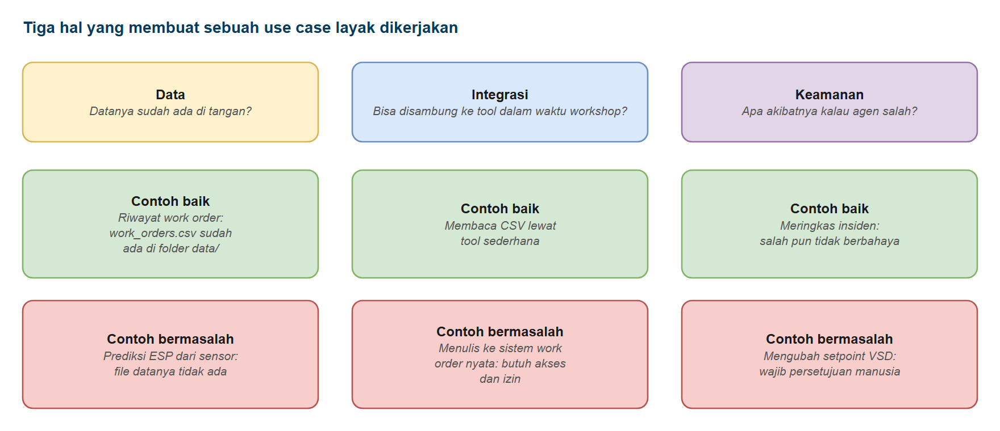
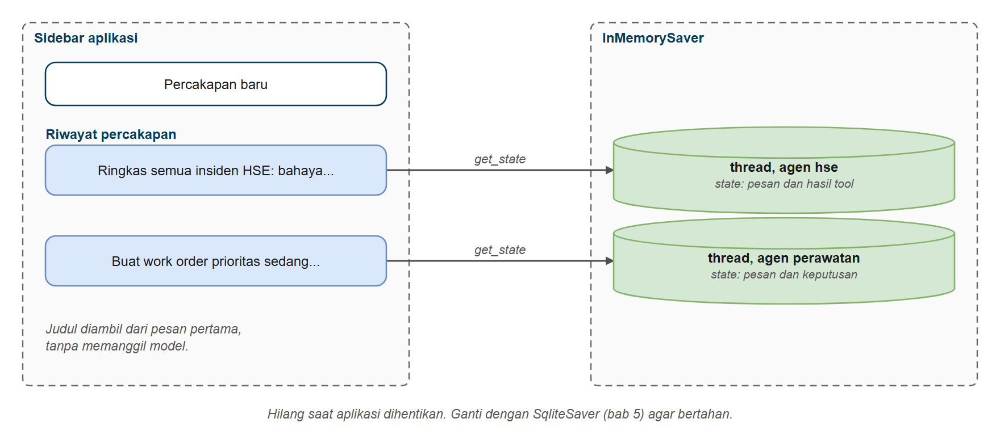
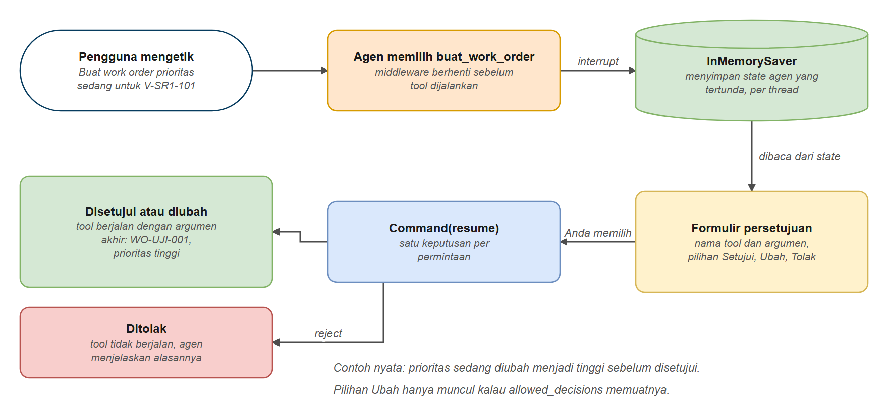

# Mini Project: Menyusun Agen dari Keping Puzzle

Di bab terakhir ini Anda tidak belajar fitur baru. Anda memakai semua yang sudah dipelajari (tool, agen, memori, streaming, persetujuan manusia, guardrails, dan pencarian dokumen) untuk menyusun **agen sederhana, secara mandiri atau berkelompok**, seperti merakit puzzle.

Kami menyediakan kepingnya. Ada **katalog tool** untuk empat use case (Operasi, Perawatan, HSE, Engineering), **bank variasi prompt**, dan **template aplikasi chat** dengan Streamlit yang sudah memuat jawaban bertahap (streaming), panel tool, formulir persetujuan, dan sidebar riwayat percakapan. Tugas Anda (atau kelompok Anda): memilih use case, lalu menyusun satu agen dari tiga keping: **tool**, **prompt**, dan **interrupt** (persetujuan manusia). Anda hanya mengubah satu file: `aplikasi/agen/saya.py`.

## Prasyarat

- Sudah menyelesaikan [Agen dengan create_agent()](../../hari3/03-agen/README.md), [Memori Agen](../../hari3/05-memori-agen/README.md), dan [Persetujuan Manusia](../../hari3/06-persetujuan-manusia/README.md)
- Membantu: [Streaming Agen](../../hari3/bonus-streaming-agen/README.md) (bab bonus), [Guardrails dan Middleware Keamanan](../../hari3/07-guardrails-middleware/README.md), dan [RAG Agentik](../10-agentic-rag/README.md) (tool `cari_dokumen`)
- Streamlit terpasang (sudah termasuk di `requirements.txt`)

## Tujuan Pembelajaran

Setelah bab ini Anda bisa:

- Menjelaskan tiga hal yang menentukan use case layak dikerjakan: data, integrasi, dan keamanan
- Memilih tool dari katalog sesuai use case, dan mengujinya langsung tanpa model
- Menulis prompt agen, dan membandingkan variasinya dengan tool yang sama
- Menentukan tool tulis mana yang diberi interrupt, dan keputusan apa yang diizinkan reviewer
- Merakit ketiga keping menjadi satu agen di template aplikasi
- Menguji agen dengan kasus uji yang diperiksa di kode, bukan dengan satu jawaban yang tampak bagus

---

## Analogi: Merakit Lego dari Papan Dasar

**Bayangkan satu set Lego dengan papan dasar yang sudah jadi.** Papan itu punya jalan, lampu, dan pagar yang sama untuk semua orang. Yang Anda lakukan adalah memilih keping dari kotak, mengikuti buku petunjuk, dan menempelkan stiker "cek dulu ke kakak" pada keping yang berbahaya, misalnya keping tombol lampu utama.

| Lego | Mini project |
|------|--------------|
| Papan dasar | Template aplikasi (`app.py` dan `kerangka.py`), tidak diubah |
| Kotak keping | Katalog tool di `alat_data.py` |
| Keping yang Anda pilih | `TOOLS`: fungsi yang boleh dipanggil agen |
| Buku petunjuk | `INSTRUKSI`: peran dan aturan agen |
| Stiker "cek dulu ke kakak" | `PERSETUJUAN`: tool yang menunggu manusia |
| Uji coba sebelum dipajang | `KASUS_UJI`: pertanyaan uji yang diperiksa kode |

Use case yang berbeda tetap memakai papan yang sama, sehingga hasilnya bisa dibandingkan dengan adil.

---

## Alur Mini Project

| Tahap | Yang dikerjakan | Hasil |
|-------|-----------------|-------|
| 1. Pilih | Menjawab tiga pertanyaan: data, integrasi, keamanan | Satu use case terpilih beserta alasannya |
| 2. Tool | Memilih tool dari katalog (atau menulis sendiri) dan mengujinya | `TOOLS` di file agen |
| 3. Prompt | Menulis atau menyalin dan mengubah prompt dari bank | `INSTRUKSI` di file agen |
| 4. Interrupt | Menentukan tool tulis yang menunggu persetujuan | `PERSETUJUAN` di file agen |
| 5. Uji | Menjalankan kasus uji dan memperbaiki | Hasil uji |



*Gambar 1. Tiga keping puzzle yang Anda susun, satu template yang tetap*

---

## Isi Folder Bab

```text
hari4/11-mini-project/
  aplikasi/
    app.py             template aplikasi Streamlit (tidak diubah)
    kerangka.py        menjalankan agen, membaca state, uji (tidak diubah)
    alat_data.py       KATALOG tool: work order, insiden HSE, laporan harian, setpoint VSD
    prompt_bank.py     variasi prompt dan kumpulan pertanyaan per use case
    studio.py          mengekspor agen untuk LangGraph Studio (opsional)
    agen/
      saya.py          puzzle Anda: tiga keping yang diisi
  code/                empat contoh kode bab ini
  solusi/              kunci jawaban: agen_contoh/ (operasi, perawatan, hse, engineering) dan investigasi_sumur.py
  lembar_rancangan.md  lembar rancangan (diisi sendiri atau bersama kelompok)
```

Jalankan template dari **root repositori** (folder yang berisi `README.md` dan `.env`):

```bash
streamlit run hari4/11-mini-project/aplikasi/app.py
```

Browser terbuka di alamat `http://localhost:8501`. Sidebar berisi pilihan agen, peran pengguna, tombol percakapan baru, dan riwayat percakapan. Layar utama menampilkan contoh pertanyaan; klik salah satunya atau ketik sendiri di kotak bawah. Sebelum menyusun apa pun, jalankan template apa adanya: agen `saya` bawaan sudah berfungsi (agen Perawatan yang hanya membaca).

> **Pertama kali memakai Streamlit**, terminal bisa menanyakan email. Tekan Enter untuk melewatinya.

---

## Bagian 1: Memilih Use Case

Use case yang baik bukan yang paling canggih. Cukup tiga pertanyaan yang dijawab jujur sebelum menulis kode:

| Hal | Pertanyaannya | Contoh yang baik | Contoh yang bermasalah |
|-----|---------------|------------------|------------------------|
| **Data** | Datanya sudah ada di tangan kita? | Riwayat work order: `data/raw/work_orders.csv` sudah ada | Prediksi kegagalan ESP dari data sensor: tidak ada file sensornya |
| **Integrasi** | Bisa disambungkan ke tool dalam waktu workshop? | Membaca file CSV lewat tool sederhana | Menulis ke sistem work order sungguhan: butuh akses dan izin dari tim TI |
| **Keamanan** | Apa akibatnya kalau agen salah? | Meringkas insiden HSE: salah pun tidak berbahaya | Mengubah setpoint VSD: salah bisa merusak pompa atau mengganggu produksi, jadi wajib persetujuan manusia |



*Gambar 2. Tiga syarat use case: data, integrasi, keamanan*

Use case yang berisiko tidak harus dibuang. Kalau kelompok tetap memilihnya, setiap tindakan tulis wajib lewat persetujuan manusia (keping ke-3), dan sebaiknya reviewer tidak boleh mengubah argumennya. Sebaliknya, use case yang datanya belum ada sebaiknya ditunda, sebaik apa pun idenya.

Katalog di bab ini sudah menyiapkan data dan tool untuk empat use case. Tool tulis ditandai karena inilah yang perlu interrupt:

| Use case | Tool baca | Tool tulis (perlu interrupt) |
|----------|-----------|------------------------------|
| **Operasi**: pengawas shift GS-SR1 | `laporan_harian`, `ringkasan_produksi_bulanan`, `bandingkan_produksi`, `hari_berkejadian`, `cek_status_sumur`, `hitung_water_cut` | `catat_serah_terima` |
| **Perawatan**: perencana pemeliharaan | `riwayat_work_order`, `statistik_kegagalan`, `aset_downtime_tertinggi`, `cari_dokumen` | `buat_work_order`, `tutup_work_order` |
| **HSE**: petugas HSE | `cari_insiden`, `ringkasan_insiden`, `cari_dokumen` | `usulkan_tindakan_korektif`, `kirim_notifikasi_hse` |
| **Engineering**: engineer lapangan | `cari_dokumen`, `konversi_satuan`, `hitung_water_cut`, `cek_status_sumur` | `ubah_setpoint_vsd` |

Anda tidak harus mengikuti satu baris tabel. Boleh menggabungkan tool dari beberapa use case, atau menulis tool sendiri (lihat [latihan.md](./latihan.md)). Hasil pilihan kelompok ditulis di [lembar rancangan](./lembar_rancangan.md), satu halaman saja.

---

## Bagian 2: Tiga Keping Puzzle

---

### Keping 1: Tool

Tool adalah apa yang bisa dilakukan agen. Tool yang salah atau deskripsinya kabur tidak bisa diselamatkan oleh agen sebesar apa pun, jadi **uji tool langsung dengan `.invoke()` sebelum memberikannya ke agen**. Tool tulis di bab ini hanya mencatat ke memori (`CATATAN_TINDAKAN`), tidak mengubah sistem nyata, sehingga aman dicoba berulang kali.

Mengambil tool dari katalog cukup dengan `import`:

```python
from alat_data import riwayat_work_order, aset_downtime_tertinggi, buat_work_order
from alat_data import KATALOG                      # seluruh katalog: KATALOG["HSE"], KATALOG["Operasi"], ...

TOOLS = [riwayat_work_order, aset_downtime_tertinggi, buat_work_order]
```

---

### Contoh 1: Katalog Tool

Contoh ini mencetak isi katalog (mana tool baca dan mana tool tulis), memanggil beberapa tool langsung, mencoba masukan yang tidak dikenal, dan memastikan tool tulis hanya mencatat ke memori.

**Kode**: [`code/01_katalog_tool.py`](./code/01_katalog_tool.py)
**Jalankan**: `python hari4/11-mini-project/code/01_katalog_tool.py`

```python
# %% [markdown]
# # Contoh 1: Katalog Tool (Keping Puzzle 1)
# Jalankan sel satu per satu dengan Shift+Enter, atau seluruh file: `python hari4/11-mini-project/code/01_katalog_tool.py`
#
# Keping puzzle pertama adalah tool. Bab ini menyediakan katalog tool untuk empat use case (Operasi, Perawatan,
# HSE, Engineering) di `aplikasi/alat_data.py`. Anda memilih tool dari katalog, atau menulis sendiri, lalu memberikannya
# ke agen. Contoh ini:
#
# 1. mencetak isi katalog: tool apa saja, dan mana yang BACA dan mana yang TULIS
# 2. memanggil beberapa tool langsung dengan `.invoke()`, tanpa model, dan memeriksa hasilnya di kode
# 3. memastikan masukan yang tidak dikenal menghasilkan pesan jelas, bukan error
# 4. memastikan tool tulis hanya mencatat ke memori (`CATATAN_TINDAKAN`), sehingga aman dicoba berulang kali
#
# Kalau tool salah, agen sebesar apa pun tidak akan menolong. Karena itu tool diuji dulu sebelum diberikan ke agen.

# %%
# Langkah 1 - Mengimpor katalog dan fungsi pemeriksa
import sys

from migas_shared.config import ROOT

sys.path.insert(0, str(ROOT / "hari4" / "11-mini-project" / "aplikasi"))

import alat_data as a


def periksa(nama: str, hasil: str, harus_ada: str) -> None:
    status = "LOLOS" if harus_ada.lower() in hasil.lower() else "GAGAL"
    print(f"   [{status}] {nama}")
    for baris in hasil.splitlines()[:3]:
        print(f"           {baris[:118]}")

# %% [markdown]
# ## Langkah 2 - Isi katalog
# `KATALOG` adalah dictionary: nama use case menjadi daftar tool. `jenis_tool()` menandai tool BACA atau TULIS.
# Tool TULIS mengubah sesuatu, jadi di sistem nyata ia harus dipasangi persetujuan manusia (keping puzzle ke-3).

# %%
for use_case, daftar in a.KATALOG.items():
    print(f"{use_case} ({len(daftar)} tool)")
    for t in daftar:
        print(f"   [{a.jenis_tool(t):<5}] {t.name:<28}{t.description.splitlines()[0][:78]}")

# %% [markdown]
# ## Langkah 3 - Tool yang dipakai bersama
# Satu tool boleh masuk ke banyak use case. Daftar ini dihitung kode dari `KATALOG`.

# %%
dipakai: dict[str, list[str]] = {}
for use_case, daftar in a.KATALOG.items():
    for t in daftar:
        dipakai.setdefault(t.name, []).append(use_case)
print("Tool yang dipakai lebih dari satu use case:")
for nama, daftar_use_case in dipakai.items():
    if len(daftar_use_case) > 1:
        print(f"   {nama:<20}{', '.join(daftar_use_case)}")

# %% [markdown]
# ## Langkah 4 - Tool baca
# Setiap tool dipanggil langsung dengan `.invoke({...})`, lalu hasilnya diperiksa memuat kata kunci yang benar.
# Tool `cari_dokumen` tidak dipanggil di sini karena membutuhkan konteks pengguna dari agen (lihat bab 7).

# %%
print("Tool baca")
periksa("riwayat_work_order(SR-020)", a.riwayat_work_order.invoke({"asset_id": "SR-020", "maks": 2}), "SR-020")
periksa("aset_downtime_tertinggi(3)", a.aset_downtime_tertinggi.invoke({"maks": 3}), "KN-112")
periksa("ringkasan_insiden()", a.ringkasan_insiden.invoke({}), "Total 120 insiden")
periksa("laporan_harian(2026-07-14)", a.laporan_harian.invoke({"tanggal": "2026-07-14"}), "LCV macet")
periksa("bandingkan_produksi(10 dan 14 Juli)", a.bandingkan_produksi.invoke({"tanggal_a": "2026-07-10", "tanggal_b": "2026-07-14"}), "deferred +320")
periksa("hari_berkejadian(3)", a.hari_berkejadian.invoke({"maks": 3}), "12 hari berkejadian")

# %% [markdown]
# ## Langkah 5 - Masukan yang tidak dikenal
# Aset, tanggal, atau nomor yang tidak ada harus menghasilkan pesan jelas, bukan error. Agen akan menyampaikan
# pesan ini apa adanya, jadi pesannya harus dapat dipahami pengguna.

# %%
print("Masukan yang tidak dikenal")
periksa("riwayat_work_order(XX-999)", a.riwayat_work_order.invoke({"asset_id": "XX-999"}), "Tidak ada work order")
periksa("laporan_harian(2026-08-05)", a.laporan_harian.invoke({"tanggal": "2026-08-05"}), "Tidak ada laporan")
periksa("bandingkan_produksi(Agustus)", a.bandingkan_produksi.invoke({"tanggal_a": "2026-07-10", "tanggal_b": "2026-08-14"}), "Tidak ada laporan")
periksa("tutup_work_order(WO-XX)", a.tutup_work_order.invoke({"wo_id": "WO-XX", "catatan": "uji"}), "tidak ditemukan")

# %% [markdown]
# ## Langkah 6 - Tool tulis
# Tool tulis hanya mencatat ke memori, jadi aman dicoba berulang kali. Nomor `-UJI-` menunjukkan bahwa semua tool tulis
# berbagi satu daftar catatan; daftar inilah yang nanti dipakai uji untuk memeriksa apakah sebuah tindakan benar-benar terjadi.

# %%
print("Tool tulis (hanya mencatat di memori)")
sebelum = len(a.CATATAN_TINDAKAN)
periksa("buat_work_order", a.buat_work_order.invoke({"asset_id": "V-SR1-101", "uraian": "Periksa LCV", "prioritas": "sedang"}), "WO-UJI-001")
periksa("tutup_work_order", a.tutup_work_order.invoke({"wo_id": "WO-26-12115", "catatan": "pulling motor selesai"}), "TUTUP-UJI-002")
periksa("kirim_notifikasi_hse", a.kirim_notifikasi_hse.invoke({"penerima": "Supervisor HSE", "pesan": "Alarm H2S SR-027"}), "NOTIF-UJI-003")
periksa("ubah_setpoint_vsd(58 Hz)", a.ubah_setpoint_vsd.invoke({"kode_sumur": "SR-020", "frekuensi_hz": 58}), "PERINGATAN")
print(f"   Catatan tindakan bertambah {len(a.CATATAN_TINDAKAN) - sebelum}: {[c['nomor'] for c in a.CATATAN_TINDAKAN]}")

# %% [markdown]
# ## Ide Utama
# - Katalog memberi keping siap pakai per use case; Anda boleh memilih sebagian, menggabung dari beberapa use case, atau menulis tool sendiri
# - Uji tool dengan `.invoke({...})` sebelum memberikannya ke agen
# - Masukan yang tidak dikenal harus menghasilkan pesan jelas agar agen bisa menyampaikannya apa adanya
# - Tool tulis di mini project hanya mencatat ke memori, tetapi di sistem nyata ia harus dipasangi persetujuan manusia
```

### Keluaran yang Diharapkan

```text
Operasi (7 tool)
   [baca ] laporan_harian              Tampilkan laporan produksi harian GS-SR1: minyak, air, gas, jumlah sumur aktif
   [baca ] ringkasan_produksi_bulanan  Ringkas produksi GS-SR1 selama Juli 2026: rata-rata minyak dan air, water cut,
   [baca ] bandingkan_produksi         Bandingkan laporan produksi harian GS-SR1 pada dua tanggal: selisih minyak, ai
   [baca ] hari_berkejadian            Daftar hari pada Juli 2026 yang punya kejadian khusus di laporan harian GS-SR1
   [baca ] cek_status_sumur            Cek status operasi sebuah sumur: area, jenis pompa, status, produksi minyak da
   [baca ] hitung_water_cut            Hitung water cut (persentase air dalam total cairan produksi) sebuah sumur.
   [tulis] catat_serah_terima          Simpan catatan serah terima shift. TINDAKAN TULIS: perlu persetujuan manusia.
Perawatan (6 tool)
   [baca ] riwayat_work_order          Tampilkan riwayat work order sebuah aset: tanggal, kategori kegagalan, kompone
   [baca ] statistik_kegagalan         Hitung jumlah work order dan total downtime per kategori kegagalan, untuk satu
   [baca ] aset_downtime_tertinggi     Tampilkan aset dengan total downtime tertinggi dari seluruh work order, besert
   [baca ] cari_dokumen                Cari chunk dokumen SOP, manual, laporan dan investigasi yang berstatus aktif.
   [tulis] buat_work_order             Buat work order pemeliharaan baru. TINDAKAN TULIS: perlu persetujuan manusia.
   [tulis] tutup_work_order            Tutup sebuah work order yang pekerjaannya selesai. TINDAKAN TULIS: perlu perse
HSE (5 tool)
   [baca ] cari_insiden                Cari insiden HSE menurut lokasi, jenis bahaya, dan tingkat keparahan. Semua fi
   [baca ] ringkasan_insiden           Ringkas seluruh insiden HSE: jumlah per jenis bahaya, per tingkat keparahan, d
   [baca ] cari_dokumen                Cari chunk dokumen SOP, manual, laporan dan investigasi yang berstatus aktif.
   [tulis] usulkan_tindakan_korektif   Catat usulan tindakan korektif untuk sebuah insiden. TINDAKAN TULIS: perlu per
   [tulis] kirim_notifikasi_hse        Kirim notifikasi HSE kepada seorang penerima atau satu kelompok. TINDAKAN TULI
Engineering (5 tool)
   [baca ] cari_dokumen                Cari chunk dokumen SOP, manual, laporan dan investigasi yang berstatus aktif.
   [baca ] konversi_satuan             Konversi satuan volume (bbl dan m3) atau tekanan (psi dan bar).
   [baca ] hitung_water_cut            Hitung water cut (persentase air dalam total cairan produksi) sebuah sumur.
   [baca ] cek_status_sumur            Cek status operasi sebuah sumur: area, jenis pompa, status, produksi minyak da
   [tulis] ubah_setpoint_vsd           Ubah frekuensi VSD (setpoint) pompa ESP sebuah sumur. TINDAKAN TULIS: perlu pe

Tool yang dipakai lebih dari satu use case:
   cek_status_sumur    Operasi, Engineering
   hitung_water_cut    Operasi, Engineering
   cari_dokumen        Perawatan, HSE, Engineering

Tool baca
   [LOLOS] riwayat_work_order(SR-020)
           SR-020: 5 work order, total downtime 25.0 jam. Terbaru:
           - WO-26-10086 (2026-09-24): Instrumentation/Control, komponen VSD, tindakan Replace, downtime 4.0 jam
           - WO-26-10320 (2026-06-18): Preventive Maintenance, komponen VSD, tindakan Adjust/Reset, downtime 3.0 jam
   [LOLOS] aset_downtime_tertinggi(3)
           3 aset dengan downtime tertinggi:
           - KN-112 (SRP): 361 jam dari 22 work order
           - KN-077 (SRP): 328 jam dari 24 work order
   [LOLOS] ringkasan_insiden()
           Total 120 insiden.
           Per bahaya: Hot Work/Fire 21, Working at Height 13, Vehicle/Driving 13, Spill/Release 13, Electrical 12, Dropped Objec
           Per tingkat: Rendah 70, Sedang 31, Tinggi 19
   [LOLOS] laporan_harian(2026-07-14)
           GS-SR1 2026-07-14: minyak 4020 bopd, air 39157 bwpd, gas 2.08 MMscfd, 54 sumur aktif, deferred 320 bbl. Kejadian: High
   [LOLOS] bandingkan_produksi(10 dan 14 Juli)
           2026-07-14 dibanding 2026-07-10: minyak -381 bopd (4401 -> 4020), air -384 bwpd, gas -0.05 MMscfd, deferred +320 bbl.
   [LOLOS] hari_berkejadian(3)
           12 hari berkejadian. Ditampilkan 3 pertama:
           - 2026-07-03: SR-014 trip OL, ESP di-restart setelah flushing (deferred 85 bbl)
           - 2026-07-06: PM separator V-SR1-102, produksi dialihkan ke V-SR1-101 (deferred 0 bbl)

Masukan yang tidak dikenal
   [LOLOS] riwayat_work_order(XX-999)
           Tidak ada work order untuk aset XX-999.
   [LOLOS] laporan_harian(2026-08-05)
           Tidak ada laporan untuk tanggal 2026-08-05. Data tersedia 2026-07-01 sampai 2026-07-31.
   [LOLOS] bandingkan_produksi(Agustus)
           Tidak ada laporan untuk tanggal 2026-08-14. Data tersedia 2026-07-01 sampai 2026-07-31.
   [LOLOS] tutup_work_order(WO-XX)
           Work order WO-XX tidak ditemukan, penutupan tidak dicatat.

Tool tulis (hanya mencatat di memori)
   [LOLOS] buat_work_order
           Work order WO-UJI-001 dibuat untuk V-SR1-101 (prioritas sedang).
   [LOLOS] tutup_work_order
           Penutupan WO-26-12115 dicatat sebagai TUTUP-UJI-002.
   [LOLOS] kirim_notifikasi_hse
           Notifikasi NOTIF-UJI-003 dikirim ke Supervisor HSE.
   [LOLOS] ubah_setpoint_vsd(58 Hz)
           Setpoint VSD SR-020 dicatat 58 Hz (VSD-UJI-004). PERINGATAN: di atas 55 Hz memerlukan persetujuan Production Engineer.
   Catatan tindakan bertambah 4: ['WO-UJI-001', 'TUTUP-UJI-002', 'NOTIF-UJI-003', 'VSD-UJI-004']
```

### Cara Kerjanya

1. **`KATALOG` adalah dictionary** dari nama use case ke daftar tool, dan `jenis_tool()` menandai tool baca atau tulis. Perhatikan bahwa `cari_dokumen`, `cek_status_sumur`, dan `hitung_water_cut` dipakai lebih dari satu use case: satu tool boleh masuk ke banyak agen.
2. **Tool diuji dengan `.invoke({...})`.** Hasilnya diperiksa di kode (`LOLOS` atau `GAGAL`), sama seperti uji biasa. `cari_dokumen` tidak dipanggil langsung karena membutuhkan konteks pengguna dari agen.
3. **Masukan yang tidak dikenal menghasilkan pesan jelas**, misalnya "Tidak ada work order untuk aset XX-999". Agen akan menyampaikan pesan itu apa adanya, jadi pesannya harus ditulis agar bisa dipahami pengguna.
4. **Docstring adalah petunjuk bagi model.** Kalimat pertama menentukan kapan tool dipilih, dan bagian `Args` memberi contoh nilai. Tool baru buatan kelompok Anda ditulis dengan pola yang sama.
5. **Nomor `-UJI-` di tool tulis** menunjukkan bahwa semua tool tulis berbagi satu daftar catatan. Daftar inilah yang nanti dipakai uji untuk memeriksa apakah sebuah tindakan benar-benar terjadi.

---

### Keping 2: Prompt

`INSTRUKSI` adalah peran dan aturan agen. Anda bebas menulisnya dari nol. Untuk memulai cepat, `aplikasi/prompt_bank.py` menyediakan tiga bahan:

- `PERAN`: satu kalimat peran untuk tiap use case
- `KHUSUS`: aturan yang menyebut tool dengan namanya (misalnya "untuk tanggal tertentu, SELALU panggil `laporan_harian` dulu")
- `GAYA`: variasi cara agen menjawab

| Gaya | Isinya | Cocok untuk |
|------|--------|-------------|
| `minimal` | Hanya peran, tanpa aturan | Pembanding: lihat apa yang terjadi tanpa aturan |
| `ketat` | Hanya dari tool, tolak yang di luar cakupan, jangan mengarang | Data operasi yang tidak boleh meleset |
| `ramah` | Nada santai, menawarkan satu langkah lanjutan tanpa menjalankannya | Asisten untuk pengguna lapangan |
| `tabel` | Perbandingan dan daftar dalam tabel, ditutup satu kalimat kesimpulan | Laporan untuk manajemen |
| `sitasi` | Setiap fakta dokumen diberi sitasi `[DOC_ID bagian]` | Agen yang memakai `cari_dokumen` |
| `hati_hati` | Tool tulis hanya bila diminta jelas, tanyakan dulu bila ada yang kurang | Agen yang punya tool tulis |

```python
from prompt_bank import susun_prompt, PERTANYAAN

INSTRUKSI = susun_prompt("Perawatan", "ketat")          # peran + aturan tool + gaya
INSTRUKSI = susun_prompt("HSE", "sitasi")               # ganti gaya
INSTRUKSI = susun_prompt("Perawatan", "ketat") + "\nSelalu sebut nomor aset di awal jawaban."   # tambah kalimat sendiri
```

`PERTANYAAN[use_case][jenis]` menyimpan pertanyaan siap pakai dalam lima jenis: `baca`, `multi` (beberapa tool berurutan), `tulis` (memicu persetujuan), `tanpa_data` (data tidak ada, agen harus jujur), dan `di_luar` (di luar cakupan, agen harus menolak). Pakai untuk `CONTOH_PERTANYAAN` dan `KASUS_UJI`.

> **Prompt tidak selalu berlaku bagi model.** Aturan "jangan memanggil tool tulis tanpa diminta" hanya imbauan. Yang benar-benar menjamin sebuah tindakan tidak berjalan sebelum disetujui adalah keping ke-3.

---

### Keping 3: Interrupt

`PERSETUJUAN` adalah kamus dari nama tool ke keputusan yang diizinkan. Tool yang ada di kamus ini berhenti menunggu manusia sebelum berjalan (mekanismenya dari [bab 6](../../hari3/06-persetujuan-manusia/README.md)). Tool yang tidak ada di kamus berjalan bebas, jadi **setiap tool tulis di `TOOLS` harus punya aturan di sini**.

```python
PERSETUJUAN = {
    "buat_work_order": {"allowed_decisions": ["approve", "edit", "reject"]},
    "kirim_notifikasi_hse": {"allowed_decisions": ["approve", "reject"]},
}
```

Memilih keputusan yang diizinkan adalah keputusan tentang risiko:

| Jenis tool tulis | Contoh | Keputusan yang diizinkan | Alasan |
|------------------|--------|--------------------------|--------|
| Argumen bisa diperbaiki reviewer | `buat_work_order` (prioritas, uraian), `ubah_setpoint_vsd` (nilai Hz) | `approve`, `edit`, `reject` | Reviewer sering ingin memperbaiki sedikit, bukan menolak seluruhnya |
| Tidak boleh diubah, hanya boleh jalan atau tidak | `kirim_notifikasi_hse`, `usulkan_tindakan_korektif` | `approve`, `reject` | Pesan yang terkirim tidak bisa ditarik; yang disetujui harus persis yang dilihat |
| Tidak ada yang boleh berjalan tanpa tinjauan khusus | tindakan yang menghentikan produksi | `reject` saja, atau jangan sediakan tool-nya | Lebih aman tidak memberikan tool sama sekali |

Formulir di aplikasi hanya menampilkan pilihan yang ada di `allowed_decisions`. Kalau `edit` tidak diizinkan, pilihan **Ubah** tidak muncul.

---

### Contoh 2: Merakit Ketiga Keping

Contoh ini merakit agen Perawatan langkah demi langkah dari terminal, tanpa UI: dua tool baca dan dua tool tulis, prompt `ketat`, lalu `PERSETUJUAN`. Reviewer-nya berupa fungsi berskrip yang menyetujui, mengubah prioritas, dan menolak. Hasilnya diperiksa di kode (`CATATAN_TINDAKAN`), bukan di kalimat jawaban.

**Kode**: [`code/02_rakit_agen.py`](./code/02_rakit_agen.py)
**Jalankan**: `python hari4/11-mini-project/code/02_rakit_agen.py`

```python
# %% [markdown]
# # Contoh 2: Merakit Agen dari Tiga Keping
# Jalankan sel satu per satu dengan Shift+Enter, atau seluruh file: `python hari4/11-mini-project/code/02_rakit_agen.py`
#
# Agen mini project selalu disusun dari tiga keping yang Anda pilih sendiri:
#
# 1. TOOLS: tool apa yang boleh dipakai agen (dari katalog di contoh 1)
# 2. INSTRUKSI: peran dan aturan agen (dari bank prompt di `aplikasi/prompt_bank.py`, atau tulis sendiri)
# 3. PERSETUJUAN: tool tulis mana yang berhenti menunggu manusia (interrupt), dan keputusan apa yang diizinkan
#
# Contoh ini merakit agen Perawatan langkah demi langkah, lalu menjalankannya dari terminal tanpa UI. Reviewer-nya
# berupa fungsi berskrip: menyetujui, mengubah, dan menolak. Hasilnya diperiksa di kode, yaitu isi `CATATAN_TINDAKAN`,
# bukan kalimat jawaban agen. Agen bisa saja menulis "work order dibuat" tanpa benar-benar memanggil tool.
#
# Kalau agen sudah bekerja di terminal, menyalin ketiga keping ke `aplikasi/agen/saya.py` akan membuatnya tampil di aplikasi.

# %%
# Langkah 1 - Mengimpor kerangka aplikasi dan komponen agen
import sys

from langchain.agents import create_agent
from langchain.agents.middleware import HumanInTheLoopMiddleware
from langgraph.checkpoint.memory import InMemorySaver

from migas_shared.config import ROOT
from migas_shared.llm import get_chat_model
from migas_shared.rag_tools import KonteksPengguna

sys.path.insert(0, str(ROOT / "hari4" / "11-mini-project" / "aplikasi"))

import alat_data as a
import kerangka as k
from prompt_bank import PERTANYAAN, susun_prompt

# %% [markdown]
# ## Langkah 2 - Keping 1: TOOLS
# Dua tool baca dan dua tool tulis dari katalog Perawatan. Tool yang sama bisa juga Anda tulis sendiri dengan `@tool`.

# %%
TOOLS = [a.riwayat_work_order, a.aset_downtime_tertinggi, a.buat_work_order, a.tutup_work_order]
for t in TOOLS:
    print(f"   [{a.jenis_tool(t):<5}] {t.name}")

# %% [markdown]
# ## Langkah 3 - Keping 2: INSTRUKSI
# `susun_prompt(use_case, gaya)` menggabungkan peran, aturan yang menyebut tool dengan namanya, dan gaya jawaban.
# Gaya `ketat` hanya menjawab dari tool dan menolak yang di luar cakupan. Contoh 3 membandingkan gaya lainnya.

# %%
INSTRUKSI = susun_prompt("Perawatan", "ketat")
print(INSTRUKSI)

# %% [markdown]
# ## Langkah 4 - Keping 3: PERSETUJUAN
# Membuat work order boleh disetujui, diubah, atau ditolak. Menutup work order hanya boleh disetujui atau ditolak,
# karena yang diperiksa reviewer adalah nomornya, bukan isinya. Kode memeriksa bahwa setiap tool tulis punya aturan.

# %%
PERSETUJUAN = {
    "buat_work_order": {"allowed_decisions": ["approve", "edit", "reject"]},
    "tutup_work_order": {"allowed_decisions": ["approve", "reject"]},
}
tanpa_aturan = [t.name for t in TOOLS if a.jenis_tool(t) == "tulis" and t.name not in PERSETUJUAN]
print(f"   Tool tulis tanpa aturan persetujuan: {tanpa_aturan or 'tidak ada'} -> {'LOLOS' if not tanpa_aturan else 'GAGAL'}")

# %% [markdown]
# ## Langkah 5 - Merakit agen
# Tiga keping masuk ke `create_agent()`. `HumanInTheLoopMiddleware` mengubah PERSETUJUAN menjadi interrupt,
# dan `InMemorySaver` menyimpan keadaan agen selama menunggu keputusan (lihat bab 6).

# %%
agen = create_agent(
    get_chat_model(),
    tools=TOOLS,
    system_prompt=INSTRUKSI,
    middleware=[HumanInTheLoopMiddleware(interrupt_on=PERSETUJUAN)],
    checkpointer=InMemorySaver(),
    context_schema=KonteksPengguna,
)
konteks = k.konteks_untuk("engineer")
print("   Agen siap.")

# %% [markdown]
# ## Langkah 6 - Pertanyaan baca: tidak ada persetujuan
# Tool baca berjalan bebas, jadi reviewer tidak pernah ditanya.

# %%
pertanyaan = PERTANYAAN["Perawatan"]["baca"][0]
print(f"   Pengguna: {pertanyaan}")
hasil_baca = k.tanya(agen, pertanyaan, "rakit-baca", konteks)
print(f"   Tool dipanggil : {hasil_baca.tool}")
print(f"   Keputusan      : {hasil_baca.keputusan or 'tidak ada (tidak ada tool tulis)'}")
print(f"   Jawaban agen   : {hasil_baca.jawaban[:150].replace(chr(10), ' ')}...")

# %% [markdown]
# ## Langkah 7 - Pertanyaan tulis: reviewer menyetujui
# `k.tanya()` menjalankan agen sampai selesai dan menjawab setiap permintaan persetujuan dengan fungsi `reviewer`.
# Di aplikasi, reviewer-nya adalah Anda lewat formulir.

# %%
def setuju(permintaan: dict, boleh: list[str]) -> dict:
    print(f"   Reviewer menerima usulan {permintaan['name']} {permintaan['args']}")
    print(f"   Pilihan yang diizinkan: {', '.join(boleh)} -> approve")
    return {"type": "approve"}


pertanyaan = PERTANYAAN["Perawatan"]["tulis"][0]
print(f"   Pengguna: {pertanyaan}")
sebelum = len(a.CATATAN_TINDAKAN)
hasil_setuju = k.tanya(agen, pertanyaan, "rakit-setuju", konteks, setuju)
print(f"   Tool dipanggil : {hasil_setuju.tool}")
bertambah = len(a.CATATAN_TINDAKAN) - sebelum
print(f"   Dicatat di kode: {[c['nomor'] for c in a.CATATAN_TINDAKAN[sebelum:]]} -> {'LOLOS' if bertambah == 1 else 'GAGAL'}")

# %% [markdown]
# ## Langkah 8 - Reviewer mengubah argumen
# Pada keputusan `edit`, tool berjalan dengan argumen baru dari reviewer. Di sini prioritas diubah menjadi `tinggi`.
# Kode memeriksa catatan terakhir, bukan jawaban agen.

# %%
def ubah_prioritas(permintaan: dict, boleh: list[str]) -> dict:
    print(f"   Reviewer mengubah prioritas {permintaan['args'].get('prioritas')} -> tinggi")
    args_baru = {**permintaan["args"], "prioritas": "tinggi"}
    return {"type": "edit", "edited_action": {"name": permintaan["name"], "args": args_baru}}


hasil_ubah = k.tanya(agen, pertanyaan, "rakit-ubah", konteks, ubah_prioritas)
terakhir = a.CATATAN_TINDAKAN[-1]
print(f"   Keputusan      : {hasil_ubah.keputusan}")
print(f"   Dicatat di kode: {terakhir['nomor']} prioritas {terakhir.get('prioritas')} -> {'LOLOS' if terakhir.get('prioritas') == 'tinggi' else 'GAGAL'}")

# %% [markdown]
# ## Langkah 9 - Reviewer menolak
# Tool tidak berjalan dan agen menerima alasan penolakan. Tidak ada catatan baru.

# %%
sebelum = len(a.CATATAN_TINDAKAN)
hasil_tolak = k.tanya(agen, pertanyaan, "rakit-tolak", konteks, k.keputusan_tolak)
print(f"   Keputusan      : {hasil_tolak.keputusan}")
print(f"   Dicatat di kode: bertambah {len(a.CATATAN_TINDAKAN) - sebelum} -> {'LOLOS' if len(a.CATATAN_TINDAKAN) == sebelum else 'GAGAL'}")
print(f"   Jawaban agen   : {hasil_tolak.jawaban[:150].replace(chr(10), ' ')}...")

# %% [markdown]
# ## Ide Utama
# - Agen mini project = tiga keping: TOOLS, INSTRUKSI, dan PERSETUJUAN, lalu `create_agent()`
# - Setiap tool tulis harus punya aturan persetujuan; kode bisa memeriksanya
# - Reviewer berskrip (`k.tanya`) menguji jalur setuju, ubah, dan tolak tanpa membuka aplikasi
# - Periksa efek nyata di data (`CATATAN_TINDAKAN`), jangan hanya percaya kalimat jawaban
```

### Keluaran yang Diharapkan

> **Catatan:** jawaban model bisa berbeda setiap kali dijalankan. Keluaran di seluruh bab ini berasal dari menjalankan skrip sebenarnya.

```text
   [baca ] riwayat_work_order
   [baca ] aset_downtime_tertinggi
   [tulis] buat_work_order
   [tulis] tutup_work_order

Anda asisten perencana pemeliharaan lapangan migas.
Untuk riwayat dan statistik, pakai riwayat_work_order, statistik_kegagalan, dan aset_downtime_tertinggi.
Untuk prosedur, pakai cari_dokumen dan beri sitasi [DOC_ID bagian].
Buat atau tutup work order HANYA bila pengguna memintanya secara jelas, dan dalam kasus itu langsung panggil tool-nya.
Jangan mengarang nomor work order atau angka downtime.
Jawab hanya dari hasil tool. Jangan mengarang angka, nomor, atau kejadian.
Jika tool tidak menemukan data, katakan terus terang.
Jika pertanyaan di luar cakupan tool Anda, katakan tidak bisa membantu dan sebutkan siapa yang bisa ditanya.
Jawab dalam Bahasa Indonesia, ringkas.

   Tool tulis tanpa aturan persetujuan: tidak ada -> LOLOS

   Agen siap.

   Pengguna: Bagaimana riwayat work order sumur SR-020?
   Tool dipanggil : ['riwayat_work_order']
   Keputusan      : tidak ada (tidak ada tool tulis)
   Jawaban agen   : Berikut riwayat work order untuk sumur **SR-020**:  Total **5 work order** dengan total downtime **25,0 jam**. Rincian terbaru:  | No. WO | Tanggal | ...

   Pengguna: Buat work order prioritas sedang untuk memeriksa level controller V-SR1-101.
   Reviewer menerima usulan buat_work_order {'asset_id': 'V-SR1-101', 'uraian': 'Memeriksa level controller', 'prioritas': 'sedang'}
   Pilihan yang diizinkan: approve, edit, reject -> approve
   Tool dipanggil : ['buat_work_order']
   Dicatat di kode: ['WO-UJI-001'] -> LOLOS

   Reviewer mengubah prioritas sedang -> tinggi
   Keputusan      : [('buat_work_order', 'edit')]
   Dicatat di kode: WO-UJI-002 prioritas tinggi -> LOLOS

   Keputusan      : [('buat_work_order', 'reject')]
   Dicatat di kode: bertambah 0 -> LOLOS
   Jawaban agen   : Maaf, pembuatan work order untuk **V-SR1-101** (memeriksa level controller, prioritas sedang) **ditolak oleh reviewer**. Silakan hubungi reviewer terk...
```

### Cara Kerjanya

1. **Langkah 2 sampai 4** adalah tiga keping puzzle. Kode juga memeriksa bahwa tidak ada tool tulis yang lolos tanpa aturan persetujuan.
2. **Pertanyaan baca tidak membuat reviewer ditanya**, karena `riwayat_work_order` tidak ada di `PERSETUJUAN`.
3. **`k.tanya()`** menjalankan agen sampai selesai dan menjawab setiap permintaan persetujuan dengan fungsi `reviewer`. Di aplikasi, reviewer-nya adalah Anda lewat formulir.
4. **Tiga keputusan, tiga efek di data.** Setuju menambah satu catatan, ubah menambah catatan dengan prioritas `tinggi` (bukan `sedang` seperti usulan agen), dan tolak tidak menambah apa-apa. Agen bisa saja menulis "work order dibuat" tanpa memanggil tool; memeriksa efek nyata menutup celah itu.
5. **Setelah agen bekerja di terminal**, menyalin ketiga keping ke `aplikasi/agen/saya.py` membuatnya tampil di aplikasi.

---

### Contoh 3: Variasi Prompt

Contoh ini membangun lima agen dengan tool dan persetujuan yang **sama**, hanya prompt-nya berbeda (`minimal`, `ketat`, `ramah`, `tabel`, `hati_hati`), lalu mengajukan tiga pertanyaan yang sama ke semuanya. Yang dibandingkan: tool yang dipanggil, panjang jawaban, ada tidaknya tabel, dan awal jawabannya.

**Kode**: [`code/03_variasi_prompt.py`](./code/03_variasi_prompt.py)
**Jalankan**: `python hari4/11-mini-project/code/03_variasi_prompt.py`

```python
# %% [markdown]
# # Contoh 3: Variasi Prompt (Keping Puzzle 2)
# Jalankan sel satu per satu dengan Shift+Enter, atau seluruh file: `python hari4/11-mini-project/code/03_variasi_prompt.py`
#
# Keping puzzle ke-2 adalah prompt (`INSTRUKSI`). `aplikasi/prompt_bank.py` menyediakan variasi gaya jawaban:
# `minimal` (hanya peran), `ketat`, `ramah`, `tabel`, dan `hati_hati`. Contoh ini membangun lima agen dengan TOOLS dan
# PERSETUJUAN yang SAMA, hanya prompt-nya yang berbeda, lalu mengajukan tiga pertanyaan yang sama ke semuanya:
#
# 1. pertanyaan multi-langkah: apakah semua agen memakai tool yang sama, dan seberapa panjang jawabannya?
# 2. pertanyaan di luar cakupan: bagaimana cara agen menolak?
# 3. permintaan tindakan tulis yang kurang detail: apakah agen menebak lalu memanggil tool tulis, mencari tahu sendiri, atau bertanya dulu?
#
# Hasil dilihat dari kode (tool yang dipanggil, panjang jawaban, ada tabel atau tidak) dan dari awal jawabannya.
# Model yang kuat sering sudah berhati-hati bahkan tanpa aturan, jadi perbedaannya bisa halus: lihat terutama tool yang
# dipanggil dan panjang jawaban.
# Ini bukan lomba mencari prompt terbaik. Tujuannya melihat bahwa perubahan prompt mengubah perilaku, lalu memilih
# variasi yang cocok dengan use case Anda. Jawaban model dapat berbeda setiap kali dijalankan.

# %%
# Langkah 1 - Mengimpor komponen
import sys

from langchain.agents import create_agent
from langchain.agents.middleware import HumanInTheLoopMiddleware
from langgraph.checkpoint.memory import InMemorySaver

from migas_shared.config import ROOT
from migas_shared.llm import get_chat_model
from migas_shared.rag_tools import KonteksPengguna

sys.path.insert(0, str(ROOT / "hari4" / "11-mini-project" / "aplikasi"))

import alat_data as a
import kerangka as k
from prompt_bank import GAYA, PERTANYAAN, susun_prompt

# %% [markdown]
# ## Langkah 2 - Isi bank gaya
# Setiap gaya adalah teks pendek yang ditambahkan ke peran dan aturan tool. Gaya `minimal` kosong: hanya peran.

# %%
for nama, teks in GAYA.items():
    print(f"{nama}: {teks.splitlines()[0][:100] if teks else '(kosong: hanya peran)'}")

# %% [markdown]
# ## Langkah 3 - Satu agen per gaya
# TOOLS dan PERSETUJUAN sama untuk semua. Hanya `system_prompt` yang berbeda.

# %%
VARIASI = ["minimal", "ketat", "ramah", "tabel", "hati_hati"]
TOOLS = [a.riwayat_work_order, a.aset_downtime_tertinggi, a.buat_work_order]
PERSETUJUAN = {"buat_work_order": {"allowed_decisions": ["approve", "edit", "reject"]}}

model = get_chat_model()
saver = InMemorySaver()
agen_per_gaya = {
    gaya: create_agent(
        model,
        tools=TOOLS,
        system_prompt=susun_prompt("Perawatan", gaya),
        middleware=[HumanInTheLoopMiddleware(interrupt_on=PERSETUJUAN)],
        checkpointer=saver,
        context_schema=KonteksPengguna,
    )
    for gaya in VARIASI
}
konteks = k.konteks_untuk("engineer")
print(f"   {len(agen_per_gaya)} agen dibuat: {', '.join(VARIASI)}")


def bandingkan(nama_pertanyaan: str, pertanyaan: str) -> None:
    """Ajukan pertanyaan yang sama ke semua agen. Permintaan persetujuan selalu ditolak agar tidak ada yang tercatat."""
    print(f"Pertanyaan ({nama_pertanyaan}): {pertanyaan}")
    print(f"   {'gaya':<11}{'tool dipanggil':<30}{'panjang':>8}{'tabel':>7}  awal jawaban")
    for gaya, agen in agen_per_gaya.items():
        hasil = k.tanya(agen, pertanyaan, f"variasi-{nama_pertanyaan}-{gaya}", konteks, k.keputusan_tolak)
        tool = ", ".join(dict.fromkeys(hasil.tool)) or "-"
        ada_tabel = "ya" if "|" in hasil.jawaban else "-"
        awal = " ".join(hasil.jawaban.split())[:60]
        print(f"   {gaya:<11}{tool:<30}{len(hasil.jawaban):>8}{ada_tabel:>7}  {awal}")

# %% [markdown]
# ## Langkah 4 - Pertanyaan multi-langkah
# Perbandingan angka sering berbentuk tabel apa pun gayanya, jadi kolom `tabel` tidak banyak membedakan di sini.
# Perhatikan kolom `tool dipanggil` dan `panjang`.

# %%
bandingkan("multi", PERTANYAAN["Perawatan"]["multi"][0])

# %% [markdown]
# ## Langkah 5 - Pertanyaan di luar cakupan
# Tidak ada tool untuk memesan suku cadang. Lihat bagaimana tiap gaya menolak dan seberapa panjang penolakannya.

# %%
bandingkan("di_luar", PERTANYAAN["Perawatan"]["di_luar"][0])

# %% [markdown]
# ## Langkah 6 - Tindakan tulis yang kurang detail
# Permintaan ini tidak menyebut aset, prioritas, atau uraian. Gaya `hati_hati` diminta bertanya dulu. Lihat kolom
# `tool dipanggil`: siapa yang memanggil `buat_work_order` dengan menebak, siapa yang memanggil tool baca untuk mencari
# tahu sendiri, dan siapa yang langsung bertanya.

# %%
bandingkan("tulis_kurang_detail", "Buatkan work order untuk pompa yang rusak.")

# %% [markdown]
# ## Ide Utama
# - Dengan tool dan persetujuan yang sama, prompt saja sudah mengubah perilaku: tool yang dipilih, panjang jawaban, format, dan keputusan menolak atau menebak
# - Prompt `minimal` adalah pembanding yang berguna: bandingkan dengan prompt Anda untuk melihat apa yang sebenarnya ditambahkan aturan
# - Salin kalimat dari bank, ubah, dan campur sesuai use case kelompok Anda; uji hasilnya dengan kasus uji (contoh 4)
```

### Keluaran yang Diharapkan

> **Catatan:** jawaban model bisa berbeda setiap kali dijalankan, jadi perbedaan antar gaya pada eksekusi Anda bisa tidak sama persis dengan di bawah. Keluaran di bawah berasal dari satu eksekusi nyata.

```text
minimal: (kosong: hanya peran)
ketat: Jawab hanya dari hasil tool. Jangan mengarang angka, nomor, atau kejadian.
ramah: Bicara santai dan membantu, seperti rekan kerja yang berpengalaman.
tabel: Tampilkan angka yang dibandingkan atau daftar kejadian dalam tabel markdown, lalu tutup dengan satu
sitasi: Setiap fakta dari dokumen harus diberi sitasi [DOC_ID bagian]. Pisahkan dengan jelas apa yang berasa
hati_hati: Tool yang mencatat atau mengubah sesuatu hanya dipanggil bila pengguna memintanya dengan jelas.

   5 agen dibuat: minimal, ketat, ramah, tabel, hati_hati

Pertanyaan (multi): Aset mana yang downtime-nya paling tinggi, dan bagaimana riwayat work order aset teratas itu?
   gaya       tool dipanggil                 panjang  tabel  awal jawaban
   minimal    aset_downtime_tertinggi, riwayat_work_order    1738     ya  Berikut ringkasan lengkapnya: --- ##  Aset dengan Downtime
   ketat      aset_downtime_tertinggi, riwayat_work_order    1505     ya  Berikut ringkasannya: --- ###  Aset dengan Downtime Terting
   ramah      aset_downtime_tertinggi, riwayat_work_order    1159     ya  Jadi begini ringkasannya: --- ###  Aset dengan Downtime Ter
   tabel      aset_downtime_tertinggi, riwayat_work_order    1866     ya  Berikut ringkasan lengkapnya: --- ###  Aset dengan Downtime
   hati_hati  aset_downtime_tertinggi, riwayat_work_order     873     ya  Berikut ringkasannya: **Aset dengan downtime tertinggi: KN-1

Pertanyaan (di_luar): Tolong pesankan suku cadang motor ESP ke vendor.
   gaya       tool dipanggil                 panjang  tabel  awal jawaban
   minimal    -                                  499      -  Baik, saya akan bantu memesan suku cadang motor ESP ke vendo
   ketat      -                                  432      -  Maaf, saya tidak bisa membantu memesan suku cadang ke vendor
   ramah      -                                  713      -  Maaf, saya tidak bisa memesan suku cadang ke vendor. Saya ha
   tabel      -                                  458      -  Saya perlu memastikan dulu: apakah Anda ingin saya membuat *
   hati_hati  -                                  532      -  Saya perlu informasi lebih lanjut sebelum bisa membantu. Moh

Pertanyaan (tulis_kurang_detail): Buatkan work order untuk pompa yang rusak.
   gaya       tool dipanggil                 panjang  tabel  awal jawaban
   minimal    aset_downtime_tertinggi            844      -  Dari data di atas, saya dapat melihat beberapa pompa yang me
   ketat      -                                  349      -  Maaf, saya tidak bisa membuat work order tanpa informasi yan
   ramah      -                                  255      -  Saya perlu tahu pompa mana yang dimaksud. Bisa tolong sebutk
   tabel      -                                  312      -  Baik, saya perlu informasi lebih detail untuk membuat work o
   hati_hati  -                                  325      -  Baik, saya bisa bantu membuatkan work order untuk pompa yang
```

### Cara Kerjanya

1. **Tool dan persetujuan sama, hasilnya tetap berbeda.** Pada pertanyaan multi-langkah semua agen memanggil dua tool yang sama, tetapi panjang jawabannya jauh berbeda: pada rekaman di atas gaya `tabel` (1866 karakter) menulis jawaban sekitar dua kali lebih panjang daripada `hati_hati` (873 karakter).
2. **Gaya mengubah cara agen menolak.** Pada pertanyaan di luar cakupan (memesan suku cadang ke vendor) tidak ada agen yang memanggil tool. Gaya `ketat` dan `ramah` terus terang menjawab tidak bisa memesan. Gaya `minimal` justru membuka dengan "Baik, saya akan bantu memesan ...", menjanjikan sesuatu yang tidak bisa dilakukan tool-nya, karena tidak ada aturan yang membatasi lingkupnya. Gaya `tabel` dan `hati_hati` bertanya balik lebih dulu.
3. **Kolom `tabel` tidak membedakan gaya pada pertanyaan multi-langkah.** Semua gaya memuat tabel di sana, karena perbandingan angka memang hampir selalu berbentuk tabel. Gaya hanya menarik jawaban ke formatnya bila Anda memintanya secara eksplisit, dan itu bisa ikut terbawa ke jawaban yang tidak membutuhkannya.
4. **Model yang kuat sering sudah berhati-hati tanpa diminta.** Pada permintaan work order yang kurang detail, tidak ada agen yang menebak dan memanggil `buat_work_order`, termasuk gaya `minimal`. Perbedaannya halus: `minimal` memanggil tool baca (`aset_downtime_tertinggi`) untuk mencari tahu sendiri, sedangkan yang lain langsung menolak atau meminta detail. Jangan jadikan ini alasan melepas interrupt. Model lain, atau pertanyaan lain, bisa saja menebak, dan hanya interrupt yang menjamin tindakan tidak berjalan tanpa persetujuan.
5. **Pilih gaya dengan bukti, bukan selera.** Tulis kasus uji yang mewakili perilaku yang Anda inginkan (contoh 4), lalu jalankan dengan beberapa gaya. Kasus uji yang sama menjadi pembanding yang adil.

---

## Bagian 3: Menjalankan Agen di Aplikasi

Setelah ketiga keping terisi, file `aplikasi/agen/saya.py` Anda terlihat seperti ini (versi ringkas):

```python
from alat_data import riwayat_work_order, aset_downtime_tertinggi, buat_work_order
from prompt_bank import PERTANYAAN, susun_prompt

JUDUL = "Asisten Perencana Pemeliharaan"
PENGANTAR = "Membaca riwayat work order dan mengusulkan work order baru yang menunggu persetujuan Anda."
CONTOH_PERTANYAAN = PERTANYAAN["Perawatan"]["baca"] + PERTANYAAN["Perawatan"]["tulis"]

TOOLS = [riwayat_work_order, aset_downtime_tertinggi, buat_work_order]            # keping 1
INSTRUKSI = susun_prompt("Perawatan", "hati_hati")                                # keping 2
PERSETUJUAN = {"buat_work_order": {"allowed_decisions": ["approve", "edit", "reject"]}}   # keping 3
```

Fungsi `buat_agen(model, checkpointer)` di bagian bawah file tidak perlu diubah. Simpan file, buka aplikasi, klik **Percakapan baru**, dan agen Anda dibangun ulang otomatis. Model dan checkpointer **disediakan aplikasi**. **Peran pengguna** (operator, engineer, hse, management) juga bukan urusan file agen: ia dipilih di sidebar dan dikirim aplikasi ke agen sebagai konteks (`KonteksPengguna`, dibahas di [bab 7](../../hari3/07-guardrails-middleware/README.md)), sehingga `cari_dokumen` hanya mengembalikan dokumen yang boleh dibaca peran itu. Agen yang perlu membaca dokumen terbatas (misalnya laporan investigasi HSE) baru menemukannya kalau peran `hse` dipilih.

Kontrak lengkapnya, untuk file agen mana pun:

| Nama | Wajib | Isi |
|------|-------|-----|
| `JUDUL` | ya | Judul di bagian atas halaman |
| `PENGANTAR` | ya | Satu atau dua kalimat tentang kemampuan agen |
| `CONTOH_PERTANYAAN` | ya | Pertanyaan contoh yang tampil sebagai tombol di layar kosong |
| `buat_agen(model, checkpointer)` | ya | Fungsi yang mengembalikan agen hasil `create_agent` |
| `KASUS_UJI` | tidak | Daftar kasus untuk [contoh 4](#contoh-4-uji-cepat-agen) |

Ingin file agen terpisah untuk tiap anggota kelompok? Salin `saya.py` menjadi `agen/<nama>.py`; setiap file di `agen/` muncul di pilihan agen di sidebar.

---

### Cara Kerja Template

Streamlit menjalankan ulang **seluruh skrip dari atas** setiap kali pengguna berinteraksi (menekan tombol, mengirim pesan). Akibatnya, variabel biasa tidak bertahan antar interaksi. Template ini mengatasinya dengan satu prinsip: **kebenaran ada di state agen (checkpointer), bukan di variabel aplikasi**.

| Kebutuhan | Cara template memenuhinya |
|-----------|---------------------------|
| Riwayat pesan bertahan antar interaksi | `InMemorySaver` dari [bab 5](../../hari3/05-memori-agen/README.md), satu `thread_id` per percakapan |
| Agen dan checkpointer tidak dibuat ulang setiap interaksi | `@st.cache_resource` |
| Jawaban tampil saat ditulis | `agen.stream(..., stream_mode=["messages", "updates"])` dari [bab bonus Streaming Agen](../../hari3/bonus-streaming-agen/README.md) |
| Tahu apakah agen sedang menunggu manusia | `agen.get_state(config).interrupts`, dibaca dari state setiap kali halaman digambar |
| Melanjutkan setelah keputusan | `Command(resume={"decisions": [...]})` dari [bab 6](../../hari3/06-persetujuan-manusia/README.md) |
| Sidebar riwayat | Daftar `thread_id` dengan judul dari pesan pertama (tanpa memanggil model) |



*Gambar 3. Riwayat percakapan di sidebar dan checkpointer*

**Kode kunci dari `aplikasi/app.py`:**

```python
@st.cache_resource
def penyimpanan() -> k.Penyimpanan:
    """Satu checkpointer dan satu daftar percakapan untuk seluruh proses. Hilang bila aplikasi dihentikan."""
    return k.Penyimpanan()

@st.cache_resource
def agen_untuk(nama: str, versi: float):
    """Dibangun ulang bila file agen diubah (versi = waktu ubah file)."""
    return k.bangun_agen(nama, penyimpanan().saver)

menunggu = k.persetujuan_menunggu(agen, thread_id) if thread_id else None   # dari state, bukan dari variabel
if menunggu:
    keputusan = formulir_persetujuan(menunggu, thread_id)
    if keputusan is not None:
        jalankan_dan_tampilkan(agen, k.lanjutkan(keputusan), thread_id, konteks)
        st.rerun()
```

Alur persetujuan di aplikasi sama dengan yang Anda pelajari di bab 6, hanya saja keputusan diambil lewat formulir, bukan `input()` di terminal:



*Gambar 4. Alur persetujuan manusia di aplikasi*

**Untuk fasilitator.** Agen contoh di `solusi/agen_contoh/` tidak tampil di aplikasi supaya peserta menyusun sendiri. Untuk mendemokannya, jalankan aplikasi dengan variabel lingkungan `TAMPILKAN_SOLUSI=1` (misalnya `TAMPILKAN_SOLUSI=1 streamlit run hari4/11-mini-project/aplikasi/app.py`, atau `$env:TAMPILKAN_SOLUSI=1` di PowerShell sebelum perintahnya).

---

### UI Alternatif (Opsional): LangGraph Studio

Selain template Streamlit, LangChain punya UI sendiri untuk menjalankan dan memeriksa agen: **LangGraph Studio**. Ia menampilkan percakapan (mode Chat) dan setiap langkah agen beserta panggilan tool (mode Graph). Agen yang sama bisa dibuka di sana tanpa mengubah `saya.py`.

```bash
langgraph dev        # jalankan dari root repositori
```

Perintah ini membaca `langgraph.json` di root repositori, yang mendaftarkan agen `saya` lewat `aplikasi/studio.py`, lalu menyalakan server lokal di `http://127.0.0.1:2024`. Terminal mencetak alamat Studio (`https://smith.langchain.com/studio/?baseUrl=http://127.0.0.1:2024`); buka di browser. Untuk agen kelompok, tambahkan satu baris di `studio.py` dan satu entri di `langgraph.json` (petunjuknya ada di komentar `studio.py`). `langgraph-cli[inmem]` sudah ada di `requirements.txt`.

Hal yang perlu diketahui sebelum memilih Studio:

- **Butuh akun LangSmith (gratis) dan akses internet** ke `smith.langchain.com`, karena halaman Studio dilayani dari sana dan menyambung ke server lokal Anda. Agen, data, dan model tetap berjalan di laptop Anda. Tracing ke LangSmith bisa dimatikan dengan `LANGSMITH_TRACING=false` di `.env`.
- **Safari memblokir localhost.** Pakai browser lain, atau jalankan `langgraph dev --tunnel`.
- **Riwayat terpisah dari aplikasi Streamlit.** Studio memasang checkpointer sendiri, jadi `studio.py` membuat agen tanpa checkpointer, dan peran pengguna memakai nilai bawaan (`engineer`).

Yang sudah diuji penyusun: server `langgraph dev` berjalan tanpa akun LangSmith, agen dimuat, dan alur persetujuan lewat API berfungsi. Run berhenti dengan permintaan persetujuan yang isinya sama seperti di aplikasi (`action_requests` dan `allowed_decisions`), lalu lanjut dengan `Command(resume={"decisions": [...]})` untuk approve, edit, dan reject. Yang **belum diuji**: tampilan Studio di browser (butuh login LangSmith) dan cara Studio menampilkan keputusan untuk `HumanInTheLoopMiddleware`; dokumentasi Studio membahas breakpoint, bukan formulir approve, edit, dan reject. Karena itu template Streamlit tetap UI utama di bab ini, sedangkan Studio cocok untuk memeriksa langkah demi langkah apa yang dilakukan agen.

---

## Bagian 4: Menguji Agen

---

### Contoh 4: Uji Cepat Agen

Agen yang terlihat bagus pada satu pertanyaan belum tentu bagus pada sepuluh pertanyaan. Setiap file agen boleh memuat daftar `KASUS_UJI`, dan skrip ini menjalankan semuanya, lalu memeriksa hasilnya **di kode**:

| Kunci | Arti |
|-------|------|
| `tanya` | Pertanyaan yang diajukan ke agen |
| `harus_tool` | Tool-tool ini harus dipanggil |
| `tanpa_tool` | Tool-tool ini tidak boleh dipanggil (misalnya tool tulis tanpa diminta) |
| `harus_ada` | Kata atau angka yang harus muncul di jawaban |
| `peran` | Peran pengguna untuk kasus ini (bawaan: `engineer`), menentukan dokumen yang boleh dibaca |
| `keputusan` | `setuju` atau `tolak` (bawaan: tolak), jawaban reviewer berskrip kalau agen meminta persetujuan |
| `tercatat` | Berapa catatan tindakan yang harus bertambah (0 berarti tool tulis tidak boleh berjalan) |

Pertanyaan kasus uji bisa diambil dari `PERTANYAAN` di bank prompt: satu kasus untuk tiap jenis (`baca`, `tulis`, `tanpa_data`, `di_luar`) sudah memberi cakupan yang baik.

**Kode kunci yang akan Anda pakai** (dari `solusi/agen_contoh/perawatan.py`):

```python
KASUS_UJI = [
    {"nama": "work order ditolak reviewer tidak tercatat", "tanya": WO, "keputusan": "tolak",
     "harus_tool": ["buat_work_order"], "tercatat": 0},
    {"nama": "work order disetujui reviewer tercatat", "tanya": WO, "keputusan": "setuju",
     "harus_tool": ["buat_work_order"], "tercatat": 1},
    {"nama": "tidak membuat work order tanpa diminta", "tanya": "Sumur SR-020 sering trip. Apa yang perlu diperiksa?",
     "tanpa_tool": ["buat_work_order"], "tercatat": 0},
]
```

**Kode**: [`code/04_uji_cepat.py`](./code/04_uji_cepat.py)
**Jalankan**: `python hari4/11-mini-project/code/04_uji_cepat.py`. Untuk menguji agen kelompok Anda, ubah `PILIHAN_AGEN` di sel pertama, misalnya `PILIHAN_AGEN = ["kelompok_a"]`.

```python
# %% [markdown]
# # Contoh 4: Uji Cepat Agen
# Jalankan sel satu per satu dengan Shift+Enter, atau seluruh file: `python hari4/11-mini-project/code/04_uji_cepat.py`
#
# Agen yang terlihat bagus pada satu pertanyaan belum tentu bagus pada sepuluh pertanyaan. Setiap file di
# `aplikasi/agen/` boleh memuat daftar `KASUS_UJI`. Skrip ini menjalankan semua kasus dan memeriksa HASILNYA DI KODE:
#
# - `harus_tool`: tool-tool ini harus dipanggil
# - `tanpa_tool`: tool-tool ini tidak boleh dipanggil (misalnya tool tulis tanpa diminta)
# - `peran`: peran pengguna untuk kasus ini (default engineer), menentukan dokumen yang boleh dibaca
# - `harus_ada`: kata atau angka yang harus muncul pada jawaban
# - `keputusan`: 'setuju' atau 'tolak' (default tolak): jawaban reviewer berskrip kalau agen meminta persetujuan
# - `tercatat`: berapa catatan tindakan yang harus bertambah (0 berarti tool tulis tidak boleh berjalan)
#
# Kasus "tercatat" memeriksa efek nyata pada data, bukan hanya apa yang diklaim agen dalam jawabannya.
#
# Sel pertama berisi `PILIHAN_AGEN`: daftar agen yang diuji. Bawaannya `saya` (agen Anda di `aplikasi/agen/saya.py`)
# dan `perawatan` (agen contoh jadi di `solusi/agen_contoh/`, sebagai gambaran kasus uji yang lengkap). Ganti dengan
# nama file agen kelompok Anda. Daftar kosong berarti semua agen di `aplikasi/agen/` yang punya `KASUS_UJI`.

# %%
# Langkah 1 - Memilih agen yang diuji
import sys

from langgraph.checkpoint.memory import InMemorySaver

from migas_shared.config import ROOT

sys.path.insert(0, str(ROOT / "hari4" / "11-mini-project" / "aplikasi"))

import kerangka as k

PILIHAN_AGEN = ["saya", "perawatan"]  # nama file agen (tanpa .py); kosong = semua agen di agen/ yang punya KASUS_UJI

pilihan = PILIHAN_AGEN or [n for n in k.daftar_agen() if getattr(k.muat_definisi(n), "KASUS_UJI", [])]
print(f"Agen yang diuji: {pilihan}")

# %% [markdown]
# ## Langkah 2 - Menjalankan semua kasus uji
# Setiap kasus diperiksa di kode: tool yang dipanggil, kata pada jawaban, dan catatan tindakan yang bertambah.

# %%
total = lolos = 0
for nama in pilihan:
    modul, agen = k.bangun_agen(nama, InMemorySaver())
    daftar = getattr(modul, "KASUS_UJI", [])
    print(f"Agen {nama} ({len(daftar)} kasus)")
    if not daftar:
        print("   belum ada KASUS_UJI di file agen ini\n")
        continue
    for i, kasus in enumerate(daftar, 1):
        gagal = k.jalankan_kasus(agen, kasus, f"uji-{nama}-{i}")
        total += 1
        lolos += not gagal
        print(f"   [{'LOLOS' if not gagal else 'GAGAL'}] {kasus['nama']}")
        for g in gagal:
            print(f"           - {g}")
    print()

print(f"Hasil: {lolos} dari {total} kasus lolos")

# %% [markdown]
# ## Ide Utama
# - Uji agen dengan banyak kasus yang diperiksa kode, bukan dengan membaca satu jawaban yang tampak bagus
# - Periksa efek nyata (tool dipanggil, data tercatat), jangan hanya percaya kalimat jawaban
# - Kasus yang gagal menunjukkan apa yang harus diperbaiki: instruksi, deskripsi tool, atau aturan persetujuan
```

### Keluaran yang Diharapkan

> **Catatan:** jawaban model bisa berbeda setiap kali dijalankan, sehingga satu kasus bisa lolos pada satu eksekusi dan gagal pada eksekusi lain. Keluaran di bawah berasal dari satu eksekusi nyata.

```text
Agen yang diuji: ['saya', 'perawatan']

Agen saya (2 kasus)
   [LOLOS] riwayat aset dibaca dari data
   [LOLOS] aset tanpa data dijawab jujur

Agen perawatan (5 kasus)
   [LOLOS] riwayat aset dibaca dari data
   [LOLOS] statistik kegagalan ESP
   [LOLOS] work order ditolak reviewer tidak tercatat
   [LOLOS] work order disetujui reviewer tercatat
   [LOLOS] tidak membuat work order tanpa diminta

Hasil: 7 dari 7 kasus lolos
```

### Cara Kerjanya

1. **Bawaannya menguji dua agen**: `saya` (agen Anda) dan `perawatan` (agen contoh di `solusi/agen_contoh/`, sebagai gambaran kasus uji yang lengkap). Setiap kasus berjalan pada percakapan baru (`thread_id` berbeda), sehingga kasus tidak saling memengaruhi lewat riwayat.
2. **Tool tulis diuji dua kali**: sekali ditolak (`tercatat: 0`) dan sekali disetujui (`tercatat: 1`). Dengan begitu terbukti bahwa persetujuan benar-benar menahan tindakan, bukan hanya mengubah kalimat jawaban.
3. **Kasus negatif sama pentingnya dengan kasus positif.** Kasus "tidak membuat work order tanpa diminta" memastikan agen tidak bertindak di luar permintaan, dan kasus "aset tanpa data" memastikan agen tidak mengarang riwayat.
4. **Pemeriksaan `harus_ada` itu kasar.** Kata seperti "tidak" lolos pada banyak jawaban. Untuk use case Anda, pilih kata atau angka yang spesifik, dan baca juga jawabannya.
5. **Kalau satu kasus kadang lolos dan kadang gagal**, jangan hapus kasusnya. Perbaiki instruksi atau deskripsi tool, lalu jalankan beberapa kali. Contohnya kasus tanggal di luar data pada agen contoh `operasi`: agen kadang menjawab tanpa memanggil `laporan_harian`, sehingga kasus gagal. Perbaikannya ada di file agen: instruksi diberi kalimat "Untuk pertanyaan tentang tanggal tertentu, SELALU panggil laporan_harian dulu", dan `harus_ada` memakai kata "Juli" yang memang muncul pada jawaban. Setelah itu jalankan beberapa kali untuk memastikan kasusnya stabil.
6. **Kunci jawaban juga diuji.** Mengisi `PILIHAN_AGEN = ["operasi", "hse", "engineering", "perawatan"]` menguji keempat agen contoh.

---

## Bagian 5: Dari Prototipe ke Penggunaan Nyata

Template ini sengaja sederhana. Sebelum agen dipakai di operasi nyata, hal-hal berikut perlu ditambahkan, idealnya bersama tim keamanan dan pemilik data:

- **Identitas pengguna yang sungguhan.** Di template, peran dipilih lewat sidebar; di pemakaian nyata, peran dan area berasal dari sistem login.
- **Riwayat dan catatan yang bertahan**, termasuk jejak audit untuk setiap tindakan tulis dan keputusan persetujuan.
- **Tool tulis yang tersambung ke sistem nyata**, dengan hak akses sekecil mungkin. Di bab ini tool tulis hanya mencatat ke memori.
- **Kumpulan uji yang lebih besar** dari pertanyaan nyata pengguna, dijalankan setiap kali instruksi, tool, atau model berubah.
- **Pemantauan biaya, kesalahan, dan waktu respons.**
- **Tinjauan keamanan data**, terutama untuk dokumen terbatas dan data operasi.

---

## Poin Penting

- **Use case layak bila datanya ada, integrasinya terjangkau, dan akibat kesalahannya terkendali**; tidak perlu skor
- **Agen = tiga keping**: `TOOLS`, `INSTRUKSI`, dan `PERSETUJUAN`, disusun di satu file tanpa menyentuh aplikasi
- **Uji tool dulu tanpa model** dengan `.invoke()`, baru berikan ke agen
- **Prompt mengubah perilaku**, tetapi hanya imbauan; yang menahan tindakan berisiko adalah interrupt
- **Setiap tool tulis harus punya aturan persetujuan**, dan keputusan yang diizinkan mengikuti risikonya
- **Di Streamlit, kebenaran ada di state agen**, bukan di variabel; skrip berjalan ulang dari atas pada setiap interaksi
- **Uji agen dengan kasus yang diperiksa kode**, termasuk kasus negatif dan efek nyata pada data
- **Jujur tentang batas**: prototipe bukan produk; sebutkan apa yang belum ada

---

## Peta Konsep

- Use case dipilih dengan tiga pertanyaan: data, integrasi, keamanan.
- Keping 1: tool dipilih dari katalog (atau ditulis sendiri) dan diuji dengan `.invoke()`.
- Keping 2: prompt ditulis atau disalin dari bank variasi, lalu dibandingkan.
- Keping 3: tool tulis diberi interrupt dengan keputusan yang diizinkan.
- Template aplikasi menjalankan agen dengan streaming, panel tool, formulir persetujuan, dan riwayat dari checkpointer.
- Kasus uji memeriksa tool yang dipanggil, kata kunci jawaban, dan efek nyata pada data.

*Use case berbeda memakai aplikasi yang sama, dan mutunya dibuktikan oleh uji, bukan oleh satu jawaban yang tampak bagus.*

---

## Latihan

Siap berlatih? Kerjakan tantangan di [latihan.md](./latihan.md)!

Latihan mencakup:

1. **Lembar Rancangan** - Memilih use case dengan tiga pertanyaan
2. **Rakit Agen dari Katalog** - Memilih tool, menulis prompt, dan memasang interrupt
3. **Variasi Prompt dan Uji** - Membandingkan prompt, menulis kasus uji, memperbaiki
4. **Riwayat yang Bertahan** (Bonus) - Mengganti `InMemorySaver` agar riwayat bertahan setelah restart

---

## Sumber Tambahan

- [Dokumentasi Streamlit: Membangun aplikasi chat](https://docs.streamlit.io/develop/tutorials/chat-and-llm-apps/build-conversational-apps) - Elemen `st.chat_message` dan `st.chat_input`
- [Dokumentasi Streamlit: Caching sumber daya](https://docs.streamlit.io/develop/concepts/architecture/caching) - `st.cache_resource`
- [Dokumentasi LangChain: Human-in-the-loop](https://docs.langchain.com/oss/python/langchain/human-in-the-loop) - Persetujuan manusia
- [Dokumentasi LangGraph: Persistence](https://docs.langchain.com/oss/python/langgraph/persistence) - Checkpointer dan thread

---

## Pemecahan Masalah

### `streamlit` tidak dikenal sebagai perintah

**Penyebab**: lingkungan virtual belum aktif, atau dependency belum dipasang.

**Perbaikan**: aktifkan `.venv`, jalankan `pip install -r requirements.txt`, lalu coba `python -m streamlit run hari4/11-mini-project/aplikasi/app.py`.

### `ModuleNotFoundError: migas_shared` atau `kerangka`

**Penyebab**: paket bersama belum terpasang, atau perintah dijalankan dari folder yang salah.

**Perbaikan**: jalankan `pip install -e .` dari root repositori, dan jalankan `streamlit run` dari **root** (bukan dari dalam folder `aplikasi`).

### Kotak merah "agen/nama.py gagal dimuat"

**Penyebab**: file agen punya syntax error, mengimpor sesuatu yang tidak ada (misalnya nama tool yang salah eja dari `alat_data`), atau belum mendefinisikan salah satu nama wajib.

**Perbaikan**: baca pesannya; ia menyebut jenis error dan nama yang kurang (`JUDUL`, `PENGANTAR`, `CONTOH_PERTANYAAN`, `buat_agen`). Perbaiki file, simpan, dan aplikasi akan memuat ulang agen. Daftar nama tool yang benar ada di keluaran [contoh 1](#contoh-1-katalog-tool).

### Agen kelompok tidak muncul di pilihan agen

**Penyebab**: file tidak berada di `aplikasi/agen/`, atau namanya diawali garis bawah.

**Perbaikan**: simpan sebagai `aplikasi/agen/<nama>.py` (tanpa awalan `_`), lalu muat ulang halaman.

### Perubahan pada file agen tidak terlihat

**Penyebab**: file belum disimpan, atau Anda masih membuka percakapan lama yang dimulai sebelum perubahan.

**Perbaikan**: simpan file, klik **Percakapan baru**, dan ajukan pertanyaan lagi. Agen dibangun ulang otomatis kalau waktu ubah file berubah.

### Tool tulis berjalan tanpa formulir persetujuan

**Penyebab**: nama pada `PERSETUJUAN` tidak sama persis dengan nama tool, atau tool tulis itu tidak dimasukkan ke `PERSETUJUAN`.

**Perbaikan**: samakan nama kunci dengan nama fungsi tool (contoh 1 menandai tool tulis; contoh 2 memeriksa bahwa tiap tool tulis punya aturan).

### "Argumen baru bukan JSON yang valid"

**Penyebab**: pada pilihan **Ubah**, argumen harus berupa JSON; kutip tunggal atau koma berlebih tidak diterima.

**Perbaikan**: pakai tanda kutip ganda dan salin struktur yang sudah tampil di kotak.

### Agen menjawab "tidak ditemukan" untuk laporan investigasi HSE

**Penyebab**: laporan investigasi (misalnya INV-2026-011) hanya boleh dibaca peran `hse`, sedangkan peran di sidebar masih `engineer` (bawaan). Tool `cari_dokumen` memfilter dokumen menurut peran sebelum hasilnya sampai ke model.

**Perbaikan**: pilih **hse** pada "Peran pengguna" di sidebar lalu ajukan pertanyaan lagi. Peran aktif ditampilkan di bawah judul agen. Pada kasus uji, tambahkan kunci `"peran": "hse"`.

### Riwayat percakapan hilang

**Penyebab**: aplikasi dihentikan dan dijalankan lagi. `InMemorySaver` hanya menyimpan di memori proses.

**Perbaikan**: ini perilaku yang diharapkan. Untuk riwayat yang bertahan, kerjakan tantangan bonus di [latihan.md](./latihan.md).

### Pertanyaan pertama yang memakai `cari_dokumen` terasa lama

**Penyebab**: indeks dokumen dibangun saat pertama dipakai, dan model embedding mungkin perlu di-download.

**Perbaikan**: tunggu hingga selesai; pertanyaan berikutnya jauh lebih cepat. Lihat [00-persiapan](../../hari3/00-persiapan/README.md).

### Port 8501 sudah dipakai

**Penyebab**: ada aplikasi Streamlit lain yang masih berjalan.

**Perbaikan**: hentikan yang lama, atau jalankan di port lain: `streamlit run hari4/11-mini-project/aplikasi/app.py --server.port 8502`.

### Kasus uji kadang lolos dan kadang gagal

**Penyebab**: jawaban model berbeda setiap kali dijalankan.

**Perbaikan**: perjelas instruksi dan deskripsi tool, perketat `harus_ada`, dan jalankan beberapa kali. Kasus yang tidak stabil adalah informasi tentang kelemahan agen, bukan alasan untuk menghapusnya.

---

## Dependency

```bash
pip install streamlit
```

Sudah termasuk di `requirements.txt`. Bab ini juga memakai paket bersama `migas-shared`, data di folder `data/`, dan indeks dokumen yang dibangun otomatis oleh tool `cari_dokumen`.

---

## Referensi

Sumber ide dan teknik di bab ini:

- Streamlit. Build conversational apps. [Tutorial](https://docs.streamlit.io/develop/tutorials/chat-and-llm-apps/build-conversational-apps).
- LangChain. Human-in-the-loop. [Dokumentasi](https://docs.langchain.com/oss/python/langchain/human-in-the-loop).
- LangGraph. Persistence. [Dokumentasi](https://docs.langchain.com/oss/python/langgraph/persistence).
- OWASP. Top 10 for Large Language Model Applications. [Standar](https://owasp.org/www-project-top-10-for-large-language-model-applications/).

---

## Navigasi

[Sebelumnya: RAG Agentik](../10-agentic-rag/README.md) | [Kembali ke Utama](../../README.md)

---

## Selamat!

Anda telah menyelesaikan seluruh kursus **LangChain untuk Pemula (versi Indonesia)**. Anda sudah belajar memanggil model, merancang prompt dan structured output, membangun tool dan agen, menambah memori, streaming, persetujuan manusia, dan guardrails, menyusun tim agen, menjawab dari database dan dokumen dengan sitasi, menghubungkan layanan lewat MCP, dan akhirnya menyusun prototipe agen sebagai kelompok.

Langkah berikutnya yang disarankan: pilih satu masalah nyata yang kecil dan berisiko rendah di tempat kerja Anda, kumpulkan pertanyaan nyata pengguna sebagai kasus uji, dan libatkan tim keamanan serta pemilik data sejak awal.
